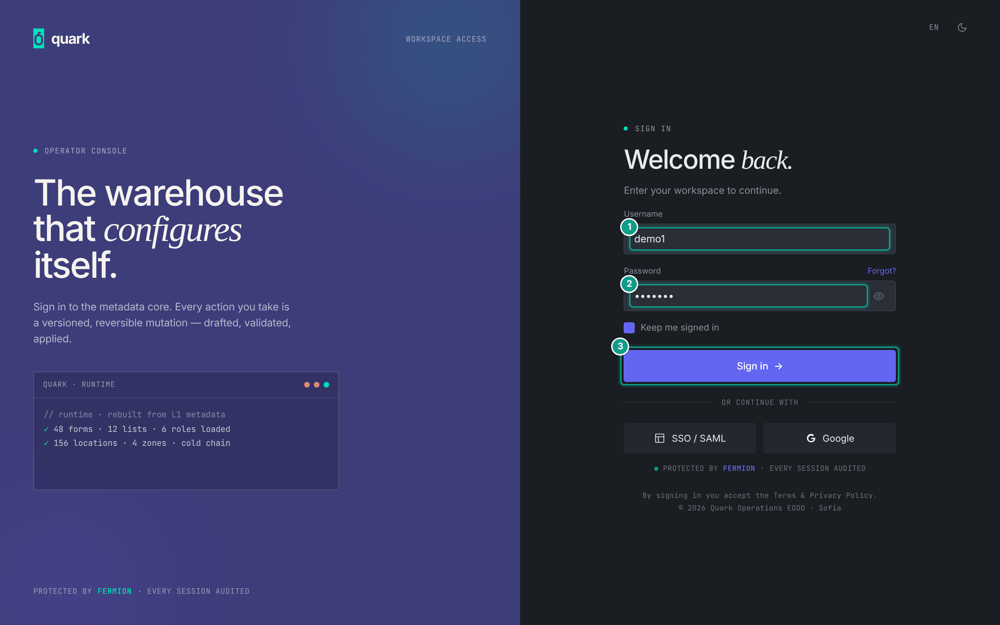
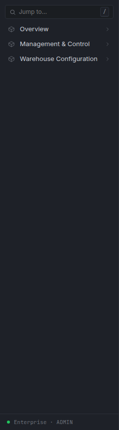
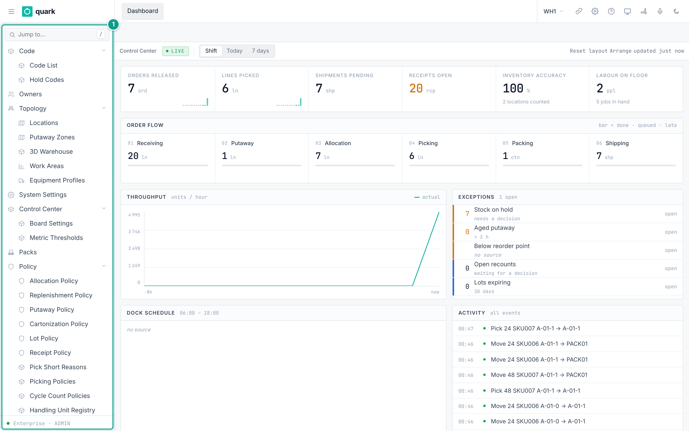

# First Login and Navigation

This page explains how to sign in, choose a warehouse and find a screen. Read [Interface overview](01-interface-overview.md) for the common layout of lists, record cards, document lines and the RF terminal.

## 1. Sign in

### What you will do

Sign in to the web UI and reach the main screen.

### Before you start

- You need a user name and a password from the person who prepared the tenant.
- For a new tenant, the installer gives you the first administrator account. This guide starts after that account exists; installation commands and server settings belong in the deployment runbook.
- Change the password after the first sign-in. Nothing forces you to do it.

### Steps

1. Open the web UI address your installer gave you.
2. In the field `Username`, type your user name.
3. In the field `Password`, type your password. Use the eye button to show or hide it.
4. Click `Sign in`.
5. Optional: use the `RU` / `EN` button on the sign-in page to change the language of the sign-in page. Use the moon/sun button to change the theme.



*Caption: the sign-in page with the fields Username and Password. Focus: Sign in form on the right: Username, Password and the Sign in button. The teal numbers on the picture mark: 1 Username, 2 Password, 3 Sign in button.*

### Field reference

| Field | Meaning | Allowed values | Example |
|---|---|---|---|
| `Username` | Your login name. | Any text. Must match an existing user. | `alex.morgan` |
| `Password` | Your password. | At least 8 characters. | Use the password issued by your administrator. |

The sign-in form and user administration use the same eight-character minimum. Passwords shorter than eight characters are rejected before any user data is written.

### What you should see

- The main screen opens with the left sidebar.
- The active warehouse code appears in the top bar.

### If something goes wrong

| Message | Meaning | Fix |
|---|---|---|
| A password length message | The password field failed the form check. | Type a longer password. |
| `Login failed.` | The server did not accept the credentials. | Check the user name and the password. |
| Login is refused for an RF terminal only | The user has **RF device login** turned off. The refusal looks the same as a wrong password. | Turn on **RF device login** for the user; see [Users, Roles and Permissions](02-users-roles-permissions.md). |
| Sign-in returns an error with no detail after a database reset | The session data was reset. | Ask the system administrator to restart the web service, then sign in again. |

### What this affects later

- Your session stores your user, your active warehouse and your permissions.
  Menus and buttons depend on the role you hold in that warehouse.

## 2. Warehouse and Enterprise mode

### What you will do

Understand which warehouse you work in, and when you are in Enterprise mode.

### Before you start

- A user can have several warehouses. Each assignment has a role; see [Users, Roles and Permissions](02-users-roles-permissions.md).
- The assignment marked **Default** opens first.

### Steps

1. After sign-in, look at the warehouse button in the top bar. It shows the code of the active warehouse.
2. To change the warehouse, click that button (tooltip `Switch warehouse`).
   A pop-up `Switch warehouse` opens. It has a search field and one row per warehouse (name, code and your role).
   Click a row.
   The app clears the previous warehouse's open forms and reloads the workspace.
3. To work on users, roles, translations and integration settings, switch to **Enterprise**.
   The Enterprise entry exists only for users who hold the `ADMIN` role in at least one warehouse.

If you hold `ADMIN` in any warehouse, the first row of the pop-up is `Enterprise` (tag `admin`). If you hold no warehouse assignment, the pop-up says `No warehouses assigned`.

### What you should see

- In a warehouse: the **warehouse sidebar** (section 3).
- In Enterprise mode: the **enterprise sidebar** (section 4). The warehouse button shows `ENTERPRISE`.

### If something goes wrong

| Message | Meaning | Fix |
|---|---|---|
| The `Reports` page shows a banner instead of reports | Operational reports require a warehouse. | Switch to a warehouse. |
| You are in Enterprise mode but every screen is denied | Your role in the linked warehouse is not `ADMIN`. | Ask an administrator to give you `ADMIN` on a warehouse. |

### What this affects later

- Warehouse data is separated. A record made in `WH1` is not visible in `WH2`.
- Users, roles, event settings and the code lists of the enterprise live above all warehouses.

## 3. Warehouse sidebar

The tree below follows the current English sidebar.

```
Overview
  Dashboard
  Reports
Management & Control
  Receiving
    Receipts
  Orders & Waves
    Orders
    Waves
  Shipping
    Transport Resources
    Dispatches
    Load Plans
    Loads
  Inventory
    Balances
    Holds
    Adjustments
    Counts
    Lot Transfers
    Replenishment
    Pending Move-In
  Execution Control
    Task Board
    Pick Assignments
    Order Control (Manual)
    Pick Pallets (Manual)
  Exceptions
    Pick Target Exceptions
    Packing Exceptions
    Skip History
  Stations
    Distribution Stations
    Consolidation Stations
    Station Routes
  Handling Units
    Handling Unit Registry
  History
    Transactions
Warehouse Configuration
  Warehouse Readiness
  Topology
    Locations
    Putaway Zones
    3D Warehouse
  Work Areas & Equipment
    Work Areas
    Equipment Profiles
  Product Data
    Owners
    SKUs
    Packs
    Barcode Formats
    Attributes
  Policies
    Allocation Policy
    Replenishment Policy
    Putaway Policy
    Cartonization Policy
    Lot Policy
    Receipt Policy
    Picking Policies
  Counting
    Cycle Count Policies
    Count Tolerances
  Reason Codes
    Hold Codes
    Pick Short Reasons
    Adjustment Reasons
  Operator Permissions
    Operators
  Dashboards
    Board Settings
    Metric Thresholds
  Settings & Reference Data
    System Settings
    Code List
```

Notes:

- All three top-level sections start collapsed. Open one level at a time. Closing a parent also closes and hides every group below it.
- `Shipping` collects transport resources, dispatches, load plans and loads. Shipping one complete order still starts from `Management & Control > Orders & Waves > Orders`.
- `Management & Control > Inventory > Replenishment` lists replenishments of pick locations. `Warehouse Configuration > Policies > Replenishment Policy` opens the urgency settings read by the planner; each pick location's `Min` and `Max` still decide when and how much to replenish.
- `Overview > Dashboard` opens the home dashboard. The dashboard also remains the first tab in the top bar.

The dashboard is the home page, so it opens right after sign-in. The breadcrumb entry **Dashboard** brings you back to it and clears the other screens.

### Where to find common work

| What you want to do | Menu path | Guide |
|---|---|---|
| Review receipts | `Management & Control > Receiving > Receipts` | [Inbound Setup](05-inbound-setup.md) |
| Review or release orders | `Management & Control > Orders & Waves > Orders` | [Outbound Setup](06-outbound-setup.md) |
| Build and release waves | `Management & Control > Orders & Waves > Waves` | [Outbound Setup](06-outbound-setup.md) |
| Review loads and dispatch work | `Management & Control > Shipping` | [Outbound Setup](06-outbound-setup.md) |
| Check stock, holds or counts | `Management & Control > Inventory` | [Inventory guides](../reference/inventory/00-inventory-overview.md) |
| Supervise tasks and pick assignments | `Management & Control > Execution Control` | [Outbound Setup](06-outbound-setup.md) |
| Resolve operational exceptions | `Management & Control > Exceptions` | [Packing](../operator/10-packing-verify.md), [Order Control](../operator/11-order-control-after-picking.md) |
| Configure locations and work areas | `Warehouse Configuration > Topology` and `Work Areas & Equipment` | [Warehouse Structure](03-warehouse-structure.md) |
| Configure owners, SKUs and packs | `Warehouse Configuration > Product Data` | [Owners and Products](04-owners-sku-uom-pack-hierarchy.md) |
| Configure warehouse rules | `Warehouse Configuration > Policies` | [Inbound Setup](05-inbound-setup.md), [Outbound Setup](06-outbound-setup.md) |
| Open operational reports | `Overview > Reports` | [Reports and Dashboards](08-reports-and-dashboards.md) |



*Caption: the sidebar immediately after sign-in. `Overview`, `Management & Control` and `Warehouse Configuration` are collapsed.*



*Caption: the warehouse sidebar with `Management & Control > Shipping` expanded. Each deeper level is indented; other branches remain collapsed.*

## 4. Enterprise sidebar

```
Enterprise Overview
Warehouses
Owners
Users & Roles
  Users
  Roles
Permission Matrix
Audit
Shared Handling Unit Types
Translations
Integrations
  Event Registry
  Events
  Subscribers
  Deliveries
  IPaaS
Platform Tools
  Metadata Studio
  RF UI Designer
  RPC Documentation
```

Notes:

- `Enterprise Overview` opens the Enterprise landing page.
- `Users & Roles`, `Integrations` and `Platform Tools` start collapsed, just like groups in the warehouse sidebar.
- `IPaaS` is available under `Integrations`; it is no longer shown in a warehouse sidebar.
- `Metadata Studio`, `RF UI Designer` and `RPC Documentation` are grouped under `Platform Tools`.

| Menu path | What it is for |
|---|---|
| `Warehouses` | Create and monitor warehouses. |
| `Users & Roles > Users` | Create users, assign warehouses and manage user access. |
| `Users & Roles > Roles` | Review roles and the permissions assigned to them. |
| `Permission Matrix` | Compare access across roles. |
| `Audit` | Review recorded changes and actions. |
| `Translations` | Maintain customer translations. |
| `Shared Handling Unit Types` | Maintain handling-unit types shared by warehouses. |
| `Integrations` | Configure events, subscribers, deliveries and the Integration Platform. |
| `Platform Tools` | Open Metadata Studio, RF UI Designer and the API reference. |

## 5. Common screen types

Lists, record cards, document headers and lines, modals, wizards and the RF terminal are described in [Interface overview](01-interface-overview.md). Read that page once, then return here for the menu path to the task you need.
