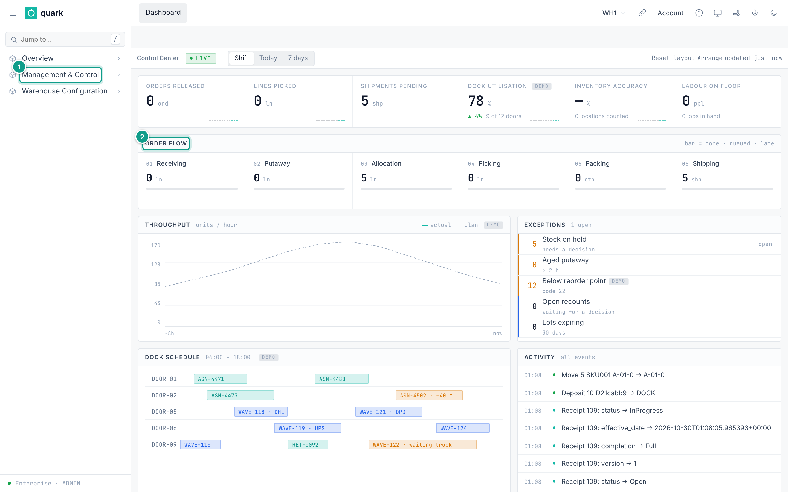
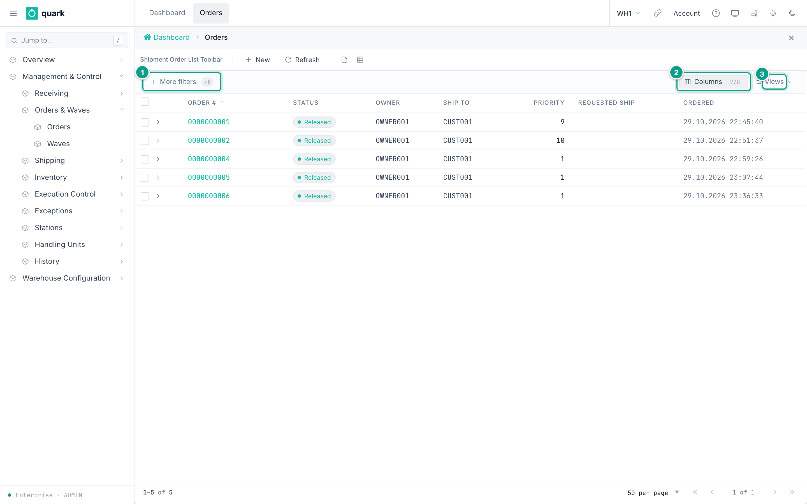
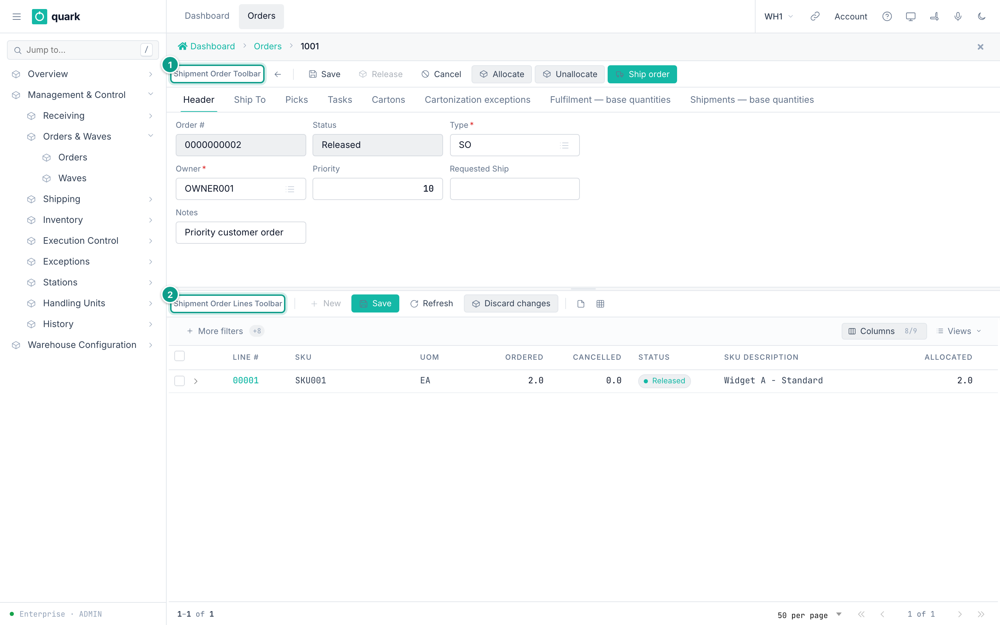
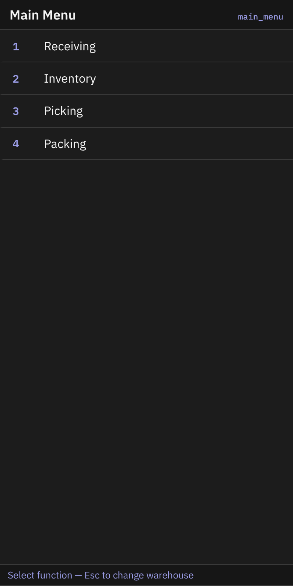

# Interface overview

Quark WMS has two working interfaces:

- the **web workspace** for administrators, planners, supervisors and office users;
- the **RF terminal** for warehouse operators who scan stock, locations and handling units.

The interface you use depends on your role and the work you are doing. For example, a planner releases an order in the web workspace. An operator then completes the assigned picking work on an RF terminal.

## 1. Choose the right interface

| Interface | Use it for | Typical users |
|---|---|---|
| Web workspace | Setup, document review, planning, exception handling, reporting and supervision. | Administrators, managers, supervisors, planners and customer-service users. |
| RF terminal | Scanning and confirming physical warehouse work. | Receivers, putaway operators, pickers, packers and loaders. |

Your user, warehouse assignment and role control which menus and actions are available. A screen or button that another user can see might not be available to you.

## 2. Web workspace

The web workspace keeps global navigation around the active screen.

```text
+----------------+------------------------------------------------------+
|                | Open screen tabs                 Warehouse and user |
| Left sidebar   +------------------------------------------------------+
|                | Breadcrumb: where you are                           |
| Search and     +------------------------------------------------------+
| menu groups    | Screen toolbar: actions for the current screen       |
|                +------------------------------------------------------+
|                | Filters, Columns and saved Views                     |
|                +------------------------------------------------------+
|                | Main content: list, card, document or dashboard      |
+----------------+------------------------------------------------------+
```

| Area | What it does |
|---|---|
| Menu button and sidebar | Opens the warehouse or Enterprise navigation tree. Use **Jump to...** to find a screen by name. |
| Open screen tabs | Keeps the screens you opened. Select a tab to return to that screen. Close a tab when you no longer need it. |
| Warehouse button | Shows the active warehouse. Select it to switch warehouse or enter Enterprise mode when your role allows it. |
| Breadcrumb | Shows the path to the current screen and lets you return to an earlier level. |
| Screen toolbar | Contains actions for the current list, record or document, such as **New**, **Save**, **Refresh** or **Release**. |
| Main content | Shows the active dashboard, list, form or document. Some documents have a header in the upper area and lines in the lower area. |

The top bar can also contain account, help, product-tool and theme buttons. The available shortcuts depend on your installation and permissions.



*Caption: the web workspace. Focus: the global navigation remains around the active dashboard; callout 1 marks a sidebar group and callout 2 marks the Order Flow section.*

## 3. Sidebar and open screens

The warehouse sidebar starts with its three top-level groups collapsed.


*Caption: use Overview for dashboards and reports, Management & Control for daily work, and Warehouse Configuration for setup.*

Open one group at a time. Each deeper group is indented below its parent.


*Caption: Management & Control is open, then Shipping. Other branches remain collapsed.*

When you select a menu item, Quark opens it as a tab in the top bar. Opening another screen does not discard the first one. Selecting the dashboard tab returns to the home dashboard.

Before changing data, check the warehouse code in the top bar. Switching warehouses closes the previous warehouse's open screens and reloads the workspace.

## 4. List screens

A list screen shows one record per row. Orders, receipts, locations, SKUs and inventory balances all use this pattern.

| Part | How to use it |
|---|---|
| Screen toolbar | Use the actions that apply to the whole list, such as **New** or **Refresh**. |
| Quick filters | Enter or select common filter values directly above the table. |
| **More filters** | Adds a filter for another available column. Active filters appear as removable chips. |
| Column headings | Select a heading to sort when sorting is available. |
| **Columns** | Show, hide, reorder or freeze columns. Required columns cannot be hidden. |
| **Views** | Save and reuse your current filter or column arrangement when the screen offers saved views. |
| Row | Select the row or its link to open the record. |
| Check box | Selects records for a toolbar action. A check box does nothing by itself. |
| Paging controls | Changes the page and the number of rows shown. |



*Caption: a typical list screen. Focus: use More filters to narrow the rows, Columns to control the table and Views to reuse a layout.*

### Find and open a record

1. Open the list from the sidebar.
2. Use a quick filter or select **More filters**.
3. Enter or select the value you need.
4. Check the active-filter chips above the table.
5. Select the matching row to open its record.

If a record is missing, first clear filters, then select **Refresh**. Also confirm that you are in the correct warehouse.

## 5. Record and document screens

A record screen shows one business object, such as an order, receipt, location or policy.

| Area | What it contains |
|---|---|
| Record toolbar | Actions for the whole record, such as **Save**, **Cancel**, **Allocate** or **Release**. |
| Tabs | Groups related fields and operational information. |
| Header | Identifies the record and shows its main status and settings. |
| Lines or details | Shows the items, tasks, picks, exceptions or child records that belong to the header. |
| Detail toolbar | Actions that apply only to the lines or detail area. |

The header and its lines can have separate toolbars. Check which toolbar you are using before selecting **New**, **Save** or **Delete**.



*Caption: a header-and-lines document. Focus: callout 1 marks actions for the whole order; callout 2 marks actions for its lines.*

Buttons and fields change with the record status and your permissions:

- an available button can be selected;
- a grey button is not available in the current state;
- when a disabled action provides a reason, point to it to read the explanation;
- a destructive or irreversible action can open a confirmation window;
- after another user changes the same record, refresh it before trying your change again.

## 6. Common screen types

| Screen type | What it is for | Typical actions |
|---|---|---|
| Dashboard | Monitors current work, flow and exceptions. | Change the time range, open a related work list. |
| List | Finds and compares many records. | Filter, sort, change columns, open a row. |
| Card | Creates or edits one record. | **Save**, **Delete**, **Refresh**. |
| Tabbed card | Splits one record into related sections. | Select a tab, edit fields, save the record. |
| Header and lines | Works with a document and its items. | Use the upper toolbar for the document and the lower toolbar for lines. |
| Modal | Collects a short decision without leaving the current screen. | Confirm or cancel. |
| Wizard | Guides a multi-step setup. | **Back**, **Next**, **Finish**. |
| Report Builder | Defines report parameters, data and document layout. | Preview, validate and publish a report. |

Fields marked with an asterisk are required. A picker button opens a list of allowed values. Read-only fields show information but cannot be changed on that screen.

## 7. RF terminal

The RF terminal uses a portrait handheld layout. It is designed for a scanner and physical function keys, but the on-screen buttons can also be selected.



*Caption: the RF main menu. Number keys select a workflow; the bottom line explains the available key action.*

Most RF screens have the same parts:

| Area | What it shows |
|---|---|
| Title | The current warehouse task, such as Receiving, Picking or Packing. |
| Screen code | A short identifier in the top-right corner. Use it when asking for support. |
| Instruction | What to scan or enter next. |
| Input field | The value read from the scanner or entered by the operator. |
| Message line | The result, warning or reason a scan was refused. |
| Function-key bar | The actions available on that step, such as **F2 lookup** or **F6 Missing**. |

Scan the value requested by the highlighted field, then use **Enter Send** when the terminal does not submit it automatically. Use **Esc** to return only when the message line says that the action is available.

Each operator guide shows the exact screens and recovery steps for that workflow. Start with [RF Terminal Login and Warehouse](../operator/01-login-and-warehouse.md).

## 8. If the interface does not match this guide

1. Confirm the active warehouse and your role.
2. Select **Refresh** on the current screen.
3. Clear active filters on a list.
4. Close and reopen the screen from the sidebar.
5. If an action remains unavailable, point to the grey button and read the reason when one is shown.
6. Record the screen name, RF screen code or visible message before contacting support.

## Related pages

- [First Login and Navigation](01-first-login-and-navigation.md)
- [Users, Roles and Permissions](02-users-roles-permissions.md)
- [Order screen overview](../reference/outbound/01-order-screen-overview.md)
- [Build a Custom Report](12-build-custom-reports.md)
- [RF Terminal Operator Guide](../operator/00-README.md)
