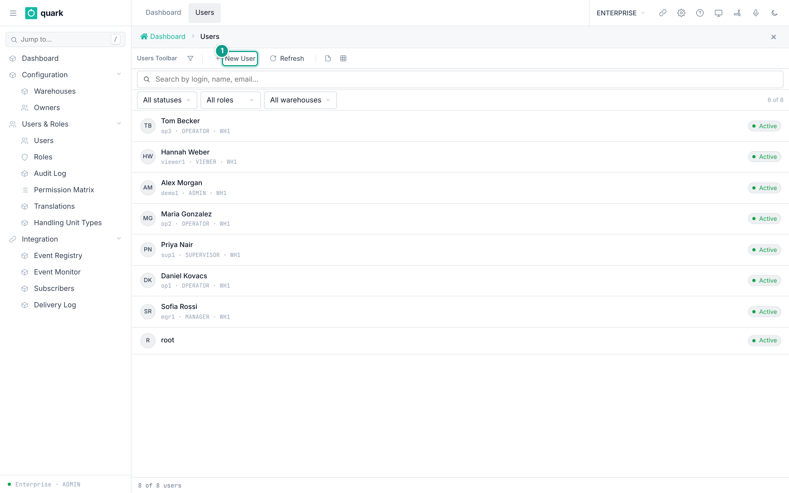
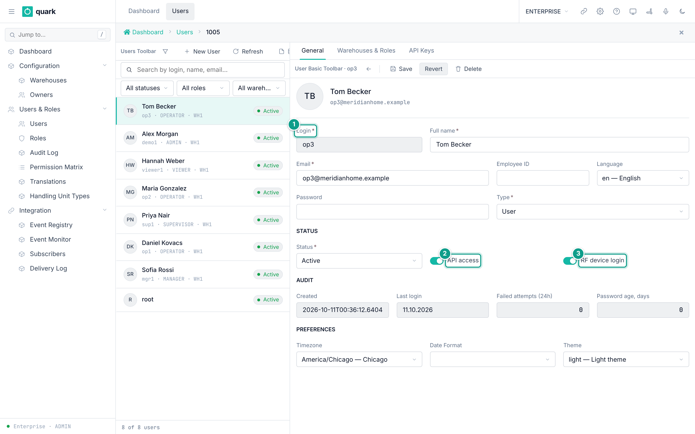
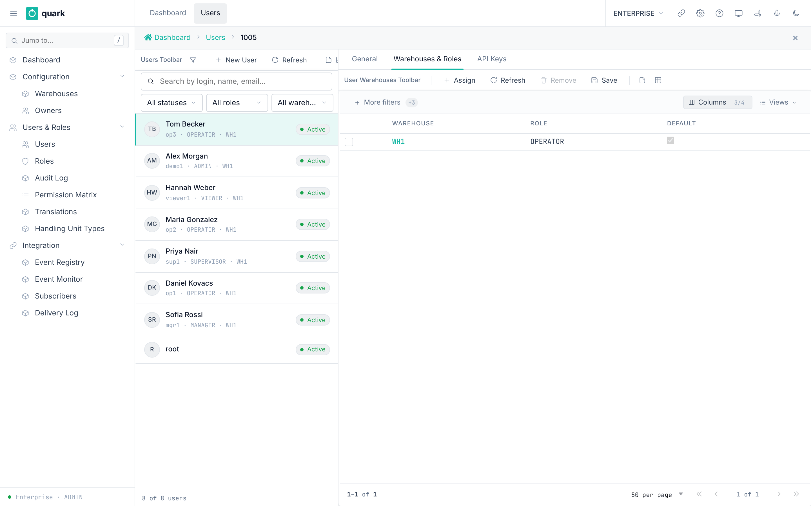
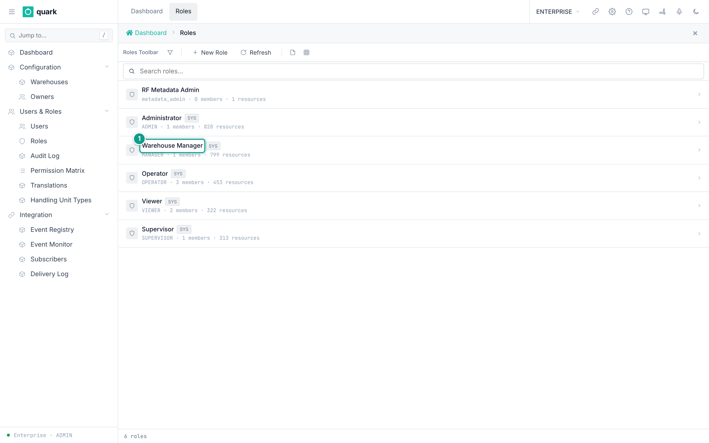
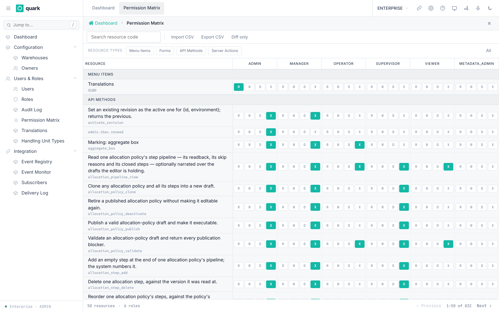
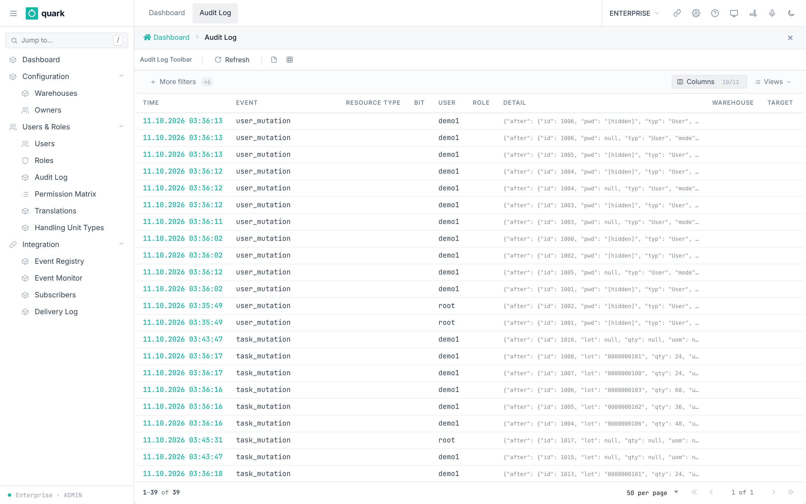
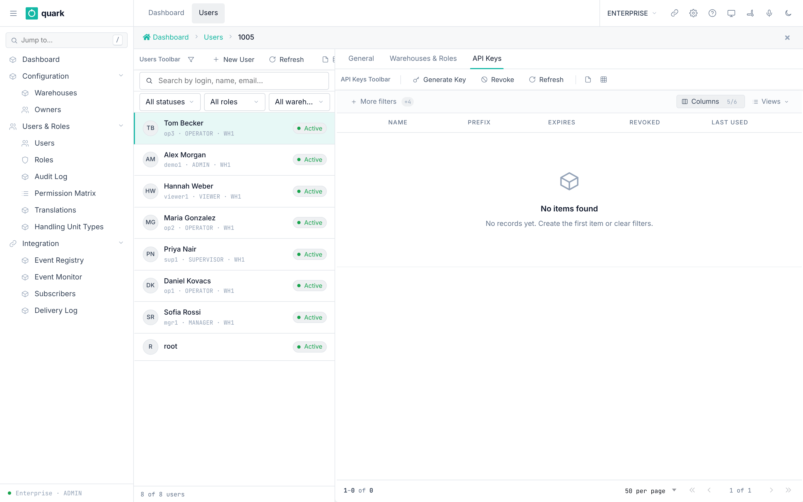
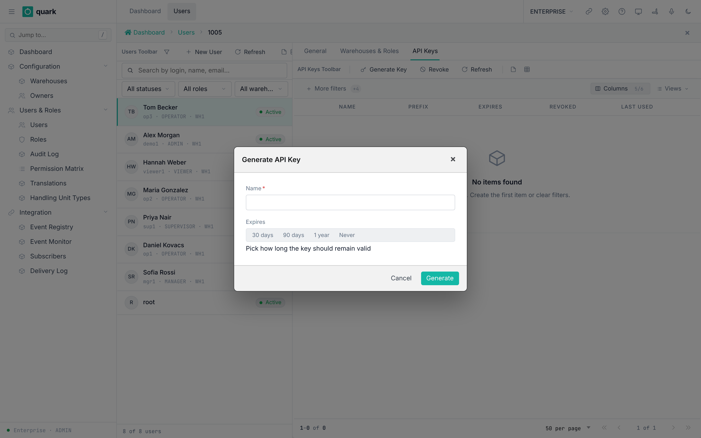

# Users, Roles and Permissions

## 1. How access works

A user can sign in only after an administrator creates the user.
A user can work in a warehouse only after an administrator assigns that warehouse and a role.

| Concept | Meaning | Where it is stored |
|---|---|---|
| User | A person or a system account. | `enterprise."user"` |
| Role | A named set of permissions, for example `OPERATOR`. | `enterprise.role` |
| Warehouse assignment | The link user + warehouse + role. One assignment per user per warehouse. | `enterprise.user_warehouse` |
| Permission | A right on one resource. Four bits: read, write, delete, execute. | `enterprise.role_permission` |
| Resource type | What the permission applies to: `api`, `server_action`, `menu_item`. | `role_permission.resource_type` |

Rules that come from the database:

- The user name is unique (`user_username_key`).
- A user can have only one warehouse assignment per warehouse (`user_warehouse_user_id_warehouse_id_key`).
- A user can have only one **default** assignment (`idx_user_warehouse_default`).
- The role code is unique (`role_code_key`).
- You cannot delete a role that a user still holds (`user_warehouse_role_id_fkey ... ON DELETE RESTRICT`).
- You cannot set your own status to `Locked` or `Disabled`, or delete your own account.
- Every active warehouse must keep at least one `ADMIN` whose status is `Active` or `Invited`. Disabling or deleting the last such administrator is refused, including a bulk delete.

How a request is checked:

1. The server finds your role in the active warehouse.
2. Users of type `Admin` or `Sys` skip permission checks. All other users are checked against `role_permission`.
3. In Enterprise mode, only the `ADMIN` role is accepted.
4. The default mode is `Enforce`. An operator can set the environment variable `RBAC_ENFORCEMENT_MODE=log_only` to log denials without blocking.

What the user sees:

- A sidebar item is not drawn when the role has no right for the menu item, or may not open its form (`web-ui-server/src/components/partials/body.rs`, `sidenav.rs`).
- On the special "component" screens (for example allocation and putaway steps), a button whose command the role may not run is not drawn (`services/component/gate.rs`).
- On ordinary screens the toolbar buttons stay visible (`components/partials/toolbar.rs` has no permission check). The click is denied by the server-action gate with `Forbidden("<handler name>")`.

## 2. Seeded roles

The baseline creates six roles (`enterprise/migrations/001_baseline.sql`).

| Code | Name | System role | Description in the database |
|---|---|---|---|
| `ADMIN` | Administrator | yes | Full access to all forms |
| `MANAGER` | Warehouse Manager | yes | Config and operations access |
| `OPERATOR` | Operator | yes | Day-to-day warehouse operations |
| `VIEWER` | Viewer | yes | Read-only access |
| `SUPERVISOR` | Supervisor | yes | Authorizes overrides (close-with-discrepancy etc.) |
| `metadata_admin` | RF Metadata Admin | no | Can read AND write RF screen metadata |

The server fills the permission rows at start-up (the **RBAC seeder**).
It uses `ON CONFLICT DO NOTHING`, so your edits in the permission matrix are kept.
The defaults for each API method are written in the code of that method (`roles = [...]`).

### What each role can do by default

The table shows the defaults found in `app-server/src/web/rpcs/*.rs`.
`Yes` means the role is in the default list of every create, update and delete method of that area.
Edit the defaults in `Users & Roles > Permission Matrix`.

| Area | ADMIN | MANAGER | SUPERVISOR | OPERATOR | VIEWER |
|---|---|---|---|---|---|
| Users, roles, role permissions, API keys, user warehouses | Write | Read only (roles, user warehouses) | None | Read only (roles, user warehouses) | Read only (roles, user warehouses) |
| Owners, owner config, addresses, bank accounts | Write | Write | Read (`get_owner` only) | Read | Read |
| Locations (create, update, delete) | Write | Write | None | Write | Read |
| Location generator (`gen_locs`) | Run | Run | None | None | None |
| Putaway zones | Write | Write | None | Read | Read |
| SKU (create, update, delete) | Write | Write | None | Write | Read |
| SKU serial config | Write | Write | None | Read | Read |
| Packs | Write | Write | None | Write (items) | Read |
| Code values (code lists) | Write | Write | None | Read | Read |
| System settings | Write | Write | None | Read | Read |
| Putaway policy | Write | Write | Write | Read | Read |
| Allocation policy | Write | Write | Write | Read | Read |
| Cartonization, lot, receipt, replenishment policy | Write | Write | None | Read | Read |
| Picking policy | Write | Write | Read | Read | Read |
| Pick short reasons | Write | Write | Write | None | None |
| Wave and wave policy (API) | Write | Write | Write (part) | None | None |
| Work areas, operators, equipment profiles | Write | Write | None (equipment: read) | Read | Read |
| Printers, printer assignments, label definitions and templates, report definitions | Write | Write | None | Read | Read |
| Inventory adjustments | Write | Write | Write | None | Read |
| Inventory counts | Write | Write | Write | Execute (part) | Read |
| Receiving, order entry, allocation, task claim | Yes | Yes | Yes | Yes (see below) | No |

Notes:

- `OPERATOR` can create, update and delete **locations, SKUs and pack items** by default. Remove these rights in the matrix if your policy says only managers may do this.
- `SUPERVISOR` is a **custom** role. Server actions that are not in its allow-list start closed (`default_server_action_grant`, last arm). Its API rights come from the code lists above and from migrations 224, 271, 279 and 287.
- `SUPERVISOR` also holds these special rights by default: `receipt.override_close_discrepancy`, `receipt.override_qty_excess`, `receipt.override_qty_shortage` (seeded rows) and `pick_drop.close_foreign` (with `ADMIN` and `MANAGER`).
- Only `ADMIN` holds `admin.rbac.reseed` by default.
- `VIEWER` keeps read-only server actions: `generic_refresh`, `query_list_form`, `generic_rpc_query`, `generic_rpc_form_load`, `generic_tree_query`, `generic_toolbar_render`, `me`. It also runs `print_report`, `set_report_favorite` and `dashboard_snapshot_rpc`.
- `OPERATOR` server actions: the generic save, new, delete and grid actions, `shipment_order_allocate`, `receipt_receive`, `receipt_capture_serial`, `receipt_resume_serials` and `generic_rpc_command` (see `seeder.rs`).
- `SUPERVISOR` adds: `allocation_policy_duplicate`, `shipment_order_release`, `shipment_order_line_cancel_qty`, `shipment_order_unallocate`, `pick_detail_delete_selected`, `task_delete_confirm`.
- Only `ADMIN` can open `Translations` (menu permission `9109`).

> Not confirmed by code: a complete per-method list of API rights for every role. The rights come from code lists, from the seeder that runs when app-server starts, and from many migrations. They cannot be merged by reading alone. To verify: start the system, sign in as `ADMIN`, open `Users & Roles > Permission Matrix`, pick the role and filter the resource type `API`. Or run `SELECT resource_code, can_read, can_write, can_delete, can_execute FROM enterprise.role_permission rp JOIN enterprise.role r ON r.id = rp.role_id WHERE r.code = '<ROLE>' AND rp.resource_type = 'api'`.

## 3. Create a user

### What you will do

Create a new user and set a password.

### Before you start

- Role: `ADMIN` (the method `create_user` is `Execute` for `Admin` only).
- You are in Enterprise mode.
- You know the user name, e-mail and language of the person.

### Steps

1. Open `Sidebar > Configuration > Users & Roles > Users`.
2. Click `New User`.
3. On the tab `General`, fill `Login`, `Full name`, `Email`, `Type` and `Status`.
4. Fill `Password`.
5. Set `Language`, `Timezone`, `Date Format` and `Theme`.
6. Click `Save`. The button `Revert` undoes unsaved edits.
7. Open the tab `Warehouses & Roles` and assign a warehouse (section 4).

*Caption: the user list with the buttons New User and Refresh. Focus: Each row shows the login, role, warehouse and the Active badge.*

*Caption: the General tab of the user card. Focus: Check Login, Email, Status, API access and RF device login. The tabs Warehouses & Roles and API Keys are next to General. The teal numbers mark: 1 Login, 2 API access, 3 RF device login.*

### Field reference

Form `enterprise_user_basic`. Labels are the English labels.

| Field | Meaning | Allowed values | Example |
|---|---|---|---|
| `Login` (required) | Login name. Unique. | Text up to 128 characters. | `op2` |
| `Full name` (required in the form) | Name shown in lists. | Text up to 200 characters. | `Anna Petrova` |
| `Email` (required) | Contact address. | Text up to 120 characters. | `anna@example.com` |
| `Employee ID` | Personnel number. | Text up to 50 characters. | `E-0042` |
| `Language` | UI language. | Codes from the `locale` registry: `en`, `ru`, `kk`. | `en` |
| `Password` | Initial password. The form hint says: "Leave empty to keep current". | Any text. The API requires it on create. | (secret) |
| `Type` (required) | Account type. | `User`, `Admin`, `Sys`, `Agent`. Only a superuser (`Admin` or `Sys`) can set a value other than `User`. | `User` |
| `Status` (required) | Account status. | `Active`, `Invited`, `Locked`, `Disabled`. `Locked` and `Disabled` block sign-in, open sessions and API keys. `Active` and `Invited` are let in. | `Active` |
| `Created` | Audit. Read-only. | Date and time. | |
| `Last login` | Audit. Read-only. | Date and time. | |
| `Failed attempts (24h)` | Audit. Read-only. | Whole number. | |
| `Password age, days` | Audit. Read-only. Hint: "Days since the password was last changed". | Whole number. | |
| `Timezone` | Used to show dates. | Values from the `TIMEZONE` code list (17 values in the enterprise database). | `Europe/Sofia` |
| `Date Format` | Date format. | Values from the `DATEFORMAT` code list (9 values). | `dd.MM.yyyy HH:mm:ss` |
| `Theme` | Light or dark. | Values of `THEME` (2 values). | `dark` |
| `API access` | May this user call the API with a key? | On or off. Default on. | on |
| `RF device login` | May this user sign in on an RF terminal? | On or off. Default on. | on |

### What you should see

- The user appears in the list `Users`.
- `Created` shows the time of creation.
- The `Password age, days` field starts counting from the password change.

### If something goes wrong

| Message | Meaning | Fix |
|---|---|---|
| `UserAlreadyExists` (user name taken) | The user name is already in the database. | Choose another `Username`. |
| `UserTypNotPermitted` | You tried to set `Type` to a value other than `User` without being a superuser. | Leave `Type` as `User`, or ask a superuser. |
| `SuperuserAccountNotPermitted` | You tried to change, re-password or delete an `Admin` or `Sys` account without being a superuser. | Ask a superuser. |
| `UserSelfLockoutNotPermitted` | You tried to lock, disable or delete the account you are currently using. | Use another `ADMIN` account to make the change. |
| `LastActiveAdminNotPermitted` | The change would leave an active warehouse without a sign-in-capable `ADMIN`. | Assign or activate another `ADMIN` for every listed warehouse first. |
| `Forbidden(...)` | Your role cannot run `create_user`. | Use an `ADMIN` account. |
| `Field {0} is required` | A required field is empty. | Fill the field. |

### What this affects later

- The user can sign in with the user name and password.
- Without a warehouse assignment, the user has no data and no role (section 4).
- `Language`, `Timezone` and `Date Format` set what the user sees.
- The operator list in each warehouse is built from users (see `03-warehouse-structure.md`, section 7).

The server has no password rule when you create a user or set a password (`UserBmc::create`, `update_pwd` in `wms-lib-core/src/model/user.rs`; RPCs `create_user` and `update_user`). Any text is stored, even an empty one on create.
Only the sign-in form checks the length: at least 6 characters. A user with a shorter password is created but cannot sign in. Always set 8 or more characters.
When you edit a user and leave the password field empty, the old password stays.

## 4. Assign a warehouse and a role

### What you will do

Give a user access to a warehouse with a role.

### Before you start

- Role: `ADMIN`.
- The user exists. The warehouse exists in `enterprise.warehouse`.

### Steps

1. Open `Sidebar > Configuration > Users & Roles > Users`.
2. Open the user.
3. Open the tab `Warehouses & Roles`.
4. Click `Assign`.
5. In the new row, pick `Warehouse` and `Role`.
6. Turn on `Default` for the warehouse that should open first.
7. Click `Save`.
8. To remove access, select the row and click `Remove`.

*Caption: the tab Warehouses & Roles with the buttons Refresh, Assign, Remove, Save.*

### Field reference

| Field | Meaning | Allowed values | Example |
|---|---|---|---|
| `Warehouse` | The warehouse to open. | An existing warehouse. One row per warehouse per user. | `WH1` |
| `Role` | The role in that warehouse. | An active role. | `OPERATOR` |
| `Default` | Opens first at sign-in. | On for at most one row of the user. | on |

### What you should see

- The row appears in the grid.
- At the next sign-in the user sees the default warehouse.

### If something goes wrong

| Message | Meaning | Fix |
|---|---|---|
| Duplicate key on `user_warehouse_user_id_warehouse_id_key` | The user already has this warehouse. | Edit the existing row. |
| Duplicate key on `idx_user_warehouse_default` | Another row is already the default. | Turn off `Default` on the other row first. |

### What this affects later

- The role decides which menus, buttons and API methods the user can use in that warehouse.
- A user with the `ADMIN` role in any warehouse can open Enterprise mode.
- Changes to roles and permissions are shared between server copies through the table `enterprise.rbac_cache_epoch` (see `docs-obsidian/architecture/rbac-cache-invalidation.md`).

The server does not show the constraint name. For a duplicate key on `user_warehouse` it answers `Record already exists` (HTTP 400, `wms-lib-web/src/error.rs`, code `23505`). The same text appears for a duplicate role code.
A delete that a foreign key refuses (a role still held by a user) answers `Cannot delete: record is in use`.

## 5. Create or edit a role

### What you will do

Create a custom role and set its permissions.

### Before you start

- Role: `ADMIN` (create, update and delete role methods are `Admin` only).

### Steps

1. Open `Sidebar > Configuration > Users & Roles > Roles`.
2. Click `New Role`.
3. Fill `Code`, `Name` and `Description`. Keep `Active` on.
4. Click `Save`.
5. Open `Sidebar > Configuration > Users & Roles > Permission Matrix`.
6. Find the new role in the columns. Set read, write, delete and execute bits for each resource.
7. Save the matrix.

*Caption: the role list with columns Code, Name, Description, Members, Resources, Active, System. Focus: SYS marks a system role; the line under each name shows members and resources. The teal number 1 marks the Warehouse Manager role.*

*Caption: the permission matrix. Focus: A green cell means the role has that right (R, W, D or X).*

### Field reference

Form `enterprise_role_basic`.

| Field | Meaning | Allowed values | Example |
|---|---|---|---|
| `Code` (required) | Stable identity of the role. It cannot change after creation. | Unique text up to 50 characters. | `PICKER` |
| `Name` (required) | Display name. | Text up to 200 characters. | `Picker` |
| `Description` | Free text. | Text. | `Floor pickers` |
| `Active` | Inactive roles are not used by the seeder. | On or off. | on |

List columns: `Code`, `Name`, `Description`, `Members`, `Resources`, `Active`, `System`. Buttons: `New Role`, `Refresh`.

### What you should see

- The role shows in the list with `Members` = 0.
- In the matrix, the seeder adds rows for the new role at the next server start. Rows that do not exist yet are created when you save the matrix (`batch_upsert_permission_matrix`).

### If something goes wrong

| Message | Meaning | Fix |
|---|---|---|
| Duplicate key `role_code_key` | The code exists. | Use another code. |
| Delete refused (`user_warehouse_role_id_fkey`) | A user still holds the role. | Change the users to another role first. |
| `Forbidden(...)` on a screen button | The server action is not granted to your role. | Grant it in the matrix. |

### What this affects later

- A new custom role starts with **no** server-action rights, except the rights you give it.
- Every permission change is written to `Users & Roles > Audit Log`.

The flag `is_system` only shows a "system" badge in the role list (`web-ui-server/src/components/layout/cortive_role_list.rs`). No rule in code or in the database protects a system role from deletion. Only the foreign key `user_warehouse_role_id_fkey` blocks it, and only while a user still holds the role. Do not delete `ADMIN`, `MANAGER`, `OPERATOR`, `SUPERVISOR` or `VIEWER`.

## 6. Read the audit log

### What you will do

See who changed permissions and which calls were denied.

### Steps

1. Open `Sidebar > Configuration > Users & Roles > Audit Log`.
2. Use the column filters. Click `Refresh`.

*Caption: the audit log list.*

### Field reference (columns)

`Warehouse`, `Target`, `Resource`, `Bit`, `Time`, `Resource Type`, `User`, `Role`, `Detail`, `Event`.

### What you should see

- One row per audited event.

### If something goes wrong

| Message | Meaning | Fix |
|---|---|---|
| Empty list | No event matches or no event was written. | Clear the filters. |

### What this affects later

- Nothing. The log is read-only.

## 7. Create an API key

### What you will do

Create a key so another system can call the API as a user.

### Before you start

- Role: `ADMIN` (the API key methods are `Admin` only).
- The user has `API access` turned on.

### Steps

1. Open the user card. Open the tab `API Keys`.
2. Click `Generate Key`.
3. Fill `Name`. Pick `Expires`.
4. Click `Generate`.
5. Copy the key from the window. It says `API key created successfully` and `This key will not be shown again — copy it now.` **This is the only time the key is shown.**
6. Click `I saved it — Close`. The server forgets the plain key.
7. To stop a key, select it and click `Revoke`. The window says `Revokes immediately. Services using this key get 401. Cannot be undone.` Click `Revoke` again.

*Caption: the API Keys tab with the buttons Generate Key, Revoke, Refresh.*

*Caption: the dialog with Name and Expires.*

### Field reference

| Field | Meaning | Allowed values | Example |
|---|---|---|---|
| `Name` (required) | Label in the list and the audit log. | Text. | `ERP link` |
| `Expires` (required) | How long the key stays valid. | `Never`, `1 year`, `90 days`, `30 days` (code list `API_KEY_EXPIRY`). | `90 days` |

List columns: `Expires`, `Prefix`, `Status`, `Name`, `Revoked`, `Last Used`.

### What you should see

- A key that starts with `wms_live_sk_`. Send it as `Authorization: Bearer <key>`.
- The list shows the key `Prefix` and `Status`.

### If something goes wrong

| Message | Meaning | Fix |
|---|---|---|
| HTTP 401 on a call | The key is revoked, expired or unknown. | Generate a new key. |
| The key is rejected and the log says `api_access disabled` | The key owner has `API access` off. | Turn on `API access` for the user. |

### What this affects later

- The external system acts with the role of the key owner. Use a user with a limited role.
- Only a hash of the key is stored.

The shared sign-in middleware (`wms-lib-web/src/middleware/mw_auth.rs`) reads the key from the header `Authorization: Bearer wms_live_sk_...`. It does this for every route that sits behind it. Without a key it falls back to the session cookie.

## 8. Roles and the warehouse operator list

Users with a warehouse assignment, `RF device login` on and status `Active` become **operators** in that warehouse.
A background job copies them every 5 minutes (`OPERATOR_SYNC_INTERVAL`). See `03-warehouse-structure.md`, section 7.

## 9. Passwords and sessions

- Passwords are stored as hashes. The hashing code is in `wms-lib-auth/src/pwd`. API keys use Argon2id.
- Signing out ends the server session and clears the cookie.
- The bootstrap administrator should change the password after the first sign-in. The column `must_rotate_password` exists, but no code reads it, and `bootstrap-admin` no longer sets it (`wms-lib-core/src/model/initial_admin.rs`). Nothing forces the change.
- There is no password complexity rule. The only length check is on the sign-in form: 6 characters (section 3).
- There is no lock-out. An account is never disabled after failed sign-ins.
- A throttle slows guessing. After 10 failed attempts within 60 seconds for one user name, or from one client address, further attempts are refused with the same error as a wrong password. Every attempt renews the 60 seconds. The counters live in the memory of each server process (`wms-lib-auth/src/authentication/login_throttle.rs`).
- The user card shows `failed_login_attempts` as a rolling 24-hour count. It starts again at 1 when the last failure is older than 24 hours, and it resets on a good sign-in. It never blocks a sign-in (`wms-lib-core/src/model/user.rs`, `record_login_failure`).
