# Warehouse Structure

This chapter covers the physical map of a warehouse:
the warehouse itself, putaway zones, locations, work areas, equipment and operators.

## 1. Create and activate a warehouse

### What you will do

Create a warehouse from the Enterprise workspace, check that its schema is ready, and activate it for operations.

### Before you start

- Sign in with an Enterprise administrator account.
- Choose the permanent storage units for weight, length and volume. They cannot be changed later.
- Choose a unique warehouse code and schema name. The schema name starts with a lowercase letter and then uses only lowercase letters, digits or underscores.

### Steps

1. Switch to **Enterprise**.
2. Open `Sidebar > Warehouses`.
3. Click **Add warehouse**.
4. On **Create warehouse**, fill in **Code**, **Name** and **Schema name**.
5. Choose **Storage weight unit**, **Storage length unit** and **Storage volume unit**.
6. Click **Create**. The system creates the warehouse with a complete schema and leaves it inactive.
7. In the list, wait for **Preparation status** to show **Ready**.
8. Select the warehouse and click **Edit**.
9. Review the name and preparation details, turn on **Active**, and click **Save**.
10. Assign users and roles as described in [Users, roles and permissions](02-users-roles-permissions.md#4-assign-a-warehouse-and-a-role).

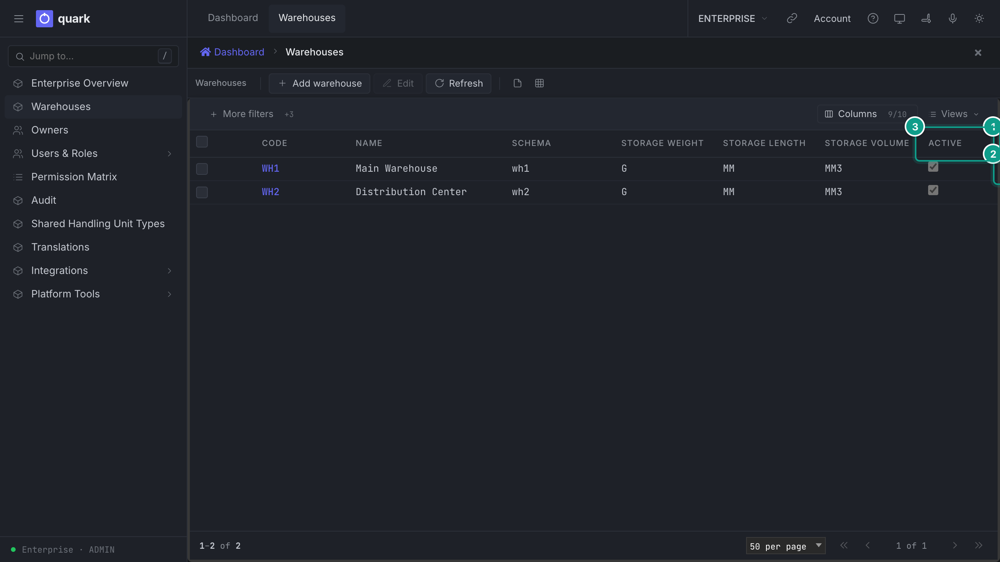

*Warehouses. Focus: activate a warehouse only after Preparation status is Ready.*

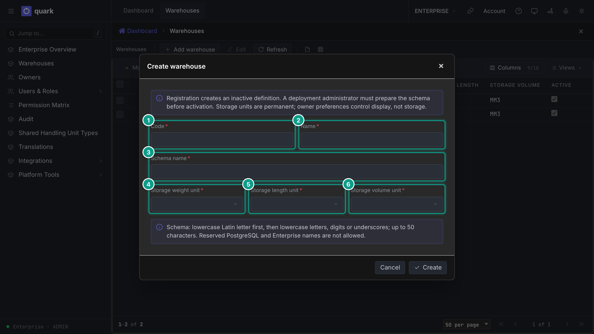

*Create warehouse. Focus: storage units and schema identity are permanent after creation.*

### Field reference

The creation window uses these fields:

| Field | Meaning | Allowed values | Example |
|---|---|---|---|
| `code` | Short code. | Text up to 20 characters. | `WH1` |
| `name` | Display name. | Text up to 200 characters. | `Main Warehouse` |
| `schema_name` | Internal schema identity created for this warehouse. | Up to 50 lowercase letters, digits or underscores; starts with a letter. | `wh1` |
| `is_active` | Whether users may operate in the warehouse. | On or off; set in **Edit** after readiness is **Ready**. | On |
| `weight_uom` | Unit in which weights are stored. | Choose from the list. | `G` |
| `length_uom` | Unit in which lengths are stored. | Choose from the list. | `MM` |
| `volume_uom` | Unit in which volumes are stored. | Choose from the list. | `MM3` |

### What you should see

- **Preparation status** becomes **Ready** after creation.
- After activation and user assignment, the warehouse appears in the warehouse switcher for those users.

### If something goes wrong

| Message | Meaning | Fix |
|---|---|---|
| The warehouse cannot be activated | Its preparation status is not ready. | Read **Preparation details**, correct the cause, refresh, and activate only when it is ready. |
| A user sees no warehouse after sign-in | The user is not assigned to it, or the warehouse is inactive. | Activate the warehouse and assign the user's warehouse role. |
| A stored unit cannot be changed | Storage units are permanent after creation. | Create the warehouse with the correct units before loading data. |

### What this affects later

- Every record you create (locations, SKUs, orders) lives in this warehouse schema only.

## 2. Location types

### What you will do

Choose the right location type for each location. The type controls what stock may do there.

### Before you start

Read the table. The values are the enum `loc_type`; the descriptions come from the `LOCTYPE` code list.

| Value | UI description | How the warehouse uses it |
|---|---|---|
| `None` | `0 - None` | No special meaning. |
| `Other` | `Other` | Storage-like. Putaway, manual moves and pick moves may land here. |
| `Case` | `PICK - Case` | Storage. Putaway and manual moves may land here. |
| `Pick` | `PICK - Piece` | Storage and pick face. Putaway and replenishment may land here. |
| `Pnd` | `PICK - Pallets, storage` | Pallet storage. Putaway, manual and pick moves may land here. |
| `SpeedPick` | `Speed Line` | Fast pick line. Putaway may land here. |
| `Sort` | `Sort station` | Putaway and pick moves may land here. A closed pick pallet may stand here. |
| `Pickto` | `Pick-to` | Drop place for picked goods. Pick moves land here. A closed pick pallet may stand here. |
| `Stage` | `Staging` | Staging. The owner's pick drop location may be a `Stage`. A closed pick pallet may stand here. |
| `Door` | `Door` | Dock door. The owner's pick drop location may be a `Door`. A closed pick pallet may stand here. |
| `Pack` | `Pack station` | A pack station. Only a `Pack` location can be the station of a work area. A closed pick pallet may stand here. |
| `Control` | `Control station` | A station where an operator confirms that every container of an order has arrived. Only a `Control` location can be the control station of a work area. |
| `QC` | `Quality control` | Single-purpose destination for "move to QC". |
| `Damage` | `Damage` | Single-purpose destination for damaged stock. |
| `Rtv` | `Return to vendor` | Single-purpose destination for return to vendor. |
| `Destroy` | `Destruction` | Destruction zone. |
| `Returns` | `Customer returns` | Customer returns. |
| `Lost` | `Lost` | Where missing stock is booked. |
| `InTransit` | `In transit (open pick pallets)` | Holds open pick pallets. **Only one `InTransit` location can exist.** |

The code also uses these location codes by name:

- `DAMAGE` (returns booked as damaged),
- `INTRANSIT` and `LOST` (stock adjustments).

The initial warehouse includes them. **Do not delete or rename them.**

The baseline also seeds the locations `UNKNOWN`, `DOCK`, `QC`, `RETURN`, `RTV`, `STAGE` and `PICKTO`. What depends on them:

- `STAGE`, `PICKTO` and `LOST` are used by the initial putaway zones for inbound, outbound, picking and missing-stock destinations. A location that is still used by a zone cannot be deleted.
- `DOCK` is the default zone of a new location, so keep that zone available.
- `QC`, `RETURN` and `RTV` can be selected as owner-specific destinations for quality control, customer returns and return to vendor.
- The 3D page draws the special floor areas by their location codes. Keep `UNKNOWN` as part of the initial warehouse map even when your process does not use it directly.

### Steps

Use the type when you create or generate locations (sections 3 and 4).

### Field reference

See the table above.

### What you should see

- The list `Locations` shows the type in the column `Type`.

### If something goes wrong

| Message | Meaning | Fix |
|---|---|---|
| `owners.picking_toloc X is a Y location, not Pickto/Stage/Door` | The owner's `Pick drop location` must be `Pickto`, `Stage` or `Door`. | Pick a location of one of those types. |
| Work area pack station is refused | Only a `Pack` location can be the station of a work area. | Change the location type to `Pack`, or pick another location. |
| Second `InTransit` location refused | Only one exists. | Use the existing one. |

### What this affects later

- Putaway, moves, picking and packing allow or refuse a destination by its type.

## 3. Create locations (one by one)

### What you will do

Create or edit one location.

### Before you start

- Role: `ADMIN`, `MANAGER` or `OPERATOR` (default rights).
- The putaway zone you want already exists (section 5). New locations get the zone `DOCK` by default.

### Steps

1. Open `Sidebar > Warehouse Configuration > Topology > Locations`.
2. Click `New`.
3. On the tab `General`, fill `Code` and `Type`. Fill the other fields you need.
4. Open the tab `Dimensions`. Fill the sizes and capacity.
5. Open the tab `Position`. Fill coordinates, `Aisle` and `Bay` if you use the 3D view.
6. Click `Save`.
7. To change or delete: select the row, edit, and use `Save` or `Delete`.

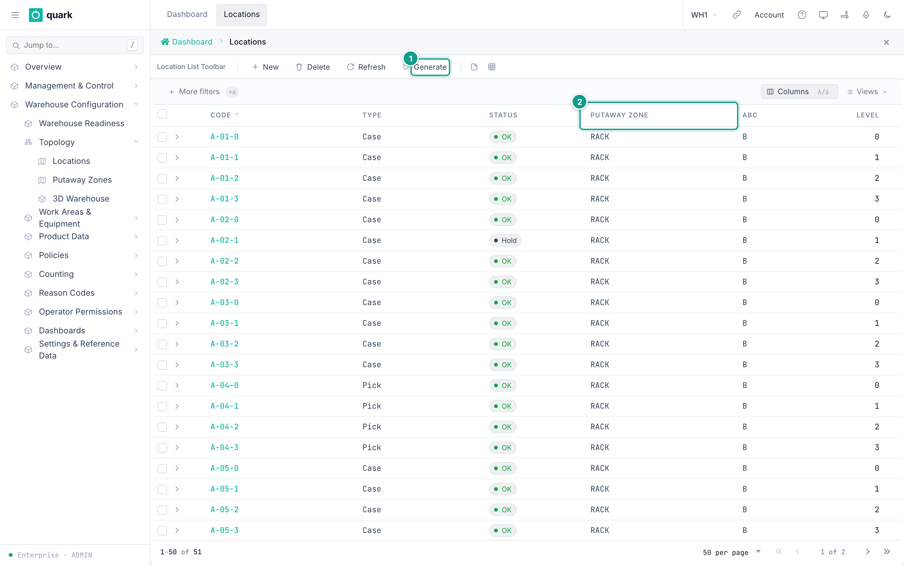

*Caption: the location list with the buttons New, Delete, Refresh, Generate. Focus: The Code, Type and Putaway Zone columns. The Generate button creates many locations. The teal numbers mark: 1 Generate button, 2 Putaway Zone column.*

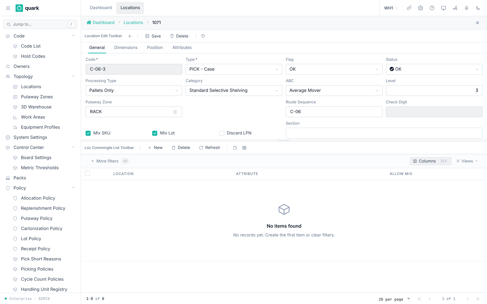

*Caption: the General tab of the location card. Focus: Check Code, Type, Putaway Zone and the Mix SKU and Mix Lot boxes.*

### Field reference

Form `location_edit_form` (tab `General`):

| Field | Meaning | Allowed values | Example |
|---|---|---|---|
| `Code` (required) | The key of the location. It is the primary key. | Up to 20 characters. Unique. | `A-01-02` |
| `Type` (required) | Location type. | See section 2. | `Case` |
| `Flag` | A special state. | `None`, `CycleCountActive`, `SanitationActive`, `MaintenanceActive`, `ReceivingHoldoff`. | `None` |
| `Status` | Read-only. It is **derived** from active location holds. | `Ok`, `Hold`, `Damage`. | `Ok` |
| `Processing Type` | Handling unit processed here. | `None`, `Pallet`, `Case`, `Piece`. | `Pallet` |
| `Category` | Storage equipment. | `None`, `NoPalletization`, `Asrs`, `CantileverRack`, `CartonFlow`, `DenseStorage`, `DoubleDeepRack`, `DriveInRack`, `DriveThroughRack`, `HorizontalCarousel`, `Other`, `PalletFlowRack`, `PalletCarousel`, `PushBackRack`, `SelectiveShelving`, `ShelvingStorage`, `WorkCenter`. | `SelectiveShelving` |
| `ABC` | Speed class. | `A`, `B`, `C`. Default `B`. | `A` |
| `Level` | Level number. | Whole number. Default 0. | `2` |
| `Putaway Zone` | Zone of the location. Picker. | An existing zone code. Default `DOCK`. | `RACK` |
| `Route Sequence` | Walking order. | Text up to 10 characters. | `0150` |
| `Check Digit` | Check digit for scanning. | Up to 3 characters. Set by the server when `CHECK_DIGIT_ENABLED` is true. | `7` |
| `Mix SKU` | May several SKUs stand here? | On or off. Default on. | on |
| `Mix Lot` | May several lots stand here? | On or off. Default on. | on |
| `Discard LPN` | Discard the container on arrival. | On or off. | off |
| `Section` | Free grouping. | Text up to 30 characters. A blank clears it. | `North` |

Tab `Dimensions`: `Cube`, `Length`, `Width`, `Height`, `Max Cube Capacity`, `Max Weight Capacity`, `Pallet positions on floor`, `Stack limit`, `Max quantity`.
All numbers must be zero or more. **Zero means "unlimited"** for capacity.

Tab `Position`: `X Coord`, `Y Coord`, `Z Coord`, `Aisle`, `Bay`. All must be zero or more.

Tab `Attributes`: custom attributes. See [Owners, SKUs, units and packs](04-owners-sku-uom-pack-hierarchy.md#8-custom-attributes).

### What you should see

- The new row in the list with `Status` = `Ok`.
- The check digit is filled if `CHECK_DIGIT_ENABLED` is on.

### If something goes wrong

| Message | Meaning | Fix |
|---|---|---|
| **Record already exists** | The code exists. | Use another code. |
| The putaway zone is not found | The selected zone does not exist. | Create the zone first (section 5). |
| A dimension, capacity or coordinate is below zero | The value is invalid. | Enter zero or more. |
| The location is in use | Stock, pending moves or owner settings refer to the location. | Empty and release the location first. |
| `Status` cannot be edited | Status is controlled by warehouse operations. | Use a hold; see [Inbound setup](05-inbound-setup.md). |

### What this affects later

- Putaway searches these locations by type, zone, ABC, mixing flags and capacity.
- `Status` blocks moves while a hold is active.

## 4. Generate many locations (bulk)

### What you will do

Create many locations from a pattern in one run.

### Before you start

- Role: `ADMIN` or `MANAGER` (`gen_locs` is `Execute` for these two).
- The pattern setting `LOC_GEN_PATTERN` (see `System Settings`). The default is `<AISLE_PREFIX><AISLE>-<LEVEL>-<LOC>`.

### Steps

1. Open `Sidebar > Warehouse Configuration > Topology > Locations`.
2. Click `Generate`. The wizard `Location Generator` opens.
3. Step `Code pattern`: fill the three ranges and the optional prefixes and suffixes.
4. Step `Classification`: choose the type, zone and flags.
5. Step `Dimensions`: fill the sizes (optional).
6. Step `Review`: check the summary. Finish the wizard.

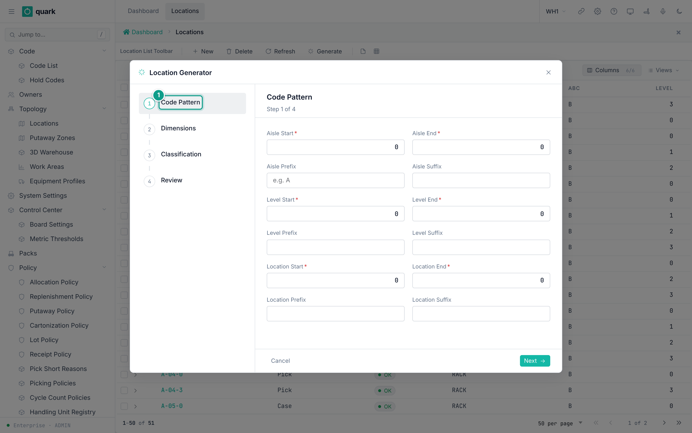

*Caption: the wizard with the step Code pattern. Focus: 1 the step Code Pattern.*

### Field reference

Step `Code pattern` (`loc_gen_step_code_pattern`):

| Field | Meaning | Allowed values | Example |
|---|---|---|---|
| `Aisle Start` / `Aisle End` (required) | Range of aisles. | Whole numbers. `Start` must be at most `End`. | 1 / 3 |
| `Aisle Prefix` / `Aisle Suffix` | Text before and after the aisle number. | Text. | `A` |
| `Level Start` / `Level End` (required) | Range of levels. | Whole numbers. | 1 / 4 |
| `Level Prefix` / `Level Suffix` | Text around the level. | Text. | |
| `Location Start` / `Location End` (required) | Range of positions. | Whole numbers. | 1 / 20 |
| `Location Prefix` / `Location Suffix` | Text around the position. | Text. | |

Step `Classification` (`loc_gen_step_classification`): `Location Flag`, `Location Category`, `Processing Type`, `Status`, `ABC Rotation`, `Putaway Zone`, `Mix SKU`, `Mix Lot`, `Discard LPN`, `Location Type` (required).

Step `Dimensions` (`loc_gen_step_dimensions`): `Cube`, `Length`, `Width`, `Height`, `Max Cube Capacity`, `Max Weight Capacity`.

Rules from `LocationCodeGenerator`:

- Code = the pattern with the tokens replaced. Tokens are `<AISLE_PREFIX>`, `<AISLE>`, `<AISLE_SUFFIX>`, the same for `LEVEL` and `LOC`.
- Numbers are padded with zeros to at least 2 digits, or the number of digits of the largest value.
- One run creates at most **10,000** locations.

Example: aisle 1 to 2, prefix `A`, level 1 to 3, position 1 to 10 gives `A01-01-01` to `A02-03-10` = 60 locations.

### What you should see

- The new locations in the list `Locations`.

### If something goes wrong

| Message | Meaning | Fix |
|---|---|---|
| `Invalid range: start must be <= end for aisles, levels, and locations` | A range has `from` above `to`. | Fix the range. |
| `Too many locations to generate: N exceeds maximum of 10000` | The product of the three ranges is above 10,000. | Run in smaller blocks. |
| Duplicate key on `location_pkey` | A generated code already exists. | Change the prefix or range. |

### What this affects later

- Same as section 3. All locations get the same type, zone and flags.

The bulk generator does not calculate check digits. If your site scans location check digits, add them after generation.
One existing code makes the whole run fail, so no location from that run is created. Change the prefix or range and try again.

## 5. Putaway zones

### What you will do

Create a zone that groups locations and names its special locations.

### Before you start

- Role: `ADMIN` or `MANAGER`.
- The four special locations exist. The defaults are `STAGE`, `STAGE`, `PICKTO`, `LOST`.

### Steps

1. Open `Sidebar > Warehouse Configuration > Topology > Putaway Zones`.
2. Click `New`.
3. On the tab `General`, fill the fields.
4. On the tab `Capacity`, fill the limits (optional).
5. On the tab `Printer Settings`, fill the printers (optional).
6. Click `Save`.

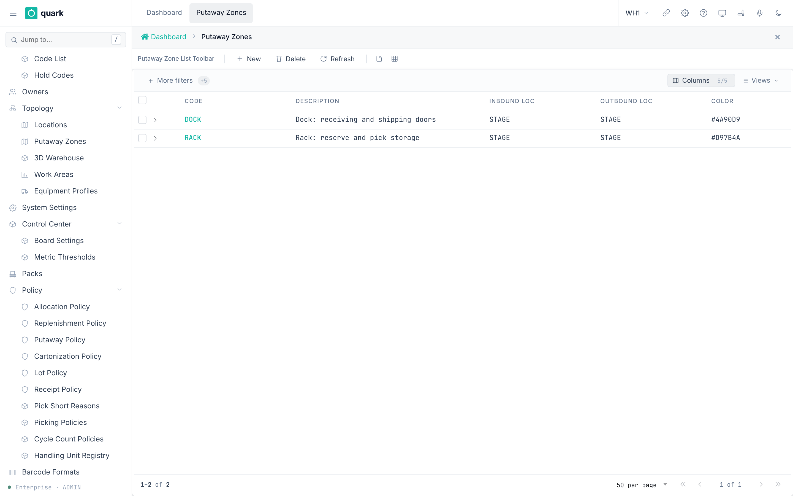

*Caption: the list of putaway zones.*

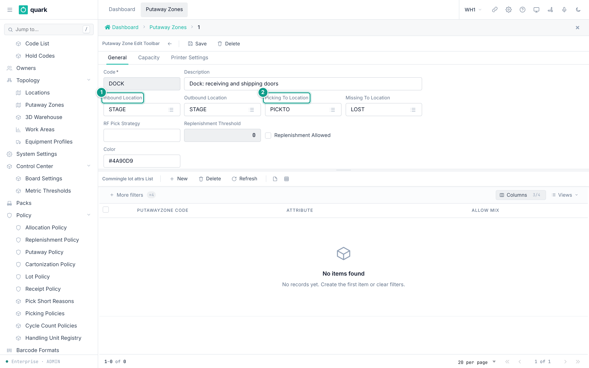

*Caption: the General tab of a zone. Focus: 1 Inbound Location, 2 Picking To Location.*

### Field reference

Tab `General` (`putawayzone_edit_form`):

| Field | Meaning | Allowed values | Example |
|---|---|---|---|
| `Code` (required) | Zone key. | Up to 20 characters. | `RACK` |
| `Description` | Free text. | Up to 60 characters. | `Rack storage` |
| `Inbound Location` | Where inbound goods of this zone wait. | An existing location. Default `STAGE`. | `STAGE` |
| `Outbound Location` | Where outbound goods of this zone wait. | An existing location. Default `STAGE`. | `STAGE` |
| `Picking To Location` | Drop place for picks from this zone. | An existing location. Default `PICKTO`. | `PICKTO` |
| `Missing To Location` | Where missing stock goes. | An existing location. Default `LOST`. | `LOST` |
| `RF Pick Strategy` | Text for the RF flow. | Text. | |
| `Replenishment Threshold` | For replenishment. | Whole number. | 0 |
| `Replenishment Allowed` | For replenishment. | On or off. | off |
| `Color` | Color on the 3D view and lists. | Color text. | `#D97B4A` |

Tab `Capacity`: `Max Cube`, `Max Weight`, `Max Cases Count`, `Min Temperature`, `Max Temperature`.
Zero means no limit. The minimum temperature must not be above the maximum.

Tab `Printer Settings`: `Default Label Printer`, `Auto Print Addr Label`, `Default Report Printer`, `Auto Print Carton Label`.

Lot mixing rules per zone: list `Lot Commingle Rules` with `Attribute`, `Allow Mix`, `Putawayzone Code`.

`Replenishment Allowed` controls whether pick locations in this zone are eligible for min/max replenishment. `Replenishment Threshold` is stored and shown but is not read by the min/max planner; the planner uses each SKU pick location's `Min` and `Max`. The form disables the threshold while `Replenishment Allowed` is off.

The zone lot mixing rules are enforced. When stock lands in a location, a location-specific rule takes priority; otherwise the zone rule is used. If neither exists, mixing is allowed. When **Allow Mix** is off, the lot attribute must match the stock already on the destination LPN or the move is refused.

### What you should see

- The zone in the list with its color.

### If something goes wrong

| Message | Meaning | Fix |
|---|---|---|
| Foreign key `fk_putawayzone_inbound_loc` (or `outbound_loc`, `picking_toloc`, `missing_toloc`) | A named location does not exist. | Create the location first. |
| Check `chk_putawayzone_temperature_order` | Minimum temperature above maximum. | Swap the values. |
| Delete refused | Locations, SKUs, work areas, policy steps or equipment profiles use the zone (RESTRICT keys). | Remove those links first. |

### What this affects later

- Putaway policy steps search by zone.
- Allocation steps filter by zone.
- SKU defaults refer to a zone.
- Work areas group zones.

## 6. Work areas, equipment profiles and operators

### What you will do

Group zones into work areas. Describe lift equipment. Give operators the right to take tasks.

### Before you start

- Role: `ADMIN` or `MANAGER`.
- Zones exist.
- For the pack station: a location of type `Pack` exists.
- For order control: a location of type `Control` exists.

### Steps

1. Open `Sidebar > Warehouse Configuration > Work Areas & Equipment > Work Areas`. Click `New`. Fill `Code` and the settings. Set **Pack station** and **Control Station** when the area uses those steps. Save.
2. In the area, add its zones: use the list `Work Area Zones`, button `New`, pick a `Putaway Zone`, click `Save`.
3. To name the picking policy: select the area and click `Assign Policy`. Pick a policy. Click `Assign`.
4. For a policy per equipment kind: in `Policy by Equipment Kind`, click `Add`. Pick an `Equipment Profile` and a `Picking Policy`.
5. Open `Sidebar > Warehouse Configuration > Work Areas & Equipment > Equipment Profiles`. Click `New`. Fill the fields. Save.
6. To exclude zones for a kind of equipment, add rows to `Excluded Zones`.
7. Open `Sidebar > Warehouse Configuration > Operator Permissions > Operators`. Click `Sync` to copy users now.
8. Open an operator. Set `Equipment Profile`. Add rows to `Task Permissions`.

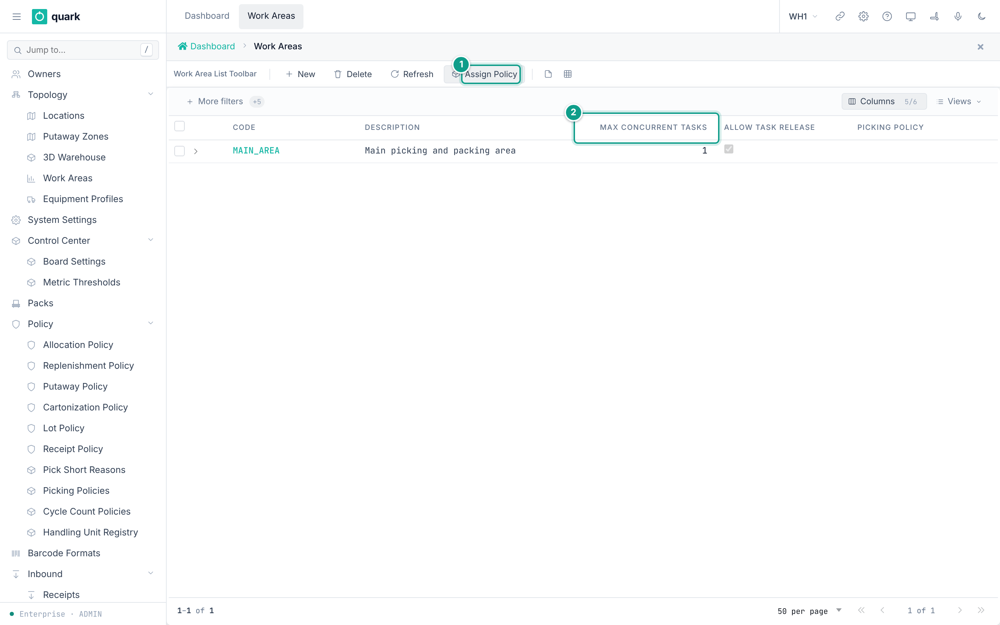

*Caption: the work area list with the buttons New, Delete, Refresh, Assign Policy. Focus: MAIN_AREA and its Max concurrent tasks. The teal numbers mark: 1 Assign Policy button, 2 Max Concurrent Tasks column.*

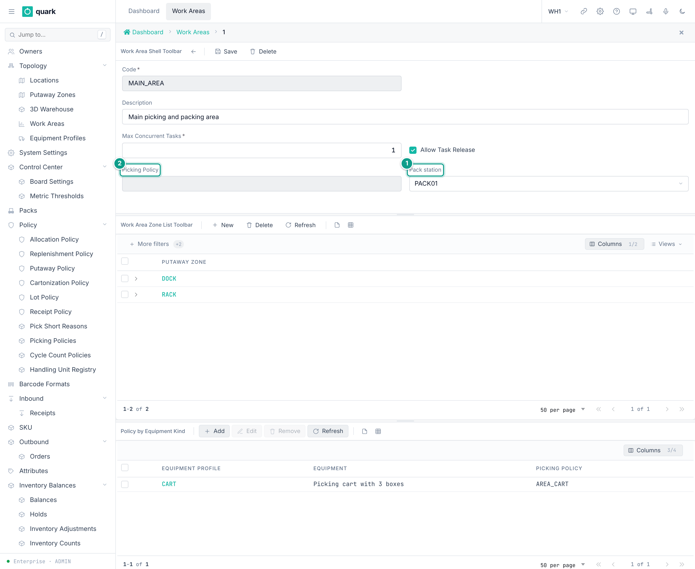

*Caption: the work area card. Focus: 1 Pack station, 2 Picking Policy.*

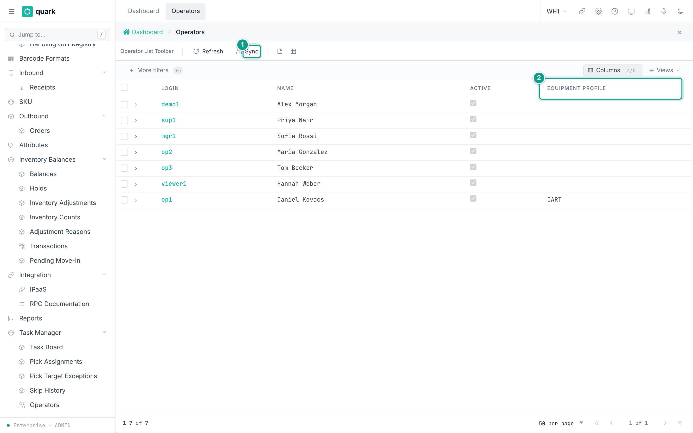

*Caption: the operator list with the buttons Refresh and Sync. Focus: 1 Sync button, 2 Equipment Profile column.*

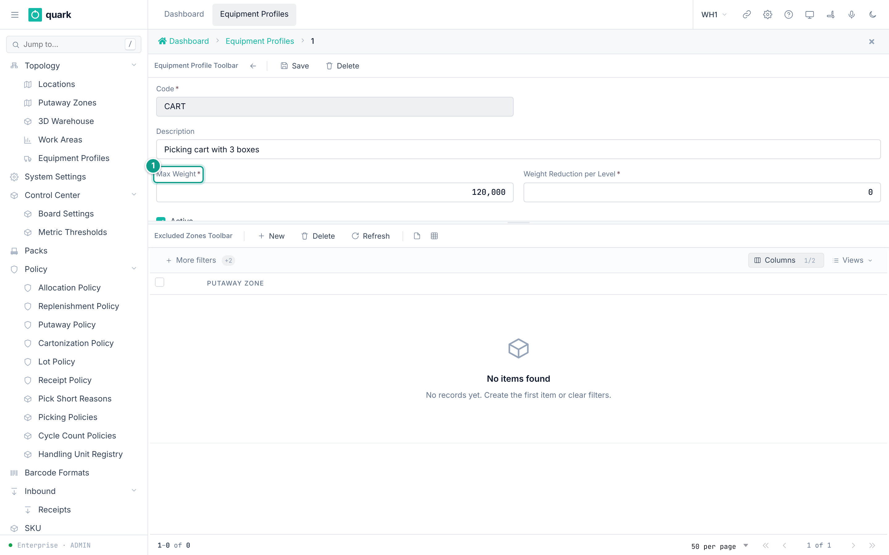

*Caption: the equipment profile card. Focus: 1 Max Weight (in grams).*

### Field reference

Work area (`work_area_normal_form`):

| Field | Meaning | Allowed values | Example |
|---|---|---|---|
| `Code` (required) | Key. Unique. | Text. | `PICK-A` |
| `Description` | Free text. | Text. | `Pick area A` |
| `Max Concurrent Tasks` (required) | Tasks one operator may hold at once. | Whole number. | 1 |
| `Allow Task Release` | May an operator hand back or refuse a task? | On or off. | on |
| `Picking Policy` | Picking policy of the area. Set by `Assign Policy`. Blank = the default policy `DISCRETE`. | A published picking policy code. | `DISCRETE` |
| `Pack station` | The pack-station location of the area. | A location of type `Pack`. | `PACK-01` |
| `Control Station` | The location where complete orders are checked after picking, packing or consolidation. Blank means that this area does not send work to order control. | A location of type `Control`. The whole warehouse uses one control station. | `CTL-01` |

Equipment profile (`equipment_profile_normal_form`). List columns: `Code`, `Description`, `Max Weight`, `Reduction per Level`, `Active`.

| Field | Meaning | Allowed values | Example |
|---|---|---|---|
| `Code` (required) | Key. | Text. | `FORKLIFT` |
| `Description` | Free text. | Text. | `Reach truck` |
| `Max weight` (required) | Load the machine lifts at ground level. | Zero or more. | 1000 |
| `Weight Reduction per Level` (required) | Weight lost for each level of height. | Zero or more. | 100 |
| `Active` | In use. | On or off. | on |

Operator (`operator_normal_form`): `Login`, `Name`, `Active` are read-only. You can change only `Equipment Profile` (blank = on foot).

Task permission (`operator_task_permission_normal_form`):

| Field | Meaning | Allowed values | Example |
|---|---|---|---|
| `Task Type` (required) | Kind of task. | `Pick`, `Putaway`, `Replenish`, `Move`, `Count`. | `Pick` |
| `Work Area` (required) | Area where the right applies. | An existing work area. | `PICK-A` |
| `Pick Execution` (required) | May the operator execute picks in this area? | On or off. Default off. | on |

One right per operator, task type and area (`uq_operator_task_permission`).

System defaults used when the terminal names no work area (`System Settings`):

| Key | Value in the seed | Meaning |
|---|---|---|
| `TASK_MAX_CONCURRENT_DEFAULT` | 1 | Tasks one operator may hold at once. |
| `TASK_ALLOW_RELEASE_DEFAULT` | 1 | May an operator hand back or refuse a task? |
| `TASK_LEASE_TTL_MIN` | 15 | Minutes a claimed task is held before the reaper returns it. |
| `TASK_SKIP_COOLDOWN_MIN` | 10 | Minutes a skipped task stays hidden. |
| `TASK_SKIP_ESCALATE_AFTER` | 3 | Refusals after which a task waits for a supervisor. |

### What you should see

- The operator list shows every user who has a warehouse assignment (any role), `RF device login` on and status `Active`.
- A pack-station area shows its `Pack` location.
- An area with order control shows the warehouse's `Control` location in **Control Station**.

### If something goes wrong

| Message | Meaning | Fix |
|---|---|---|
| `you have no right to take Pick tasks in any work area - ask a supervisor` | The operator has no `Task Permissions` row for the task type, or the equipment excludes every zone. | Add a task permission. |
| `there are Pick tasks in your work areas, but every one is heavier than your equipment lifts (up to N at ground level) - they wait for other equipment` | The equipment profile is too weak for the pool. | Use other equipment or raise `Max weight`. |
| Work area **Pack station** is refused | The location is not of type `Pack`. | Use a `Pack` location. |
| The area cannot assign a control station because this warehouse checks orders at another station | A different control station is already used in the warehouse. | Select the station named in the message. |
| Task cannot be released | `Allow Task Release` is off in the area. | A supervisor must use `Return to Pool` or `Reassign` on the task board. |
| Delete of a work area refused | Zones or permissions refer to it (RESTRICT keys). | Remove those rows first. |
| Operator missing from the list | The user has `RF device login` off, a status other than `Active`, or no assignment to this warehouse. | Fix the user; click `Sync`. |

### What this affects later

- Pick tasks are handed only to operators with a right in the area.
- A closed pick pallet or a carton goes to the pack station of the area.
- Containers go through order control only when the area names a control station. A closed pick pallet going directly from picking also needs `Control` in the policy's **Pallet Drop Cell Types**; cartons produced by packing follow the area's station settings.
- A supervisor works from `Management & Control > Execution Control > Task Board` (columns include `Assignee`, `Status`, `Lease Expires`, `Refusals`; buttons `Return to Pool`, `Reassign`, `Delete Task`).

A user becomes an active operator of a warehouse when **RF device login** is on, the user status is **Active**, and the user has an assignment to that warehouse. The sync sets an operator inactive when one of these conditions stops being true.

## 7. Operator sync

- The operator list refreshes automatically about every five minutes.
- The `Sync` button on `Operators` runs the same job for the active warehouse at once.
- You cannot create or delete an operator by hand. A person who leaves is set inactive by the next sync.

## 8. 3D warehouse

`Sidebar > Warehouse Configuration > Topology > 3D Warehouse` opens the warehouse map.
It draws locations from their coordinates (`X Coord`, `Y Coord`, `Z Coord`) and the zone color.

The page is titled `Warehouse Topology`. Its controls are:

- `Refresh` reloads the data.
- `Color Mode`: `Zone`, `Status`, `Type`, `Aisle`, `Level`, `Occupancy`.
- `Layers` (check boxes): `Rack structure`, `Analytics`, `Stock`, `Floor labels`, `Grid`.
- `Filters`: `Putaway Zone`, `Aisle`, `Status`, `Occupancy` (`Empty`, `Occupied`, `Reserved`, `Section locked`, `Blocked`), `Level`, and `Search Location` (example `A-03-2`).
- A `Legend` for the current color mode.
- Click a location to open its details. `Focus` centers it, and `×` closes the panel.
- Mouse: left button turns the view, right button moves it, wheel zooms, double-click fits all. The button `Fit view` does the same as the double-click.

## 9. Cycle count policies (short note)

`Sidebar > Warehouse Configuration > Counting > Cycle Count Policies` (`inventory_count_policy_normal_form`).

| Field | Meaning | Allowed values |
|---|---|---|
| `Code` | Key. | Text. |
| `Description` | Free text. | Text. |
| `Active` | In use. | On or off. |
| `Zone`, `Location Type`, `ABC`, `Aisle` | Filters. **Set at least one.** A location must match every filter that is set. | Zone code, location type, `A`/`B`/`C`, aisle text. |
| `Every (days)` (required) | A location counted within this many days is not due. | Whole number. |
| `Locations per Run` (required) | Daily limit. | Whole number. |
| `Mode` (required) | Count mode. | `Blind`, `Informed`. |
| `Recounts per Location` | Limit of recounts. | Whole number. |
| `Freeze` | Stock freeze for the counts this policy makes. | `Hard`, `Soft`. |

Buttons: `Save`, `Run Now`, `Delete`.
Setting `COUNT_ON_PUTAWAY_DEVIATION` (0 or 1) asks for a count of the destination when putaway deviates.

The full count workflow (`Management & Control > Inventory > Counts`) is outside the scope of this guide.
