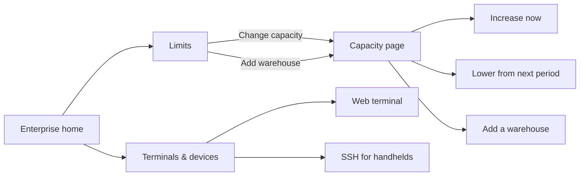
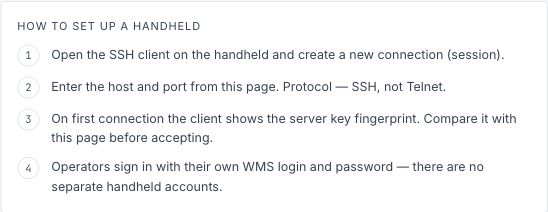

# Enterprise Console, Capacity and Terminals

The Enterprise home shows subscription usage and access. From there, an
administrator can open the capacity page or the connection details used to set
up handheld terminals.

## 1. Review subscription limits

### Before you start

- Sign in with an Enterprise administrator account.
- Switch to **Enterprise**.

### Steps

1. Open **Enterprise Overview**.
2. Find the **Limits** card.
3. Review **Warehouses**, **Users** and **Database storage**.
4. Read the status below the meters:
   - **All good**: each measured limit is below 80 percent.
   - **Close to the limit**: at least one measured limit is at or above 80
     percent but below 100 percent, and no limit has been reached.
   - **Limit reached**: no capacity remains for at least one measured limit.
   - **Subscription suspended — access is limited**: this status takes
     priority over the limit warnings. Restore the subscription before
     expecting normal access.

An installation without subscription limits shows a value as **unlimited**.
The capacity links appear only when the subscription can be changed online.

## 2. Increase licensed capacity

### What you will do

Increase **Licensed warehouses** or **Licensed users** for the current billing
period.

### Steps

1. On the **Limits** card, click **Change capacity**. The page opens in a new
   tab.
2. Under **Capacity**, increase **Licensed warehouses** or **Licensed users**.
3. Review the monthly price change, excluding VAT. The charge for the remaining
   part of the current period is calculated when Stripe processes the change.
4. Click **Increase now**.
5. Wait for **Your new capacity is licensed**. The WMS normally receives the
   new limits within a minute; reopen **Enterprise Overview** to see them.
6. If the bank requires confirmation, click **Pay the invoice**. The page keeps
   checking while payment is pending.

Raising **Licensed warehouses** changes the limit; it does not create a
warehouse. Add it separately as described in [Warehouse
Structure](03-warehouse-structure.md#1-create-and-activate-a-warehouse).

## 3. Lower capacity from the next period

### Before you start

- Capacity cannot be lowered below what the plan includes.
- Capacity cannot be lowered below the number of warehouses or users currently
  in use.
- An increase and a decrease must be submitted separately.

### Steps

1. Open **Change capacity** from the Enterprise home.
2. Reduce **Licensed warehouses** or **Licensed users**.
3. Review the effective date and click **Lower from _date_**.
4. The page shows **Decrease from _date_** and the last time at which you can
   cancel it. Nothing is refunded for the current period.
5. To cancel before that cutoff, click **Take it back**.

The lower limits are applied shortly before the next period, when the change is
sent to Stripe. After that point the change is final for the renewal.

## 4. Add a licensed warehouse

The capacity page contains **Add a warehouse** even when no capacity change is
pending. Enter **Code** and **Name**, select **Weight**, **Length** and
**Volume**, and click **Add warehouse**. The units cannot be changed later and
the schema name is assigned automatically.

See [Warehouse Structure](03-warehouse-structure.md#1-create-and-activate-a-warehouse)
for activation, readiness and recovery steps.

## 5. Set up handheld terminals

### What you will do

Copy the addresses and connection details for browser-based or SSH handhelds.

### Steps

1. In Enterprise mode, open **Terminals & devices**.
2. For a handheld with a browser, use **Web terminal**:
   - click **Open**, or click **Copy** beside the address;
   - operators sign in with their WMS login.
3. For a handheld with an SSH client, use **SSH for handhelds**:
   - copy **Host** and **Port**;
   - select SSH, not Telnet, in the handheld client;
   - on the first connection, compare the server key with **Host key
     fingerprint** before accepting it;
   - use **Ready-made command** when configuring a desktop terminal client.
4. Operators sign in on the WMS login screen with their own WMS login and
   password. There are no separate SSH accounts for operators.

*Terminals & devices. The setup card gives the warehouse the protocol,
host-key check and operator sign-in steps without exposing connection values.*

If **No web terminal is deployed for this installation** or **No SSH terminal
is set up for this installation** is shown, use the available connection type
or contact the installation administrator.

## If something goes wrong

| Message or symptom | Meaning | Fix |
|---|---|---|
| **Open this page from your WMS again** | The capacity link works once and its session lasts 30 minutes. | Close the page and open **Change capacity** again from **Enterprise Overview**. |
| **Capacity cannot be changed online** | The subscription has no capacity sold per unit. | Contact sales to change the subscription. |
| **Raise and lower separately** | One request contains both an increase and a decrease. | Submit the increase first, then reopen the page for the decrease. |
| Lowering is not available | The system could not confirm current usage. | Try again later; do not reduce capacity without a current usage count. |
| **Stripe did not accept the change** | The capacity and charge were not changed. | Try again later or contact sales. |
| The change is taking longer than usual | The request is saved but the final Stripe result is not ready. | Reopen the capacity page from the WMS later to check it. |
| **Terminal settings are unavailable right now** | The Enterprise console could not read the deployment details. | Reload the page later. |
| The subscription is suspended | Handhelds cannot sign in, but their addresses remain unchanged. | Restore the subscription; the devices do not need to be reconfigured. |

## What this affects later

- Warehouse and user limits control whether another warehouse or user can be
  added.
- Terminal connection details belong to this customer installation. Recheck
  the host-key fingerprint if a device reports that it changed.

