# Owners, SKU, UOM, Pack Hierarchy, Lot and Serial Rules

## 1. Owners (customers, suppliers, carriers)

### What you will do

Create a business partner record. The same table holds goods owners, suppliers, carriers, customers and other partners.
The field `Type` tells which kind it is.

### Before you start

- Role: `ADMIN` or `MANAGER` (create and delete). `OPERATOR` and `VIEWER` can read.
- For `Delivery location (picker carrier)`: a location of type `Pickto`, `Stage` or `Door` exists.
- For a parent owner: the parent exists.

### Steps

1. Open `Sidebar > Warehouse Configuration > Product Data > Owners`.
2. Click `New`.
3. On the tab `General`, fill `Code`, `Type`, `Company` and the other fields. Click `Save`.
4. Open the tab `Addresses`. Click `New Address`. Fill the form. Click `Save`.
5. Open the tab `Bank Accounts`. Click `New`. Fill the form. Click `Save`.
6. Open the tab `WH Settings`. Fill the five sub-tabs (section 2).
7. Click `Save All` to store the whole card.

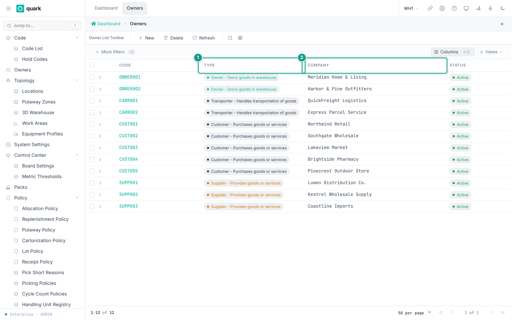

*Caption: the owner list with the buttons New, Delete, Refresh. Focus: 1 The Type column shows the role of each partner. 2 Company is the name. OWNER001 and OWNER002 own goods in the warehouse.*

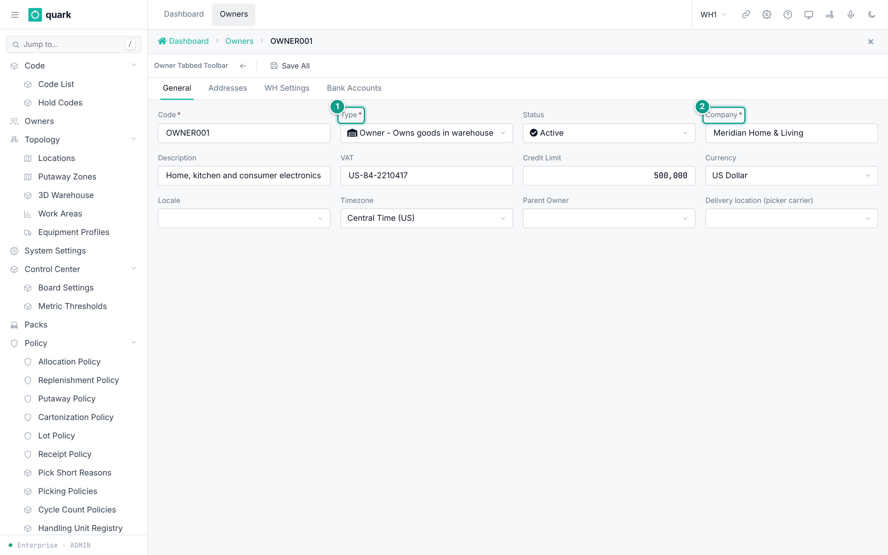

*Caption: the General tab of an owner. Focus: 1 Type, 2 Company.*

### Field reference

Form `owner_general_form`:

| Field | Meaning | Allowed values | Example |
|---|---|---|---|
| `Code` (required) | Key. Unique in the warehouse. | Up to 30 characters. | `SUPP001` |
| `Type` (required) | Kind of partner. | `Sup`, `Cus`, `Trn`, `Rec`, `Con`, `Own`, `Man`, `Dst`, `Vnd`, `Brk`. | `Sup` |
| `Status` | State of the partner. | `Active`, `Inactive`, `Suspended`. Default `Active`. | `Active` |
| `Company` (required) | Company name. | Up to 45 characters. | `ABC Manufacturing` |
| `Description` | Free text. | Up to 50 characters. | |
| `VAT` | Tax number. | Up to 18 characters. | `VAT111222333` |
| `Credit Limit` | Credit limit. | Number. | 500000 |
| `Currency` | Currency code. | Up to 3 characters (code list `CURRENCY`, 30 values). | `USD` |
| `Locale` | Language of the partner. | A code from the `locale` registry (`en`, `ru`, `kk`). | `en` |
| `Timezone` | Time zone of the partner. | Text up to 50 characters. | `Europe/Berlin` |
| `Parent Owner` | Parent in a tree. | Another owner. | |
| `Delivery location (picker carrier)` | Where the picker leaves a carrier's picked goods. | A location of type `Pickto`, `Stage` or `Door`. | `PICKTO` |

What the types mean (from code and form names):

| Code | Meaning | Evidence |
|---|---|---|
| `Sup` | Supplier | Picker `owner_supplier_list_form`: "Popup list for owners of type Supplier". |
| `Trn` | Carrier | Picker `owner_carrier_list_form`: "Popup list for owners of type Carrier". Seeded carriers `CARR001` and `CARR002` have type `Trn`. |
| `Own` | Own owner (goods owner) | List `owner_own_list_form`. |
| `Vnd` | Vendor | List `owner_vendor_list_form`. |
| `Cus` | Customer | Seeded customers `CUST001` and `CUST002` have type `Cus`. List `shipment_order_customer_list` is the "Ship To" picker. |
| `Rec` | Receiver | Code list `OWNER_TYPES`: "Receives goods or services". |
| `Con` | Consignee | Code list `OWNER_TYPES`: "The person or entity to whom goods are shipped". |
| `Man` | Manufacturer | Code list `OWNER_TYPES`: "Produces goods". |
| `Dst` | Distributor | Code list `OWNER_TYPES`: "Distributes goods to retailers or customers". |
| `Brk` | Broker | Code list `OWNER_TYPES`: "Facilitates transactions between buyers and sellers". |

The `Ship To` picker (`shipment_order_customer_list`) shows only owners of type `Cus`. The picker label is `Customer List`.

Address (`owner_address_form`): `ISO Code`, `Contact`, `Phone`, `Email`, `Address Type` (required), `Company`, `Address 1`, `Address 2`, `City`, `State`, `ZIP`, `Country`, `Default`.

Bank account (`owner_bank_acct_edit`): `Bank Name` (required), `Description`, `BIC/SWIFT` (required), `Account/IBAN` (required), `Correspondent Acct`, `Currency` (required), `Default`, `Active`.

### What you should see

- The new owner in the list with the columns `Code`, `Company`, `Type`, `Status`.

### If something goes wrong

| Message | Meaning | Fix |
|---|---|---|
| Duplicate key `owners_code_key` | The code exists. | Use another code. |
| `owners.picking_toloc X is a Y location, not Pickto/Stage/Door` | The delivery location has the wrong type. | Pick a location of type `Pickto`, `Stage` or `Door`. |
| Delete refused | Receipts, orders, SKUs, balances or tasks refer to the owner (`ON DELETE RESTRICT`). | Close or move those records. Set `Status` to `Inactive`. |
| `Field {0} is required` | A required field is empty. | Fill it. |

### What this affects later

- Every SKU, receipt, order and stock row belongs to one owner.
- `Sup` and `Trn` owners are chosen on receipts as `Supplier` and `Carrier`.
- The carrier's `Delivery location (picker carrier)` is where picked carrier goods are left.

## 2. Owner settings for the warehouse (tab `WH Settings`)

### What you will do

Set the defaults the warehouse uses for one owner.

### Before you start

- The policies and locations you want to pick exist.
- The owner has a settings row. The seeded owner `OWNER001` has one.
- A new owner does not get a settings row by itself. `Save All` creates the row when the settings tabs carry data. If you fill nothing in, no row is made.

### Steps

1. Open the owner. Open the tab `WH Settings`.
2. Fill the sub-tab `LPN Config`.
3. Fill the sub-tab `Policies`.
4. Fill the sub-tab `Locations`.
5. Fill the sub-tab `Units of Measure`.
6. Fill the sub-tab `Receiving`.
7. Click `Save All`.

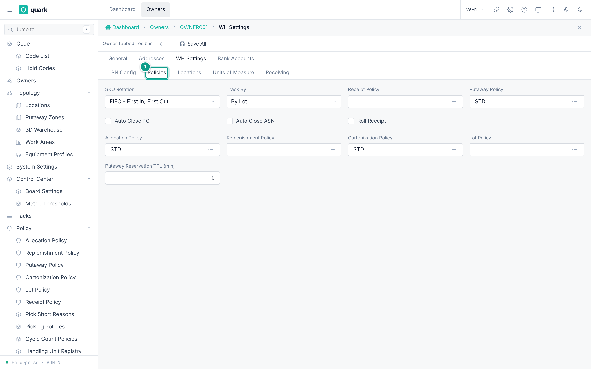

*Caption: the Policies sub-tab of the owner settings. Focus: 1 the Policies sub-tab.*

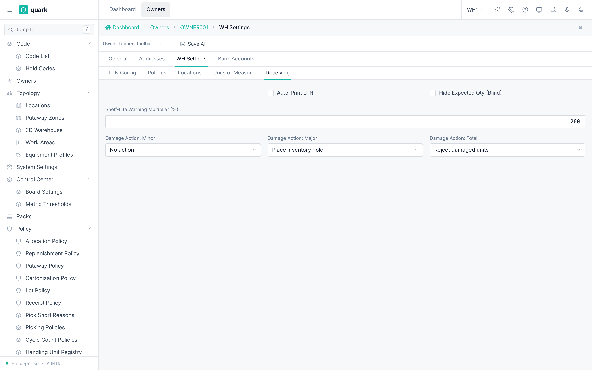

*Caption: the Receiving sub-tab.*

### Field reference

`LPN Config` (`owner_wh_lpn_form`):

| Field | Meaning | Allowed values | Example |
|---|---|---|---|
| `LPN Length` | Length of generated LPN numbers. | Whole number. | 10 |
| `LPN Start #` | First LPN number. | Whole number. | 1 |
| `Next LPN #` | Next number to issue. | Whole number. | 1 |
| `LPN Rollback #` | Number at which the counter goes back. | Whole number. | |
| `System Generated LPN` | The system makes the LPN. Default on. | On or off. | on |
| `Commingled LPN` | Several owners on one LPN. Default off. | On or off. | off |
| `Duplicate LPN` | The same LPN twice. Default off. | On or off. | off |
| `Mixed LPN` | Several SKUs on one LPN. Default off. | On or off. | off |

`Policies` (`owner_wh_policies_form`):

| Field | Meaning | Allowed values | Example |
|---|---|---|---|
| `SKU Rotation` | Default stock rotation. | `Fifo`, `Lifo`, `Fefo`. | `Fifo` |
| `Track By` | How stock is tracked. | `None`, `Lot`, `Serial`, `Batch`. Default `Lot`. | `Lot` |
| `Receipt Policy` | Default receipt policy. | A receipt policy. | `STD` |
| `Putaway Policy` | Default putaway policy. | A putaway policy. | `STD` |
| `Auto Close PO` | Close the PO automatically. | On or off. | off |
| `Auto Close ASN` | Close the ASN automatically. | On or off. | off |
| `Roll Receipt` | Combine receipts. | On or off. | off |
| `Allocation Policy` | Default allocation policy. | An allocation policy. | `STD` |
| `Replenishment Policy` | Owner default replenishment policy. | Stored only; the planner reads the policy on the SKU instead. | |
| `Cartonization Policy` | Default cartonization policy. | A cartonization policy. | `STD` |
| `Lot Policy` | Default lot policy. | A lot policy. | `STD` |
| `Putaway Reservation TTL (min)` | Minutes a putaway reservation is held. Blank = warehouse default (`PUTAWAY_RESERVATION_TTL_MIN` = 15). | Whole number above 0 (`chk_owner_config_putaway_ttl`). | 15 |

`Locations` (`owner_wh_locations_form`): `Pick Code`, `Carton Group`, `Returns Location`, `QC Location`, `Receiving Location`. The seeded owner has `Receiving Location` = `STAGE`.

`Units of Measure` (`owner_wh_uom_form`): `Weight UOM`, `Dimension UOM`, `Cube UOM`. The seeded owner has `KG`, `CM`, `M3`.

`Receiving` (`owner_config_receiving_form`):

| Field | Meaning | Allowed values | Example |
|---|---|---|---|
| `Auto-Print LPN` | Print an LPN label after a receive. | On or off. | off |
| `Hide Expected Qty (Blind)` | Operator does not see the expected quantity. | On or off. | off |
| `Shelf-Life Warning Multiplier (%)` | Hint: "200 = 2x min_shelf_life triggers warning". | Whole number. Seed 200. | 200 |
| `Damage Action: Minor` | What to do with minor damage. | `None`, `Hold`, `Reject`. Seed `None`. | `None` |
| `Damage Action: Major` | What to do with major damage. | Same. Seed `Hold`. | `Hold` |
| `Damage Action: Total` | What to do with total loss. | Same. Seed `Reject`. | `Reject` |

### What you should see

- The values are saved on the owner.

### If something goes wrong

| Message | Meaning | Fix |
|---|---|---|
| Check `chk_owner_config_putaway_ttl` | TTL is zero or negative. | Enter a positive number or leave blank. |
| Foreign key error on a location | The location does not exist. | Create it first. |

### What this affects later

- Receiving uses the damage actions and the default locations.
- The default policies are not copied into new SKUs. They are a fallback at run time. If the SKU has no policy of its own, the system uses the owner default. This holds for putaway, allocation, cartonization and receipt policies.
- The replenishment and lot defaults are stored, but no code reads them (checked in Rust code).

## 3. Units of measure (UOM)

### What you will do

Know which units exist and where to add one.

### Before you start

- Role: `ADMIN` or `MANAGER` to edit code values.

### Steps

1. The 32 seeded units are listed in the code list `UOM`: open `Sidebar > Warehouse Configuration > Settings & Reference Data > Code List`, find `UOM`.
2. To add a unit, add a value to the code list (section 3 of `11-faq.md` has the screen steps).
3. The class and conversion factor of a unit live in the table `uom_class`.
   No screen edits this table.

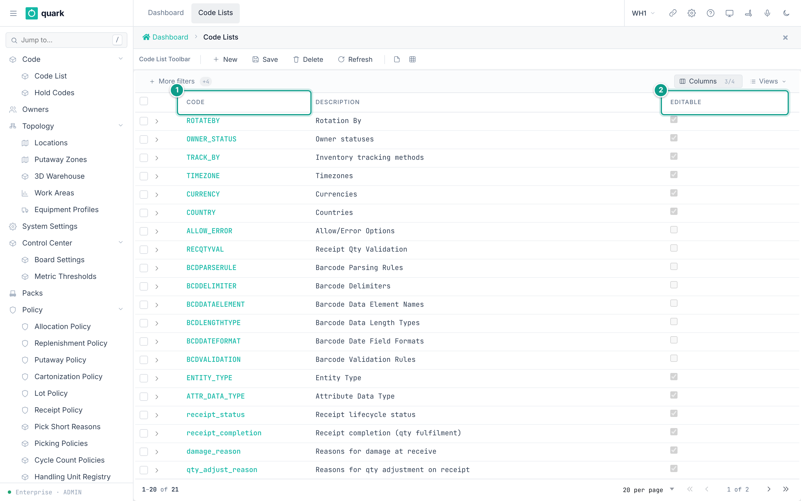

*Caption: the code list screen. Focus: The Code and Description columns; the Editable box shows which lists you can change. The teal numbers mark: 1 Code, 2 Editable.*

### Field reference

Seeded units and classes (from the `uom_class` seed):

| Class | Units |
|---|---|
| `Handling` | `EA`, `IP`, `CS`, `PL` |
| `Container` | `BX`, `BG`, `DR`, `CRT`, `BDL`, `TU`, `TK`, `CN`, `RL` |
| `Weight` | `KG` (factor 1), `LB` (0.45359237), `TON` (1000), `G` (0.001), `OZ` (0.028349523125) |
| `Length` | `MTR` (1000), `FT` (304.8), `YD` (914.4), `CM` (10), `IN` (25.4), `MM` (1) |
| `Volume` | `LTR` (0.001), `GAL` (0.003785411784), `ML` (1e-06), `CBM` (1), `M3` (1), `MM3` (1e-09) |
| `Area` | `SQM`, `SQF` |

The factor must be above zero (`ck_uom_class_factor_positive`).

Pack-hierarchy UOMs (`EA`, `IP`, `CS`, `PL`) are chosen in the pack screens (section 5).

Also set the warehouse base units in `enterprise.warehouse` (`weight_uom`, `length_uom`, `volume_uom`). They are fixed after first use.

### What you should see

- The unit appears in the drop-downs `UoM`, `Base UOM`, `Parent UOM` and `UOM`.

### If something goes wrong

| Message | Meaning | Fix |
|---|---|---|
| A new unit has no class | The side table has no row. | The step card then says nothing about the unit. Ask the installer to add a `uom_class` row. |

### What this affects later

- Allocation steps warn when a rule can never be met for a measured unit (weight, length, volume, area).

- No screen or API method adds a `uom_class` row. The rows come from the database baseline. A new class row needs a database migration.

## 4. SKU

### What you will do

Create an item master record.

### Before you start

- Role: `ADMIN`, `MANAGER` or `OPERATOR` (create, update, delete default).
- The owner exists.
- A pack exists (section 5).
- A cartonization policy, receipt policy, allocation policy, replenishment policy and lot policy exist. **The SKU form requires all five.** The database defaults for receipt, replenishment and lot policy point to id 1.

### Steps

1. Open `Sidebar > Warehouse Configuration > Product Data > SKUs`.
2. Click `New`.
3. Tab `Basic`: fill `Owner`, `SKU Code`, `Pack`, `Description`, `Active`.
4. Tab `Weight`: fill `Gross Weight`, `Net Weight`, `Tare Weight`, `Cube`.
5. Tab `Policies`: pick the five required policies.
6. Optional tabs: `Shelf Life`, `Temperature & Aging`, `Serial Tracking`, `Attributes`.
7. Click `Save`.
8. Barcodes: open the barcode list of the SKU, click `New`, fill the form, click `Save`.
9. Optional: tab `Pick Locations` — the locations the SKU is picked from. On a saved SKU click `New` on the tab, choose the `Location` in the picker, pick `Pick Type` and `Unit`, enter `Min` and `Max`, click `Save`. To change one, open it with the arrow at the start of its row; to remove one, tick it and click `Delete`.

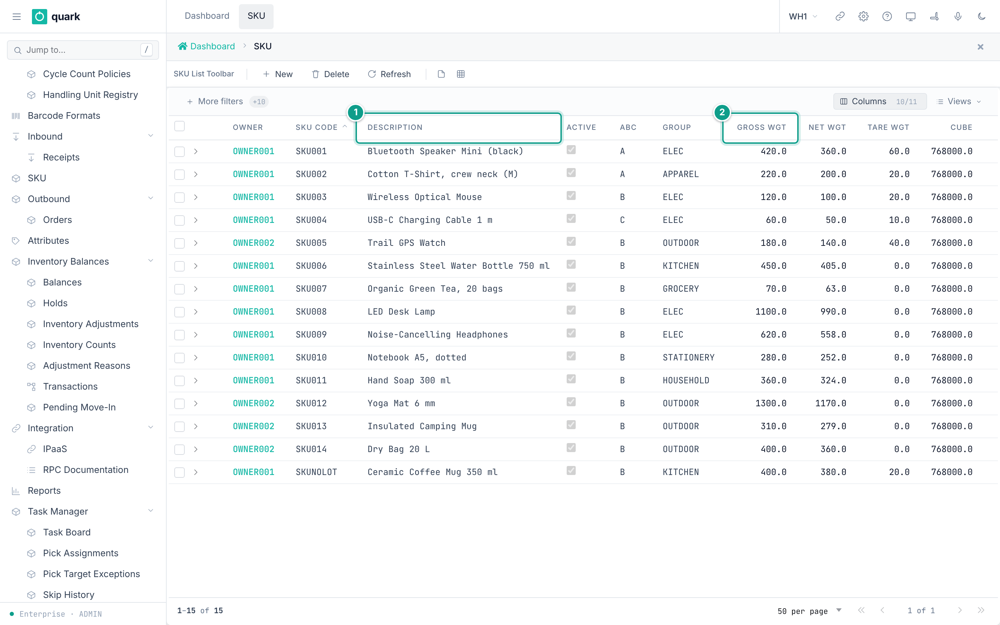

*Caption: the SKU list. Focus: SKU Code, Owner, Description and the weight columns. The teal numbers mark: 1 Description, 2 Gross Wgt (weights are in grams).*

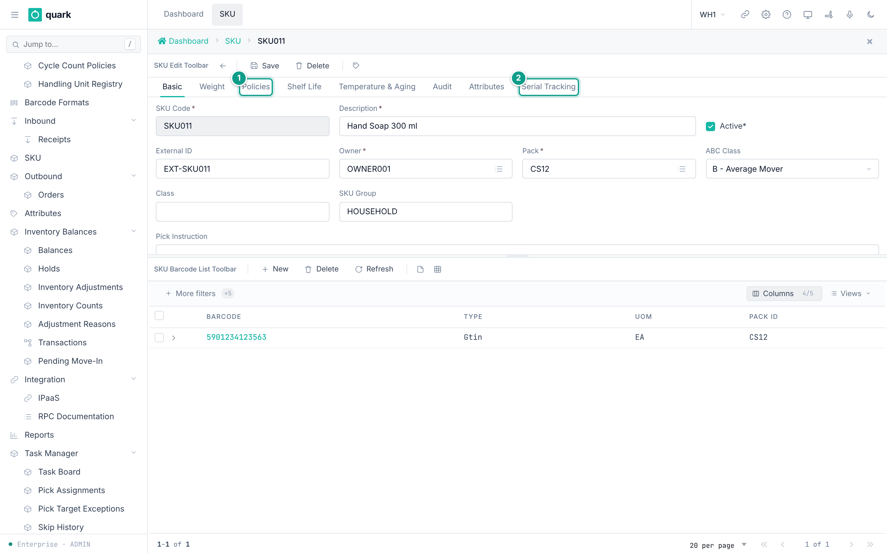

*Caption: the Basic tab of a SKU. Focus: The tabs are above the fields; the Policies tab is the third one. The barcode list is at the bottom. The teal numbers mark: 1 Policies tab, 2 Serial Tracking tab.*

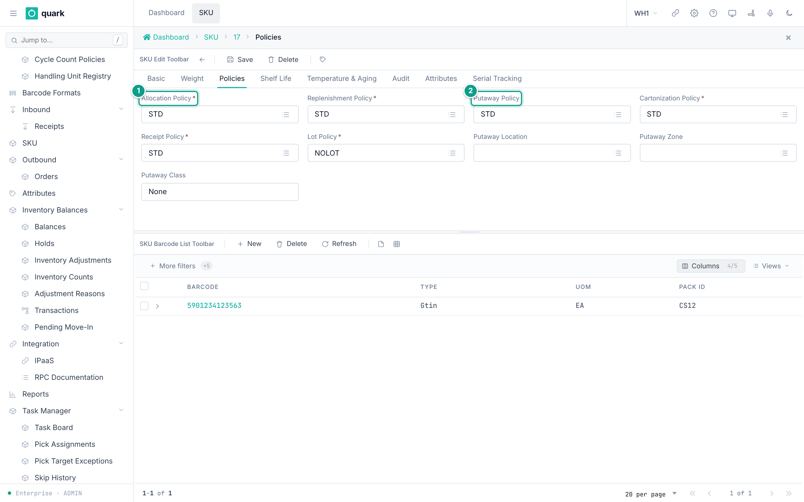

*Caption: the Policies tab of a SKU. Focus: 1 Allocation Policy, 2 Putaway Policy.*

### Field reference

Tab `Basic` (`sku_basic_form`):

| Field | Meaning | Allowed values | Example |
|---|---|---|---|
| `Owner` (required) | Owner of the item. | An owner. | `OWNER001` |
| `SKU Code` (required) | Item code. Unique per owner (`uq_sku_owner_code`). | Text. | `WIDGET-1` |
| `External ID` | Id in the ERP. Unique when set (`sku_external_id_key`). | Text. | `ERP-77` |
| `Pack` (required) | Pack hierarchy of the item. | A pack. | `STD` |
| `ABC Class` | Speed class. | `A`, `B`, `C`. | `B` |
| `Class` | Free class text. | Text. | |
| `SKU Group` | Group text. | Text. | |
| `Description` (required) | Name. | Text. | |
| `Active` (required) | In use. | On or off. | on |
| `Pick Instruction` | Text shown to the picker. | Text. | |

Tab `Weight` (`sku_weight_form`): `Gross Weight`, `Net Weight`, `Tare Weight`, `Cube` (all required, default 0), `Stack limit` (zero or more), `Positions required` (one or more, `chk_sku_positions_required_positive`).

Tab `Policies` (`sku_policies_form`): `Cartonization Policy`, `Receipt Policy`, `Allocation Policy`, `Replenishment Policy`, `Lot Policy` (all required), `Putaway Location`, `Putaway Zone`, `Putaway Class`, `Putaway Policy`.

Tab `Shelf Life` (`sku_shelf_life_form`):

| Field | Meaning | Allowed values | Example |
|---|---|---|---|
| `Expire Days` | Days to expiry from a date. | Whole number. | 365 |
| `Min. shelf life at shipping (days)` | Minimum days of life a lot must still have when it ships (not how long the product lasts). | Whole number. | 20 |
| `Min Shelf Life on Pick` | Minimum days left to pick. | Whole number. | 30 |
| `Min Shelf Life on Receive` | Minimum days left to receive. | Whole number. | 90 |
| `Rotation` (required) | Stock rotation. | `Fifo`, `Lifo`, `Fefo`. Default `Fifo`. | `Fefo` |
| `Rotate By` (required) | Date used to rotate. | `Lot`, `Mandate`, `ExpDate`, `BestBy`, `DelivBy` (code list `ROTATEBY`: lot number, manufactured date, expiration date, best-by date, delivery-by date). | `ExpDate` |

Tab `Temperature & Aging` (`sku_temperature_form`): `Requires Temperature Capture`, `Min Temperature (°C)`, `Max Temperature (°C)`, `Warning Temp Min (°C)`, `Warning Temp Max (°C)`, `Max Age on Receive (days)`.

Tab `Pick Locations` (list `sku_pick_location_list`, card `sku_pick_location_edit`). A SKU may have several; they are taken in route order, there is no manual priority.

| Field | Meaning | Allowed values | Example |
|---|---|---|---|
| `Location` (required) | Where the SKU is picked from. | A location of type `Pick`, `SpeedPick` or `Case`. | `A-04-0` |
| `Owner` | The SKU's owner, shown for reference. | Read only. | `OWNER001` |
| `Pick Type` (required) | How the location is picked. | `Each`, `Inner pack`, `Case`, `Pallet`. | `Each` |
| `Unit` (required) | The unit of `Min` and `Max`. | A unit of the SKU's active pack. | `EA` |
| `Min` (required) | Below this the location needs replenishing. | Zero or more. | 2 |
| `Max` (required) | What the location holds when full. | More than zero, not below `Min`. | 10 |

Writing needs `ADMIN`, `MANAGER` or `SUPERVISOR`; every role can read.

Putaway reads them: a step with scope `Pick location of the SKU` puts the pallet into one of them, within its `Max`, and the ordering `Nearest to the pick location` searches a zone outward from the first one (see `policies/01-putaway-policy-steps-and-criteria.md`).

Barcode (`sku_barcode_edit_form`): `Pack` (required), `Default UOM` (required), `Barcode` (required), `Barcode Type` (`Upc`, `Mni`, `Rtlin`, `Epcid`, `Crn`, `Gtin`, `None`), `User Notes 1`, `User Notes 2`, `Vendor`.

### What you should see

- The SKU in the list with its owner, code, group, ABC and weights.

### If something goes wrong

| Message | Meaning | Fix |
|---|---|---|
| Duplicate key `uq_sku_owner_code` | The owner already has this code. | Use another code. |
| Duplicate key `sku_external_id_key` | The external id is used. | Use another one. |
| Check `chk_sku_positions_required_positive` | `Positions required` is below 1. | Enter 1 or more. |
| Delete refused | Stock, orders, receipts, picks or barcodes refer to the SKU. | Set `Active` off instead. |
| Required policy missing | One of the five policies is empty. | Pick a policy. |
| Location … is of type … and cannot hold stock to pick | Pick locations must be `Pick`, `SpeedPick` or `Case`. | Choose such a location. |
| Unit … is not a unit of the SKU's pack | The unit is not in the SKU's active pack. | Choose a unit from the list. |
| Location … is already a pick location of this SKU | The SKU already has this location. | Edit the existing row. |
| Location … is the pick location of SKU … and does not mix SKUs | Another SKU has this location and it holds one SKU only. | Choose another location, or allow mixing on the location. |
| Location … still holds … of this SKU: move it out first | The location still has this SKU (on hand or on its way). | Move the stock out, then delete. |
| Delete of a location refused | A SKU still has it as a pick location. | Remove it from the SKU's `Pick Locations` tab first. |

### What this affects later

- Receiving, putaway, allocation, picking and cartonization read the SKU and its policies.
- The pack defines units and quantities.
- `Rotation` and `Rotate By` decide which lot is allocated first.

## 5. Pack hierarchy

### What you will do

Describe how a product is packed from the largest unit to the base unit.

A **pack hierarchy** is a chain of units. Each unit holds a number of the next smaller unit.
Example: `PL` holds 10 `CS`; `CS` holds 10 `IP`; `IP` holds 10 `EA`.

### Before you start

- Role: `ADMIN`, `MANAGER` or `OPERATOR` can create. Items need the same.
- You know the units and counts for the item.

### Steps (wizard)

1. Open `Sidebar > Warehouse Configuration > Product Data > Packs`.
2. Click `Pack Wizard`. The wizard `New Pack Wizard` opens.
3. Step `Pack Info`: fill `Pack Code` and `Description`.
4. Step `Base Unit`: pick `Base UOM`. Fill weight, cube and size of the base unit.
5. Step `Pack Levels`: fill `Qty per Child` and `Parent UOM`. Repeat to add more levels.
6. Step `Review`: read the `Summary`. Finish.

### Steps (by hand)

1. Open `Sidebar > Warehouse Configuration > Product Data > Packs`. Click `New`. Fill `Code` and `Description`. Save.
2. Open the pack. Click `New Item`. Fill the tab `Basic`. Fill `Dimensions`, `Pallet`, `Catch Weight` if needed.
3. Click `Save`.

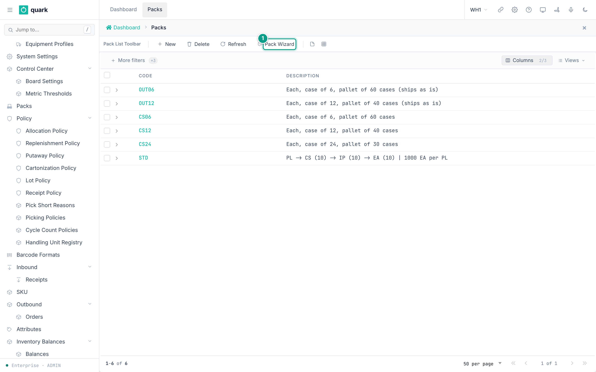

*Caption: the pack list with the button Pack Wizard. Focus: 1 the Pack Wizard button.*

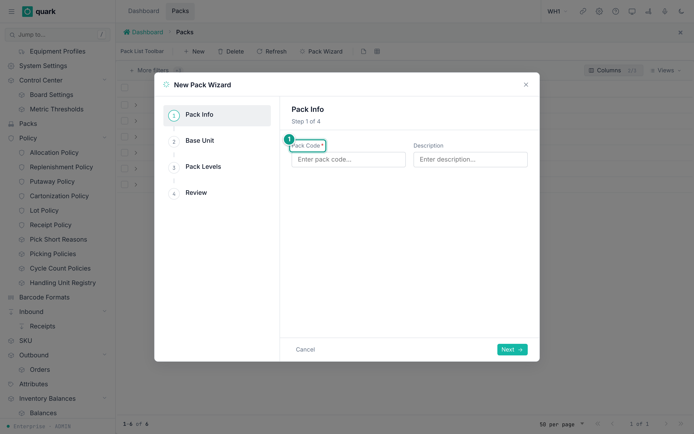

*Caption: the wizard, step Pack Info. Focus: 1 Pack Code.*

### Field reference

Item tab `Basic` (`pack_item_basic_form`):

| Field | Meaning | Allowed values | Example |
|---|---|---|---|
| `UoM` (required) | Unit of the item. | A UOM code. Not repeated in the pack. | `CS` |
| `Qty per Child` | How many child units this unit holds. | Above 0 for any unit that has a child. | 10 |
| `Child UoM` | The next smaller unit. | Another item of the same pack. Empty for the base unit. | `IP` |
| `Qty/BaseUnit` | Base units in one of this unit. Server computes it. Read-only. | Number. | 1000 |
| `Hierarchy Level` | 0 = largest unit. Server computes it. Read-only. | Whole number. | 0 |
| `Cartonize` | May this unit be used in cartonization? | On or off. | on |
| `Replenish` | For replenishment. | On or off. | off |

Other tabs: `Dimensions` (`Length`, `Width`, `Height`, `Weight`, `Cube`), `Pallet` (`Ti (Per Layer)`, `Hi (Layers)`, `Wood Length`, `Wood Width`, `Wood Height`), `Catch Weight` (`Catch Weight`, `Catch Weight UoM`, `Nominal Weight`, `Min Weight`, `Max Weight`, `Dual UoM`, `Secondary UoM`).

The tabs `Converter` and `Breakdown` on the pack card are helpers: `UOM Converter` and `Qty Breakdown` (button `Calculate`).

Rules checked by `wms-pack` (`validate_hierarchy`):

- The chain must have exactly one largest unit and exactly one base unit.
- A unit cannot contain itself.
- A unit can be the child of one parent only.
- No loops. All items must connect in one chain.
- A UOM cannot repeat.
- `Qty per Child` must be a finite number above zero.

### What you should see

- The pack list shows `Code` and `Description`.
- The item list shows `Level`, `UOM`, `Weight`, `Cube`, `Qty/BaseUnit`, `Qty/Child`.

### If something goes wrong

| Message | Meaning | Fix |
|---|---|---|
| `UOM must not be empty` | An item has no unit. | Pick a unit. |
| `UOM '{uom}' occurs more than once` | The same unit appears twice. | Remove one. |
| `UOM '{uom}' references missing child UOM '{child_uom}'` | The child unit is not in the pack. | Add the child item. |
| `UOM '{uom}' cannot contain itself` | Child = same unit. | Pick another child. |
| `child UOM '{child_uom}' is claimed by more than one parent` | Two units name the same child. | Fix the chain. |
| `qty_per_child for UOM '{uom}' must be finite and greater than zero` | Bad quantity. | Enter a number above 0. |
| `pack hierarchy must have exactly one root, found {count}` | More than one largest unit. | Connect all units in one chain. |
| `pack hierarchy must have exactly one leaf, found {count}` | More than one base unit. | Same. |
| `circular reference detected at UOM '{uom}'` | The chain loops. | Fix the children. |
| `pack hierarchy is disconnected: {visited} of {total} items are reachable` | Some items are outside the chain. | Connect or delete them. |
| `pack code '{code}' already exists` | Pack code is used. | Use another code. |
| `pack {pack_id} is referenced and cannot be deleted` | SKUs use the pack. | Change the SKUs first. |

### What this affects later

- Quantities in base units (`Qty/BaseUnit`) drive receiving, allocation and cartonization.
- Allocation rules `EqPackPallet` and `NePackPallet` compare to the pack's pallet quantity.
- The seeded pack `STD`: `PL -> CS (10) -> IP (10) -> EA (10)`, so 1000 `EA` per `PL`.

The database column is `child_pack_item_id` (each item points down to its child) and the screens use `Qty per Child`. The old design note `docs-obsidian/domain/pack-hierarchy.md` still describes `parent_pack_item_id`. That note is out of date.

## 6. Lot policy

### What you will do

Say which lot dates and attributes are shown, required and checked.

### Before you start

- Role: `ADMIN` or `MANAGER` (write). Others read.
- Seeded policies: `STD` ("Standard Lot Policy") and `NOLOT` ("No-tracking policy").

### Steps

1. Open `Sidebar > Warehouse Configuration > Policies > Lot Policy`.
2. Click `New`. Fill `Code` and `Description`.
3. Section `Lot creation`: pick the mode.
4. Section `Date attributes`: for each of the four dates set `Show`, `Required`, `Label`, `Show on pick`, `Verification`.
5. Section `Custom attributes`: click `Add attribute`. Fill the row.
6. Click `Save`.
7. Assign the policy to SKUs on the SKU tab `Policies`.

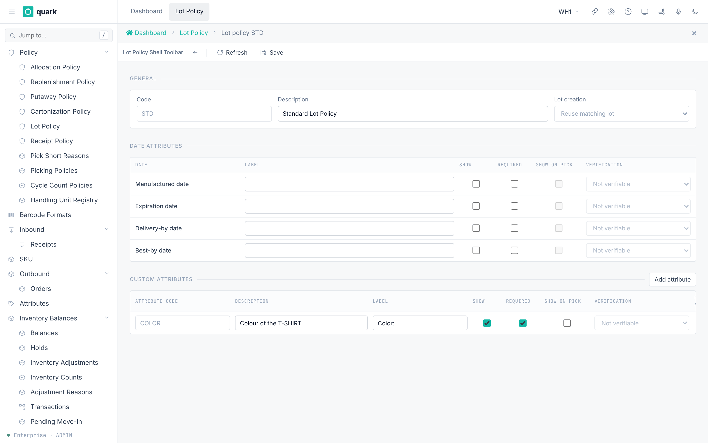

*Caption: the lot policy editor.*

### Field reference

| Field | Meaning | Allowed values | Example |
|---|---|---|---|
| `Code` | Key. | Text. | `PHARMA` |
| `Description` | Free text. | Text. | |
| `Lot creation` | When a lot is created. | `Reuse matching lot` (`Existing`), `One lot per receipt` (`PerReceipt`), `One lot per receive event` (`PerReceiveEvent`). Seed `Existing`. | |
| Dates | `Manufactured date`, `Expiration date`, `Delivery-by date`, `Best-by date`. | Each has `Show`, `Required`, `Label`, `Show on pick`, `Verification`. | |
| `Verification` | How the picker proves the value. | `Not verifiable`, `Visual`, `Barcode`, `Visual or barcode`. | `Barcode` |
| `Attribute code` | Code of a custom lot attribute. | Up to 20 characters. Unique per policy. | `COLOR` |
| `Override allowed` | May a supervisor override a mismatch? | On or off. | off |

Rules from the database:

- `Required` needs `Show` (`lot_policy_attribute_required_is_shown`).
- `Show on pick` needs `Show` (`chk_lot_policy_attribute_pick_needs_receipt`).
- Verification other than `Not verifiable` needs `Show on pick` (`chk_lot_policy_attribute_verified_is_shown`).
- One attribute code once per policy.

Also the receipt line has `Lot Attr Check` with `Disabled`, `Advisory`, `Strict`.

### What you should see

- The message `Lot policy saved`.

### If something goes wrong

| Message | Meaning | Fix |
|---|---|---|
| Check errors above | The flags do not follow the rules. | Turn on `Show` first. |
| `Someone changed this record after you opened it. Look at the current version and make your change again.` | Version conflict. | Refresh and repeat. |
| Delete refused | A SKU or a lot uses the policy. | Change the SKU first. |

### What this affects later

- Receiving asks for the shown and required dates and attributes.
- Picking shows the attributes that have `Show on pick` and checks them as set.

## 7. Serial number tracking

### What you will do

Turn on serial tracking for a SKU and describe the serial format.

### Before you start

- Role: `ADMIN` or `MANAGER` (write).
- The SKU exists.

### Steps

1. Open `Sidebar > Warehouse Configuration > Product Data > SKUs`. Open the SKU.
2. Open the tab `Serial Tracking`.
3. Turn on `Continuous Serial Tracking`. Without it, the SKU is **not** serial-tracked.
4. Set `Allow ASN Pre-advised` and `Allow Receive Capture`.
5. Set `Serial Scope`, `Parse Mode` and the parse fields.
6. Click `Save`.

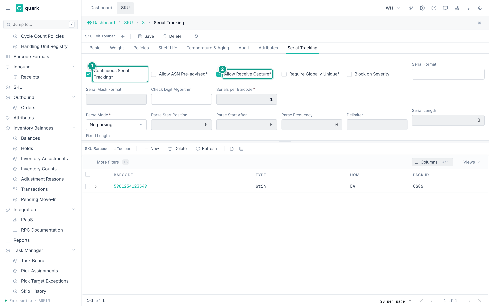

*Caption: the Serial Tracking tab of a SKU. Focus: 1 Continuous Serial Tracking, 2 Allow Receive Capture.*

### Field reference

| Field | Meaning | Allowed values | Example |
|---|---|---|---|
| `Continuous Serial Tracking` (required) | Turns tracking on. Default off. | On or off. | on |
| `Serial Scope` (required) | What one serial identifies. | `PerUnit`, `PerCase`, `PerInnerPack`, `PerPallet`. Default `PerUnit`. | `PerUnit` |
| `Parse Mode` (required) | How a barcode yields serials. | `None`, `Fixed`, `Bounded`. Default `None`. | `None` |
| `Serials per Barcode` (required) | Serials in one barcode. | Whole number. Default 1. | 1 |
| `Serial Length`, `Fixed Length`, `Delimiter` | Barcode layout. | Number or text. | |
| `Parse Start Position`, `Parse Start After`, `Parse Frequency` | Where serials start. | Whole numbers. | |
| `Serial Format`, `Serial Mask Format`, `Check Digit Algorithm` | Format rules. | Text up to 20 or 200 characters. | |
| `Auto-Increment` (required) | Create serials by counting. Default off. | On or off. | off |
| `Increment Source Pos.`, `Increment Length` | Counting layout. | Whole numbers. | |
| `Allow ASN Pre-advised` (required) | Serials may come on the ASN. | On or off. Default off. | on |
| `Allow Receive Capture` (required) | Serials may be scanned at receipt. | On or off. Default off. | on |
| `Allow deferred capture` | Capture later. | On or off. | off |
| `Require Globally Unique` (required) | Serial unique over the whole warehouse. | On or off. Default off. | on |
| `Max Serials per LPN` | Anomaly limit. | Whole number. Default 1000. | 1000 |
| `Velocity Threshold (min)` | Anomaly limit. | Whole number. Default 30. | 30 |
| `Vendor Surge Factor` | Anomaly limit. | Number. Default 3.0. | 3.0 |
| `Block on Severity` | Block on a severe anomaly. | On or off. | off |
| `Warranty Period (days)` | Warranty. | Whole number. | 365 |
| `Industry Profile` | Hint for the profile. | `general`, `pharma`, `electronics`, `food`, `aerospace`. | `general` |
| `Pick Episode Reassignment` (required) | What happens when a picker changes during a serial scan. | `Block`, `Handover`, `CancelAndRestart`. Default `Block`. | `Block` |

Packing a serial-tracked SKU is refused today (`SERIAL_PACKING_NOT_SUPPORTED`, `wms-outbound/src/packing/README.md`).

### What you should see

- Receiving asks for serials. Inventory shows `By Serial` rows.

### If something goes wrong

| Message | Meaning | Fix |
|---|---|---|
| Code 65 `SerialRequired` | A serial is needed on the line. | Scan the serial. |
| Code 66 `SerialFormatInvalid` | The serial does not match the format. | Scan again or fix the format. |
| Code 67 `SerialDuplicate` | The serial exists already. | Check the serial. |
| Code 95 `SerialAsnNotAdvised` | The SKU needs the serial on the ASN first. | Advise serials on the receipt line (tab `Pre-Advised Serials`). |
| Check `chk_sku_serial_pick_episode_reassignment_mode` | A value outside the list. | Use the listed values. |

### What this affects later

- The RF terminals ask for serials at receive, move, pick.
- `SERIAL_PACKING_NOT_SUPPORTED` blocks closing a pack carton for a serial SKU.

- `Industry Profile` enforces nothing. It is a stored hint only. No rule in the code reads it.

## 8. Custom attributes

### What you will do

Define a reusable field, then give one SKU a value for it. This is a two-part setup:

- the **attribute definition** says which records can use the field and what kind of value it accepts;
- the **attribute value** is the answer stored on one SKU or location.

For example, define the text attribute `COLOR` once, then set `COLOR = Blue` on SKU `WIDGET-1`.

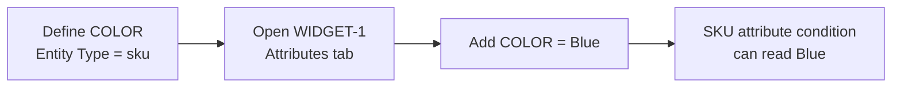

### Before you start

- `ADMIN` or `MANAGER` creates and changes attribute definitions.
- `ADMIN`, `MANAGER` or `OPERATOR` adds and changes values on a SKU or location.
- Create and save the SKU or location before adding a value.
- Use `Entity Type = sku` for this example. The value picker only shows definitions for the record type you opened.

### Steps

1. Open `Sidebar > Warehouse Configuration > Product Data > Attributes`.
2. Click `New`.
3. Set `Entity Type` to `sku`, enter `Code = COLOR`, `Label = Color`, and choose `Data Type = Text`.
4. If the definition is intended for one owner, choose that `Owner`. Leave it blank for a system-wide definition. Click `Save`.
5. Open `Sidebar > Warehouse Configuration > Product Data > SKUs`, open the SKU, and select the `Attributes` tab.
6. Click `New`. In `Attribute`, choose `COLOR`.
7. Enter `Blue` in `Text Value`. The form shows the one value field that matches the definition's data type.
8. Click the `Save` button in the attribute card. The tab returns to the values list; `COLOR` is now a row.

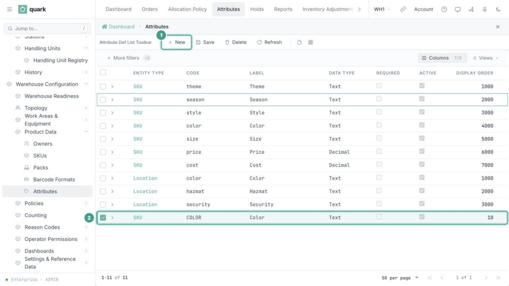

*Capture bookmark: the Attribute Definitions list with `COLOR`, `sku`, `Text`, Required and Active visible.*

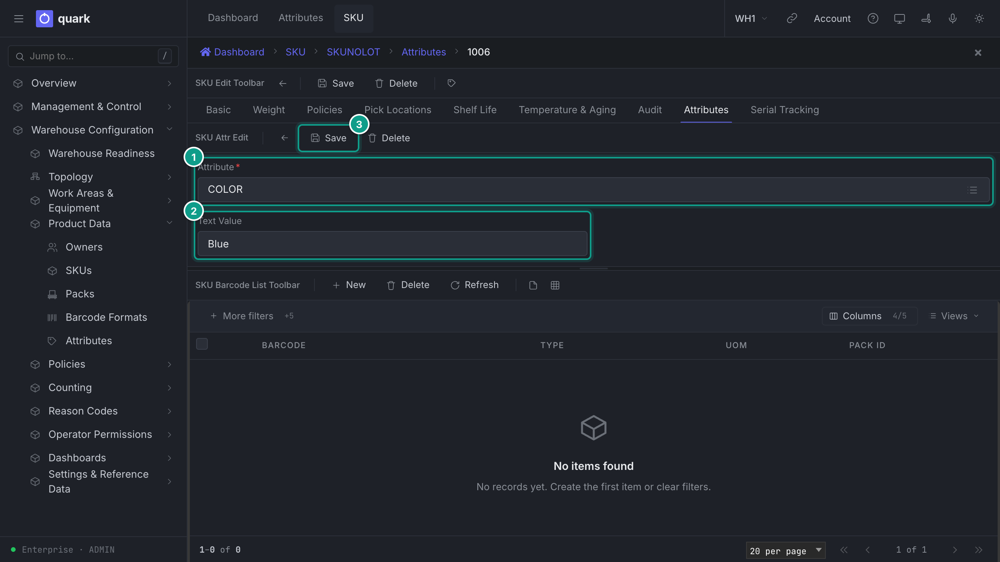

*Capture bookmark: a saved SKU's Attributes tab with `COLOR` selected and `Text Value = Blue`.*

### Field reference

| Field | Meaning | Allowed values | Example |
|---|---|---|---|
| `Entity Type` (required) | Where the attribute appears. | `sku`, `receipt`, `location` (code list `ENTITY_TYPE`). | `sku` |
| `Code` (required) | Key. Unique per entity type and owner. | Text. | `COLOR` |
| `Label` (required) | Shown name. | Text. | `Color` |
| `Data Type` (required) | Type of value. | `Text`, `Integer`, `Decimal`, `Boolean`, `Date`. | `Text` |
| `Owner` | Stored scope for the definition. Blank means system-wide. The current SKU and location value pickers do not enforce this scope, so select the definition carefully. | An owner. | |
| `Display Order` | Order. | Whole number. | 10 |
| `Required` | Stored metadata. The SKU and location value cards do not enforce it today. | On or off. | off |
| `Active` | When off, putaway matching ignores the definition. Current SKU and location lists, pickers and cards may still show it and allow its value to be saved or edited. | On or off. | on |
| `Default Value` | Stored metadata. The SKU and location value cards do not copy it into a new value today. | Text. | |

The value card depends on `Data Type`:

| Data Type | Field shown on the value card | Example |
|---|---|---|
| `Text` | `Text Value` | `Blue` |
| `Integer` | `Integer Value` | `24` |
| `Decimal` | `Decimal Value` | `12.50` |
| `Boolean` | `Boolean Value` | on |
| `Date` | `Date Value` | `2026-10-27` |

The definition list offers `receipt`, but the current web UI has value tabs only for SKUs and locations. Receipt line lot attributes are configured through lot policies; do not use this screen as their setup path.

### What you should see

- The definition appears in `Attribute Definitions`.
- The SKU's `Attributes` tab shows one row for `COLOR` and its text value.
- Open the row to change its value. Use `Delete` on the value card to remove the value from this SKU without deleting the shared definition.

### If something goes wrong

| Message | Meaning | Fix |
|---|---|---|
| Duplicate key `uq_attr_def_owner` or `uq_attr_def_system` | The code is used for that entity type and owner. | Use another code. |
| Duplicate key `uq_attr_value` | That SKU or location already has a value for this definition. | Open the existing row instead of clicking `New`. |
| The definition is missing from `Attribute` | Its entity type does not match this tab. | Check `Entity Type` on the definition. The picker filters SKU and location definitions separately. |
| An inactive or other-owner definition is still listed | The value picker filters only by entity type today; it does not enforce `Active` or `Owner`. | Do not select it. Reopen the definition and check `Active` and `Owner`. |
| All five value fields appear | No definition has been chosen yet. | Choose `Attribute`; the form then keeps only its matching value field visible. |

### What this affects later

- Values are stored per record. Changing `COLOR` on one SKU does not change another SKU.
- Text values from active SKU and location definitions feed putaway conditions (`SKU attribute`, `Location attribute`). Inactive definitions and other data types are stored, but those conditions ignore them today.

## 9. Handling unit types (containers you own)

### What you will do

Define a kind of reusable carrier once, then register the physical totes, carts or boxes that the warehouse can scan. These are separate actions:

- a **type** is shared enterprise configuration;
- **registration** creates individually coded, empty units in one warehouse;
- **binding** happens later in an operating flow, when an operator scans one of those units as a pick carrier or box.

Registration does not reserve a unit, put goods into it or attach it to a picking assignment.

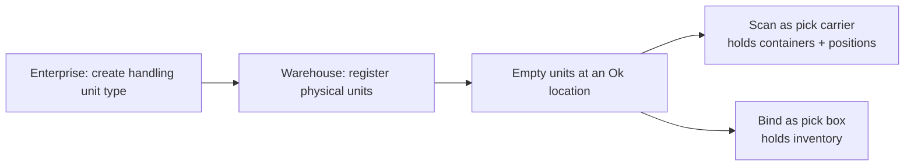

### Before you start

- `ADMIN` or `MANAGER` creates and changes types in Enterprise mode.
- `ADMIN`, `MANAGER` or `SUPERVISOR` registers units in an active warehouse.
- The registration location exists in that warehouse and has status `Ok`.
- For `Owned By = This warehouse`, the warehouse has a default owner configured.
- If you select `Print Labels`, configure the `handling_unit_label`, renderer and printer assignment first. Registration itself does not wait for printing.

No handling unit type is seeded.

### Create the type

1. Switch to Enterprise mode and open `Sidebar > Shared Handling Unit Types`.
2. Click `New`.
3. Enter `Code` and `Name`, then set what the unit can hold. A picking cart normally has `Holds Containers` on and a positive `Positions` value. A reusable pick box normally has `Holds Inventory` on and `Holds Containers` off.
4. Set the physical limits, usage policy and `Code Prefix` when needed.
5. Click `Save`.

| Field (type) | Meaning | Allowed values |
|---|---|---|
| `Code`, `Name` (required) | Identity. | Text. |
| `Holds Inventory`, `Holds Containers` | What it can hold. | On or off. |
| `Positions` | Slots. | Whole number. |
| `Shippable`, `Returnable`, `Inspect on Return` | Flow flags. | On or off. |
| `Default Usage Policy` | Who may use units. Empty = by the asset owner (warehouse: shared; client: own only). | Code list. |
| `Inner Length`, `Inner Width`, `Inner Height`, `Max Gross Weight`, `Tare Weight` | Physical size. | Numbers. |
| `Code Prefix` | Prefix of generated unit codes. Empty uses `HU`. | 1 to 10 uppercase letters or digits. |

Allowed values:

- `Default Usage Policy`: `OwnOnly` or `WarehouseShared`. Empty means warehouse-owned units are shared and client-owned units are for that client only.
- A type must stay `Active` to register new units or bind its existing units during picking.

### Register physical units

1. Switch to the warehouse that will hold the units and open `Sidebar > Management & Control > Handling Units > Handling Unit Registry`.
2. Tick exactly one type and click `Register`. The button opens the modal even with no selection, but confirmation then says `Tick exactly one handling unit type`.
3. In `Register Handling Units`, enter `Count` from 1 to 500 and an existing `Location` whose status is `Ok`.
4. Choose `Owned By`:
   - `This warehouse`: leave `Client` empty;
   - `Client`: choose the owning client.
5. Turn on `Print Labels` only when the printer path is ready.
6. Click `Register`.
7. Open the type row. The lower `Handling Units` list shows each generated code, `Empty` status, location and asset owner.

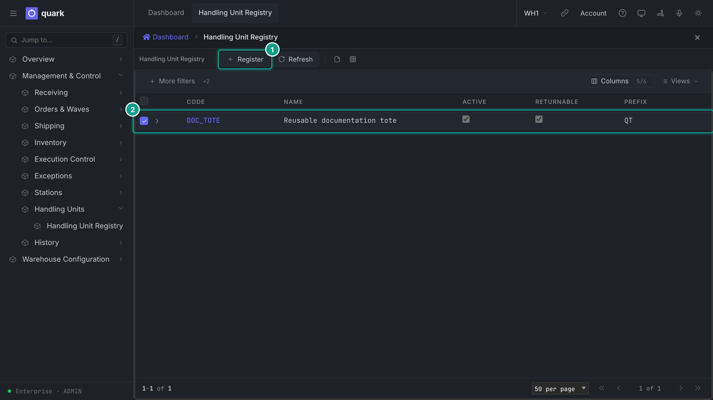

*Handling Unit Registry before registration. Focus: tick exactly one type before opening `Register`.*

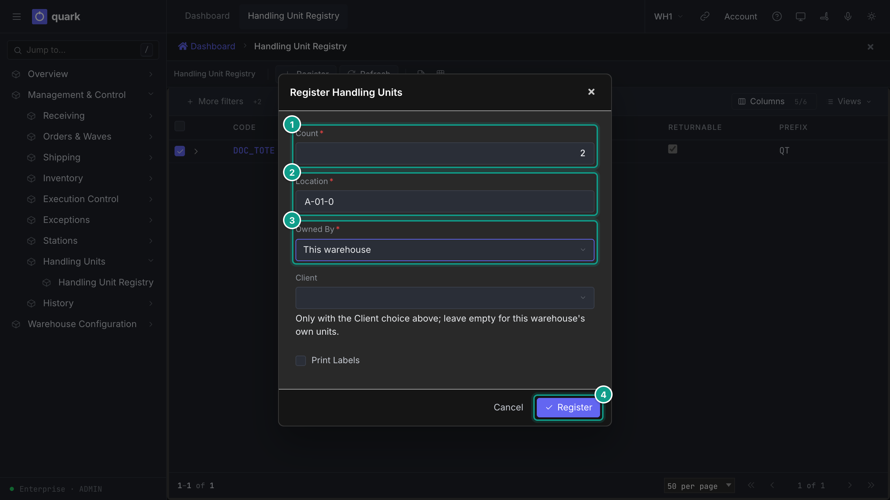

*Batch registration of physical units. Focus: count, usable location, asset owner and optional label printing.*

Each code is the type's prefix followed by a seven-digit generated number, for example `TOTE0000042`. New units have status `Empty`, origin `Manual` and the location entered in the modal.

When `Print Labels` is on, one detached post-commit run tries `handling_unit_label` for each new code in order and stops at the first printer, configuration, render or send failure. The units stay registered. Replaying the registration does not print again; check the registry, fix printing and use the site's controlled reprint process for the failed and skipped labels instead of registering the batch again.

### Registration is not binding

| Action | What changes | What does not change |
|---|---|---|
| Create a type | Enterprise configuration becomes available to warehouses. | No physical unit exists. |
| Register units | Individually coded `Empty` units are created at the chosen location. | They are not assigned to work and hold no stock. |
| Scan a carrier for a pick assignment | An eligible empty unit is selected as the carrier. | Registration and asset ownership do not change. |
| Bind a box to a pick position | An eligible empty unit is attached to that position and can receive picked goods. | Its type and asset owner do not change. |

### If something goes wrong

| Message or symptom | Meaning | Fix |
|---|---|---|
| `Tick exactly one handling unit type` | No type, or more than one type, was selected. | Close the modal, tick one row and repeat. |
| `the handling-unit type is out of service` | `Active` is off. | Reactivate the type after review, or choose another type. |
| `count {n} is outside 1..=500` | The batch is empty or too large. | Register 1 to 500 units at a time. |
| `location {code} not found or does not accept handling units (status is not Ok)` | The location is missing or unavailable. | Use an existing location with status `Ok`. |
| `the warehouse has no default owner; specify the handling unit owner explicitly` | Warehouse-owned registration cannot determine the goods owner stored on the container. | Configure the warehouse default owner, or register client-owned units. |
| `customer handling unit: specify the owning customer` | `Client` ownership was chosen without a client. | Choose the client. |
| `a warehouse handling unit has no owning customer: remove the customer or choose the Customer ownership` | A client was sent with `This warehouse`. | Clear `Client` or choose client ownership. |
| Units appear but labels do not | Registration committed; asynchronous printing could not resolve, render or reach a printer. | Do not register again. Fix the label/printer path and print under the site's controlled process. |

### What this affects later

- A pick carrier must be an empty, unheld registered unit whose active type has `Holds Containers` on and a positive `Positions` value.
- A reusable pick box must be empty and unheld; its active type must have `Holds Inventory` on and `Holds Containers` off. Its effective usage policy must permit the goods owner.
- Dissolving a pick assignment can release its empty boxes, and the shared-pick release command can return an empty shared tote. Neither action registers a new instance.

See also [Picking overview](policies/20-picking-overview.md), [Picking policy settings](policies/21-picking-policy-settings.md), [Printing and Labels](07-printing-and-labels.md) and [Handling unit types reference](../reference/administration/18-handling-unit-types.md).
