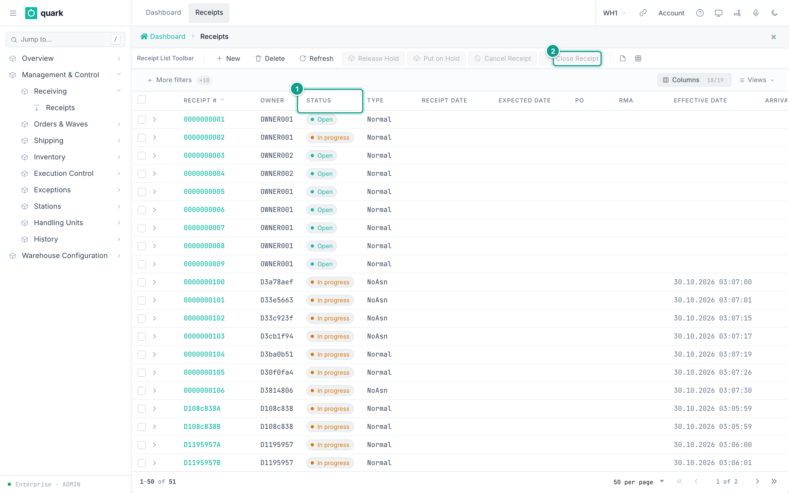
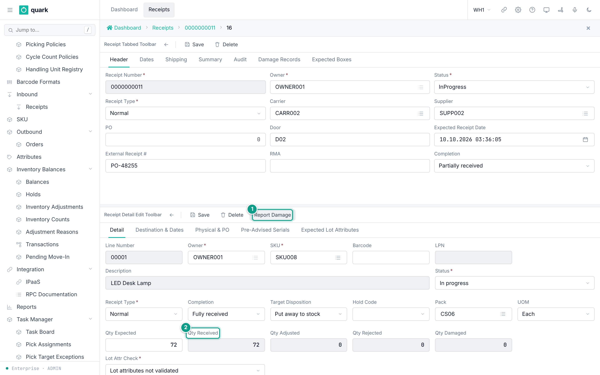
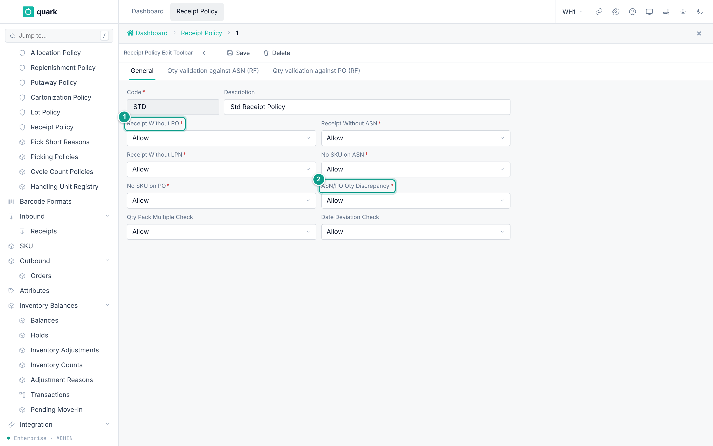
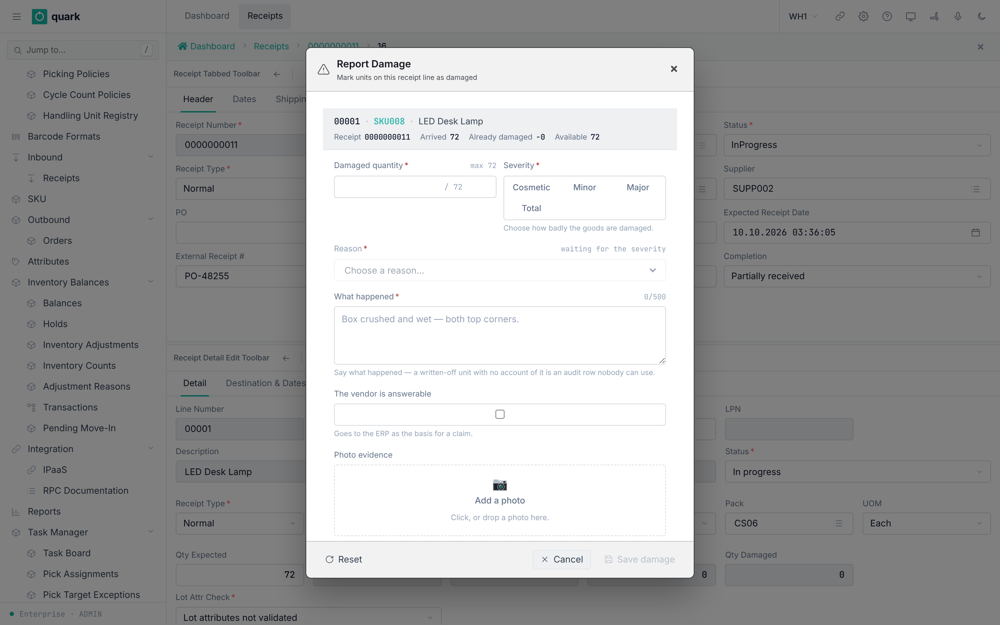
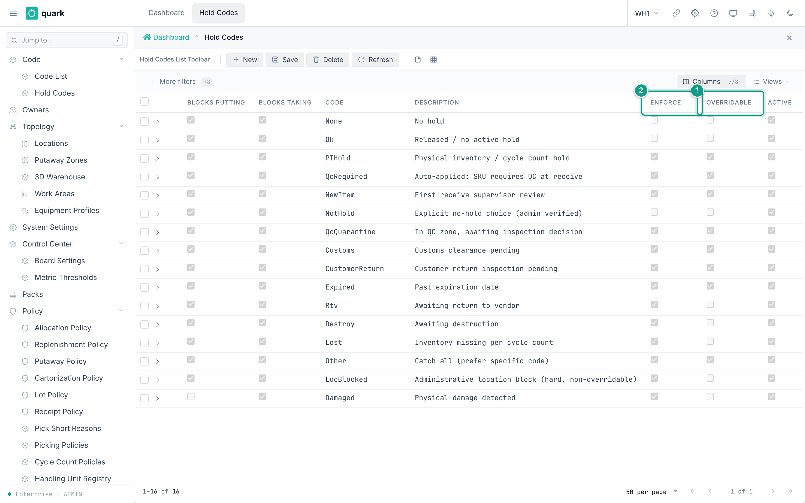
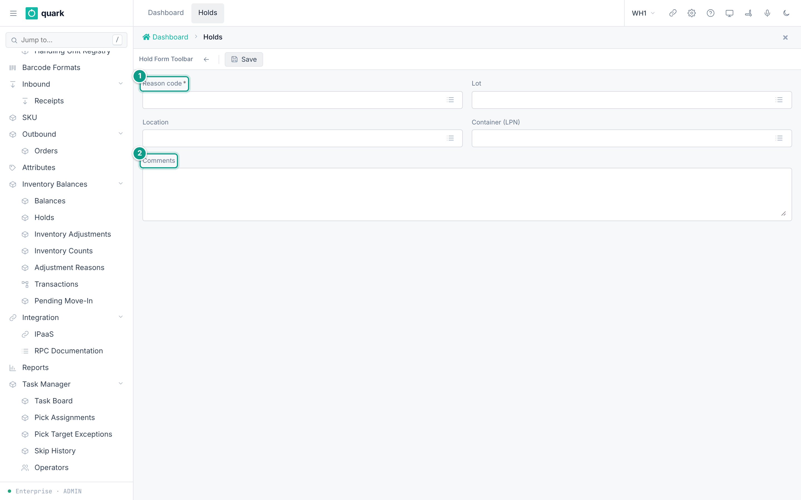
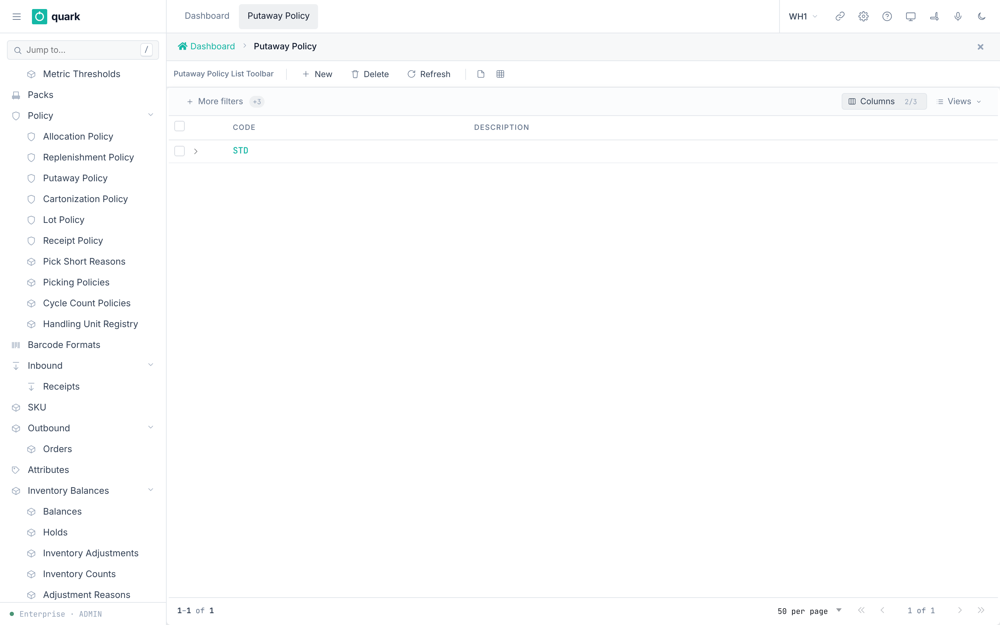
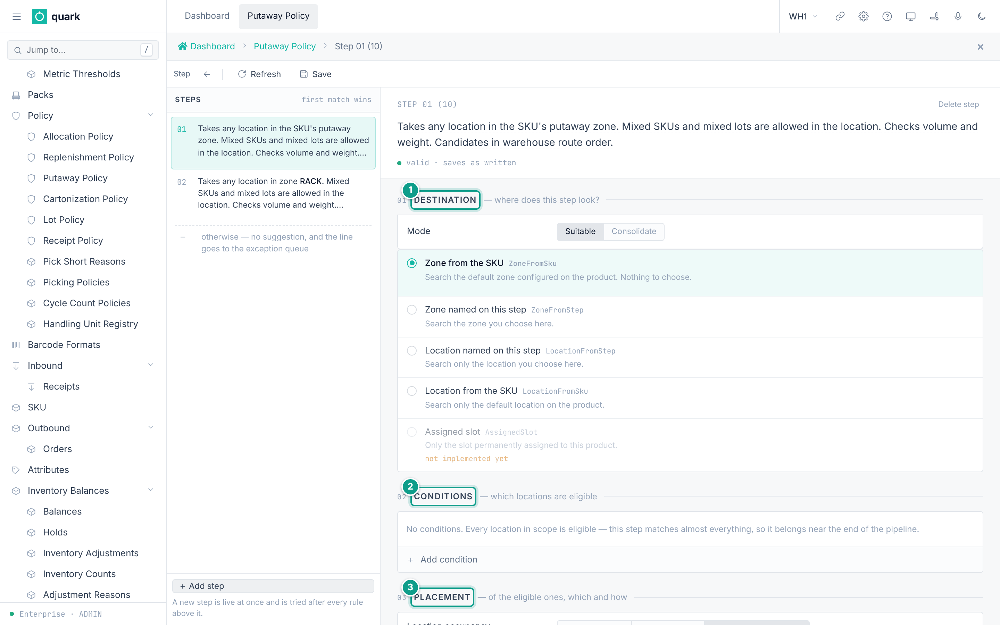

# Inbound Setup

Inbound covers receipts (ASN and other receiving documents), quantity tolerances, damage handling, holds and putaway.

## 1. Receipts

### What you will do

Create a receiving document with lines, so the floor can receive against it.

The product uses one document type for all receiving: the **receipt**.
An advance ship notice (ASN) is a receipt that has expected lines.
There is no separate ASN screen in the menu.

### Before you start

- Role: `ADMIN`, `MANAGER`, `SUPERVISOR` or `OPERATOR` (receiving API methods are granted to all four).
- The owner, the SKUs and the supplier exist.
- The owner's `WH Settings` are filled (`04-owners-sku-uom-pack-hierarchy.md`, section 2).

### Steps

1. Open `Sidebar > Management & Control > Receiving > Receipts`.
2. Click `New`.
3. Tab `Header`: fill `Receipt Number`, `Owner`, `Receipt Type`, `Supplier`, `Carrier`, `Expected Receipt Date` and the other fields you know.
4. Tab `Dates` and tab `Shipping`: fill what you know.
5. Click `Save`.
6. In the list `Receipt Lines`, click `New`. Fill `SKU`, `UOM`, `Qty Expected` and `Pack`. Click `Save`.
7. Optional: on the line, open the tab `Expected Lot Attributes`, `Pre-Advised Serials` or `Destination & Dates`.
8. To receive on the web: select a line and click `Receive`. The window `Receive line` opens. Use `Receive` or `Receive & next`.

*Caption: the receipt list with the buttons New, Delete, Refresh, Release Hold, Put on Hold, Cancel Receipt and Close Receipt. Focus: 1 The Status column, showing Open and In progress receipts. 2 The Close Receipt button, which works on the selected receipt.*

*Caption: the Header tab of a receipt. Focus: 1 Completion shows Partially received while Status shows InProgress. 2 The Damage Records tab. The lines are in the list below.*

*Caption: the card of a receipt line, tab Detail. Focus: 1 the Report Damage button, 2 Qty Received.*

### Field reference

Tab `Header` (`receipt_header_form`):

| Field | Meaning | Allowed values | Example |
|---|---|---|---|
| `Receipt Number` (required) | Document number. Unique (`receipt_receipt_number_key`). | Text. | `ASN-1001` |
| `Owner` (required) | Owner of the goods. | An owner. | `OWNER001` |
| `Status` | State. | `Open`, `InProgress`, `OnHold`, `Closed`, `Cancelled`. Default `Open`. | `Open` |
| `Receipt Type` | Kind of receipt. | `Normal`, `CustomerReturn`, `InterFacilityTransfer`, `Sscc`, `CaseLevel`. Default `Normal`. | `Normal` |
| `Carrier` | Carrier. | An owner of type carrier. | |
| `Supplier` | Supplier. | An owner of type supplier. | `SUPP001` |
| `PO` | Purchase order id. | Whole number. | |
| `Door` | Dock door text. | Text. | `D1` |
| `Expected Receipt Date` | Planned arrival. | Date and time. | |
| `External Receipt #` | Id in the ERP. | Text. | |
| `RMA` | Return authorization. | Text. | |
| `Completion` | Read-only result. | `Pending`, `Partial`, `Full`, `Over`. | `Pending` |

Tab `Shipping`: `Vehicle Plate`, `Vehicle Date`, `Driver Name`, `Trailer Plate`, `Trailer Type`, `Temperature`, `Total Weight`, `Total Volume`.
Tab `Dates`: `Receipt Date`, `Effective Date`, `Close Date`, `Arrival Date`, `Actual Ship Date`, `Scheduled Ship Date`, `Promised Ship Date`, `Planned Ship Date`.
Tab `Summary` (read-only): `Completion`, `Version`, `Close Summary`, `Cancel Summary`.
Other tabs: `Audit`, `Damage Records`, `Expected Boxes` (buttons `Move Boxes`, `Cancel Box`).

Receipt line, tab `Detail` (`receipt_detail_fields_form`):

| Field | Meaning | Allowed values | Example |
|---|---|---|---|
| `SKU` (required) | Item. | A SKU of the owner. | `WIDGET-1` |
| `Owner` (required) | Owner. | An owner. | |
| `Receipt Type` (required) | Type of the line. | As the header. | |
| `UOM` | Unit of the line. | A UOM. | `EA` |
| `Qty Expected` | Planned quantity. | Number. | 100 |
| `Pack` | Pack of the line. | A pack. | `STD` |
| `Lot Attr Check` (required, read-only) | How lot attributes are checked. | `Disabled`, `Advisory`, `Strict`. | `Disabled` |
| `Qty Received`, `Qty Adjusted`, `Qty Rejected`, `Qty Damaged` | Counters. Read-only. | Numbers. | |
| `Completion`, `Target Disposition` | Read-only. `Target Disposition`: `Stock`, `CrossDock`, `Hold`. | | `Stock` |

Line, tab `Destination & Dates`: `Manufactured Date`, `Delivery By Date`, `Best By Date`, `To Lot`, `To Location`, `To LPN`, `Expiration Date`.
Line, tab `Physical & PO`: `Temperature`, `PO`, `PO Detail`, `QC Required`, `QC Status`.

Buttons on the receipt list and their windows:

| Button | Window | Fields |
|---|---|---|
| `Put on Hold` | `Put Receipt on Hold` | `Hold reason` (required; list of **active, enforcing hold codes**), `Comments`. Holding a receipt also holds every line that is not closed or cancelled. |
| `Release Hold` | none | Releases the hold. |
| `Cancel Receipt` | `Cancel Receipt` | `Reason` (required). Cancelling is final and cascades to every line not already closed. |
| `Close Receipt` | `Close Receipt` | Closing is final. A shortage or excess goes into the close summary. If a discrepancy needs a supervisor, `Supervisor username` and `Supervisor password` appear. |
| `Adjust Qty` (line) | `Adjust Received Qty` | `Correct Qty` (required), `Reason` (required), `Comment`. |

Receiving codes you will meet (`ReceiptValidationReturnCode`):

| Code | Name | Meaning |
|---|---|---|
| 22 | ReceiptWithoutAsnDoc | Receiving with no ASN is not allowed by the policy. |
| 24 | NoSkuOnAsn | The SKU is not on the ASN. |
| 25 | ReceiptWithoutLpn | An LPN is required. |
| 27 / 29 | QtyExcess / PoQtyExcess | More than expected (ASN / PO). |
| 28 | QtyShortage | Less than expected at close. |
| 30 | QtyNotPackMultiple | Quantity is not a multiple of the pack. |
| 35 to 37 | LotAttributeMissing / Mismatch / FormatInvalid | Lot attribute problem. |
| 45 to 49 | Date codes | Expiration too soon or passed, manufactured too old, delivery-by passed, best-by passed, expiration missing. |
| 50 / 51 | TemperatureOutOfRange / TemperatureRequired | Temperature rules. |
| 55 to 60 | Container codes | Mixing, hierarchy or SSCC problems. |
| 70 | InvalidStateForOperation | The receipt state does not allow the action. |
| 71 | CannotCloseWithExceptions | Close needs a supervisor override. |
| 72 | CannotCancelWithInventory | Cancel is refused because stock was received. |
| 73 | CannotCloseWithOpenSerialEpisode | An open serial capture blocks close. |
| 76 | DestinationLocationHeld | The destination location has an enforcing hold. |
| 77 | CannotCloseWithPendingDamage | A damage record has no disposition yet. |

### What you should see

- The receipt in the list with status `Open`.
- After receiving, `Qty Received` grows and `Completion` changes to `Partial`, `Full` or `Over`.

### If something goes wrong

| Message | Meaning | Fix |
|---|---|---|
| Duplicate key `receipt_receipt_number_key` | The number exists. | Use another number. |
| Code 71 | Close needs a supervisor. | Enter supervisor credentials in the window. The supervisor needs the right `receipt.override_close_discrepancy`. |
| Code 72 | Stock was already received. | Adjust or close instead of cancelling. |
| Code 77 | Damage has no disposition. | Decide the disposition (section 3). |
| `cannot {to} an order in status {from}` style messages | The action does not fit the status. | Check the `Status`. |

### What this affects later

- Received stock creates balances and a putaway need.
- Closing seals the receipt and sends events to subscribers.

- A manual line with no `Pack` takes the SKU's pack, the way lines made by receiving or by ASN load do. A `Pack` you choose is checked and kept. Lines made by receiving or by ASN load take the pack from the SKU.

## 2. Receipt policy (tolerances)

### What you will do

Set how strict receiving is about missing documents, quantity, pack multiples and dates.

### Before you start

- Role: `ADMIN` or `MANAGER` (write).
- Seeded policy: `STD` ("Std Receipt Policy"). It allows everything and checks no quantity.

### Steps

1. Open `Sidebar > Warehouse Configuration > Policies > Receipt Policy`.
2. Click `New`. Open the tab `General`. Fill the fields.
3. Open the tab `Qty validation against ASN (RF)`. Set limits.
4. Open the tab `Qty validation against PO (RF)`. Set limits.
5. Click `Save`.
6. Assign the policy to SKUs (SKU tab `Policies`, field `Receipt Policy`).

*Caption: the General tab of a receipt policy. Focus: 1 Receipt Without PO, 2 ASN/PO Qty Discrepancy.*

### Field reference

Tab `General`:

| Field | Meaning | Allowed values | Example |
|---|---|---|---|
| `Code` (required) | Key. | Text. | `STRICT` |
| `Description` | Free text. | Text. | |
| `Receipt Without PO` (required) | What to do when no PO. | `Allow`, `HardError`, `Warning`. | `Warning` |
| `Receipt Without ASN` (required) | When no ASN. | Same. | `HardError` |
| `Receipt Without LPN` (required) | When no LPN. | Same. | `Allow` |
| `No SKU on ASN` (required) | SKU missing on the ASN. | Same. | `HardError` |
| `No SKU on PO` (required) | SKU missing on the PO. | Same. | `Allow` |
| `ASN/PO Qty Discrepancy` (required) | ASN and PO quantities differ. | Same. | `Warning` |
| `Qty Pack Multiple Check` | Quantity not a pack multiple. | Same. | `Allow` |
| `Date Deviation Check` | Dates out of the SKU rules. | Same. | `Allow` |

Values: `Allow` = accept. `Warning` = warn, the operator can go on. `HardError` = refuse.

Tabs `Qty validation against ASN (RF)` (form title `ASN Qty Validation`) and `Qty validation against PO (RF)` (form title `PO Qty Validation`). The PO tab uses the same fields with the prefix `po_`:

| Field | Meaning | Allowed values | Example |
|---|---|---|---|
| `Execute Qty validation` | Level of the check. | `None`, `Sku`, `Lot` (code list `RECQTYVAL`). Seed `None`. | `Sku` |
| `Excess Message` | Show a message on excess. | On or off. | on |
| `Excess Override` | Excess above the limit needs an override. | On or off. | on |
| `Excess Override %` | The limit for the soft check. | Whole number. | 5 |
| `Excess Error` | Excess above the limit is refused. | On or off. | on |
| `Excess Error %` | The limit for the hard check. | Whole number. | 10 |
| `Shortage Message` | Show a message on shortage. | On or off. | on |
| `Shortage Override` | Shortage needs an override. | On or off. | on |
| `Shortage Override %` | The limit. | Whole number. | 5 |

How the excess check works (`ExcessLimits` in `wms-inbound`):

- Percent = (received + new − expected) × 100 ÷ expected.
- If percent is above `Excess Error %` and `Excess Error` is on: **refused**.
- Else if percent is above `Excess Override %` and `Excess Override` is on: **needs an override**.
- Else: accepted.
- If nothing was expected: any receive is excess. It is refused when `Excess Error` is on, otherwise it needs an override.

### What you should see

- The policy in the list with columns `Code`, `Description`, `Without PO`, `Without ASN`.

### If something goes wrong

| Message | Meaning | Fix |
|---|---|---|
| Code 27 / 29 with an override request | Excess is above the soft limit. | A supervisor with `receipt.override_qty_excess` approves. |
| Code 27 / 29 as a refusal | Excess is above the hard limit. | Receive less, or raise the limit. |
| Code 28 | Shortage at close. | A supervisor with `receipt.override_qty_shortage` approves. |
| Delete refused | SKUs use the policy. | Change the SKUs first. |

### What this affects later

- Receiving on RF and web reads the policy of the SKU.
- The system setting `ALLOW_CLOSE_WITH_DISCREPANCY` (seed `1`) lets a supervisor close a receipt that is `Partial` or `Over`.
- The tab titles say `(RF)`, but the quantity checks are not RF only. The web `Receive` window and RF call the same method (`receipt_receive_against_asn`), so the same checks run. When the server asks about an excess or a shortage, the web window shows the question and, for a supervisor, the approval.

## 3. Damage handling and dispositions

### What you will do

Set what happens to damaged goods found at receiving, and know how a damage case is closed.

### Before you start

- Role: `ADMIN` or `MANAGER`.
- Locations of type `QC` and `Damage` exist (seeded: `QC`, `DAMAGE`).

### Steps

1. Open the owner (`Sidebar > Warehouse Configuration > Product Data > Owners`). Open `WH Settings > Receiving`.
2. Set `Damage Action: Minor`, `Damage Action: Major`, `Damage Action: Total`.
3. Set reasons: open `Sidebar > Warehouse Configuration > Settings & Reference Data > Code List` and edit the lists `damage_reason`, `damage_severity` and `damage_action` if you need other words.
4. The operator reports damage on a line: `Report Damage`.
5. Close each damage case with a disposition (API or RF; see below).

*Caption: the Report Damage window on a receipt line.*

### Field reference

Window `Report Damage` (`report_damage_cmp`):

| Field | Meaning | Allowed values | Example |
|---|---|---|---|
| `Damaged quantity` (required) | Damaged units. | Number up to the available quantity. | 3 |
| `Severity` (required) | Level. | `Cosmetic`, `Minor`, `Major`, `Total`. | `Major` |
| `Reason` (required) | Cause. List depends on the severity. | Values of `damage_reason`, for example `Crushed`, `Wet`, `Torn`, `TempBreach`, `TransitDamage`, `BrokenSeal`, `Theft`. | `Wet` |
| `Send the damaged units to` | Where damaged units go. Filled from the severity; you can change it. | `Major` fills the `QC` location. `Total` fills the `Damage` location. `Cosmetic` and `Minor` hide the field. | `QC` |
| `The vendor is answerable` | Sent to the ERP as the basis for a claim. | On or off. | on |
| `What happened` (required) | Free text. | Text. | |

Owner actions (code list `damage_action`): `None` (no action), `Hold` (place inventory hold), `Reject` (reject damaged units). Seed: Minor `None`, Major `Hold`, Total `Reject`.

Dispositions of a damage record (`receipt_detail_damage.disposition`; empty = still pending):

| Disposition | Set by | Effect |
|---|---|---|
| `Repurpose` | `receipt_set_damage_disposition` (stateful, per damage record) | Marker only. |
| `Destroyed` | `receipt_set_damage_disposition` | Marker only. |
| `WrittenOff` | `receipt_write_off_damage` | Writes the stock off. |
| `RTV` | `receipt_move_damage_to_rtv` | Moves the stock to a return-to-vendor location. |

The tab `Damage Records` (columns `ID`, `Line`, `Qty`, `Reason`, `Description`, `Reported At`, `Reported By`, `Severity`) is read-only.

There is no web button and no RF screen for the dispositions. Nothing in the web metadata or in the RF client calls them. They are JSON-RPC methods only. Use the API (see `09-integrations-and-api.md`).

### What you should see

- A new row in `Damage Records`.
- `Qty Damaged` on the line goes up.

### If something goes wrong

| Message | Meaning | Fix |
|---|---|---|
| Code 77 on close | A damage record has no disposition. | Set the disposition through the API or RF. |
| Destination refused: a hold forbids it | A location hold blocks the move. | Release the hold, or use the supervisor override. |

### What this affects later

- Held stock cannot be allocated (see section 4).
- Written-off and RTV stock leaves available stock.
- A damage photo can be attached from the window if the device allows it.

## 4. Hold reasons and holds

### What you will do

Define the hold reasons your warehouse uses and place a hold.

### Before you start

- Role for reasons: `ADMIN` or `MANAGER` (write). Role to place holds: `ADMIN`, `MANAGER`.

### Steps: edit hold reasons

1. Open `Sidebar > Warehouse Configuration > Reason Codes > Hold Codes`.
2. Click `New`. Fill the fields. Click `Save`.

### Steps: place a hold

1. Open `Sidebar > Management & Control > Inventory > Holds`.
2. Click `New Hold`.
3. Pick a `Reason code`. Fill exactly one of `Lot`, `Location`, `Container (LPN)`.
4. Fill `Comments`. Click `Save`.

*Caption: the hold code list. Focus: 1 Overridable, 2 Enforce.*

*Caption: the New Hold form. Focus: 1 Reason code, 2 Comments.*

### Field reference

Hold code (`hold_code_normal_form`):

| Field | Meaning | Allowed values | Example |
|---|---|---|---|
| `Code` (required) | Key. | Text up to 30 characters. | `QcQuarantine` |
| `Description` | Free text. | Text up to 100 characters. | |
| `Rank` (required) | Sort and priority number. | Whole number. | 20 |
| `Enforce` | The hold really blocks. Default on. | On or off. | on |
| `Overridable` | A supervisor can override. Default off. | On or off. | off |
| `Active` | In use. Default on. | On or off. | on |
| `Blocks putting` | Forbids putting stock in a place under this hold (receive, target of a move). Default on. | On or off. | on |
| `Blocks taking` | Forbids taking stock from a place under this hold (available stock, allocation, source of a move). Default on. | On or off. | on |

New hold (`hold_form`): `Reason code` (required), `Lot`, `Location`, `Container (LPN)` ("Fill exactly ONE of Lot / Location / Container"), `Comments`.

Seeded hold codes: `None`, `Ok`, `PIHold`, `QcRequired`, `NewItem`, `NotHold`, `QcQuarantine`, `Customs`, `CustomerReturn`, `Expired`, `Damaged`, `Rtv`, `Destroy`, `Lost`, `Other`, `LocBlocked`.
`LocBlocked` is "Administrative location block (hard, non-overridable)". `PIHold` can be acknowledged.

The receipt hold window lists only codes with `Active` on and `Enforce` on.

### What you should see

- The hold in the list `Holds` with `Scope`, `Target`, `Qty`, `Started`, `Auto-release`, `Reason`, `By`.
- A location under a hold shows `Status` = `Hold`.

### If something goes wrong

| Message | Meaning | Fix |
|---|---|---|
| Code 76 `DestinationLocationHeld` | An enforcing hold is on the destination. | Release the hold, or use the supervisor override when the code is overridable. |
| Foreign key `fk_inventory_hold_code` | The reason code does not exist. | Add the hold code first. |
| Delete refused | Holds or SKUs refer to the code (`fk_sku_receipt_hold_code`, `fk_sku_lot_hold_code`). | Change them first. |

### What this affects later

- Setting `MOVE_HOLD_POLICY` (seed `warn`) decides whether a move asks for an acknowledgement (`warn`) or goes on (`silent`).
- Allocation skips held stock when the hold has `Blocks taking` on.

## 5. Putaway policy

### What you will do

Tell the system where to put received pallets.

A putaway policy is a list of **steps**. The system tries the steps from the top.
The first step that finds a suitable location wins. If no step finds one, there is no suggestion and the line goes to the exception queue.

### Before you start

- Role: `ADMIN`, `MANAGER` or `SUPERVISOR` (write steps). `OPERATOR` and `VIEWER` read.
- Zones and locations exist (`03-warehouse-structure.md`).
- **The seeded policy `STD` has no steps.** An empty policy suggests nothing. You must add steps.

### Steps

1. Open `Sidebar > Warehouse Configuration > Policies > Putaway Policy`.
2. Click `New`. Fill `Code` and `Description`. Click `Save`.
3. Open the policy. The step editor opens.
4. Click `Add step`. A new step is live at once and is tried after every rule above it.
5. For the step, set the band **Destination**: `Mode` and the search scope.
6. Set the band **Conditions**: click `Add condition`. Pick a property, `is` or `is not`, and values.
7. Set the band **Placement**: occupancy, fit checks, temperature, guard, ordering.
8. Drag steps to change the order. Put narrow rules first and wide rules last.
9. Click `Save`.
10. Use `Dry run`: enter an LPN and click `Evaluate` to see what the saved policy would do.
11. Link the policy: SKU tab `Policies` (`Putaway Policy`) or the owner default (`Putaway Policy`).

*Caption: the putaway policy list. Focus: Open the row to edit the steps.*

*Caption: the step editor with the three bands. Focus: 1 Destination, 2 Conditions, 3 Placement.*

### Field reference

Policy header (`putaway_policy_normal_form`): `Code` (required), `Description`.

Step fields, from the step editor:

| Field | Meaning | Allowed values | Example |
|---|---|---|---|
| `Mode` | Kind of search. | `Suitable` (any location with room), `Consolidate` (a location that already holds this item). | `Suitable` |
| Scope | Where to look. | `Zone from the SKU`, `Zone named on this step`, `Location named on this step`, `Location from the SKU`, `Assigned slot`. | `Zone named on this step` |
| `Zone` / `Location` | Anchor for the scope. | An existing zone or location. | `RACK` |
| Condition properties | Narrow the locations. | `Location type`, `Location status`, `Location category`, `Processing type`, `Location flag`, `Location ABC`, `Mixed SKU`, `Mixed lot`, `SKU ABC`, `SKU group`, `SKU class`, `Putaway class`, `Rotation`, `Lot attribute`, `SKU attribute`, `Location attribute`. At most 16. | `Location type is Pick` |
| `Location occupancy` | What the location may hold. | `Any occupancy`, `Must be empty`, `Allow mixing, with rules`. | `Any occupancy` |
| `Mixed SKU`, `Mixed lot` | Mixing rules. | `Allowed` / `Not allowed` / `Any`. | |
| `Fit checks` | Refuse a location that cannot take the load. | `Cube`, `Weight`, `Quantity`, `Stacking limit`, `Pallet dimensions`. | |
| `Temperature` | The zone range must cover the SKU range. | On or off. | on |
| `Guard` | Hard limit on how far stock travels. | `No guard`, `Stay in the source zone`, `Stay in the source location`. | `No guard` |
| `Ordering` | Which eligible location is offered first. | `Pick route` (walking order), `Nearest to the assigned slot`. | `Pick route` |

Destination types a putaway may land in: `Case`, `Pick`, `SpeedPick`, `Pnd`, `Sort`, `Other`. Other location types are never offered.

Policy choice for a pallet: first `Putaway Policy` of the SKU, otherwise the owner's `Putaway Policy`.
If the SKUs on one pallet point to different policies, putaway refuses the pallet.

Rules the step editor checks before `Save`:

- A scope that names a zone or location needs that anchor.
- A guard of "source zone" or "source location" needs that anchor.
- `One lot per location` cannot be used while several SKUs may mix: `one lot never spans several SKUs — with mixed SKUs allowed, lots cannot be kept apart`.
- `Must be empty` cannot be combined with mixing rules.
- `Consolidate` cannot be combined with `Must be empty`: `Consolidate places onto a location that already holds this SKU, so it can never be an empty one.`
- A step that can never run (because an earlier step takes every candidate) shows `never runs`. The editor shows `closed by step N (S)`, where N is the position in the pipeline and S is the stored step number.
- A step with no conditions matches almost everything: `No conditions. Every location in scope is eligible — this step matches almost everything, so it belongs near the end of the pipeline.`

### What you should see

- The message `The steps are saved.`
- The dry run shows a candidate location, the rule that won and an outcome.

### If something goes wrong

| Message | Meaning | Fix |
|---|---|---|
| `cannot save — {0}` | The step breaks a rule above. | Read the reason and fix the step. |
| `Someone changed this record after you opened it. Look at the current version and make your change again.` | Another user saved first. | Refresh and repeat. |
| `no putaway policy on the SKU or the owner default` | Neither the SKU nor the owner names a policy. | Set one. |
| `LPN spans SKUs with different putaway policies: ...` | A mixed pallet has conflicting policies. | Split the pallet or align the policies. |
| Dry run: `What is on LPN ... resolves to policy X, not policy Y ...` | The pallet uses another policy. | Use an LPN whose SKUs use this policy. |
| `A policy with an empty pipeline suggests nothing.` | No steps. | Add steps. |

### What this affects later

- The suggested location is reserved for `PUTAWAY_RESERVATION_TTL_MIN` minutes (seed 15) or the owner's own `Putaway Reservation TTL (min)`.
- A deviation from the suggestion needs an acknowledgement. If `COUNT_ON_PUTAWAY_DEVIATION` is `1`, the destination location is counted.
- Without a working policy, received stock waits and no location is suggested.

The editor texts come from the English translation rows `putaway_step.*` in the web metadata. The server errors come from `crates/libs/wms-inventory/src/putaway/policy.rs`.

## 6. Minimal inbound setup

1. One `QC`, one `Damage` and one `Stage` location (seeded).
2. One zone with storage locations.
3. A putaway policy with at least one step, linked to the owner default.
4. One receipt policy (seeded `STD`).
5. Hold code set (seeded).
6. One owner with `WH Settings` filled.
