# Outbound Setup

Outbound covers shipment orders, allocation, release, picking, cartonization, packing, dispatch planning, loading, Goods Issue and replenishment. The packing action `Repack` is available on the RF terminal (see section 8).

## 1. Order flow in one picture

```text
New -> Allocated (Allocate) -> Released (Release) -> Picked -> Goods Issue -> Closed
 \________ Cancel (only before anything is picked) _______/
```

A Load can ship only part of an order. While demand remains, the order or line can show `PartiallyShipped`; a shipped line can show `Shipped`. A complete-order Goods Issue closes the order after it ships all remaining demand.

Statuses of an order: `New`, `PartiallyAllocated`, `Allocated`, `PartiallyReleased`, `Released`, `PartiallyPicked`, `Picked`, `PartiallyShipped`, `Shipped`, `Closed`, `Cancelled`.
Statuses of a line: `NotAllocated`, `PartiallyAllocated`, `Allocated`, `PartiallyReleased`, `Released`, `PartiallyPicked`, `Picked`, `PartiallyShipped`, `Shipped`, `Closed`, `Cancelled`.
The order status is calculated from the lines. You do not set it by hand.

## 2. Shipment orders

### What you will do

Create an order, allocate stock, and release it to the floor.

### Before you start

- Role to create and edit: `ADMIN` or `MANAGER`.
- Role to release, cancel and cancel quantity: `ADMIN`, `MANAGER`, `SUPERVISOR` (the release band).
- Role for `Allocate` and `Ship order`: `ADMIN`, `MANAGER`, `SUPERVISOR` or `OPERATOR`.
- The owner, the ship-to partner and the SKUs exist, and stock is on hand.
- The order type `SO` ("Standard Outbound") is seeded. **No screen or API creates order types.**
- An allocation policy is published (section 3).

### Steps

1. Open `Sidebar > Management & Control > Orders & Waves > Orders`.
2. Click `New`.
3. Tab `Header`: fill `Type`, `Owner`, `Priority`, `Requested Ship`, `Notes`. `Order #` and `Status` are read-only.
4. Tab `Ship To`: fill `Ship To` (required) and `Carrier`.
5. Click `Save`.
6. In the list `Order Lines`, click `New`. Fill `SKU`, `UOM`, `Ordered` and `Pick Instruction`. Click `Save`.
7. Click `Allocate` on the order card. The system reserves stock using the allocation policy.
8. Check the tabs `Picks`, `Cartons` and `Cartonization exceptions`.
9. Click `Release`. Tasks are created for the floor.
10. To undo a reservation before picking: `Unallocate`.
11. To stop the order: `Cancel`.
12. After picking and any required packing, use one Goods Issue path: `Ship order` for one fully picked order, or a Load for a planned multi-order departure (section 10).

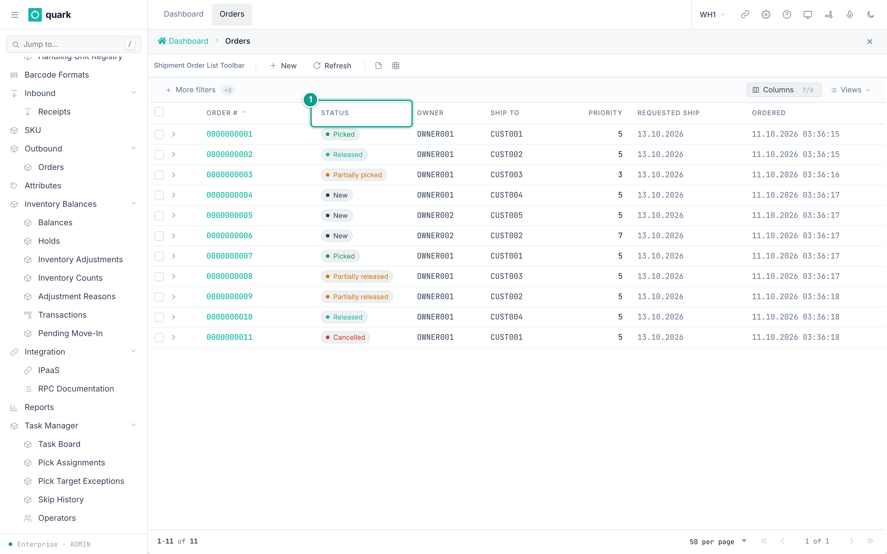

*Caption: the order list with the buttons New and Refresh. Focus: 1 The Status column: New, Released, Partially picked, Picked and Cancelled orders are in the list.*

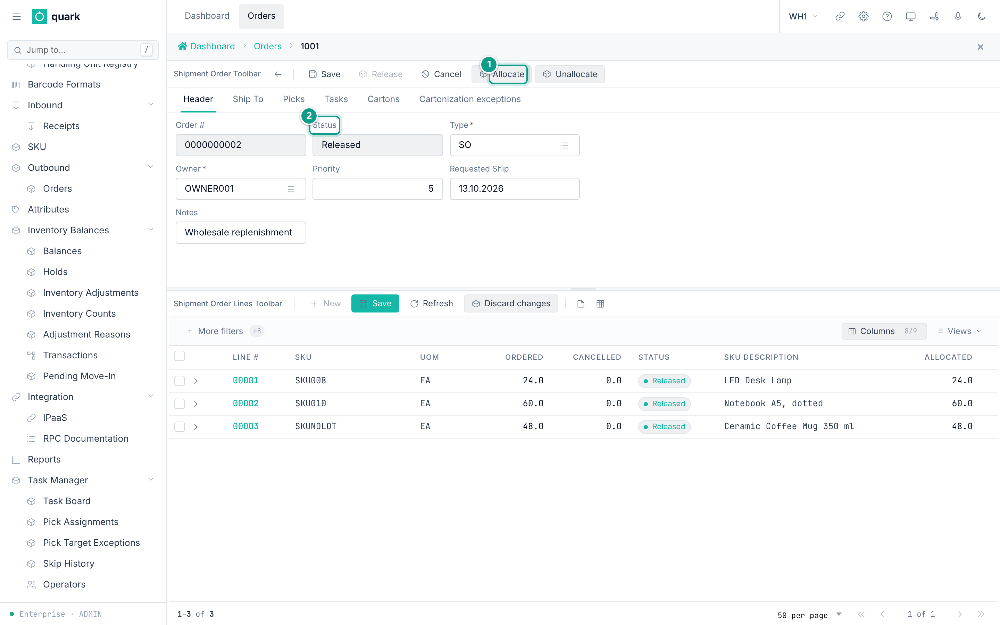

*Caption: the Header tab of an order, with the buttons Cancel, Release, Save, Allocate, Unallocate. Focus: The Status field shows Released. The toolbar shows which actions are possible. The teal numbers mark: 1 Allocate, 2 Status.*


*Caption: the order lines with the buttons New, Refresh, Save, Discard changes. Focus: The lower panel: line 00001, SKU001, ordered 1.0, allocated quantity, allocated quantity and status Released. The picture is the same as above; the teal numbers mark the Allocate button and the Status field.*

### Field reference

Tab `Header`:

| Field | Meaning | Allowed values | Example |
|---|---|---|---|
| `Order #` | Number. Read-only. | Text. | `SO-0001` |
| `Status` | Read-only. | See section 1. | `New` |
| `Type` (required) | Order type. | An order type, seeded `SO`. | `SO` |
| `Owner` (required) | Owner of the goods. | An owner. | `OWNER001` |
| `Priority` | Priority. | Whole number. Default 50. | 50 |
| `Requested Ship` | Requested ship date. | Date. | |
| `Notes` | Free text. | Text. | |

Tab `Ship To`: `Ship To` (required), `Carrier`, `Cancel Reason`.

Order line: `Line #` (read-only), `SKU` (required), `UOM` (required), `Ordered` (required), `Cancelled` (read-only), `Status` (read-only), `Pick Instruction`.
The list also shows `SKU Description` and `Allocated`.

Button `Cancel Qty` (window `Cancel Quantity`): `Quantity to cancel` (required; "The amount to REMOVE from the line, in base units - not the new total.") and `Reason` (required; "A reduced line without a reason is unauditable.").

Order-type table: seeded `SO` = `Standard Outbound`.

### What you should see

- After `Allocate`: line status `Allocated` or `PartiallyAllocated`, a plan of cartons, and picks.
- After `Release`: tasks in `Management & Control > Execution Control > Task Board`, status `Released` (or `PartiallyReleased` if some stock is short).
- After Goods Issue: the `Shipments — base quantities` tab records immutable shipped quantities. A fully shipped order is closed; an order split across Loads can show `PartiallyShipped` until its remaining demand ships.

### If something goes wrong

| Message | Meaning | Fix |
|---|---|---|
| `cannot {to} an order in status {from}` | The action does not fit the status. | Check the status. |
| `the order has no lines` | You tried to release an empty order. | Add lines. |
| `every line is fully cancelled or shipped - nothing left to ship` | Nothing open on the order. | Cancel the order instead. |
| `quantity must be greater than zero` | A line quantity is 0 or less. | Enter a positive number. |
| `cannot cancel {requested} - only {open} is still open` | You cancel more than is open. | Lower the number. |
| `cannot reduce qty_ordered to {requested} - {committed} is already committed` | Part is reserved or picked. | Unallocate first. |
| `line {line_no} already has {qty_picked} picked` | Cancel is refused after picking began. | Finish the order. |
| `{count} line(s) are still open` | Close needs every line done. | Finish or cancel the lines. |
| `order is locked by another operation (waited {ms}ms)` | A second user works on it. | Retry. |
| `allocation still has {qty} units deferred by inventory lock contention` | Stock was busy. | Allocate again. |
| `version conflict on {entity} {entity_id}` | Someone saved before you. | Refresh and repeat. |
| `Forbidden("...")` | Your role lacks the right. | Ask for the right in the matrix. |
| `this order is closed: nothing is left to ship` | The order is already closed, whether by shipment or by completing or cancelling all demand. | Do not press `Ship order` again. Check `Shipments — base quantities` when a shipment exists; otherwise review the order's close and cancellation history. |
| `only an open released order may ship` | The order is not in a shippable lifecycle state. | Refresh it and finish release, picking and packing first. |
| `this order belongs to an active Load; confirm its shipment through that Load` | The order is already committed to a Load. | Do not use `Ship order`; finish the Load in section 10. |

### What this affects later

- Allocation reserves stock and creates picks.
- Release creates tasks and, with cartonization, a carton plan.
- Goods Issue deducts picked stock, updates serials and counters, records shipment history, and publishes the departure as one command.
- The statuses drive the task board and the reports.

The shipment order list has no `Close` button. A complete-order Goods Issue closes the order automatically when no demand remains. The separate API method `shipment_order_close` remains an administrative lifecycle command for `ADMIN` and `MANAGER` after every line is terminal.

## 3. Allocation policy

### What you will do

Define the rules that decide which stock is reserved for an order line.

An allocation policy is a list of **steps**. The system tries them in order and reserves from the first step that has stock.
A policy has a life cycle: `Draft` -> `Published` -> `Retired`. A published policy cannot be edited. Duplicate it to change it.

### Before you start

- Role: `ADMIN`, `MANAGER` or `SUPERVISOR` (write steps).
- Seeded policy `STD`: version 1, published, one step (`Firm`, `EA`, sort `LotRotation`).
- Locations, zones and units exist.

### Steps

1. Open `Sidebar > Warehouse Configuration > Policies > Allocation Policy`.
2. To change a published policy, select it and click `Duplicate`. A new draft opens.
3. To make a new one, click `New`. Fill `Code` and `Description`. Click `Save`.
4. Open the policy. Click `Add step`.
5. Fill the four bands: **Source**, **Conditions**, **Selection**, **Output**.
6. Drag steps to change the order.
7. Click `Save`.
8. Click `Validate`. Read every blocker.
9. Click `Publish`.
10. To stop using a policy: `Deactivate` (retire). A retired policy cannot be edited either.
11. Link the policy: SKU tab `Policies` (`Allocation Policy`) and the owner default.

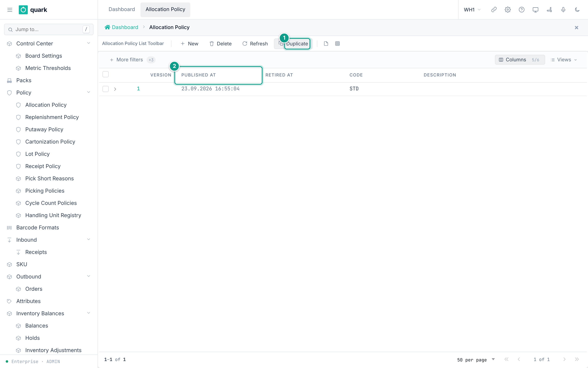

*Caption: the policy list with the buttons New, Delete, Refresh, Duplicate. Focus: The Version and Published At columns. The teal numbers mark: 1 Duplicate, 2 Published At.*

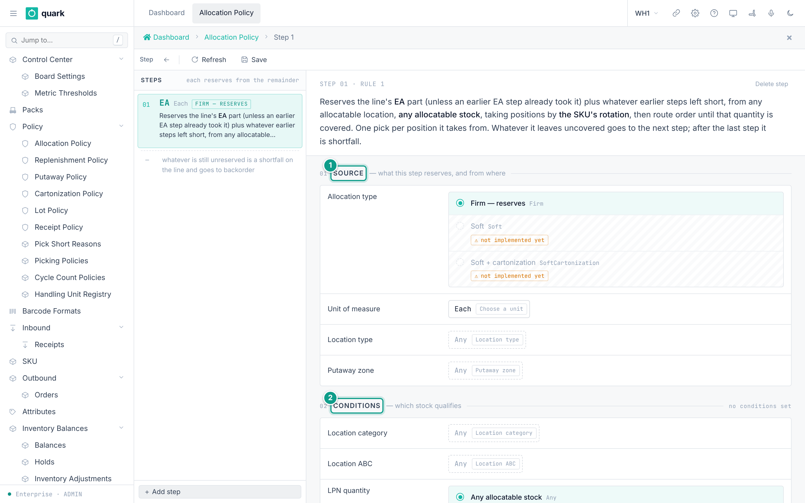

*Caption: the step editor with four bands. Focus: The step list is on the left; the rules of the selected step are on the right. Allocation types marked "not implemented yet" cannot be chosen. The teal numbers mark: 1 Source, 2 Conditions.*

### Field reference

Policy header: `Code` (required), `Description` (required), `Version`, `Published at`, `Retired at` (all read-only).

Step bands:

| Band | Field | Meaning | Allowed values |
|---|---|---|---|
| Source | `Allocation type` | Commitment kind. | `Firm` only. `Soft` and `SoftCartonization` exist in the list but are **refused** by the validator. |
| Source | `Unit of measure` | Unit to reserve in. | A UOM code, default `EA`. |
| Source | `Location type` | Limit to a location type. | A location type, or any. Hold zones (`QC`, `Damage`, `Rtv`, `Destroy`, `Returns`, `Stage`, `Lost`) are refused. |
| Source | `Putaway zone` | Limit to a zone. | A zone, or any. |
| Conditions | `Location category` | Limit to a category. | A category, or any. |
| Conditions | `Location ABC` | Limit to a class. | `A`, `B`, `C`, or any. |
| Conditions | `LPN quantity` | Whole pallets or not. | `Any`, `EqPackPallet` (only whole pallets), `NePackPallet` (anything but a whole pallet). |
| Selection | `Sort ranks` (1 to 4) | Order to take stock. | `LotRotation`, `Location`, `LpnQuantity`. `Lpn`, `LpnRotationInLoc`, `LocationAbc` are **refused**. |
| Selection | `Quantity fit` | How to fit the quantity. | `LowToHigh`, `ExactFit`, `BiggerFit`, `BestFit`, `HighToLow`. Needs `LpnQuantity` in a sort rank. |
| Output | `One pick per UOM / location` | Merge picks. | On: "merged into one task line per location". Off: "a task line per LPN". |

Validation blockers (`validate_policy`):

| Code | Meaning |
|---|---|
| `UNSUPPORTED_HEADER_FLAG` | `strict_lot_rotation`, `allow_overallocation` or `speed_pick_by_uom` is on. This build cannot run them. |
| `NO_ACTIVE_STEPS` | The policy must have at least one active step. |
| `EMPTY_UOM` | A step has no unit. |
| `UNSUPPORTED_STEP` | A step uses a value this build cannot run (see the table). |
| `SHADOWED_STEP` | A step can never run, because an earlier step takes its candidates first. |

Also: `step names qty_fit_rule={...} but no sort_1..sort_4 names LpnQuantity`.

### What you should see

- The list shows `Version`, `Published at`, `Retired at`.
- After `Publish`, the policy is executable and cannot be edited.
- The step editor warns `never reserves`, `never runs` or `closed by step N`.
- A shortfall: "whatever is still unreserved is a shortfall on the line and goes to backorder".

### If something goes wrong

| Message | Meaning | Fix |
|---|---|---|
| `allocation policy '{code}' is published and immutable; clone it to create a new draft` | You edit a published policy. | Click `Duplicate`. |
| `allocation policy '{code}' is retired and immutable; clone it to create a new draft` | Same for retired. | Duplicate. |
| `allocation policy '{code}' is not a draft` | Publish needs a draft. | Duplicate first. |
| `allocation policy '{code}' is not currently published` | Deactivate needs a published policy. | Check the status. |
| `step uses {axis}={value}, which this build cannot execute` | An unsupported value. | Change the value. |
| Delete refused | An order line or pick uses the policy. | Retire it instead. |

### What this affects later

- Every order line freezes the policy at allocation. Old orders keep their policy.
- Wrong steps cause unreserved stock (backorder).

## 4. Waves and wave policy

### What you will do

Group unreleased orders, review the complete composition and release the group through the ordinary order-release pipeline.

### Before you start

- Role: `ADMIN`, `MANAGER` or `SUPERVISOR`.
- Orders are not released, cancelled or claimed by another wave.
- To assign a station, configure a `Sort` location with station positions first.

### Steps

1. Open `Sidebar > Management & Control > Orders & Waves > Waves`.
2. Click `New Wave`, enter `Wave code`, and click `Create`.
3. Open the wave and click `Composition and progress`.
4. Click `Add Order`, choose `Unreleased Order`, optionally enter `Membership sequence` and `Member priority`, then click `Review` and `Confirm Draft edit`.
5. Repeat for the orders in this wave. Use `Remove Order` to correct the draft.
6. Optional: click `Station`, select the `Sort` station, then review and confirm the draft edit.
7. Review the complete member list, then click `Release` and `Confirm Wave action`.
8. If some members were blocked or failed, correct their order data and click `Retry blocked`.
9. Use `Cancel Wave` only while the wave is still unstarted (`Draft` or `Planned`).

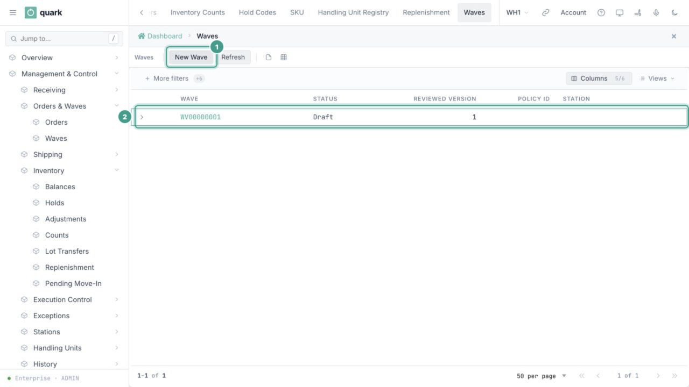

*Wave list with status, order counts and release progress. Focus: choose the wave whose composition or release result needs review.*

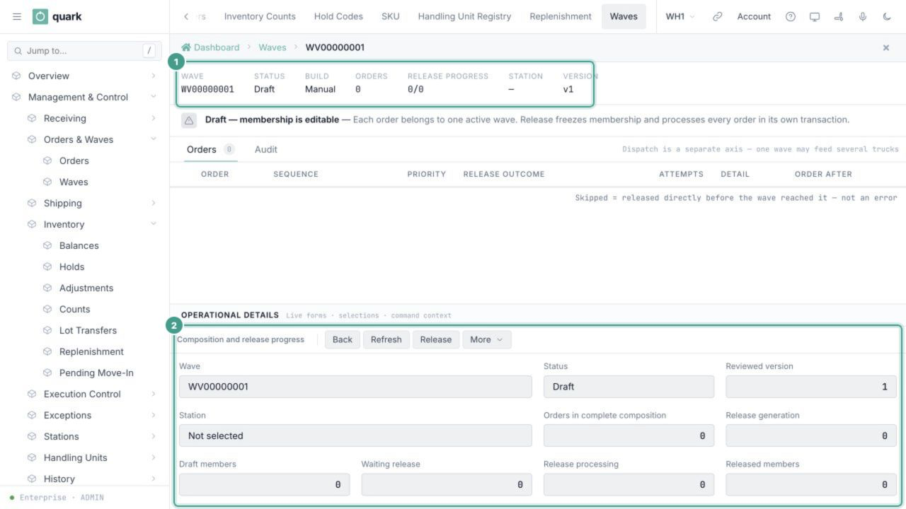

*Wave card with composition, progress and controlled actions. Focus: review every member outcome before retrying or cancelling.*

### Field reference

The wave card shows `Status`, `Release generation`, station, member counts and the release result of every order. Wave statuses are `Draft`, `Planned`, `Released`, `InProgress`, `Completed`, `Cancelled`. There is no `Releasing` wave status. After you confirm `Release`, the wave is `Planned` while its order rows move through the release queue. When no order is `Pending` or `Processing`, the wave becomes `Released`; picking can later move it to `InProgress` and `Completed`.

Each order in the wave has its own status:

| Order status | Meaning | Operator response |
|---|---|---|
| `Draft` | The saved order belongs to a draft wave. | Finish reviewing the complete composition before release. |
| `Pending` | The ordinary order-release step is queued. | Wait; do not release the order separately. |
| `Processing` | The order-release step is running. | Wait for its saved result. This is the current equivalent of a “running” member. |
| `Released` | The ordinary order-release step succeeded. | Continue with picking. |
| `Blocked` | A saved business or release-processing blocker needs attention. This includes automatic allocation failing after the order itself was released. | Read the saved detail and current order status, correct the cause, then use `Retry blocked` when a retry is still needed. |
| `Failed` | The release attempt ended with an operational failure. | Read the saved detail, confirm the cause is resolved, then use `Retry blocked`. |
| `Skipped` | The order was already released, so the wave did not repeat release. | Review the order's current work; no retry is required. |

The current web screen enables `Retry blocked` only when the wave is `Released`; after you click it, the review proceeds only when at least one member is `Blocked` or `Failed`. The API also accepts the retry while the wave is `InProgress` or `Completed`, but the web button does not expose those two states yet. `Cancel Wave` is limited to `Draft` or `Planned` before any member reaches `Processing`, `Released` or `Skipped`; the confirmation does not ask for a reason.

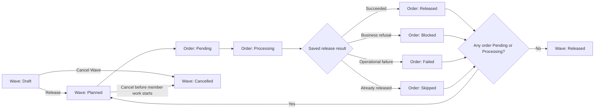

The diagram stops when the release generation settles. Picking status uses separate, complete work evidence: a non-station wave becomes `InProgress` when pick or task work exists, while a station wave waits until its first shared tote reaches the station. `Completed` requires all known work to be finished, no broken work links and every station position to be free. A `Blocked` member can be terminal only when it has explicitly zero work; a `Failed` member never proves completion.

Wave policy has no web editor. The API methods `wave_policy_create`, `wave_policy_preview` and `wave_policy_build` create waves by rule. Its fields include:

| Field | Meaning | Allowed values |
|---|---|---|
| `code` | Key. | Text up to 30 characters. |
| `eligible_statuses` | Order statuses taken into waves. | Default `New`, `PartiallyAllocated`, `Allocated`. |
| `priority_from`, `priority_to` | Priority range. | Numbers. |
| `requested_ship_days_ahead`, `include_undated` | Ship date window. | Number, true or false. |
| `owner_id`, `carrier_id` | Limit to an owner or carrier. | Ids. |
| `group_by_owner`, `group_by_carrier`, `group_by_requested_ship_date` | Group rules. | true or false. |
| `max_orders` | Orders per wave. | Default 100. |
| `max_lines` | Lines per wave. | Number or empty. |
| `max_waves_per_run` | Waves per run. | Default 10. |
| `schedule_interval_minutes`, `schedule_starts_at` | Recurring run. | Number, time. |
| `auto_release` | Release waves automatically. | Default false (keeps Draft waves). |

### What you should see

- A draft wave lists its complete intended order composition.
- Release records a per-order outcome. It creates ordinary picking work; it does not confirm picking, move stock, load transport or ship goods.
- A policy-built wave records the policy and run that created it.

### If something goes wrong

| Message | Meaning | Fix |
|---|---|---|
| `a wave policy with this code already exists` | Duplicate code. | Use another code. |
| `version conflict on wave policy {policy_id}` | Someone saved first. | Re-read and repeat. |
| `wave membership changed while the command was acquiring locks; retry with the current version` | A race. | Retry. |
| A wave action says the observed state changed | Another user changed the wave. | Cancel the dialog, click `Refresh`, review the new composition and decide again. |

### What this affects later

- Release of a wave releases one order per transaction and preserves each order's result.

No wave policy exists at the start. No migration or dev seed inserts into `wave_policy`.

## 5. Picking policy

### What you will do

Define how pickers confirm and drop picks.

A picking policy has revisions. Each code has revisions with a status: `Draft` -> `Published` -> `Retired`.
The seeded policy is `DISCRETE` (revision 1, published): "One order, one root container: today's picking".

### Before you start

- Role: `ADMIN`, `MANAGER` (write). `SUPERVISOR`, `OPERATOR`, `VIEWER` read.

### Steps

1. Open `Sidebar > Warehouse Configuration > Policies > Picking Policies`.
2. Click `New Draft`. Fill `Code` and `Description`. Click `Create Draft`. The server copies the latest revision of the code, or `DISCRETE` for a new code.
3. Open the draft. Change the sections.
4. Click `Save`.
5. Click `Publish`.
6. To stop a revision: `Retire`.
7. Assign the policy to a work area (`Warehouse Configuration > Work Areas & Equipment > Work Areas`, button `Assign Policy`) or per equipment kind.

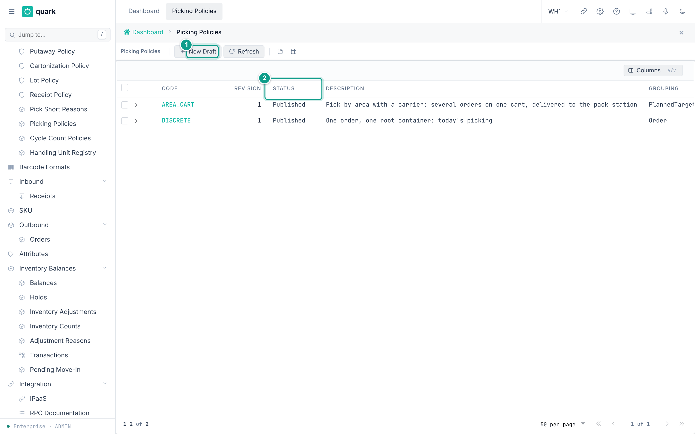

*Caption: the policy list with the button New Draft. Focus: Status (Published), Grouping and Deposit. The teal numbers mark: 1 New Draft, 2 Status.*

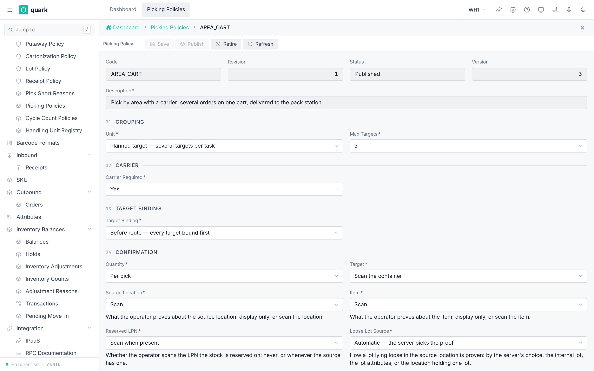

*Caption: the policy card with the buttons Save, Publish, Retire, Refresh. Focus: The numbered blocks are Grouping, Carrier, Target binding and Confirmation. The Retire button is in the toolbar.*

### Field reference

| Field | Meaning | Allowed values (seed `DISCRETE`) |
|---|---|---|
| `Description` (required) | Free text. | Text. |
| `Unit` (`grouping_unit`) | What is grouped in one task. | `Order` (one order per task), `PlannedTarget` (several targets per task). Seed `Order`. |
| `Max Targets` | Targets per pass. | 1 to 99. Seed 1. |
| `Carrier Required` | A cart must be used. | Yes or no. Seed no. |
| `Target Binding` | When a target container is bound. | `Unbound`, `BeforeRoute`. Seed `Unbound`. |
| `Quantity` | Quantity confirmation. | `PerPick`, `Aggregated`. Seed `PerPick`. |
| `Target` | Target confirmation. | `ScanContainer`, `PositionNumber`. Seed `ScanContainer`. |
| `Deposit Mode` | Where goods go. | `CollectToRoot`, `DirectToTarget`. Seed `CollectToRoot`. |
| `Completion` | When a pick is complete. | `Complete`, `ConfirmAtLocation`. Seed `Complete`. |
| `Pallet Drop Suggestion` | Source of the suggested drop cell. | `OwnerThenTask`: the owner's picking drop location, else the order's task destination. |
| `Pallet Drop Cell Types` | Types allowed for the drop cell. | At least one of `Door`, `Pickto`, `Sort`, `Stage`, `Pack`. Seed `Pickto`, `Sort`, `Stage`, `Door`. |
| `Count an Emptied Location` | Ask for a count when a pick empties a location. | Yes or no. Seed no. |
| `Source Location` | Proof at the source. | `DisplayOnly`, `Scan`. Seed `Scan`. |
| `Item` | Proof of the item. | `DisplayOnly`, `Scan`. Seed `Scan`. |
| `Reserved LPN` | Proof of the LPN. | `DoNotConfirm`, `ScanWhenPresent`. Seed `ScanWhenPresent`. |
| `Loose Lot Source` | Proof of a lot in a loose location. | `NoConfirmation`, `Automatic`, `ScanInternalLot`, `ConfirmLotAttributes`, `ExclusiveLocation`. Seed `Automatic`. |
| `Lot Attribute Capture` | How lot attributes are entered. | `ScanOnly`, `ScanOrManual`. Seed `ScanOrManual`. |

Rules (`PickingPolicyRefusal`):

| Message | Meaning |
|---|---|
| `Targets per pass must be between 1 and 99, got {value}` | `Max Targets` is out of range. |
| `With grouping by order the section '{field}' cannot be changed: the grouping itself defines it` | Order grouping fixes some sections. |
| `Grouping by planned target requires a carrier container` | Turn on `Carrier Required`. |
| `With grouping by planned target the target is bound before the route` | Set `Target Binding` to `BeforeRoute`. |
| `With grouping by planned target goods are put straight into the target` | Set `Deposit Mode` to `DirectToTarget`. |
| `With grouping by planned target the target is confirmed by scanning the container` | Set `Target` to `ScanContainer`. `PositionNumber` is not built. |
| `A closed pallet must be allowed into at least one location type` | The drop list is empty. |
| `A closed pallet cannot be put into a location of type {loc_type}` | The type is not one of the five. |
| `Location type {loc_type} is listed twice` | Duplicate in the list. |

### What you should see

- The list shows `Code`, `Revision`, `Status`, `Description`, `Grouping`, `Deposit`.

### If something goes wrong

| Message | Meaning | Fix |
|---|---|---|
| A refusal from the table above | A rule is broken. | Fix the field. |
| Save refused on a published revision | Published revisions are fixed. | Create a new draft. |

### What this affects later

- The RF picking flow follows the policy of the work area (and equipment).
- An area with no policy works by the default `DISCRETE`.

## 6. Pick short reasons

### What you will do

Define what happens when a picker cannot find the full quantity.

### Before you start

- Role: `ADMIN`, `MANAGER`, `SUPERVISOR` (write).
- Seeded reasons: `SHORT`, `LPN_NOT_FOUND`, `WRONG_LOCATION` (revision 1, published). Each has six actions.

### Steps

1. Open `Sidebar > Warehouse Configuration > Reason Codes > Pick Short Reasons`.
2. Click `New Revision`. Fill `Code`, `Description`, `Allow Partial`, `Allow Zero`.
3. Click `Add Action` for each action. Fill the form. Click `Save`.
4. Click `Save`, then `Publish`.
5. To stop a revision: `Retire`.

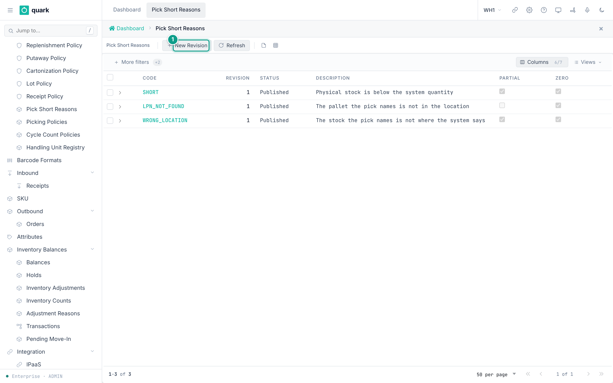

*Caption: the list of reasons with the button New Revision. Focus: 1 the New Revision button.*

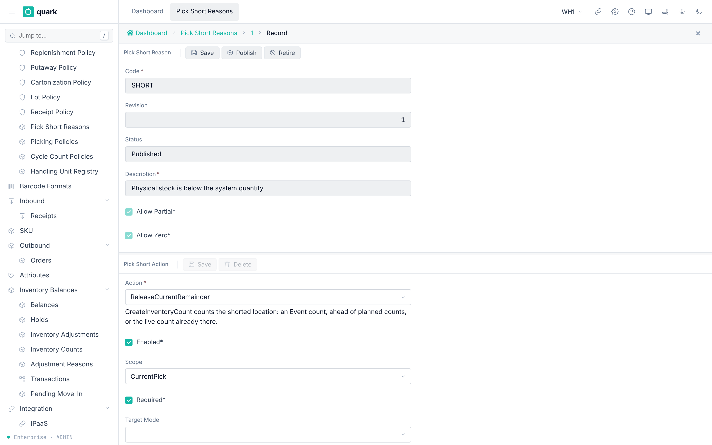

*Caption: an action of a reason.*

### Field reference

Reason: `Code` (required), `Revision`, `Status` (`Draft`, `Published`, `Retired`), `Description` (required), `Allow Partial` (required), `Allow Zero` (required).

Action:

| Field | Meaning | Allowed values |
|---|---|---|
| `Action` (required) | What the system does. | `ReleaseCurrentRemainder`, `BlockSourceLocation`, `ReleaseRelatedReservations`, `RelocateResidualToMissing`, `ReallocateReleasedDemand`, `CreateInventoryCount`, `HoldInventory`, `HoldContainer`, `RequestSupervisorReview`. |
| `Enabled`, `Required`, `Supervisor Review` (required) | Switches. | On or off. |
| `Scope` | How much stock is touched. | `CurrentPick`, `SameSourceStock`, `CurrentSkuAtLocation`, `EntireLocation`. |
| `Target Mode` | Where the residual goes. | `ZoneMissingToLoc`, `FixedLocation`. |
| `Fixed Location` | Shown for `FixedLocation`. | A location code. |
| `Trigger After` | When the action runs. | `AfterReservationRelease`, `AfterResidualRelocation`, `AfterCountCompletion`. |
| `Order Scope` | Which orders. | `CurrentOrder`, `OrdersWithReleasedReservations`, `CurrentAndAffectedOrders`. |

Rules before publish (`validate_draft`):

- `Pick short reason '{0}' must release the current remainder` - an enabled `ReleaseCurrentRemainder` is required.
- `RelocateResidualToMissing` needs `BlockSourceLocation` and `ReleaseRelatedReservations`; the release scope must cover the relocation scope; a target mode is required; its scope must be `EntireLocation`.
- `CreateInventoryCount` cannot be `Required`; its scope must be `CurrentSkuAtLocation` or `EntireLocation`.
- Nothing may use `AfterCountCompletion`.
- `AfterResidualRelocation` needs the relocation action.
- `FixedLocation` needs a location code.
- `ReallocateReleasedDemand` with an order scope wider than `CurrentOrder` needs `ReleaseRelatedReservations`.
- Errors read `action {action:?} has incompatible configuration: {reason}`.

### What you should see

- The status changes to `Published`. The picker can choose the reason on the RF.

### If something goes wrong

| Message | Meaning | Fix |
|---|---|---|
| `Pick short reason '{0}' is not an editable draft` | The revision is published or retired. | Click `New Revision`. |
| `Pick short reason '{0}' is not published` | Runtime use needs a published reason. | Publish it. |

### What this affects later

- When a picker shorts a pick, the system runs the actions of the chosen reason: it can block the location, release reservations, move residual stock to the missing location, and try to allocate again.
- Setting `TASK_SKIP_*` values (see `03-warehouse-structure.md`) control task skipping, not shorts.

The order is fixed in code (`remediation.rs`):

1. In the short command itself: the found quantity is committed, the rest of that pick is released, and the source location is blocked. A remediation request is saved.
2. A background worker then runs the remediation. It releases the related reservations. Picks that an operator is working on are left alone.
3. It moves the free residual stock to the missing (Lost) location.
4. After that commit, it makes an inventory count of the location, if the reason asks for it.
5. It allocates the released orders again, if the reason asks for it. Allocation skips the blocked location.

A refused step is retried by the worker.

## 7. Cartonization policy

### What you will do

Tell the system which boxes exist and how to plan an order into boxes.

### Before you start

- Role: `ADMIN`, `MANAGER` (write).
- Seeded policy `STD` ("Standard parcel") with three boxes `BOX-S`, `BOX-M`, `BOX-L`.
- Every item you want planned has weight and size in its pack (`Cartonize` on).

### Steps

1. Open `Sidebar > Warehouse Configuration > Policies > Cartonization Policy`.
2. Click `New`. Fill `Code`, `Name`, `Description`. Keep `Active`.
3. Section `General`: set `Pick splitting`, `Objective`.
4. Section `Solver settings`: keep the defaults unless told otherwise.
5. Section `Exception handling`: choose `Stop` or `Ship as is` for each cause.
6. Section `Cartons in solver order`: click `Add carton`. Fill the row. Use `Move carton up` and `Move carton down` for the order.
7. Click `Save`.
8. Link the policy: SKU tab `Policies` (`Cartonization Policy`).

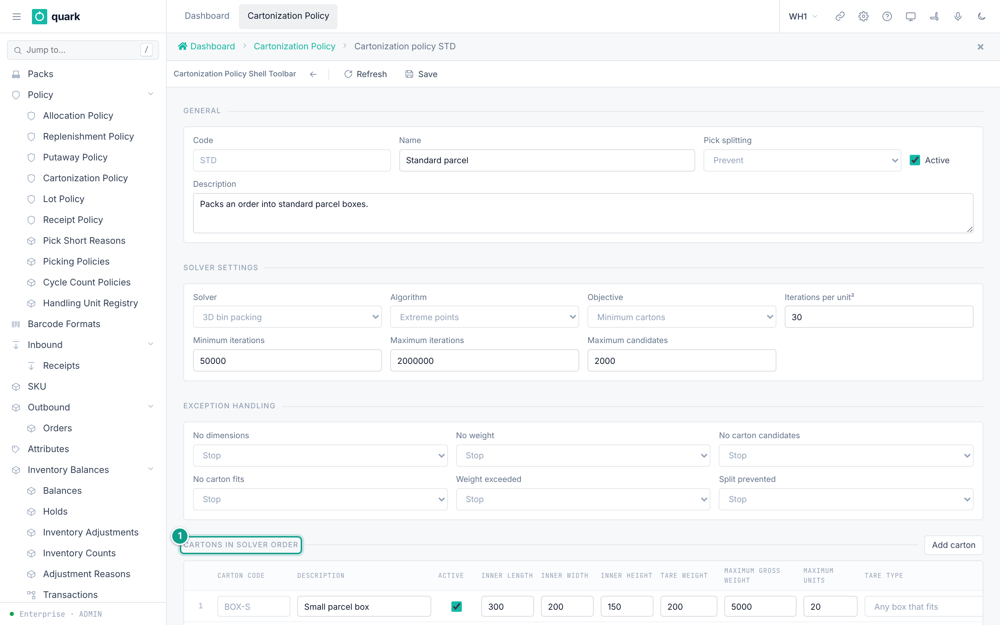

*Caption: the cartonization policy editor. Focus: 1 the list of cartons in solver order.*

### Field reference

| Field | Meaning | Allowed values |
|---|---|---|
| `Pick splitting` | May one pick spread over several boxes? | `Prevent`, `Allow`. Seed `Prevent`. |
| `Objective` | Goal. | `Minimum cartons` is the only one the engine solves (`cartonization_policy_objective_is_executable`). `Minimum unused volume`, `Fewest pick splits`, `Balanced weight` are listed but the engine does not solve them. |
| `Solver` / `Algorithm` | Method. | `3D bin packing` / `Extreme points` (only values). |
| `Iterations per unit²`, `Minimum iterations`, `Maximum iterations`, `Maximum candidates` | Search limits. | All above 0; maximum iterations not below minimum. Seed 30, 50000, 2000000, 2000. |
| Exception causes | `No dimensions`, `No weight`, `No carton candidates`, `No carton fits`, `Weight exceeded`, `Split prevented`. | `Stop` (hold just this pick; planned cartons stand) or `Ship as is` (the pick travels with no carton named in advance). Seed: all `Stop`. |
| Carton: `Carton code`, `Name` | Identity. | Text. |
| Carton: `Inner length`, `Inner width`, `Inner height` | Inner size. | Above 0 for an active carton. |
| Carton: `Tare weight` | Empty box weight. | Above 0 and below the maximum when the maximum is set. |
| Carton: `Maximum gross weight` | Limit. | 0 means no limit. |
| Carton: `Maximum units` | Unit limit. | 0 means no limit. |
| Carton: `Active` | In use. | On or off. |

### What you should see

- The message `Cartonization policy saved`.
- On an allocated order: the tab `Cartons` shows a plan with `Carton code`, `Planned gross weight` and `Planned volume`.

### If something goes wrong

| Message | Meaning | Fix |
|---|---|---|
| Check `cartonization_active_carton_has_dimensions` | An active box has a zero side. | Enter sizes above 0. |
| Check `cartonization_carton_weights_are_executable` | Tare is 0 or not below the maximum. | Fix the weights. |
| Check `cartonization_policy_solver_limits_valid` | A search limit is not valid. | Enter valid limits. |
| `cartonization solver budget exceeded after {consumed} of {limit} iterations` | The order is too large for the limits. | Raise `Maximum iterations`. |
| Tab `Cartonization exceptions` shows a reason such as `NoDimensions` | An item has no size or weight. | Complete the pack data. |

### What this affects later

- Each pick gets a planned carton. Pickers fill the planned boxes.
- Reasons `Stop` hold only that pick; the rest goes on.

## 8. Pack stations

### What you will do

Prepare a pack station for the RF Verify action.

Packing itself runs on the RF terminal. The web UI prepares the master data only.

### Before you start

- Role: `ADMIN` or `MANAGER`.
- Cartonization is working, so cartons exist.

### Steps

1. Create a location of type `Pack` (`Sidebar > Warehouse Configuration > Topology > Locations`).
2. Open `Sidebar > Warehouse Configuration > Work Areas & Equipment > Work Areas`. Open the area.
3. In the field `Pack station`, pick the `Pack` location. Save.
4. Make sure the picking policy of the area allows `Pack` in `Pallet Drop Cell Types` when pallets should go to the station.
5. Make sure the label `shipping_label` exists (see `07-printing-and-labels.md`).

### Field reference

See `03-warehouse-structure.md`, section 6.

### What you should see

- After a pick, the unit waits for `Pack` at the station.

### If something goes wrong

| Message | Meaning | Fix |
|---|---|---|
| Trigger error `work_area_pack_station_is_a_pack_location` | The location is not of type `Pack`. | Use a `Pack` location. |
| `SERIAL_PACKING_NOT_SUPPORTED` | The carton holds serial-tracked stock. | Not supported today. |
| `PACK_SOURCE_SHORT`, `PACK_UNEXPECTED_ITEM` | The box does not hold what was picked. | Resolve the packing exception. |

### What this affects later

- Closing a carton prints the shipping label and sets weights and a verdict.
- Goods Issue is separate from carton close; use `Ship order` or the Load workflow in section 10.
- The action `Repack` works on the RF terminal. The action is chosen once, when the packer opens the work, from what the unit is: a box off a cart is **verified**, a discrete pick pallet is **repacked** into output cartons (`resolve_packing_action`, `wms-outbound/src/packing/README.md`). There is nothing to set for it. Voiding an empty output carton and reopening a closed one have commands but no RF screen yet.

There is no packing queue in the web UI. Migration 110 only adds one message word (`STATION_UNKNOWN`). The queue is the query `packing_queue_list`. The RF screen `PACK00` (`rf-screens/103_uc_pack_verify.sql`) reads it after the packer scans the station.

## 9. Task Manager screens

| Screen | Use |
|---|---|
| `Management & Control > Execution Control > Task Board` | See every task. Buttons: `Return to Pool` (reason required), `Reassign` (new `Operator`), `Delete Task`. |
| `Management & Control > Execution Control > Pick Assignments` | See carts in use. Button `Dissolve` (reason required): returns tasks to the pool and takes empty boxes off the cart. |
| `Management & Control > Exceptions > Pick Target Exceptions` | See box-full problems. Button `Retry`. |
| `Management & Control > Exceptions > Skip History` | See tasks refused or handed back. |
| `Warehouse Configuration > Operator Permissions > Operators` | Operators (see `03-warehouse-structure.md`). |

`Delete Task` removes every selected task nobody has taken yet, and returns its pick to reserve. An order with nothing in work goes back to `Allocated`. Press `Release` to dispatch again.

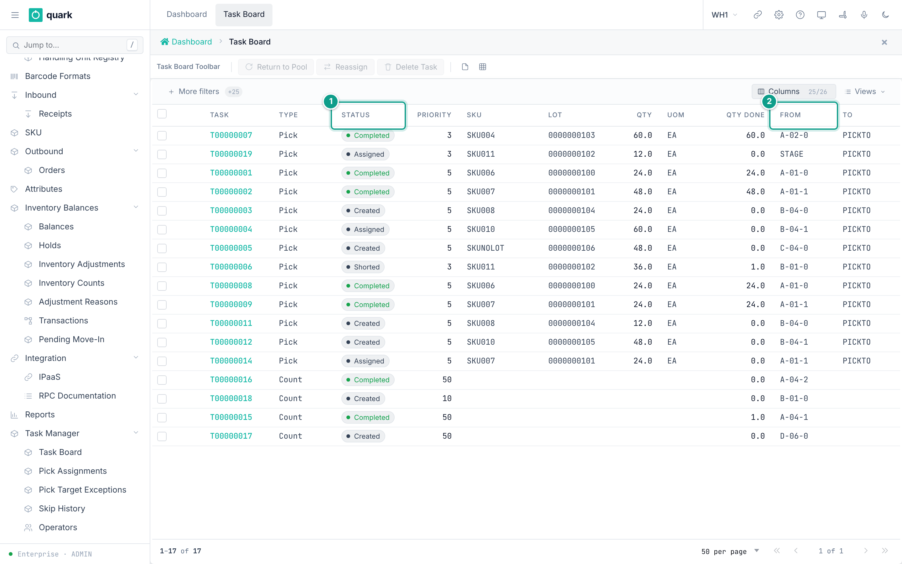

*Caption: the task board. Focus: Task, Status, SKU and the From and To locations. The teal numbers mark: 1 Status, 2 From.*

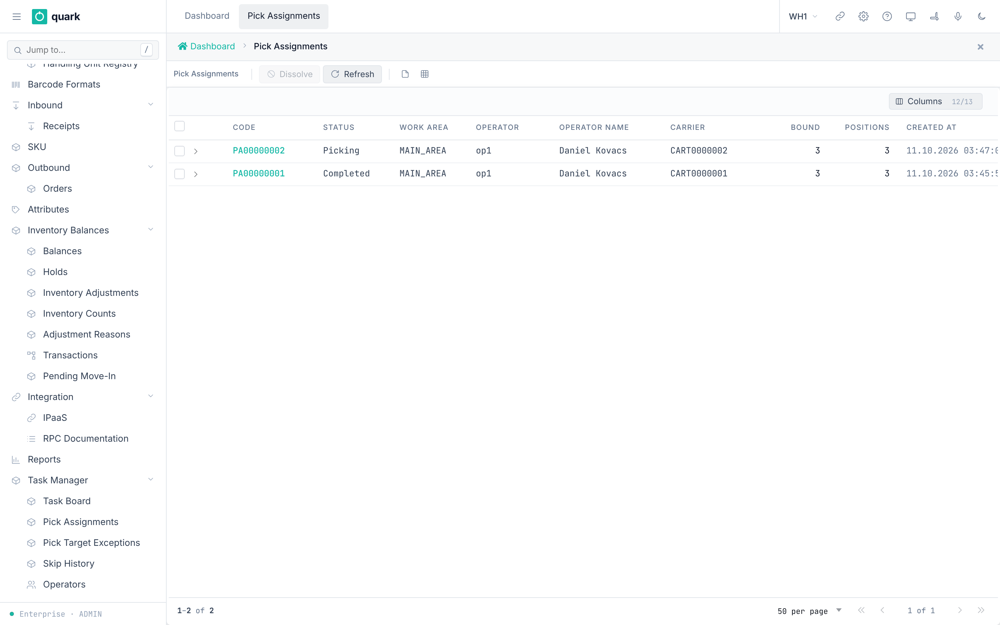

*Caption: the pick assignment board. Focus: The list is empty when nobody works a pick-by-area assignment.*

## 10. Dispatch, loading and Goods Issue

### What you will do

Confirm warehouse departure either for one fully picked order or for a reviewed Load. Loading and shipment are separate decisions: `Loaded` does not deduct stock; Goods Issue is the irreversible step that does.

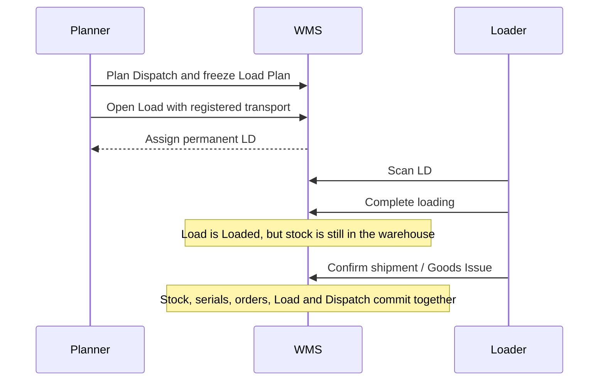

### Before you start

- `ADMIN`, `MANAGER` or `SUPERVISOR` plans dispatches, load plans and transport. `OPERATOR` can run loading and confirm shipment after the Load exists.
- The order is released and picked. Finish its packing job when packing is required.
- For the Load path, ready units are at their required `Stage` location and are not held.
- Use one path only. An order in an active Load must ship through that Load.

### Ship one complete order

1. Open `Sidebar > Management & Control > Orders & Waves > Orders` and open the fully picked order.
2. Click `Ship order`.
3. In `Confirm shipment — stock will be deducted`, verify `Order`, `Reviewed status` and `Reviewed Order version`.
4. Click `Confirm — ship and deduct stock`.
5. Open the `Fulfilment — base quantities` and `Shipments — base quantities` tabs to check the shipped base quantities and Goods Issue receipt.

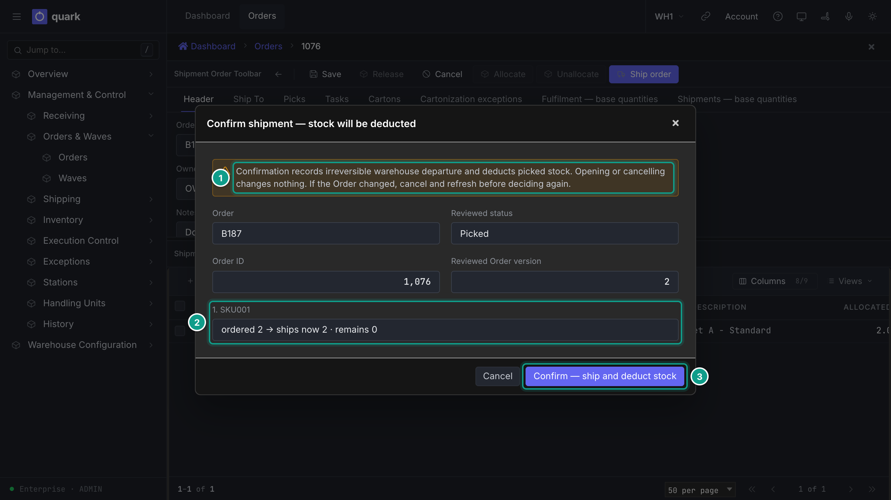

*Irreversible direct Goods Issue review. Focus: confirm the reviewed order, status and version before stock is deducted.*

Direct `Ship order` ships the order's currently ready picked content after handoff. For each line, remaining effective demand is ordered minus cancelled minus already shipped. If some demand is not ready, the Goods Issue can be partial and the order stays open; later ready content can ship in another direct Goods Issue or through a Load. Every root included in the direct shipment must first be placed at its destination; stock on an open pallet in transit is not ready. The physical content must belong only to this order. A pallet shared by several orders, an order in a frozen Load Plan, or an order in an active Load must use the Load path.

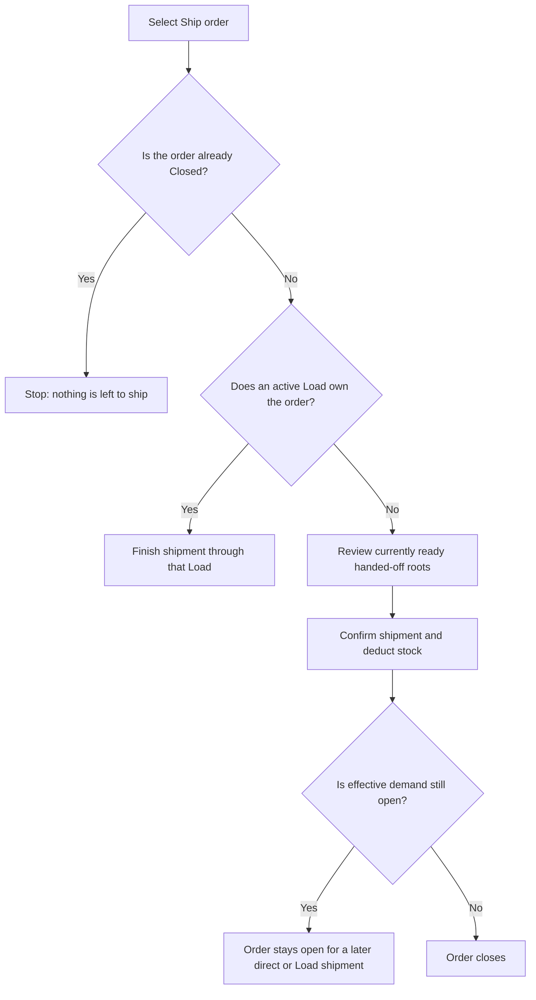

### Plan a Load

1. Open `Sidebar > Management & Control > Shipping > Transport Resources`. Click `Register`, enter `Transport reference`, `Kind`, optional `Carrier` and `Plate`, then click `Register` in the dialog. The kinds are `Truck`, `Trailer`, `Container`, `SwapBody` and `CourierCage`.
2. Open `Sidebar > Management & Control > Shipping > Dispatches`. Click `New Dispatch`, enter the dispatch reference, optionally choose a carrier and `Door`, then click `Create`.
3. Open the dispatch. Enter `New stop sequence` and `New stop destination`, then click `Add Stop`. Choose `Order to add`, its now-persisted `Delivery stop`, and optional `Preferred stage`, then click `Add Order`.
4. Review `Stops` and `Orders`, then click `Plan Dispatch`.
5. Open `Sidebar > Management & Control > Shipping > Load Plans`. Click `New Load Plan`, choose the planned dispatch and `Loading order`, then click `Create`.
6. Open the plan and click `Generate stop order`. Click `Review composition`; check all stops, selected units, invalid units and unplanned units.
7. Click `Freeze reviewed composition`. Freeze is a planning commitment, not loading or shipment.
8. Back on the plan, click `Open Load`, choose an unused active transport, click `Review selected transport`, then `Confirm — open Load`.

Opening the Load assigns its permanent number in the form `LD` plus eight digits, for example `LD00000042`. Use that number to find the Load in the list, identify its card and scan it on the RF terminal. Loads created before this numbering change keep their existing `LOAD-...` codes; do not relabel historical work.

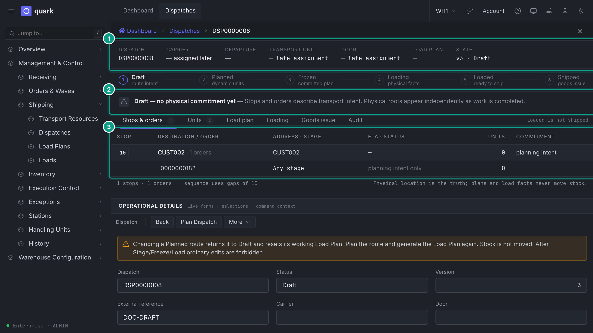

*Dispatch card before planning. Focus: every order belongs to the intended stop and no route row is missing.*

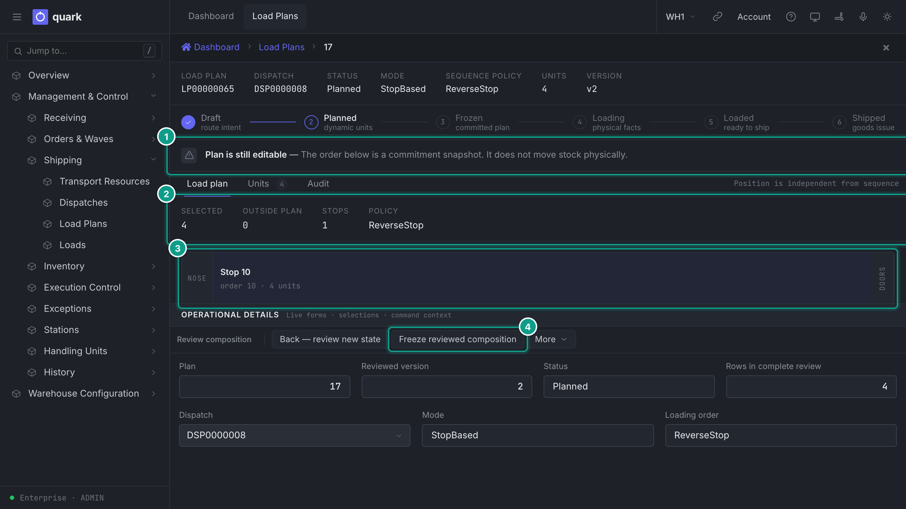

*Load Plan composition review. Focus: selected, invalid and unplanned unit counts before Freeze.*

Loading-order choices are `Last delivery stop first`, `First delivery stop first`, `Any stop group`, `Manual unit order`, and `Any eligible unit (no stop priority)`. Use the review screen to resolve invalid or unplanned units before Freeze.

### Load and ship in the web UI

1. Open `Sidebar > Management & Control > Shipping > Loads`, open the Load, and click `Composition and progress`.
2. On an `Open` Load, click `Confirm transport / start`. Enter the bound transport reference, click `Review entered scan`, review the saved decision, then click `Confirm loading action`.
3. For each unit, click `Review root LPN`, enter the physical root LPN, and review its location, quantity and next sequence. Physically load it, then click `Confirm loading action`.
4. When `Remaining units` is 0, click `Complete loading (not ship)` and confirm. The status becomes `Loaded`; stock has not left yet.
5. Click `Ship whole Load / deduct stock`. Verify the reviewed Load, transport and complete counts, then click `Confirm shipment / deduct stock`.

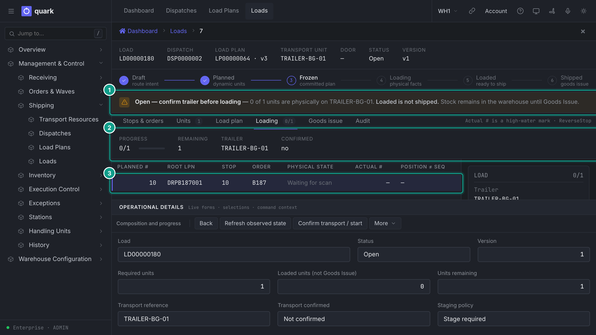

*Load card with planned and physically confirmed units. Focus: required, loaded and remaining counts stay separate.*

### Load and ship on the RF terminal

1. Open `Main Menu > Loading > Load Units`.
2. On `Scan Load`, scan the Load code.
3. On `Confirm Transport`, scan the bound transport and press `F4 Start`.
4. On `Scan Unit`, scan a root LPN. The scan is a read-only review.
5. On `Confirm Unit Loading`, physically load the unit and press `F4 Confirm`.
6. After the last unit, press `F5 Complete` on `Scan Unit`. Review `Complete Loading`, then press `F4 Complete`.
7. On `Load Status`, press `F5 Ship`. On `Confirm Shipment`, review the irreversible warning and complete counts, then press `F4 Ship all`.

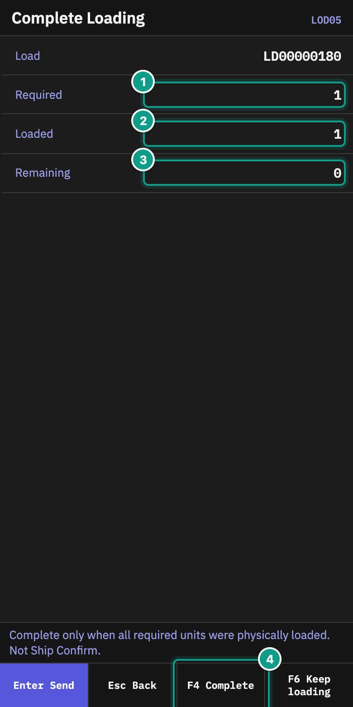

*RF `Complete Loading` review. Focus: all required units are confirmed before `F4 Complete`.*

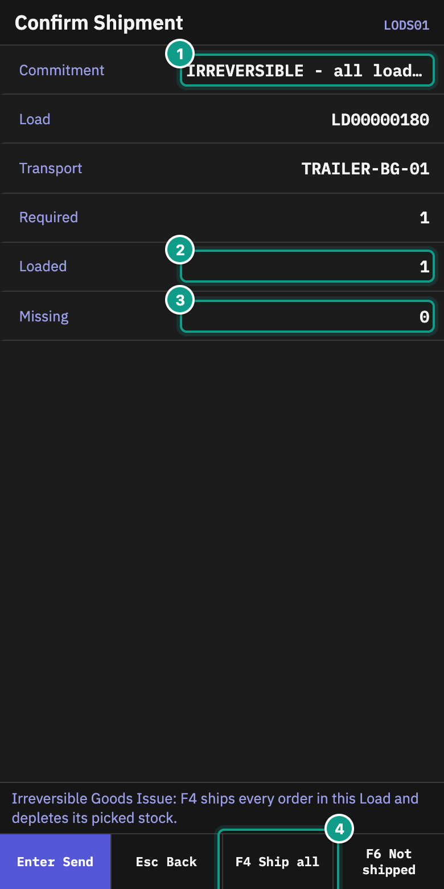

*RF `Confirm Shipment` screen. Focus: the irreversible warning, transport and complete unit counts before `F4 Ship all`.*

### What you should see

- Load states progress through `Open`, `Loading`, `Loaded` and `Shipped`.
- A newly opened Load has a read-only `LD########` number in the list, card breadcrumb and composition header.
- `Composition and progress` keeps planned and actual loading facts separate.
- Goods Issue records shipment history, deducts picked stock, updates serials and order counters, and marks the Load and Dispatch shipped in one transaction.

### If something goes wrong

| Situation | Fix |
|---|---|
| The scanned Load does not exist (`LD_NOT_FOUND`) | Check the complete `LD########` number and scan again. An older open Load can still have its original `LOAD-...` code. |
| The observed version changed | Cancel the decision, refresh or rescan, and review the current state. Do not retry with only a new version number. |
| The unit is not in this plan (`LD_NOT_IN_PLAN`) | Leave it unloaded. Scan a unit from the reviewed Load Plan, or ask the planner to resolve the membership before loading continues. |
| The unit is not ready (`LD_UNIT_NOT_READY`) | Leave it unloaded. Complete its required picking or packing state, then review the unit again. |
| The unit is not staged or is held (`LD_UNIT_NOT_STAGED`, `LD_UNIT_HELD`) | Leave it unloaded. Move it to the required Stage location or resolve the hold through the approved procedure, then review it again. |
| The unit is out of sequence (`LD_WRONG_LOAD_SEQUENCE`) | Leave it unloaded. Load the current stop group or explicitly planned unit first; do not change the plan merely to bypass the refusal. |
| The unit is already loaded (`LD_ALREADY_LOADED`) | Do not confirm it again. Review the current Load's composition, progress and unload history before continuing. |
| The unit belongs to another Load (`LD_IN_ANOTHER_LOAD`) | Stop loading it. Ask a supervisor or support to identify the active Load and reconcile the physical unit before either Load continues. |
| A unit was confirmed loaded by mistake | Before shipment, use `Acknowledge physical unload` in the Load view, or `Loading > Unload / Cancel (Supervisor)` on RF. Scan the removed root and enter a reason. This preserves history and does not move stock. |
| The Load must be cancelled | Physically unload and acknowledge every unit first, then use `Cancel empty Load`. |
| Shipment is already committed | Do not repeat or reverse it from a generic status control. Use the immutable `Shipments` record as the receipt and follow the site's controlled correction process. |

Loading refusal text can be translated or reworded. Support tools and API clients should route on the stable `LD_...` code returned with the refusal, not on its English text.

## 11. Replenishment of pick locations (min/max)

### What you will do

Keep the pick locations filled. A SKU's pick location (SKU card, tab `Pick Locations`) has a `Min` and a `Max`. When it falls to `Min` or below, the system plans what it lacks up to `Max` and an operator brings it from storage on the RF terminal.

### Before you start

- The SKU has a pick location with `Min`, `Max` and a `Unit` (see `04-owners-sku-uom-pack-hierarchy.md`).
- The pick location's putaway zone has **Replenishment Allowed** switched on. Without it the zone's pick locations are never replenished.
- Operators who replenish have the `Replenish` task right in a work area over the pick zone and the storage zones.
- A serial-tracked SKU is not replenished in this version.

### How it decides

| Question | Answer |
|---|---|
| When | What lies in the location plus what is already on its way is at or below `Min`. Checked every 5 minutes, and at once by **Replenish Now**. |
| How much | Up to `Max`, in whole units of the pick location's `Unit`, rounded down (16 boxes, not 16.5). Less than one unit — nothing. |
| From where | Free stock of the SKU (not reserved, not held) in a `Case`, `Pick` or `SpeedPick` location that is not one of the SKU's own pick locations; status `Ok`. Lots in the SKU's rotation (FEFO by expiry, FIFO oldest first, LIFO newest first), then by route. One task per source; several if one pallet is not enough. |
| How urgent | By the SKU's replenishment policy (below): 1 — urgent, 2 — important, 3 — below `Min`. The task queue gives the most urgent first. |
| Twice | No: an open replenishment counts as already there. |

### The screen `Replenishment`

`Sidebar > Management & Control > Inventory > Replenishment`. The list shows every replenishment: urgency, status (`Open`, `Done`, `Shorted`, `Cancelled`), pick location, SKU, lot, from where, quantity and unit, the short reason, when it was planned.

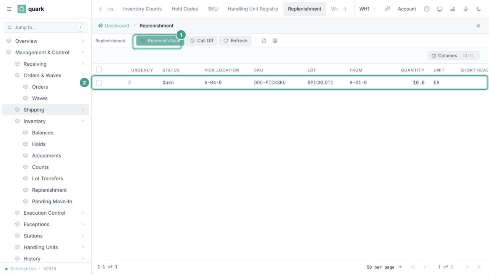

*Replenishment list. Focus: urgency, source, destination, quantity and current status of the open move.*

| Button | What it does |
|---|---|
| **Replenish Now** | Runs the planner at once (`replenishment_plan`). |
| **Call Off** | Cancels the ticked open replenishment, on the version you see (`replenishment_cancel`). Its task leaves the pool. If it changed meanwhile: refresh and decide again. |
| **Refresh** | Reloads the list. |

### How urgent: the replenishment policy

Every SKU has a replenishment policy (`STD` unless the SKU card names another). `Sidebar > Warehouse Configuration > Policies > Replenishment Policy` lists them; open a row to set its rule, **New** makes one by its code with the default rule.

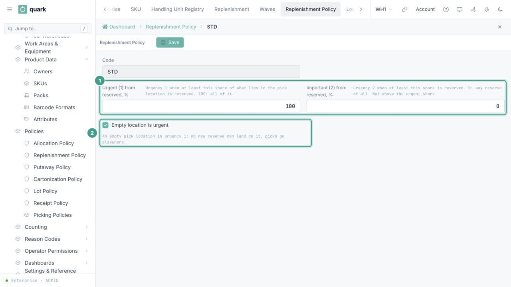

*Replenishment policy card. Focus: urgent and important reservation thresholds and the empty-location rule.*

| Setting | Default | Meaning |
|---|---|---|
| **Urgent (1) from reserved, %** | 100 | Urgency 1 when at least this share of what lies in the pick location is reserved for picks. |
| **Important (2) from reserved, %** | 0 | Urgency 2 when at least this share is reserved. 0 means any reserve at all. |
| **Empty location is urgent** | on | An empty pick location is urgency 1: no new reserve can land on it, so picks go elsewhere. |

Otherwise urgency 3. A share counts only when something is reserved. The important share may not be above the urgent one; each is 0 to 100 — **Save** refuses otherwise and says why. Saving works on the version you opened: if someone saved the policy meanwhile, refresh and decide again. Only Admin and Manager save a policy. A replenishment already planned keeps its urgency; the new rule applies from the next planning.

Example, 40 lie in the pick location, default rule: 40 reserved — 1; 10 reserved — 2; nothing reserved — 3; empty — 1.

The operator's side is `operator/12-replenish.md`.
