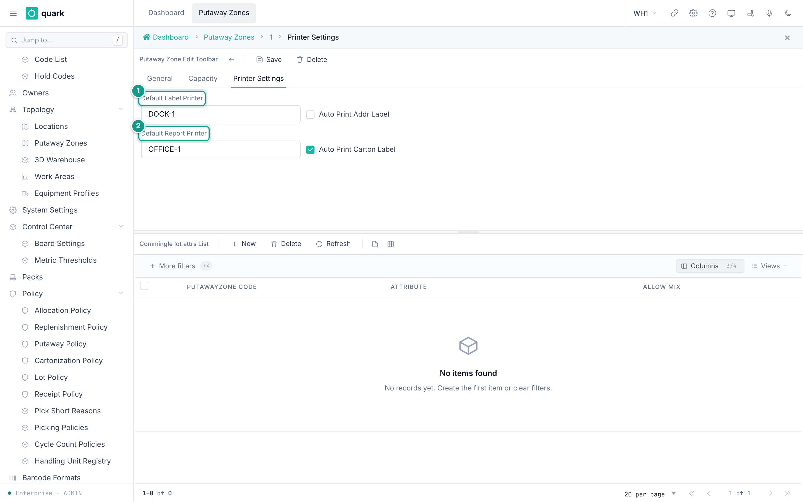
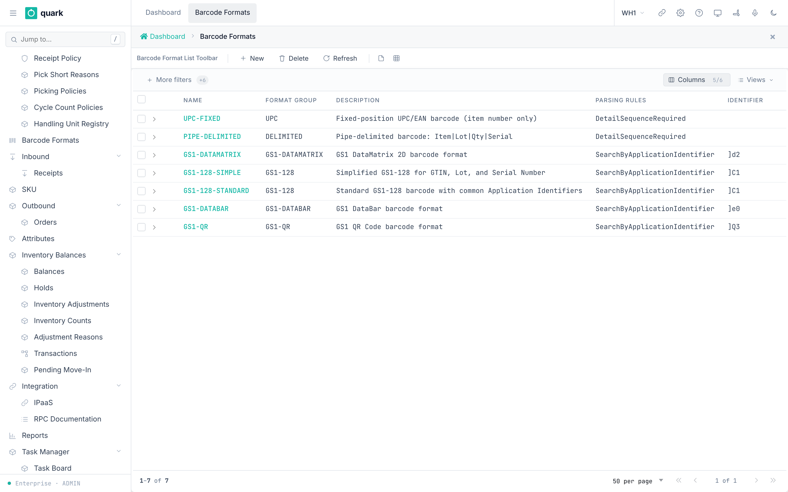

# Printing and Labels

## 1. What exists

| Part | What it does | Web screen? |
|---|---|---|
| Label definitions | Name, size and DPI of a label. | Yes, in the label designer. |
| Label templates | The label layout. | Yes, in the label designer. |
| Zone printer settings | Default printers in a putaway zone. | Yes. `Warehouse Configuration > Topology > Putaway Zones > Printer Settings`. |
| Barcode formats | Rules to read scanned barcodes (GS1 and others). | Yes. `Sidebar > Warehouse Configuration > Product Data > Barcode Formats`. |

Labels are made in ZPL for Zebra printers. The server sends the ZPL to the printer's network port (default 9100).

Your site installer connects the printer network and label renderer. Label design has a web screen: open `Sidebar > Overview > Reports`, then click **Label designer**. If the button is not available, ask an Enterprise administrator for label-designer access.

## 2. Seeded labels

The standard catalogue contains these active 203-DPI labels:

| Code | Purpose | Category | Size (mm) | Used by |
|---|---|---|---|---|
| `pallet_label` | Pallet label | `pallet` | 100 x 150 | Pallet identification. |
| `sku_label` | Item label | `sku` | 50 x 30 | Item identification. |
| `location_label` | Location label | `location` | 70 x 40 | Location identification. |
| `lpn_id_label` | LPN identification label | `lpn` | 100 x 50 | Auto-print after a receive (`Auto-Print LPN`), and LPN print on the move path. |
| `handling_unit_label` | `Handling unit label` | `custom` | 100 x 50 | Printed once for each registered handling unit. |
| `shipping_label` | `Shipping label` | `shipping` | 100 x 150 | Printed when a pack carton is closed. |

Label codes are exact and case-sensitive. Do not rename `lpn_id_label`, `handling_unit_label` or `shipping_label`; warehouse workflows use those codes when they request a label.

Seeded templates: `pallet_100x150`, `sku_50x30`, `location_70x40`, `lpn_id_100x50`, `handling_unit_100x50`, `shipping_100x150` (status `applied`).

## 3. Printer settings in a putaway zone

### What you will do

Set default printers for a zone and turn on automatic printing.

### Before you start

- Role: `ADMIN` or `MANAGER`.
- The zone exists.

### Steps

1. Open `Sidebar > Warehouse Configuration > Topology > Putaway Zones`.
2. Open the zone. Open the tab `Printer Settings`.
3. Fill the fields. Click `Save`.

*Caption: the Printer Settings tab of a zone. Focus: 1 Default Label Printer, 2 Default Report Printer.*

### Field reference

| Field | Meaning | Allowed values | Example |
|---|---|---|---|
| `Default Label Printer` | Name of the label printer. | Text up to 45 characters. | `ZEBRA-01` |
| `Auto Print Addr Label` | Print an address label automatically. | On or off. | off |
| `Default Report Printer` | Name of the report printer. | Text up to 45 characters. | `HP-OFFICE` |
| `Auto Print Carton Label` | Print a carton label automatically. | On or off. | off |

### What you should see

- The values are saved with the zone.

### If something goes wrong

| Message | Meaning | Fix |
|---|---|---|
| Nothing prints | The site could not select or reach a printer. | Check the saved printer name. If it is correct, ask the system administrator to check the printer connection. |

### What this affects later

- These values are part of the zone setup. The site's printer configuration decides how the saved names are mapped to physical printers.

## 4. Barcode formats

### What you will do

Define how the system reads scanned barcodes such as GS1-128.

### Before you start

- Role: `ADMIN` or `MANAGER`.
- Seeded formats: `GS1-128-STANDARD`, `GS1-128-SIMPLE`, `GS1-DATAMATRIX`, `UPC-FIXED`, `PIPE-DELIMITED`, `GS1-DATABAR`, `GS1-QR`.

### Steps

1. Open `Sidebar > Warehouse Configuration > Product Data > Barcode Formats`.
2. Click `New`. Fill the tab `Configuration`. Click `Save`.
3. Open the detail list `Format Details`. Click `New`. Fill each element in order. Click `Save`.
4. Use `Test Barcode`: paste a barcode in `Scan or Paste Barcode` and click `Test`. Read `Parsed Result`.

*Caption: the barcode format list.*

### Field reference

Format (`barcode_format_edit_form`):

| Field | Meaning | Allowed values | Example |
|---|---|---|---|
| `Name` (required) | Key. | Text. | `GS1-128-STANDARD` |
| `Format Group` (required) | Family. | Text. | `GS1-128` |
| `Description` (required) | Free text. | Text. | |
| `Barcode Identifier` | Symbology prefix. | Text. | `]C1` |
| `Chars to Trim` | Characters to remove. | Whole number. | 0 |
| `Auto Detect Identifier` | Find the prefix automatically. | On or off. | on |
| `Notes` | Free text. | Text. | |
| `Parsing Rules` (required) | How to read. | `Detail Sequence Required`, `Search by Application Identifier`. | `Search by Application Identifier` |
| `Default Ending Delimiter` | End-of-field mark. | Code list `BCDDELIMITER`. | `GS1128FNC1` |

Detail (`bf_detail_edit_form`): `Sequence`, `App Identifier`, `Data Group Name`, `Data Length`, `Prefix Trim`, `Suffix Trim`, `Start Position`, `Stop Position`, `Repeats Until End`, `Decimal Place`, `Lot Policy`, `Data Length Type` (`Fixed Length`, `Variable Length`), `Delimiter Before`, `Delimiter After`, `Date Format`, `Validation`, `Data Element Name`.
Data elements include `Item Number`, `Location`, `License Plate Number`, `Serial Number`, `Lot Number`, `Manufactured Date`, `Expiration Date`, `Delivery By Date`, `Best By Date`, `Quantity`, `Case ID`, `Alternate SKU`, `Unit of Measure`, `Net Weight`.

### What you should see

- The test shows the parsed values.

### If something goes wrong

| Message | Meaning | Fix |
|---|---|---|
| The parsed result is empty | The identifier or the details do not match the barcode. | Check `Barcode Identifier` and the details. |

### What this affects later

- RF scanning uses these formats to split one barcode into item, lot, dates and serial.

- A format is chosen by its `Barcode Identifier`, not by SKU. The scan must start with the identifier, and `Auto Detect Identifier` must be on. If several formats match, the longest identifier wins, then the lowest id. A format with an empty identifier claims nothing. If no format claims the scan, it is read as a plain code. `barcode_scan_parse` is a query: it changes nothing.
