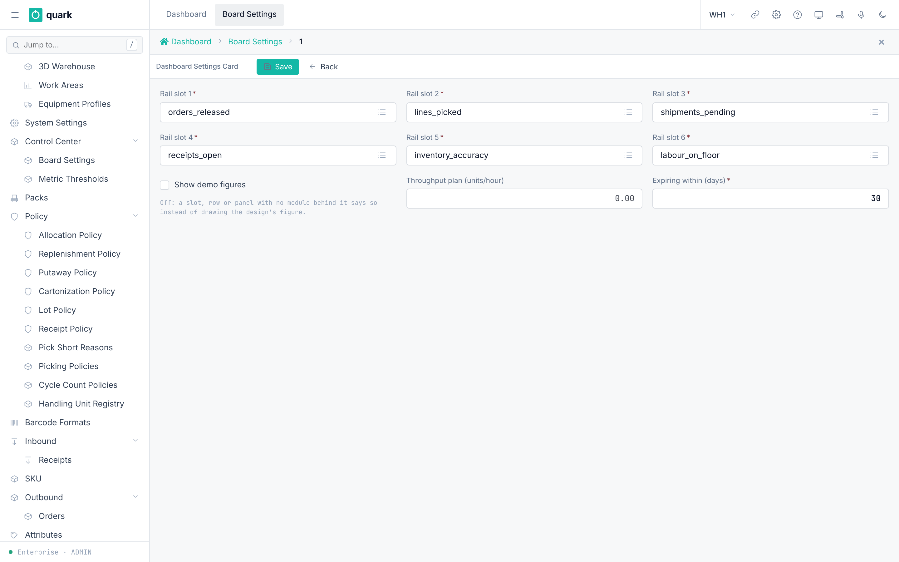
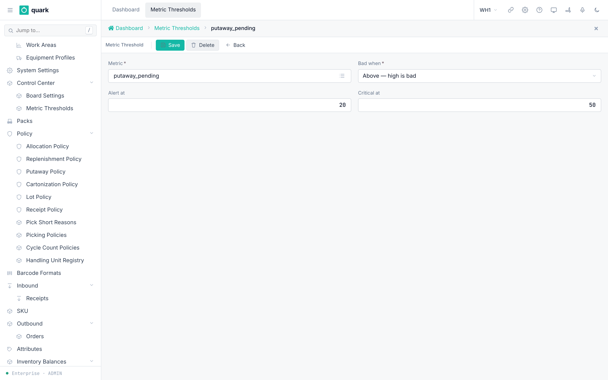

# Reports and Dashboards

## 1. Reports

### What you will do

Open the report catalogue, run a report, and check that the report service is set up.

Reports are produced by a separate service named **Quark Reports**.
The web UI shows it inside a frame. The service has no users of its own.
The web UI signs a short token (5 minutes) that carries the user, the language, the warehouse and the allowed report codes.

### Before you start

- Role to run reports: all roles (`print_report`, `list_report_album`, `get_report_album` and `set_report_favorite` are granted to `ADMIN`, `MANAGER`, `SUPERVISOR`, `OPERATOR`; `VIEWER` also holds `print_report` and `set_report_favorite`).
- You work in a **warehouse**, not in Enterprise mode.
- The installer set these two values for `web-ui-server`:
  - `REPORTS_SERVICE_URL`: the address of the report service.
  - `REPORTS_JWT_SECRET`: a shared secret of at least 32 bytes. The report service reads the same secret as `QUARK_REPORTS_JWT_SECRET`.
- The report service runs, and its catalogue was loaded (`import-catalog`).

### Steps

1. Switch to a warehouse (not Enterprise).
2. Open `Sidebar > Reports`.
3. Search or group the report list. Click a report.
4. Fill the parameter form.
5. Click run. The browser downloads the file (PDF, XLSX).
6. Click the star to mark a favorite.

*Caption: the report catalogue inside the frame. Focus: The groups on the left and the report cards on the right. The seed report names and descriptions are not in English.*

### Field reference

Seeded report catalogue (16 reports). Names are the English labels.

| Code | English name | Category |
|---|---|---|
| `ru_inv_3` | Inventory Count Sheet (INV-3) | audit |
| `kz_esf_print` | Electronic Invoice (ESF) | finance |
| `grouped_receipt_by_supplier` | Receipts by Supplier | inbound |
| `kz_act_priemki` | Inventory Acceptance Certificate | inbound |
| `kz_z_1` | Goods Receipt Order (Z-1) | inbound |
| `ru_mh_1` | Goods Receipt Order (M-4) | inbound |
| `ru_torg_2` | Discrepancy Report (TORG-2) | inbound |
| `ru_m_11` | Materials Requisition Note (M-11) | inventory |
| `ru_mh_3` | Materials Record Card (M-17) | inventory |
| `cortive_pick_list` | Pick List | outbound |
| `kz_snt_print` | Accompanying Waybill for Goods (SNT) | outbound |
| `kz_z_2` | Stock Release Note (Z-2) | outbound |
| `pivot_sku_by_month` | SKU by Month (Pivot) | outbound |
| `ru_torg_12` | Goods Consignment Note (TORG-12) | outbound |
| `ru_ttn_1t` | Consignment and Waybill (1-T) | outbound |
| `ru_upd_503` | Universal Transfer Document (UPD) | outbound |

> Label missing in English: the `description` text of the 16 report definitions is in Russian. The report names come from the English label and are correct. Example: `ru_inv_3` has the Russian name `Инвентаризационная опись ИНВ-3` in the Russian label only.

Inventory count reports (category `inventory`). Each asks for a period, `date_from` and `date_to`:

| Code | English name | What it shows |
|---|---|---|
| `inventory_count_accuracy` | Inventory Accuracy | Share of locations and lines that matched on the first count, and the difference in units and value. By zone, by SKU ABC class and by counter. |
| `inventory_count_variance_by_sku` | Count Variance by SKU | The 100 SKUs with the largest first-count difference, by value and then by units. |
| `count_variance_causes` | Count Variance Causes | Accepted differences by cause. Then each cause by zone, by counter and by SKU. Per row: how many, their share, the difference in units, in value and its net value. |
| `location_empty_confirmations` | Empty Confirmations | Locations confirmed empty by operators. |

- Value is the difference × the SKU's `cost` attribute. A SKU without a cost adds no value.
- `Count Variance Causes` counts what the board panel `Variance causes` counts: tasks accepted with an adjustment, by the time of the decision. Run it for today and it agrees with the panel on `Today`.
- `Count Variance Causes` names a seeded cause by the description of the cause list, which is English (`Mix-up with another item`). The board names it in the reader's language. Your own causes appear as you named them. A difference accepted before causes existed shows as `— не записана`.
- `Inventory Accuracy` and the board's `Inventory accuracy` use one definition: a location's **first** count matched when every line matched.

Access rule today:

- The token carries `reports = ["*"]`, so **every** report is allowed for every user. The code comment calls this "step 1". Narrowing the list per role is not built.
- The `designer` claim (permission to open the report editor) is true only when the user passes the Studio-admin check.

### What you should see

- The catalogue with groups and counts.
- After a run, a downloaded file.

### If something goes wrong

| Message | Meaning | Fix |
|---|---|---|
| A banner `wms-reports-unconfigured` instead of the frame | `REPORTS_SERVICE_URL` or `REPORTS_JWT_SECRET` is missing, or the secret is shorter than 32 bytes. | Ask the installer to set both. |
| A banner `wms-reports-enterprise` | You are in Enterprise mode. | Switch to a warehouse. |
| A banner `wms-reports-unavailable` | The token could not be signed. | Check the secret and the logs. |
| The frame is blank or refuses to load | The address in `REPORTS_SERVICE_URL` does not match the address the frame uses. | Check the address ("Nothing was done. Check REPORTS_SERVICE_URL against the address ..."). |
| The report service refuses to start | `QUARK_REPORTS_RENDER_KEY` is missing (at least 32 bytes). | Set it. |
| The catalogue is empty | The catalogue was never imported or `reports[]` is empty. | Run `quark-reports import-catalog`. |

### What this affects later

- The frame uses your active warehouse schema for its data sets.
- Report run history is stored in the report service schema `reports`.
- Deletions in your own report tables do not travel to the service (see its install guide).

- The old report definition screen is retired. Its menu item `report_def_menu` is inactive and does not reach the sidebar.
- Report definitions are added in two ways. The command `quark-reports import-catalog` loads the catalogue. Or a Studio admin clicks `Report designer` above the frame on `Sidebar > Reports` and edits there. The same page has `Label designer`.

## 2. Dashboard

### What you will do

Set what the dashboard (the "Control Center") shows.

The dashboard has a left **rail** of up to six key figures (metrics), panels, and a plan line.

### Before you start

- Role: `ADMIN` or `MANAGER` (write). `SUPERVISOR`, `OPERATOR`, `VIEWER` read the dashboard data (`dashboard_snapshot_rpc`).

### Steps: board settings

1. Open `Sidebar > Control Center > Board Settings`.
2. Open the single settings row.
3. Pick a metric for each of `Rail slot 1` to `Rail slot 6`.
4. Set `Throughput plan (units/hour)` and `Expiring within (days)`.
5. Decide `Show demo figures`.
6. Click `Save`.

### Steps: thresholds

1. Open `Sidebar > Control Center > Metric Thresholds`.
2. Click `New`.
3. Pick the `Metric`. Pick `Bad when`. Fill `Alert at` or `Critical at` (or both).
4. Click `Save`.

*Caption: the board settings card with six rail slots.*

*Caption: the threshold card.*

### Field reference

Board settings (`dashboard_setting_normal_form`):

| Field | Meaning | Allowed values | Example |
|---|---|---|---|
| `Rail slot 1` to `Rail slot 6` (required) | Metric in each rail slot. | A metric key (below). | `orders_released` |
| `Show demo figures` | "Off: a slot, row or panel with no module behind it says so instead of drawing the design's figure." | On or off. Seed on. | off |
| `Throughput plan (units/hour)` | "Empty: no plan line." | Number. | 120 |
| `Expiring within (days)` (required) | Window for the expiry figure. | Whole number. Seed 30. | 30 |
| `Version` | Read-only. | | |

Metric catalogue (`Dashboard Metrics`, columns `Key`, `Metric`, `Measured`):

| Key | Name | Measured |
|---|---|---|
| `orders_released` | Orders released | yes |
| `lines_picked` | Lines picked | yes |
| `shipments_pending` | Shipments pending | yes |
| `dock_utilisation` | Dock utilisation | no (stub) |
| `inventory_accuracy` | Inventory accuracy | yes |
| `labour_on_floor` | Labour on floor | yes |
| `receipts_open` | Receipts open | yes |
| `lines_received` | Lines received | yes |
| `putaway_pending` | Putaway pending | yes |
| `stock_on_hold` | Stock on hold | yes |
| `moves_executed` | Moves executed | yes |

Threshold (`dashboard_threshold_normal_form`):

| Field | Meaning | Allowed values | Example |
|---|---|---|---|
| `Metric` (required) | Which metric. | A metric key. | `receipts_open` |
| `Bad when` (required) | Direction of trouble. | `Above`, `Below`. | `Above` |
| `Alert at` | Level for an alert. "A level is reached at its value. One of the two is enough." | Number. | 50 |
| `Critical at` | Level for critical. | Number. | 100 |

Rules (`dashboard_metric_threshold` checks):

- At least one of `Alert at` and `Critical at` must be set (`chk_dashboard_metric_threshold_some_level`).
- With `Above`: `Alert at` must not be above `Critical at`. With `Below`: `Alert at` must not be below `Critical at` (`chk_dashboard_metric_threshold_order`).

### What you should see

- The rail shows the six chosen figures. Figures past a threshold change color.
- Metrics marked "no (stub)" show no real value.

### If something goes wrong

| Message | Meaning | Fix |
|---|---|---|
| Check `chk_dashboard_metric_threshold_some_level` | No level given. | Fill at least one. |
| Check `chk_dashboard_metric_threshold_order` | Levels are in the wrong order for the direction. | Swap the values. |
| `Someone changed this record ...` | Version conflict. | Refresh and repeat. |
| An empty rail slot | The seed row has no rail value. | Pick a metric for each slot. |

### What this affects later

- Only the display changes. No stock or order data changes.
- Each user can arrange personal layout (`user_dashboard_layout`).

- Users do not reach the dashboard from the sidebar. It is the first tab (`dashboard`, tachometer icon) in the main tab bar, and its form is the form `dashboard`.
- The page has a toolbar and a board. The toolbar has a live or offline pill, the scope buttons `Shift`, `Today` and `7 days`, `Reset layout` and `Arrange`. The board has these panels: metric rail, order flow, throughput, exceptions, dock schedule, activity, aged putaway, labour by zone, count progress and variance causes. Dock schedule and labour by zone have no data source. With `Show demo figures` off they say so.

### Inventory accuracy and variance causes

- **Inventory accuracy** (rail metric `inventory_accuracy`): the share of locations counted in the scope (`Shift`, `Today`, `7 days`) that matched on the **first** count. A location matched when every line of that count matched. A recount does not improve the figure. This is the definition of the report `Inventory Accuracy`.
- The sparkline under the figure has 12 bars, one per twelfth of the scope. A full bar is 100 %. A stretch with no counts repeats the last measured value; it is not 0 %.
- **Variance causes** (panel `Variance causes`, after count progress, full width): the differences accepted in the scope, one row per cause. Each row shows the cause, a bar and `count · share %`. The most frequent cause is on top. `Not established`, `Within tolerance` and `no cause recorded` are grey. They say nothing about where stock goes wrong.
- With no difference accepted in the scope, the panel says `no variance accepted in this period`.
- A user who saved their own layout gets the panel at the end of the board. `Reset layout` puts it after count progress.
- The causes come from the accept window (`policies/24-inventory-count-policy.md`, section 6b).

## 3. Other places to read data

| Screen | Path | Use |
|---|---|---|
| Balances | `Sidebar > Inventory Balances > Balances` | Tabs: `By Location`, `By Container`, `By SKU`, `By Lot`, `By Serial`, `Open Episodes`, `On Hold`. |
| Transactions | `Sidebar > Inventory Balances > Transactions` | The ledger of stock moves, with before and after values. |
| Pending Move-In | `Sidebar > Inventory Balances > Pending Move-In` | Reserved putaway destinations. |
| Audit Log | `Enterprise > Users & Roles > Audit Log` | Permission changes and denials. |
| Event Monitor | `Enterprise > Integration > Event Monitor` | Business events and their status. |

*Caption: the balances tabs. Focus: The summary tiles show total, available, allocated and on hold quantity. The tabs above the tiles change the grouping. The teal numbers mark: 1 Available (ATP), 2 Allocated, 3 On Hold.*
