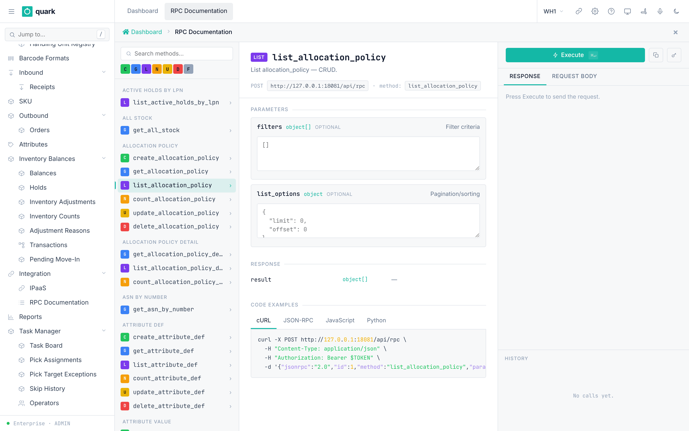
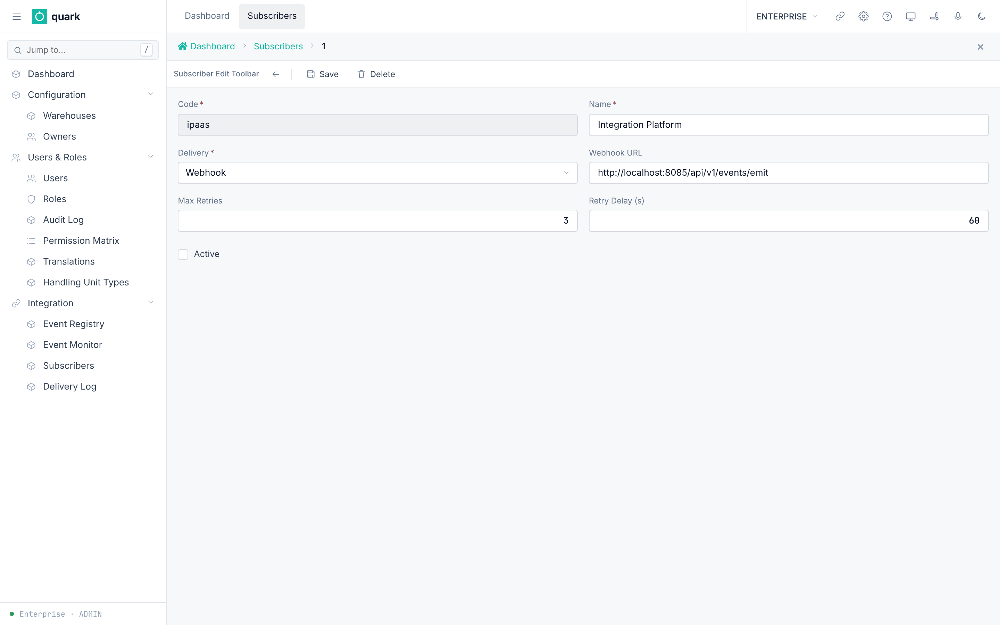
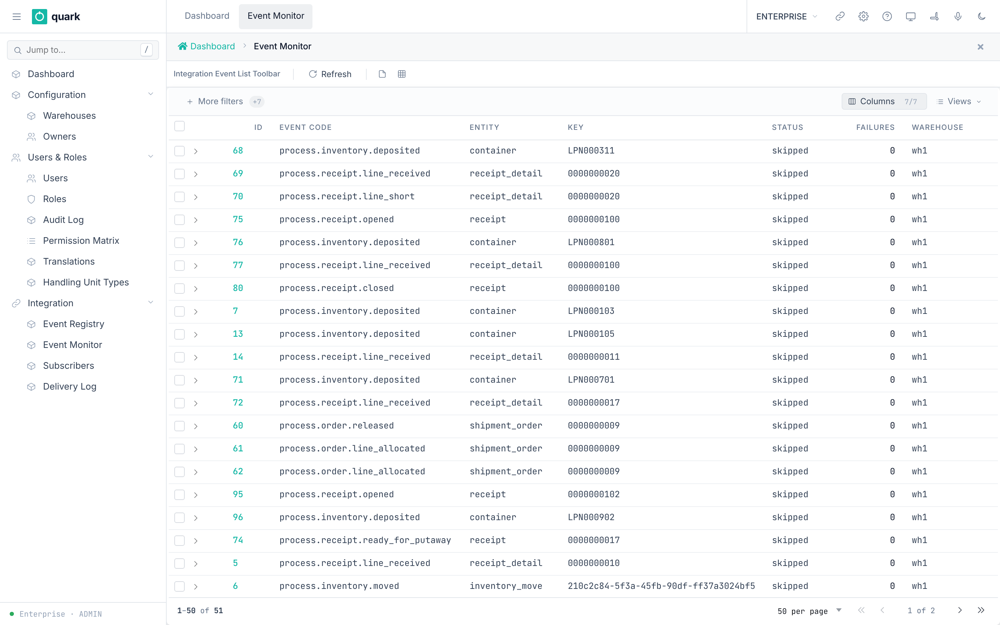

# Integrations and API

This chapter lists only what exists today. It is short on purpose.

## 1. What exists

| Part | What it does | Where |
|---|---|---|
| JSON-RPC API | Every business action as a method call. | Path `/rpc` on `app-server`. |
| API keys | Let another system call the API as a user. | `02-users-roles-permissions.md`, section 7. |
| RPC documentation | Browsable list of methods. | `Enterprise > Platform Tools > RPC Documentation`. |
| Business events | Events such as `process.receipt.closed`. | `Enterprise > Integrations > Events`. |
| Subscribers | Who receives events (webhook, poll, internal). | `Enterprise > Integrations > Subscribers`. |
| Integration Platform | Builds and monitors flows between WMS, ERPs, marketplaces and other services. | `Enterprise > Integrations > IPaaS`; see the [Integration Platform guide](../integration-platform/00-README.md). |

The platform includes connector and flow templates for supported integration patterns. A template is a starting point: you still enter the address and credentials for your own environment, test the connector and activate the resulting flow.

## 2. Call the API

### What you will do

Make a call from another system.

### Before you start

- A user with a limited role and `API access` on.
- An API key (see `02-users-roles-permissions.md`, section 7).

### Steps

1. Open `Enterprise > Platform Tools > RPC Documentation` to find the method and its parameters.
2. Send an HTTP POST to the `/rpc` path with the header `Authorization: Bearer <key>`.
3. Send a JSON-RPC 2.0 body.
4. For a command (any write), send a unique `idempotency_key` in `params.meta`.
5. For a command on an entity that a user read first, send `version` in `params.data`.



*Caption: the RPC documentation page. Focus: The middle panel shows the parameters and code examples; the Execute button is at the top right.*

### Field reference

The shape of a call (from `.claude/rules/api-versioning-and-idempotency.md`):

```json
{
  "jsonrpc": "2.0",
  "id": "req-1",
  "method": "receipt_close",
  "params": {
    "meta": { "idempotency_key": "<UUID v4>" },
    "data": { "version": 7 }
  }
}
```

| Kind | `idempotency_key` | `version` in `data` | Example |
|---|---|---|---|
| `query` | no | no | `list_sku`, `get_shipment_order` |
| `stateless_command` | required | no | `receipt_receive_against_asn`, `move_execute`, `shipment_order_allocate` |
| `stateful_command` | required | required | `receipt_close`, `receipt_cancel`, `update_allocation_policy` |

Method groups (modules of the RPC catalogue):

| Group | Modules |
|---|---|
| Master data | `code`, `code_value`, `pack`, `owner`, `owner_address`, `owner_bank_account`, `owner_config`, `putawayzone`, `location`, `loc_lot_commingle`, `putawayzone_lot_commingle`, `sku`, `sku_audit`, `sku_barcode`, `barcode_format`, `barcode_format_detail`, `check_digit`, `key` |
| Inbound | `lot_policy`, `receipt_policy`, `receipt`, `receipt_commands`, `receipt_audit`, `receipt_detail`, `receipt_expected_lot_attributes`, `receipt_detail_damage`, `receipt_damage_photo`, `case_level`, `case_level_commands` |
| Inventory | `putaway_policy`, `inventory_hold_code`, `move_command`, `putaway`, `hold`, `serial_commands`, `transaction_log`, `sku_serial_config`, `inventory_balance_serial`, `handling_unit`, `inventory_adjustment`, `inventory_count`, `lot_by_attributes`, `barcode_scan` |
| Outbound | `allocation_policy`, `replenishment_policy`, `cartonization_policy`, `wave`, `shipment_order`, `shipment_order_commands`, `container_commands`, `pick_commands`, `pick_assignment`, `pick_short_reason`, `picking_policy`, `packing` |
| Tasks | `work_area`, `equipment_profile`, `operator`, `task`, `task_commands`, `wms_task` |
| Reporting | `report_definition`, `report_template`, `label_definition`, `label_template`, `printer_configuration`, `printer_assignments` |
| Enterprise | `project`, `user`, `sys_settings`, `warehouse`, `role`, `override_grant`, `user_warehouse`, `user_api_key`, `audit_log`, `role_permission`, `permission_matrix`, `dashboard`, `dashboard_setting`, `log_level`, `handling_unit_type` |
| Integration | `inventory`, `inventory_search`, `marking`, `entity_attribute`, `event_registry`, `integration_event`, `integration_event_delivery` |
| RF | `screen_def`, `metadata` |

Rights: each method has a role list. The defaults are in the role table in `02-users-roles-permissions.md`. Edit them in the Permission Matrix.

### What you should see

- A JSON-RPC result, or an error object with a code.
- For a stateful command that hits a version conflict, the error code is `40` and the data holds the current state (`current_state`) so the client can refresh.

### If something goes wrong

| Message | Meaning | Fix |
|---|---|---|
| HTTP 401 | Key unknown, revoked or expired. | Generate a new key. |
| `Forbidden(...)` | The key owner's role lacks the method. | Grant the method in the Permission Matrix. |
| Idempotency conflict (code 42) | The same key was used with a different payload. | Use a new key. |
| Idempotency in progress (code 44) | The same request is still running. | Retry with the same key. |
| Version conflict (code 40) | The entity changed. | Read it again, then repeat. |

### What this affects later

- The same domain rules apply as in the web UI.

## 3. Business events and subscribers

### What you will do

Choose which events leave the warehouse system and where they go.

### Before you start

- Role: `ADMIN` (Enterprise mode).
- A receiver that can accept a webhook, or an IPaaS flow.

### Steps

1. Open `Enterprise > Integrations > Event Registry`. Check the events. 339 are seeded: `bio_lifecycle` 267, `business` 61, `form_render` 3, `scheduled` 3, `field_change` 4, `security` 1.
2. Open `Enterprise > Integrations > Subscribers`. Click `New`.
3. Fill `Name`, `Code`, `Delivery`, `Webhook URL`, `Max Retries`, `Retry Delay (s)`. Turn on `Active`.
4. Click `Save`.
5. Watch `Enterprise > Integrations > Events` and `Deliveries`.



*Caption: the subscriber card.*



*Caption: the event monitor.*

### Field reference

Subscriber (`ent_integration_subscriber_normal_form`):

| Field | Meaning | Allowed values | Example |
|---|---|---|---|
| `Name` (required) | Display name. | Text up to 200 characters. | `ERP link` |
| `Code` (required) | Key. | Text up to 50 characters. | `erp` |
| `Delivery` (required) | How the event gets out. | `poll`, `webhook`, `queue` (list `DELIVERY_METHOD`). The seed also uses `internal`. | `webhook` |
| `Webhook URL` | Target for `webhook`. | URL up to 500 characters. | `https://erp.example/hook` |
| `Max Retries` | Delivery attempts. | Whole number. Default 3. | 3 |
| `Retry Delay (s)` | Seconds between attempts. | Whole number. Default 60. | 60 |
| `Active` | In use. | On or off. | on |

The event filter (`event_filter`, JSON) picks event codes. It accepts wildcards such as `process.*`. It has no field on this form.

Event registry (`ent_event_registry_normal_form`): `Code` (required), `Name` (required), `Description`, `Active`, `Builtin` (read-only), `Category` (required).

Seeded subscribers:

| Code | Delivery | Active | Purpose |
|---|---|---|---|
| `ipaas` | `webhook` to the Integration Platform event endpoint | **off** | Sends matching process events to the platform. Configure and test the destination and access header before turning it on. |
| `quark_outbound_execution` | `internal` | on | Allocation top-up after contention or a short pick. **Do not turn off.** |
| `quark_inventory_count` | `internal` | on | Counts a location when a warehouse event asks for it. **Do not turn off.** |

Business event codes include, for example: `process.order.created`, `process.order.released`, `process.order.closed`, `process.receipt.opened`, `process.receipt.line_received`, `process.receipt.closed`, `process.receipt.damaged_reported`, `process.putaway.completed`, `process.pick.created`.

### What you should see

- A new event appears in `Events` with status and failure count.
- A delivery row appears in `Deliveries` with status, attempts, last error, HTTP code.

### If something goes wrong

| Message | Meaning | Fix |
|---|---|---|
| Delivery stays failed with `Last Error` | The receiver refuses or is down. | Fix the receiver. The system retries up to `Max Retries`. |
| No delivery rows | The subscriber is off or its filter matches nothing. | Turn on `Active`; check the filter. |

### What this affects later

- The two internal subscribers drive allocation top-up and event-driven counts. If they are off, those functions stop.

There is no web field or public API field for `event_filter` or `warehouse_filter`. Ask the deployment administrator to configure them when a subscriber must receive only selected events or warehouses. Event codes accept `*`, a prefix such as `process.*`, or an exact code. An empty warehouse list allows all warehouses.

## 4. IPaaS

`Enterprise > Integrations > IPaaS` opens the Integration Platform. Use it to create connectors, fork flow templates, configure schedules and webhooks, and monitor each execution.

The Integration Platform has a separate tenant access boundary. If it asks for access or shows an authorization error, request a platform access link or key from the deployment administrator. Do not use a marketplace connector credential as the platform access key.

Start with the [Integration Platform quickstart](../integration-platform/01-quickstart.md). For production access and deployment checks, see [Configuration, access and API](../integration-platform/06-configuration-access-and-api.md).

## 5. Outbound and replenishment calls

- Shipping is available through `shipment_order_ship` for one complete order and `confirm_shipment` for a complete reviewed Load. Both perform Goods Issue; loading alone does not deduct stock.
- Loading uses the `load_*` methods, including separate read-only scan review and state-changing confirmation calls.
- Replenishment uses `replenishment_plan`, `replenishment_take_next`, `replenishment_confirm` and `replenishment_cancel`. The policy urgency card saves through `replenishment_policy_save`.

Use the generated API reference for current request and response schemas. Do not treat a successful loading confirmation as proof of shipment; verify the Goods Issue receipt or shipment history.
