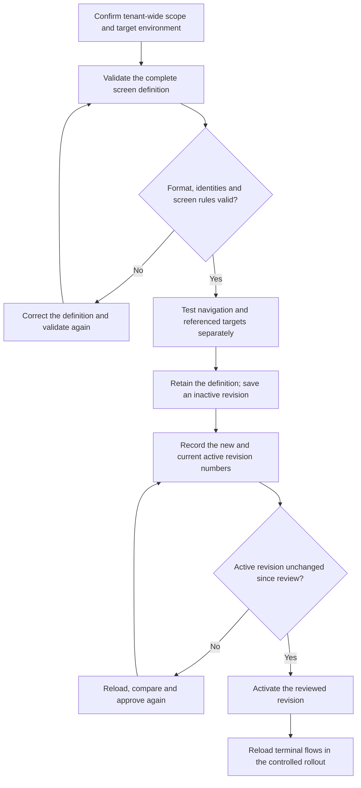
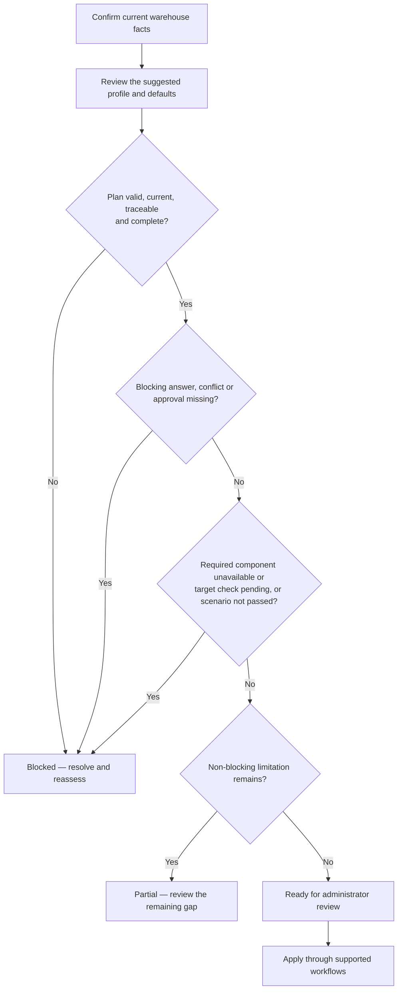
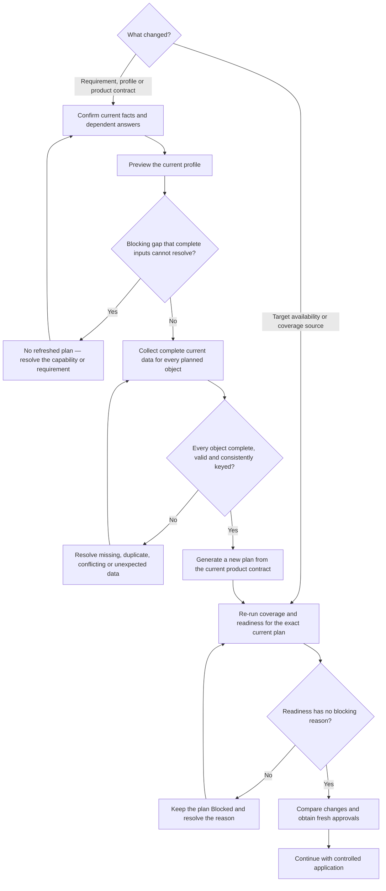

# Warehouse profile and assisted onboarding

## What this is

The General Distribution profile is a reviewed standard setup for an inactive
warehouse. Assisted onboarding can turn confirmed customer requirements and
that standard into an explainable plan. It can inspect the current setup and
check selected policy behaviour without changing warehouse data. It does
**not** apply the plan or change the warehouse automatically.

An administrator remains responsible for reviewing every planned change,
approving it and carrying it out through the supported administrator workflows.

## When to use it

Use the profile while preparing a new, inactive warehouse. It is not an upgrade
tool for an active warehouse.

The core checklist covers:

- warehouse topology and master data;
- receipt, putaway, allocation, replenishment and picking policies;
- packing and shipping configuration;
- work areas, equipment, users and permissions.

The plan always includes the standard report and label requirements as
plan-only items. It adds other optional areas, such as customer-defined
cartons, only when the confirmed requirements call for them.

## What the assistant can do

The assistant separates preparation from execution:

- **Inspect and validate:** read the current setup, preview generated locations
  and run supported policy checks without saving changes.
- **Prepare for approval:** describe proposed warehouse records and policy
  changes for an administrator to review.
- **Plan only:** prepare cartonization, report and label drafts that still need
  their normal editor, preview and validation workflow.

The assistant cannot publish policies, activate reports, render or print
documents, or make configuration changes by itself. Normal role permissions
still apply when an administrator carries out an approved change.

## Information to confirm first

Record explicit answers for:

- whether integrations are required;
- whether reports are required;
- whether labels are required;
- whether customer-defined cartons are required;
- whether RF terminal screens need customer-specific adaptation;
- whether road transport is required;
- which approved customer report samples define the expected output.

Road transport requires the reporting scope because the standard output includes the
CMR consignment note. Report samples cannot be supplied when reports are out of
scope.

If an earlier answer changes, review every dependent answer again. The planning
assessment treats the updated answers as a new revision and does not silently
reuse dependent decisions from the previous revision.

## Profile suggestion and approval

Assisted onboarding can compare the confirmed facts with reviewed warehouse
profiles. A profile with a conflicting mandatory requirement is not eligible.
Other matches are ranked. A unique best match can be selected for the plan; a
tie remains unresolved. This selection is a suggestion only: it is not an
approval, is not saved as warehouse configuration and still requires
administrator review.

Defaults follow the same review boundary:

- eligible low-risk defaults for master data, processes, strategies, roles,
  reports and labels may be reviewed as one bundle;
- high-risk choices must be approved individually;
- integration and RF interface defaults always require explicit approval;
- compliance-sensitive defaults are not proposed by assisted onboarding.

An accepted default becomes part of the reviewed plan. It is not written to the
warehouse automatically.

## Plan more than one object of a kind

One assisted plan can include several customer objects of the same kind. For
example, it can plan several zones, location ranges, policies, SKUs, work
areas or users instead of reducing each area to one generic record.

Give every planned object a short, stable key:

- use 1–64 English letters (`A-Z`, `a-z`), digits, dots, underscores or
  hyphens;
- do not use spaces or slashes;
- keep the same key through every step for that object. For example, the
  create, rules, validation and publication steps for one policy must all name
  the same policy key; previewing and generating one location range must use
  the same range key.

The General Distribution profile still represents one warehouse and one
owner. It does not support a second warehouse or owner in the same plan. Each
required report or label item is also planned once. Every repeatable area must
contain at least one complete object.

The same step for the same object can be requested by more than one part of the
onboarding questionnaire. Matching copies are combined. Different values for
that same step and object key are a conflict: correct the customer data and
obtain the required review again before generating the plan.

## Review and release an RF screen adaptation

When the confirmed requirements call for an RF terminal adaptation, treat the
screen definition and its release as separate approvals. Assisted onboarding
can validate and plan these steps, but it does not save or activate an RF
screen. An Administrator or Manager performs the approved release manually.

RF screen revisions and the active selection are shared by all warehouses in
the same tenant and environment. They are not isolated per warehouse. Activating
a revision can therefore affect every terminal in that tenant and environment;
schedule it as a controlled tenant-wide release.

1. Validate the complete screen definition before saving it. This check covers
   the current screen format, screen identity, widget identities and rules
   inside that one screen. It does not read or change the saved terminal setup.
2. Resolve every invalid field or screen rule. If the check reports an unknown
   field, remove or correct it: the terminal would ignore that field.
3. Check every navigation path and referenced target screen separately. The
   definition check does not prove that another screen or route exists.
4. Retain the exact validated definition for the release record, then save it.
   Saving creates a new, inactive revision and returns its revision number; the
   terminals continue using the current active revision.
5. Record the returned revision number and the revision currently active in the
   target environment. Test the navigation and targets in a controlled
   environment before production activation.
6. Activate the reviewed revision as a separate controlled step. Plan how
   terminals will reload: a terminal with a cached flow can keep the old screen
   until that flow is reloaded.

Activation is refused if another administrator changed the active revision
after your review. Reload the current revision, compare the changes and approve
again. Do not retry an old approval against the new state.

## Reference catalogues

The assisted plan carries European English requirements for pallet, SKU,
location, LPN, handling-unit and shipping labels. Its plan-only report
requirements are Goods Receipt Note, Putaway List, Picking List, Packing List,
Delivery Note, Inventory Count Sheet and Stock Adjustment Report. Road
transport adds a CMR consignment note requirement.

These plan items are not the same thing as the deployable
[General Distribution report set](08-reports-and-dashboards.md#general-distribution-reports).
That current nine-report package is deployment-managed and is not installed by
warehouse Bootstrap or from the **Reports** screen. The assisted plan does not
create or activate either catalogue. An administrator must review each required
output in the supported editor and deployment workflow.

The assisted plan does not select a different UI language or a country-specific
document set.

## Read the readiness result

The planning assessment has three results:

| Result | Meaning | What to do |
|---|---|---|
| **Blocked** | The plan cannot be approved yet. Its structure, validation, traceability, revision or coverage is not current and complete; a confirmation, blocking answer or approval is missing; evidence conflicts; a required component is unavailable or still needs a target-system check; or a required validation scenario has not passed. | Resolve every blocking item, refresh changed answers and run the required scenarios again. |
| **Partial** | All blocking gates and required scenarios passed, but a non-blocking limitation remains. This includes unknown, plan-only, target-check or unsupported items that do not block the plan. | Decide whether to resolve, defer or remove each non-blocking item before approval. |
| **Ready** | The reviewed facts are current, required coverage is available and all required scenarios passed, with no unresolved non-blocking limitation. | Continue with administrator review and controlled application. |

**Ready** describes the plan, not the warehouse. It never authorizes execution,
activates the warehouse or replaces the controlled go-live scenario.

## Refresh a reviewed plan after a change

A General Distribution plan is tied to the confirmed requirements, the
reviewed profile and the product contract available when the plan was
prepared. Regenerate the plan when:

- a confirmed requirement or dependent answer changes;
- the reviewed profile changes;
- a product update changes a supported operation or one of its required
  fields.

Regeneration is required even when the displayed profile version is unchanged.
The current product contract must still match the one used to prepare the
reviewed plan.

Coverage and readiness belong to one exact plan. Re-run those checks, without
necessarily regenerating an otherwise current plan, when target capability
availability changes or when the available coverage was produced for another
plan.

1. Confirm the latest requirements and review every dependent answer.
2. Preview the current profile. Stop if a blocking gap cannot be resolved by
   supplying complete inputs for the planned changes. Required custom
   integrations, custom report outputs, missing product capabilities and
   required target gates remain blocking until a supported approach is
   available or the customer confirms that the requirement no longer applies.
   No refreshed plan exists while one of these gaps remains.
3. For the remaining planned changes, supply complete current data for every
   planned object. Use a distinct stable key for each repeated object and the
   same key for every step that belongs to it. Missing, duplicated,
   conflicting, unexpected or invalid data prevents plan generation.
4. Generate the new plan from the current profile and product contract.
5. Run coverage and readiness checks for this exact plan. A changed target
   capability requires fresh coverage even when the plan itself remains
   current.
6. Resolve every readiness blocker, including stale confirmations, missing
   approvals or answers, conflicting evidence, target checks and required
   scenarios that have not passed.
7. Compare a regenerated plan with the previously reviewed plan and obtain fresh
   approvals before any controlled application.

Generating and checking the refreshed plan does not change warehouse data.

## Review and validate the setup

1. Confirm that the target warehouse is still inactive.
2. Review the customer facts and every planned configuration area.
3. Review previews and the readiness result. A **Blocked** plan cannot be
   approved. Resolve every blocking item and review every **Partial** item.
4. Apply approved changes through the normal administrator workflow.
5. Run one controlled scenario through **Receive**, **Putaway**, **Allocate**,
   **Replenish**, **Pick**, **Pack**, **Load** and **Goods Issue**.
6. Open every required report and label in its editor. Validate and preview it,
   then compare the output with the approved sample.
7. Activate the warehouse only after the full scenario passes.

## Current limitation

There is no customer UI that applies a warehouse profile in one step. Assisted
onboarding currently prepares a deterministic plan and validates its scope; it
does not create or publish business-specific reason codes, policies or other
warehouse records by itself. Report and label drafts remain plan items until an
administrator creates, validates and activates them through the supported
editors.

## Related guides

- [Go-Live Checklist for a New Tenant](10-checklist-go-live.md)
- [Warehouse Structure](03-warehouse-structure.md)
- [Outbound Setup](06-outbound-setup.md)
- [Printing and Labels](07-printing-and-labels.md)
- [Reports and Dashboards](08-reports-and-dashboards.md)
