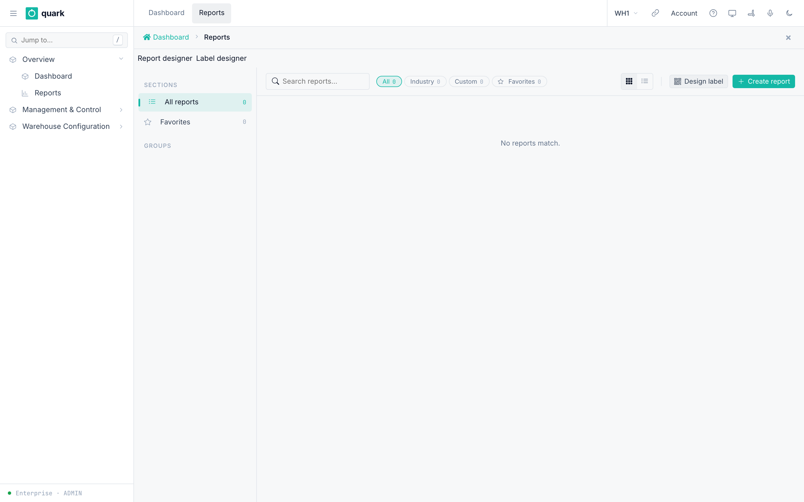

# Build a Custom Report

## What you will do

Create a report that reads warehouse data, asks the user for parameters and produces a PDF from a Typst template.

The designer keeps the report definition, data and document layout on one screen. The report catalogue remains the starting point for creating, opening and running reports.

## Before you start

- Switch to the warehouse whose data you want to use. Do not stay in Enterprise mode.
- Open `Sidebar > Overview > Reports`.
- You need permission to open **Report designer**. If the button is not available, ask an Enterprise administrator.
- Decide who will use the report, what one row means and which filters are needed.
- Start with a small result set. A report query must be read-only.

The names in this guide describe controls by their purpose. The report designer can use a different interface language from the main warehouse screen, so use the control's position and function when its displayed text differs.



## Know the designer workspace

| Area | What it is for |
|---|---|
| Top bar | Name and code the report, preview it, and create or save it. |
| Insert palette | Insert a formatting snippet, parameter reference, dataset or dataset column at the current cursor position. You can also drag an item into the template. |
| Template editor | Write the Typst document layout. The editor includes formatting controls, undo, redo and zoom. |
| **Document** | Review the rendered preview beside the template. |
| **Parameters** | Define the values a user must enter before running the report. |
| **Datasets** | Define and test the read-only SQL queries that supply rows to the template. |
| **Properties** | Set the report name, category and catalogue description after the report has been created. |

The preview and the template are part of the same workspace. **Save template** saves the template together with its parameters and datasets. **Save properties** saves the catalogue name, category and description separately.

## 1. Create the report shell

1. Click **Report designer** above the report catalogue.
2. Click **New report** if the designer opened an existing report.
3. Enter a clear **Report name**.
4. Enter a stable **Report code**, for example `sku_catalogue`.
5. Edit the starter template if needed.
6. Click **Preview** to confirm that the draft renders.
7. Click **Create report**.

After creation, the **Parameters**, **Datasets** and **Properties** tabs become available.

The report code cannot be changed later. It is used by catalogue links and report access rules. To use another code, create a new report and remove the old one after the replacement has been tested.

## 2. Add report properties

Open **Properties** and set:

| Field | What to enter |
|---|---|
| **Name** | The catalogue name visible to users. |
| **Category** | `inbound`, `outbound`, `inventory`, `labor`, `audit`, `performance`, `finance` or `other`. |
| **Description** | A short explanation of the report and its scope. |

Click **Save properties**. This button saves the catalogue properties, not the Typst template.

## 3. Define parameters

Use a parameter when the person running the report must choose a date, code, number or yes/no value.

1. Open **Parameters**.
2. Click **Add parameter**.
3. Fill the row:

| Field | Meaning |
|---|---|
| **Code** | A short name without spaces, for example `date_from` or `sku_search`. |
| **Label** | The field name shown to the report user. |
| **Type** | `String`, `Int`, `Float`, `Date` or `Bool`. |
| **Required** | Turn on when the report must not run without the value. |

4. Add the other parameters in the order that makes sense to the user.
5. Click **Save template** after the datasets and template are ready.

The template reads a parameter as `report_data.params.<code>`. For example:

```typst
#if report_data.params.sku_search != none [
  Filter: #report_data.params.sku_search
]
```

Renaming or deleting a parameter also updates its dataset bindings. Review every affected query before saving.

## 4. Add a dataset

A dataset is one read-only SQL query. Its rows become data for the Typst template.

1. Open **Datasets**.
2. Click **Add dataset**.
3. Give it a short name, for example `skus`.
4. Replace the starter query with a complete query.
5. Click the run button on the dataset card.
6. Check the returned column names and sample rows.

Dataset rules:

- start with `SELECT` or `WITH`;
- use one statement only, without a semicolon;
- do not use `CREATE`, `DROP`, `ALTER`, `TRUNCATE`, `INSERT`, `UPDATE`, `DELETE` or `MERGE`;
- name calculated columns with `AS`, so the palette and template have a stable column name;
- select only the columns you need and limit exploratory queries.

Example without parameters:

```sql
SELECT
  code,
  descr AS description
FROM sku
ORDER BY code
LIMIT 100
```

## 5. Bind parameters to SQL

SQL parameters use PostgreSQL positions: `$1`, `$2` and so on. The order of checked parameter bindings on the dataset card decides those numbers.

Example query:

```sql
SELECT
  code,
  descr AS description
FROM sku
WHERE code ILIKE '%' || $1 || '%'
ORDER BY code
LIMIT 100
```

To supply `$1`:

1. Create a `String` parameter named `sku_search`.
2. On the `skus` dataset card, select `sku_search` under **Parameter bindings**.
3. Confirm that the binding is shown as `$1 sku_search`.
4. Run the dataset and enter a sample value when asked.

If you select a second parameter, it becomes `$2`. Clearing or reordering bindings changes the SQL positions, so run the dataset again after any binding change.

## 6. Build the Typst template

The report data is available under `report_data`:

| Value | Use |
|---|---|
| `report_data.title` | Current report name. |
| `report_data.params.<code>` | Value entered for a report parameter. |
| `report_data.datasets.<name>` | Rows returned by a dataset. |
| `report_data.config` | Saved report configuration when an advanced template needs it. |

The palette lists the current parameters and datasets. Click a name to insert its reference. For a dataset column, the palette inserts a safe row lookup such as `report_data.datasets.skus.at("code")`; inside a row loop, use `row.at("code", default: "")`.

Working example:

```typst
#set page(margin: 16mm)
#set text(size: 9pt)

= #report_data.title

#let rows = report_data.datasets.skus

#table(
  columns: (1fr, 2fr),
  inset: 4pt,
  [*SKU*], [*Description*],
  ..rows.map(row => (
    [#row.at("code", default: "")],
    [#row.at("description", default: "")],
  )).flatten(),
)
```

The formatting toolbar can insert bold, italic, underline, headings, lists, formula text, raw code, references and comments. **Undo** and **Redo** apply to the template editor. Preview zoom changes only the designer view, not the saved document.

## 7. Preview and save

1. Click **Preview**.
2. If the report has parameters, enter preview values and continue.
3. Check page breaks, headings, totals, empty values and long text.
4. Compare the preview rows with the dataset test result.
5. Click **Save template**.
6. Return to the report album and run the report as a normal user.

Reports without parameters can preview automatically after an edit. Reports with parameters preview only after you click **Preview** and supply the values.

Saving the template also saves its parameters and datasets. **Save properties** remains a separate action for name, category and description.

## 8. Change or delete a report

To edit a report, open it from the album and choose **Report designer**. Test the dataset and preview before saving.

To delete it:

1. Open **Properties**.
2. Click **Delete**.
3. Click the confirmation button only after checking the report code.

If deletion reports that an imported copy remains, use **Remove copy**. Return to the album and confirm that the report is no longer offered.

## What you should see

- The dataset test shows rows and their column names.
- The palette lists each parameter and dataset.
- The preview uses the current unsaved template, current dataset definitions and the preview parameter values.
- After saving, the catalogue shows the report in its selected category.
- A normal report run asks for the configured parameters and downloads the rendered file.

## If something goes wrong

| What you see | Meaning | What to do |
|---|---|---|
| **Report designer** is missing | Your session does not allow report design. | Ask an Enterprise administrator to grant the required designer access. |
| The dataset is refused before it runs | The SQL is not one read-only statement. | Start with `SELECT` or `WITH`, remove the semicolon and remove every write operation. |
| A legal column name is missing from the palette | The palette could not infer it from a complex expression or `SELECT *`. | Add an explicit `AS column_name`, then run the dataset again. You can also type the row lookup manually. |
| The dataset returns no rows in preview | A parameter is empty, bound in the wrong order or too restrictive. | Check the `$1…$N` binding order and run the dataset with the same preview values. |
| The template shows an empty value | The dataset or column name in the template does not match the saved name. | Insert the reference from the palette or compare it with the dataset result. |
| Preview reports invalid JSON | The report has no datasets and the manual preview data is not valid JSON. | Correct the JSON or add a dataset. |
| Preview works but a normal run fails | The saved template, dataset or parameter definition differs from the current draft. | Save the template, return to the album and run again with the same values. |
| A long report is slow | The query returns more data than the document needs. | Add filters, choose fewer columns and test with a practical row limit. |

## Related guides

- [Reports and Dashboards](08-reports-and-dashboards.md): open the catalogue, run reports and configure dashboard metrics.
- [Printing and Labels](07-printing-and-labels.md): printer setup and warehouse labels.

