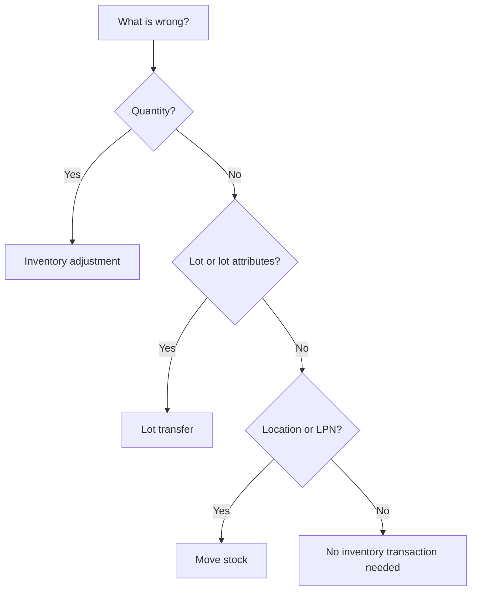

# Inventory control

Use these workflows when stock is in the warehouse but its quantity, lot, location or container needs to change. Choose the workflow by the physical change you are making.

| What needs to change | Use | Result |
|---|---|---|
| The recorded quantity is wrong | [Adjust stock](01-adjust-stock.md) | Sets the stock position to a reviewed target quantity and records the correction. |
| Stock keeps its place and container but needs another lot or lot attributes | [Transfer stock to another lot](02-transfer-stock-between-lots.md) | Moves the selected quantity from the source lot to a matching or newly created target lot. |
| Stock moves to another location or container | [Move stock and manage LPNs](03-move-stock-and-manage-lpns.md) | Moves free stock, keeps its LPN, creates a new LPN or merges into an existing LPN. |
| A new pallet label is needed during a move | [Generate and print an LPN](03-move-stock-and-manage-lpns.md#generate-and-print-a-new-lpn) | Generates a new LPN and previews or prints its identification label. |

Adjustments and lot transfers are supervisor workflows. The web move is also available to operators, but generating, previewing and printing a new LPN requires an administrator or manager. Review the selected stock and the intended result before the final action. **Post** changes stock in an adjustment or lot transfer. **Move** changes stock immediately after its checks pass.

## Where to find the screens

Open **Management & Control > Inventory**. The group contains **Balances**, **Adjustments**, **Counts**, **Lot Transfers** and other inventory workspaces.

The web move starts from **Balances > By Location** rather than from a separate menu item: select the stock row you want to move.
