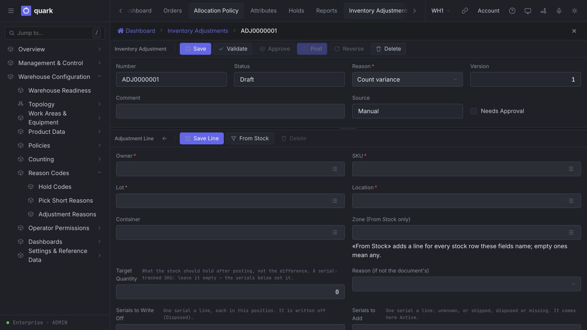

# Adjust stock

Use an inventory adjustment when the quantity recorded for a stock position is wrong. An adjustment is a reviewed document: creating and validating it does not change stock. Stock changes only when the document is posted.

## Before you start

- You have the **ADMIN**, **MANAGER** or **SUPERVISOR** role. Only an administrator or manager can approve an adjustment when its reason requires approval.
- An active adjustment reason exists under **Warehouse Configuration > Reason Codes > Adjustment Reasons**.
- You know the owner, SKU, lot, location and LPN of each affected stock position.
- You know the quantity that should remain after the correction.

## Create the adjustment

1. Open **Management & Control > Inventory > Adjustments**.
2. Select **New**. The system assigns an adjustment number and opens a draft.
3. Choose the **Reason**.
4. Enter a **Comment** when the reason requires one, or whenever the explanation will help the reviewer.
5. Select **Save**.
6. In the lines section, select **Add Line**.
7. Choose the **Owner**, **SKU**, **Lot** and **Location**. Choose the **Container** when the stock is inside an LPN; leave it empty for loose stock.
8. For stock without serial tracking, enter **Target Quantity**. This is the final quantity that should be on the stock position, not the amount to add or remove.
9. For a serial-tracked SKU, leave **Target Quantity** empty. Enter the individual serial numbers under **Serials to Write Off** and **Serials to Add**. The system calculates the target quantity from those serials.
10. Select **Save** and repeat for any other stock positions.

*Caption: a draft adjustment with its line form open. The line identifies the stock position and records the final Target Quantity, not a plus-or-minus difference.*

Examples:

| Recorded quantity | Correct quantity | Target quantity |
|---:|---:|---:|
| 10 | 8 | 8 |
| 3 | 7 | 7 |
| 5 | 0 | 0 |

## Review and post

1. Select **Validate**. The system checks every line without changing stock.
2. Review **Current**, **Target**, **Effect** and **Would Refuse** for every line.
3. If the reason requires approval, an **ADMIN** or **MANAGER** selects **Approve** after validation. A supervisor cannot approve the document and must wait for that approval before posting it.
4. Select **Post** only when the complete result is correct.

Posting is all or nothing. If one line cannot be posted, no line changes stock. A target below the quantity already allocated or picked is refused.

After posting, the adjustment cannot be edited or deleted. Use **Reverse** to create a separate correction that restores the earlier quantities, then review and post that document.

## What you should see

- The document moves through **Draft**, **Validated**, optionally **Approved**, and **Posted**.
- Each changed line records the quantity before and after the correction.
- The inventory transaction history contains one adjustment entry for each changed stock position.
- A reason configured to request a count creates follow-up counting work for the affected location.

## Related detail

- [Creating an adjustment](../../reference/inventory/43-creating-an-adjustment.md)
- [Adding adjustment lines](../../reference/inventory/44-adding-lines-to-an-adjustment.md)
- [Validating an adjustment](../../reference/inventory/46-validating-an-adjustment.md)
- [Approving an adjustment](../../reference/inventory/47-approving-an-adjustment.md)
- [Posting an adjustment](../../reference/inventory/48-posting-an-adjustment.md)
- [Reversing an adjustment](../../reference/inventory/49-reversing-an-adjustment.md)
