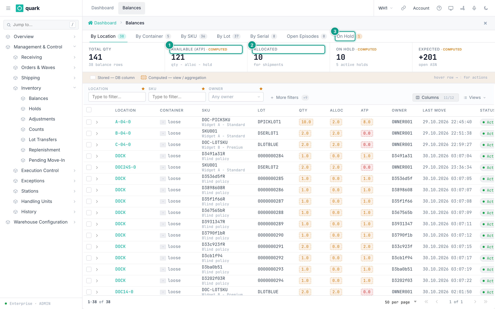

# Move stock and manage LPNs

Use the web move to move stock to another location, repack it into a new LPN or merge it into an existing LPN. The basic web move is available to **ADMIN**, **MANAGER**, **SUPERVISOR** and **OPERATOR**. Generating, previewing or printing a new LPN requires **ADMIN** or **MANAGER**. Operators can also perform the scanning workflow from the RF terminal; this page describes the web workspace.

## Open the move document

1. Open **Management & Control > Inventory > Balances**.
2. Stay on **By Location**.
3. Filter by location, SKU, owner, lot or LPN until the exact stock row is visible.
4. Open that row. The **Move** document shows the source identity, available quantity and destination controls.

*Caption: Balances > By Location. Open the row for the exact location, SKU, lot and LPN you intend to move.*

The move can use only stock that is not already allocated or picked. The document shows the maximum move quantity. Held stock can require supervisor authorization.

## Choose the destination

| LPN mode | Use it when | What to enter |
|---|---|---|
| **Keep** | The stock and its current LPN move together. Loose stock remains loose. | Choose a destination **Location** different from the source. |
| **New LPN** | The stock is repacked into a new pallet or container identified by the generated LPN label. | Choose a destination **Location**. It may be the same location when only the LPN changes. |
| **Existing** | The stock must join an LPN that already exists. | Choose the destination LPN. Its current location becomes the destination automatically. |

1. Select the LPN mode.
2. Choose the destination location or existing LPN required by that mode.
3. Enter **Move quantity**. Use the displayed maximum for a full available move or a smaller value for a partial move.
4. Enter a **Reason** when it will help the inventory history or when a controlled override requires it.
5. Select **Move**.

After a successful move, the system returns to **Balances** and refreshes the list. The transaction history records the source, destination, quantity and reason.

## Generate and print a new LPN

1. In the move document, select **New LPN**.
2. The system generates an LPN and displays it beside the mode buttons.
3. Select the eye icon to preview the identification label.
4. Select the printer icon to send the label to the configured printer.
5. Complete the move and confirm that it succeeded. The generated code becomes a registered LPN only when **Move** succeeds.
6. Attach the printed label to the new container after that confirmation.
7. Select **regenerate** only when the displayed code must be replaced. Destroy or remove any label printed with the earlier code.

The print action uses the LPN identification label and the printer configuration prepared in [Printing and Labels](../07-printing-and-labels.md). If preview works but printing does not, check the label template, printer route and printer availability before moving the stock.

If you select **Cancel** or the move fails, the generated code is not registered. Destroy or remove its printed label; do not place it on stock.

## Important rules

- **Keep** needs another location; otherwise nothing changes.
- **New LPN** can keep the same location because the container changes.
- **Existing** takes the location of the selected destination LPN.
- A partial move splits the balance row.
- Allocated or picked quantity cannot be moved from this screen.
- Moving a parent LPN also moves its child containers when the complete container is moved.
- Selecting **Cancel** leaves stock unchanged.

## Related detail

- [Moving stock](../../reference/inventory/40-moving-stock.md)
- [Move stock document](../../reference/inventory/17-move-stock-document.md)
- [RF operator move](../../operator/06-move.md)
- [Printing and Labels](../07-printing-and-labels.md)
