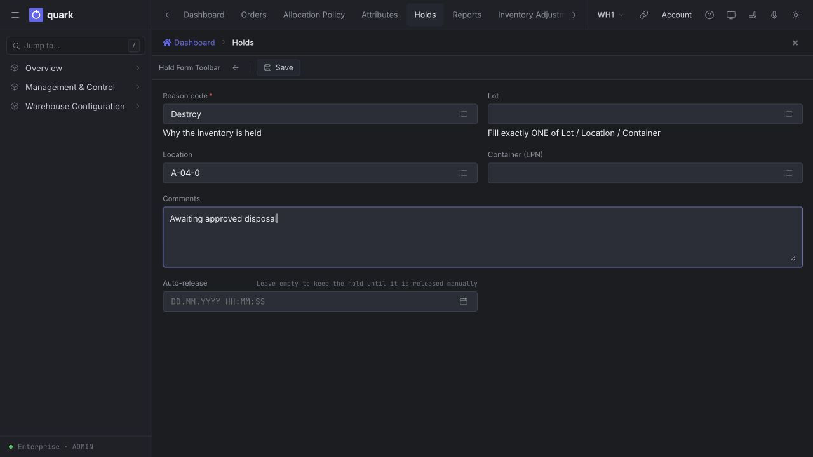
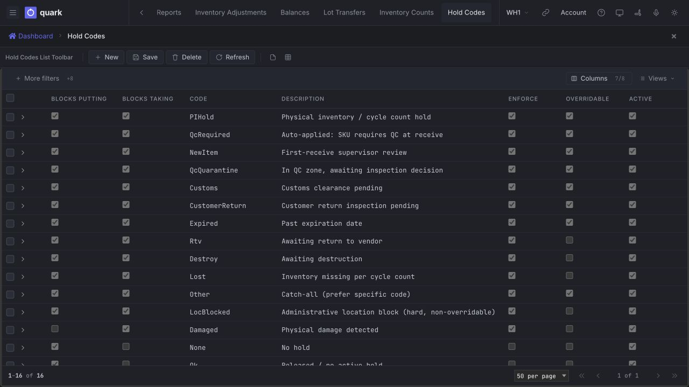

# Hold and release stock

Use a hold when the recorded quantity is correct but the stock must not be used normally. A hold can stop stock from being put away, moved, allocated or picked without removing it from the warehouse balance.

Use an [inventory adjustment](01-adjust-stock.md) instead when the quantity itself is wrong.

## Before you start

- You have the **ADMIN** or **MANAGER** role, or a custom role with permission to manage inventory holds.
- An active reason code exists under **Warehouse Configuration > Reason Codes > Hold Codes**.
- You know exactly what the hold covers: one lot, one location or one container (LPN).
- You understand whether the reason should block putting stock in, taking stock out, or both.

## Choose the hold scope

Each hold must use exactly one scope.

| Scope | What it covers | Typical use |
|---|---|---|
| **Lot** | Every balance position that uses the lot code. This can include more than one SKU or owner when they share that code. | Quality quarantine, expiry review or customs clearance for a lot. |
| **Location** | All stock in the location while the hold is active. | Unsafe rack, damaged location or an area closed for investigation. |
| **Container (LPN)** | All stock identified by that LPN. | One suspect pallet, tote or carton. |

Use an LPN hold for an open pick pallet. The system does not allow a location hold on the in-transit place used by open pick pallets.

## Place a hold

1. Open **Management & Control > Inventory > Holds**.
2. Select **New Hold**.
3. Choose the **Reason code**.
4. Fill exactly one of **Lot**, **Location** or **Container (LPN)**.
5. Enter **Comments** that tell the next person why the stock is held and what must happen before release.
6. Set **Auto-release** only when the hold has a known end time. Leave it empty when a person must review and release the stock.
7. Select **Save**.

*Caption: a location hold prepared for `A-04-0`. Exactly one target is filled; quantity is not changed.*

The hold appears in the **Holds** list. The list shows its reason code, scope, target, covered quantity, start time, optional auto-release time, user and comments.

## What the hold changes

- The physical and recorded quantity stay unchanged.
- A hold that blocks taking makes the covered stock unavailable for new allocation and picking.
- A hold that blocks putting prevents receiving or moving stock into the covered location.
- An enforcing location hold changes the location status to **Hold**. A damage hold can show the location as **Damage**.
- The covered stock remains visible in **Balances** and on the **On Hold** view.
- Existing reservations are not silently rewritten. Resolve any work that was already released before the hold was placed.

Allocation cannot ask a person to approve a warning. Stock that is blocked from taking is therefore unavailable even when the reason code is marked **Overridable**.

## Release a hold

1. Open **Management & Control > Inventory > Holds**.
2. Select one active hold.
3. Select **Release**.
4. Refresh **Balances** and confirm that the stock is available for the intended process.

The released row disappears from the active Holds list. The inventory quantity does not change. When an auto-release time is set, the system releases the hold after that time without requiring the button.

Do not switch off a reason code as a substitute for releasing holds. Switching it off changes the behaviour of every active hold that uses that code and leaves the hold records open.

## Configure hold reason codes

Open **Warehouse Configuration > Reason Codes > Hold Codes**. Administrators and managers can edit the behaviour of a supported existing code. Do not add an arbitrary code without product support: inventory movement recognises the standard hold-code catalog, so an unsupported code can stop a move with a system error.

*Caption: Hold Codes shows the two blocking directions beside Enforce, Overridable and Active. The check boxes describe what every active hold using that code will do.*

| Setting | What it means |
|---|---|
| **Code** | Stable name used by holds and warehouse rules. Do not rename a code that is already in use. |
| **Description** | Operator-facing explanation of the reason. Keep it specific enough for a supervisor decision. |
| **Rank** | Required catalog value. It has no ordering or blocking-priority effect in the current workflow. |
| **Enforce** | Controls interactive move and receiving checks and the status of a held location. When it is off, those checks do not stop on this reason. Allocation and pick confirmation still follow **Active** and **Blocks taking**. |
| **Overridable** | Allows an authorised supervisor to accept an interactive warning and continue. It does not make stock available to automatic allocation. |
| **Blocks putting** | Stops receiving or moving stock into a held destination location. This direction is evaluated for location holds. |
| **Blocks taking** | Stops stock from being used for allocation, picking or a move out of the held lot, location or LPN. |
| **Active** | Makes the reason usable and its rules effective. Retire an unused reason by switching this off; release existing holds separately. |

### Recommended combinations

| Purpose | Best scope | Enforce | Overridable | Blocks putting | Blocks taking |
|---|---|---:|---:|---:|---:|
| Hard quarantine for a lot or LPN | Lot or LPN | On | Off | Off | On |
| Quarantine that a supervisor may move | Lot or LPN | On | On | Off | On |
| Unsafe or closed location | Location | On | Off | On | On |
| Stop stock entering a location | Location | On | As required | On | Off |
| Informational marker only | Lot or LPN | Off | Off | Off | Off |

**Blocks putting** is a destination-location rule. A lot or LPN hold is checked on the source/taking side. An enforcing location hold also marks the whole location as **Hold**, so picking and putaway may still avoid that location even when **Blocks taking** is off.

For a truly informational code, switch off **Enforce**, **Blocks putting** and **Blocks taking**. Switching off **Enforce** alone does not restore ATP or picking when **Blocks taking** remains on.

## Common examples

| Situation | Suggested scope | Suggested behaviour |
|---|---|---|
| One returned pallet waits for inspection | Container (LPN) | Block taking. Make the code overridable only when a supervisor is allowed to confirm its move to the inspection area. |
| A complete lot waits for quality approval | Lot | Block taking; make the warning overridable only when the warehouse allows a controlled move. |
| A rack location is unsafe | Location | Hard block putting and taking; do not allow an override. |
| Goods are waiting for destruction | Container (LPN) or lot | Block taking and do not allow an override. |
| A temporary operational note must remain visible | Lot or LPN | Informational combination: all blocking settings off. |

## If an operation is refused

| What you see | What to check |
|---|---|
| Stock is visible but available quantity is zero | Open **Holds** and check for a lot, location or LPN hold with **Blocks taking** on. |
| A move cannot leave the source | Check holds on the source location, lot and LPN. Release the hold or use an allowed supervisor confirmation. |
| A move or receipt cannot use the destination | Check the destination location for a reason with **Blocks putting** on. |
| The warning cannot be overridden | The reason is not overridable, the role lacks permission, or the operation has no interactive override. Release the hold after the required review. |
| The location picker refuses an in-transit place | Hold the pick pallet by its LPN instead of holding the shared in-transit location. |

## Related guides

- [Move stock and manage LPNs](03-move-stock-and-manage-lpns.md)
- [Adjust stock](01-adjust-stock.md)
- [Balances and availability](../../reference/inventory/01-balances-screen-overview.md)
- [Holds list](../../reference/inventory/20-holds-list.md)
