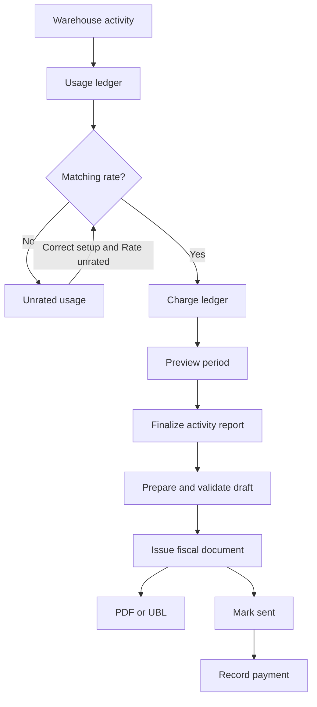
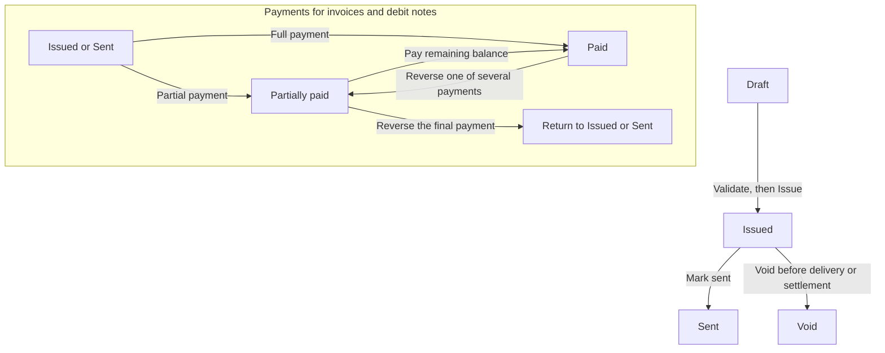

# Billing Lite and VAT

Billing Lite turns completed warehouse work into an activity report and, when
required, a VAT invoice. One billing account can consolidate activity from two
or more warehouses, while every usage fact and charge keeps its warehouse and
stock-owner attribution.

This is a controlled usage-rating and invoicing workflow. It is not a complete
3PL contract-management or accounts-receivable system. Read [Current limits](#current-limits)
before adopting it for a legal or customer-facing process.

## What you will do

1. Create a billing account and connect the correct owner in each warehouse.
2. Define effective-dated rates and VAT rules.
3. Review captured usage and resolve anything that could not be rated.
4. Preview and finalize an activity report for a period.
5. Prepare, validate and issue a fiscal document.
6. Download PDF or UBL, record delivery and reconcile payments.

## Before you start

- Work in **Enterprise** mode. Billing Lite is not a warehouse-local menu.
- Use `ADMIN` or `MANAGER` to configure billing and perform billing actions.
  `SUPERVISOR` can read the billing registers, preview periods and download
  exports. It cannot change setup or finalize a period.
- Create all warehouses and owners first. Complete the legal and billing
  requisites on the relevant owner cards.
- Choose one warehouse as the issuer. Exactly one owner at that warehouse must
  represent the legal entity that issues the fiscal document.
- Identify one connected owner as the **Billing identity**. Its frozen details
  become the buyer details on the invoice.
- Have the approved rates, currency, VAT treatment, fiscal number ranges and
  effective dates available. A qualified tax professional must approve the VAT
  setup for the legal entities and jurisdictions involved.

### Roles

| Role | What it can do |
|---|---|
| `ADMIN`, `MANAGER` | Create and change accounts, owner bindings, rates, VAT rules and fiscal sequences; rate usage; finalize periods; prepare, validate, issue and update fiscal documents; record and reverse payments. |
| `SUPERVISOR` | Read accounts, setup and ledgers; preview periods; export activity reports; download invoice PDF and UBL. |
| `VIEWER` | Read storage reconciliation only. |

## 1. Prepare issuer and buyer requisites

Billing takes legal names and identifiers from owner master data. Complete the
owner cards before preparing the first invoice.

For the issuer owner, provide the legal company name, country and postal
address, VAT or company identifier as applicable, default currency and bank
details used on the fiscal document. Complete the same buyer identity fields
for the owner that will be marked **Billing identity**.

Finalizing the activity report freezes the seller and buyer details. Changing
an owner card later does not rewrite that report or any fiscal document prepared
from it.

## 2. Create the billing account

1. Switch the warehouse selector to **Enterprise**.
2. Open `Sidebar > Billing Lite > Accounts`.
3. Click **New** and fill:

| Field | Meaning |
|---|---|
| **Code** | Stable account code used by billing operations. |
| **Name** | Customer-facing account name. |
| **Issuer warehouse** | Warehouse whose legal entity and fiscal sequence issue the invoice. |
| **Enabled from** | First date on which activity can belong to the account. |
| **Disabled at** | Optional end of the account's active period. |

4. Save the account.

An account may consolidate several warehouses, but it does not erase their
boundaries in the ledgers. Usage and charges retain both **Warehouse** and
**Owner** attribution. The consolidated PDF activity annex summarizes activity
by warehouse.

## 3. Connect owners by warehouse

1. Open `Sidebar > Billing Lite > Owners by warehouse`.
2. Click **New**.
3. Select the **Billing account**, then the **Warehouse**, then the owner from
   that warehouse.
4. Set **Enabled from** and, when needed, **Disabled at**.
5. Turn on **Billing identity** for exactly one connection in the account.
6. Repeat for every warehouse and stock owner whose activity belongs in the
   consolidated report.

The warehouse and owner are a pair. Connecting an owner in one warehouse does
not add another warehouse's activity to the billing account, even when the same
owner code exists there.

### Example: two warehouses and three owners

Fictional account `NORTHSTAR` contains:

| Warehouse | Stock owner | Billing identity | Result |
|---|---|---:|---|
| `WH-NORTH` | `NORTHSTAR-RETAIL` | Yes | Buyer identity and north-site activity. |
| `WH-NORTH` | `NORTHSTAR-MARKETPLACE` | No | Marketplace stock activity, still attributed separately. |
| `WH-SOUTH` | `NORTHSTAR-RETAIL` | No | South-site activity under the same consolidated account. |

The final activity report has one account total, but its underlying charges
still show the warehouse and owner that produced them.

## 4. Create rates

Open `Sidebar > Billing Lite > Rates` and create an effective-dated rate for
each billable activity and unit.

| Field | Meaning |
|---|---|
| **Billing account** | Account to charge. |
| **Warehouse override** | Optional site-specific price. Leave empty for the account-wide price. |
| **Activity** | Implemented billing activity. |
| **Unit** | Unit that must match the activity fact. |
| **Unit price** | Exact decimal price per unit. |
| **Valid from**, **Valid to** | Dates on which the rate applies. Activity is rated by its occurrence time. |
| **Description** | Optional operational note. |

A warehouse override wins over the account-wide rate. The system refuses
overlapping dates at the same account, warehouse, activity and unit scope.

### Activities currently rated

| Activity | Unit | Source event or snapshot |
|---|---|---|
| Inbound line | `LINE` | A receipt line is received. |
| Inbound unit | `BASE_UNIT` | Base units are received. |
| Inbound case | `CASE` | Cases are received. |
| Pick order | `ORDER` | An order is picked. |
| Pick line | `LINE` | Lines on that order are picked. |
| Pick unit | `BASE_UNIT` | Base units on that order are picked. |
| Pack order | `ORDER` | An order is packed. |
| Pack package | `PACKAGE` | Packages are produced by packing. |
| Outbound shipment | `SHIPMENT` | One fact is created for each posted Goods Issue. A partially shipped order can produce more than one fact. |
| Outbound line | `LINE` | Shipped lines are counted. |
| Outbound unit | `BASE_UNIT` | Shipped base units are counted. |
| Storage pallet-day | `PALLET_DAY` | The daily storage snapshot counts eligible pallets. |

The system deduplicates repeated delivery of the same source fact. Planned
receipts and load-planning events are not billable activity. Storage currently
supports pallet-day, not cell-day.

## 5. Review usage and charges

- `Sidebar > Billing Lite > Usage ledger` shows captured facts, including
  account, warehouse, owner, activity, quantity, unit, occurrence time and
  source reference.
- `Sidebar > Billing Lite > Charge ledger` shows the selected unit price,
  amount and currency. A finalized charge also points to its activity report.
- `Sidebar > Billing Lite > Storage snapshots` shows storage snapshot runs.

An **unrated** usage fact is evidence, not a zero-price charge. Check the owner
binding, activity/unit pair, occurrence date and rate dates. Then select the
account in **Accounts**, click **Close period**, enter the dates and click
**Rate unrated**. The result reports how many facts were examined, rated and
still unrated.

Storage snapshots run at most once per warehouse and business date. The web UI
shows the runs but does not expose the reconciliation operation. Ask an
implementer or support user to run the storage reconciliation API when a
pallet-day count is missing or unexpected.

## 6. Preview and finalize an activity report

1. Open `Sidebar > Billing Lite > Accounts`.
2. Tick one account and click **Close period**.
3. Enter **Period start** and **Period end**. Both dates are inclusive.
4. Click **Preview**.
5. Check the total, warehouse count and **unrated** count.
6. If anything is unrated, close the gap and click **Rate unrated**, then
   **Preview** again.
7. Click **Finalize** only after the result is complete.

Finalization allows only one close for the same account and period. It freezes
the selected charges, currency, total, seller and buyer details, and integrity
hash. A closed report cannot be changed by later rate or owner-card edits.

Open `Sidebar > Billing Lite > Activity reports` to review the closed report.
Tick one closed row and click **Export CSV** for a UTF-8 activity export. The
activity report does not currently have a PDF export.

## 7. Configure VAT rules

Open `Sidebar > Billing Lite > VAT rules`. Each rule is effective-dated and can
apply to the whole account or be narrowed by warehouse and activity. The most
specific matching rule wins. Two equally specific matches block invoice
preparation until the ambiguity is removed.

| VAT category | Use |
|---|---|
| `S` | Standard rated. Enter a rate greater than 0 and not more than 100. The seller VAT identifier is required. |
| `Z` | Zero rated. Enter an explicit zero rate and the required legal basis. |
| `E` | Exempt from VAT. Enter an explicit zero rate and legal basis. |
| `AE` | Reverse charge. Enter an explicit zero rate and legal basis. Seller and buyer VAT identifiers are required. |
| `G` | Export outside the EU. Enter an explicit zero rate and legal basis. |
| `K` | Intra-community supply. Enter an explicit zero rate and legal basis. Seller and buyer VAT identifiers are required. |
| `O` | Outside the scope of VAT. Do not enter a VAT rate; enter the legal basis. |

Every category except `S` requires the applicable exemption reason, reason code
or legal reference. The system does not infer tax treatment from an address.

Tax is aggregated and rounded by VAT group using the document currency's minor
unit. Prices, usage and ledger values retain exact decimals before fiscal
rounding. Review the result with a qualified tax professional; software
validation does not replace legal approval.

## 8. Configure fiscal sequences

Open `Sidebar > Billing Lite > Fiscal sequences`. Configure a sequence for the
issuer warehouse, issuer owner, country and document type. Configure a separate
effective sequence for each document type you will issue: invoice, credit note
and debit note. Set the prefix, number range, width and effective date. For
Bulgarian sequences, the current rules require an empty prefix and a 10-digit
number.

The number is assigned only when **Issue** succeeds. A failed issue attempt does
not consume a committed number, and an issued number is never reused.

## 9. Prepare, validate and issue an invoice

1. Open `Sidebar > Billing Lite > Activity reports`.
2. Tick one closed report and click **Prepare invoice**.
3. Choose **Tax jurisdiction** and **Tax point date**. Add **Due date** when
   required, then click **Prepare**.
4. Open `Sidebar > Billing Lite > Fiscal invoices`.
5. Tick the draft and click **Validate**. Enter the intended **Issue date**.
6. Resolve every reported prerequisite. Validation checks frozen identities,
   lines, totals, VAT groups, sequence readiness and UBL requirements without
   consuming a fiscal number.
7. Tick the draft, click **Issue**, enter **Issue date**, then confirm **Issue**.

Issuing freezes fiscal content and assigns the official number. Do not issue a
document until the buyer, seller, currency, lines, VAT treatment and dates are
approved.

### Fiscal document lifecycle

Payment paths in this diagram apply only to invoices and debit notes. Credit
notes cannot receive payment allocations. Another partial payment or reversal
can also leave the document `Partially paid` while a balance remains.

**Mark sent** records delivery state; it does not send email or submit to a
Peppol access point. **Mark paid** records the whole outstanding balance as a
manual payment. Use **Record payment** when the actual payment date, method and
external reference must be retained.
An invoice that was delivered or has a settled amount cannot be voided.

## 10. Download PDF and UBL

From `Fiscal invoices`:

- Click **Download PDF**, select **Document language**, then **Download**.
- Click **Download UBL** for the EN 16931-oriented XML document.

PDF is available in English and Bulgarian. Bulgarian is a document language,
not a promise that the web interface is localized in Bulgarian.

UBL generation includes deterministic product checks. An installation can also
use a configured EN 16931 validation service. When that service is configured,
validation fails closed if it is unavailable or rejects the document. Without
that service, core checks and UBL generation remain available; external profile
validation does not run. Configure and monitor the validation service before
production fiscal use.

## 11. Credit notes and debit notes

Select an `Issued`, `Sent` or `Paid` invoice in `Fiscal invoices`.

### Full credit note

1. Click **Full credit note**.
2. Enter **Tax point date** and **Correction reason**.
3. Click **Prepare credit note**.
4. Validate and issue the resulting draft through the same invoice actions.

A full credit note reverses the complete original fiscal content. Partial
credit notes are not supported.

### Debit note

1. Click **Debit note**.
2. Enter **Tax point date**, **Due date**, a positive **Adjustment percent** and
   **Correction reason**.
3. Click **Prepare debit note**.
4. Validate and issue the resulting draft.

The adjustment percent must be greater than 0 and no more than 1000. The debit
note recalculates line and VAT totals from the original document.

## 12. Record and reverse payments

Payment reconciliation is one fiscal document at a time. An invoice or debit
note can have several payments, but one entered payment cannot be split across
several documents.

1. In `Fiscal invoices`, tick one `Issued`, `Sent` or `Partially paid` invoice
   or debit note.
2. Click **Record payment**.
3. Enter **Payment date**, **Amount**, **Payment method** and a unique
   **External reference**.
4. Click **Record**.

Supported payment methods are bank transfer, card, cash, direct debit and
manual. Currency is inherited from the fiscal document, and the payment cannot
exceed its remaining amount. The external reference must be unique within the
billing account. A partial allocation changes the document to
`Partially paid`; complete settlement changes it to `Paid`.

To correct a payment, open `Sidebar > Billing Lite > Payments`, tick one posted
payment, click **Reverse**, enter **Reversal reason** and confirm **Reverse**.
The original row remains in the ledger with `Reversed` status, the allocation
is undone and the fiscal document's settlement status is recalculated.

`Sidebar > Billing Lite > Payment allocations` shows the immutable link between
each payment and fiscal document.

## Test Billing Lite before go-live

Use fictional data in a non-production tenant.

1. Create one account with an issuer warehouse and connect one owner in each of
   two warehouses. Mark one connection as **Billing identity**.
2. Complete seller and buyer requisites.
3. Add account-wide rates for one inbound activity and one outbound activity.
   Add a warehouse override for one of them.
4. Configure an approved VAT rule and the invoice sequence.
5. Complete a small receipt in the first warehouse and pick, pack and ship a
   small order in the second.
6. Confirm both facts in **Usage ledger** and their separate warehouse/owner
   attribution. Confirm the override price in **Charge ledger**.
7. Preview the period. Expected: two warehouses, no unrated usage and the sum
   of the visible charges.
8. Finalize, open **Activity reports** and download **Export CSV**. Compare its
   rows and total with the charge ledger.
9. Prepare and **Validate** an invoice. Review seller, buyer, dates, currency,
   VAT groups and totals before **Issue**.
10. Download PDF and UBL. If external UBL validation is configured, confirm a
    successful validation result.
11. Click **Mark sent**, record a partial payment and confirm `Partially paid`.
    Record the remainder and confirm `Paid`.
12. Reverse the last payment and confirm that the payment remains visible and
    the invoice returns to the calculated earlier settlement state.

Do not treat this walkthrough as tax certification, printer certification,
email delivery certification or Peppol certification.

## Audit and integration evidence

Closed activity reports, issued fiscal content, payment allocations and
reversals are retained as evidence. Billing publishes lifecycle events for
issued, sent, paid and voided documents, and for posted and reversed payments.
Retries do not create a second business event, and each event retains its
warehouse and owner attribution.

Use the enterprise audit and event screens to investigate who performed an
action and whether a downstream consumer received it. Event availability does
not itself mean that an external accounting, email or Peppol adapter is
configured.

## If something goes wrong

| Message or symptom | Meaning | Fix |
|---|---|---|
| Unrated usage remains | No unambiguous effective rate matches the account, warehouse, activity, unit and occurrence date. | Correct the binding or rate, then use **Rate unrated** and preview again. |
| The billing period cannot be previewed | Dates, account setup or captured facts are inconsistent. | Check the selected account and inclusive dates, then review the usage ledger. |
| The billing period was not closed | Unrated usage, concurrent close or changed ledger content blocked finalization. | Refresh, resolve unrated rows and preview again before **Finalize**. |
| The fiscal invoice was not prepared | Seller/buyer identity, tax rule, dates or closed report is incomplete. | Complete requisites and VAT setup, then prepare again. |
| The fiscal invoice is not ready | Deterministic validation found a missing or inconsistent fiscal field. | Follow the returned message; do not issue until validation passes. |
| The invoice UBL was not generated | Fiscal prerequisites or external validation failed. | Correct the draft setup, or restore the configured validation service. |
| The payment was not recorded | Status, amount, method or external reference is invalid. | Use an `Issued`, `Sent` or `Partially paid` invoice or debit note and enter no more than the remaining amount. |
| The invoice cannot be voided | It was already delivered or has a settled amount. | Use the approved correction document and payment-reversal workflow instead. |
| A repeated external payment reference is rejected | The same reference was already used with different payment data. | Reconcile the existing payment; do not reuse a bank reference for a different amount or document. |

## Current limits

- This release does not provide contract authoring, minimum charges, tiered
  prices, recurring subscription fees or full 3PL billing.
- No foreign-exchange conversion is performed. Keep one approved document
  currency and matching rates for a billing period.
- Activity report export is CSV only; there is no activity-report PDF.
- Storage billing supports pallet-day only. Cell-day is not implemented.
- Credit notes reverse the full original document; partial credit notes are not
  implemented.
- Payments are entered manually. There is no bank-statement import, automatic
  matching or allocation of one payment across several invoices.
- **Mark sent** records a state. Billing Lite does not send email and does not
  provide Peppol AS4 delivery.
- External EN 16931 validation is installation-dependent. PDF and UBL output do
  not by themselves prove legal acceptance in a country or trading network.
- Upgrade only after taking a normal enterprise database backup and reviewing
  active accounts, rate periods, open drafts, fiscal sequences and the totals of
  already issued documents. Reconcile those records again after the rollout.

## Related guides

- [Owners, SKU, UOM, Pack Hierarchy, Lot and Serial Rules](04-owners-sku-uom-pack-hierarchy.md)
- [Inbound Setup](05-inbound-setup.md)
- [Outbound Setup](06-outbound-setup.md)
- [Reports and Dashboards](08-reports-and-dashboards.md)
- [Integrations and API](09-integrations-and-api.md)

