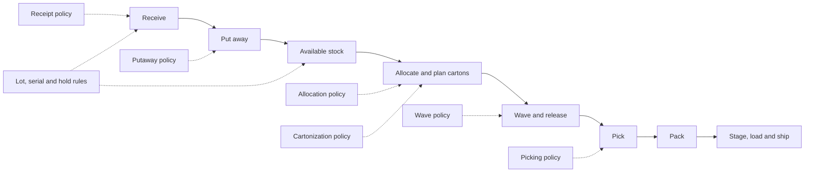

# Policy reference

Policies turn warehouse rules into repeatable decisions. Use this section when
you need to understand which setting controls a workflow, choose safe defaults,
or explain why Quark selected a particular location, stock balance or task.

Start with the overview for the process you are configuring. Open the detailed
reference only when you need the exact field, allowed values or interaction
with another setting.

## Choose the process

| Process | Start here | What you configure |
|---|---|---|
| Receiving | [Receipt policy](40-receipt-policy-settings.md) | LPN requirements, unexpected SKUs, quantity differences, pack multiples and date checks. |
| Putaway | [Putaway overview](00-putaway-overview.md) | How Quark chooses a destination from policy steps, zones, locations and stock-mixing rules. |
| Allocation | [Allocation overview](10-allocation-overview.md) | Which eligible stock an order reserves and in what order. |
| Waves | [Wave overview](12-wave-overview.md) | How orders are grouped, scheduled and released. |
| Picking | [Picking overview](20-picking-overview.md) | Picking mode, work area, equipment, shortage handling and count requests. |
| Cartonization | [Cartonization overview](30-cartonization-overview.md) | How Quark selects cartons and plans picked goods into them. |
| Lots | [Lot policy and attributes](32-lot-policy-and-attributes.md) | Lot creation, dates and customer-defined lot attributes. |
| Serial numbers | [Serial configuration](33-serial-configuration.md) | Which SKUs require serials and how scanned values are validated. |
| Replenishment | [Replenishment status](35-replenishment-status.md) | Min/max planning, task monitoring and RF completion. |

## Settings used across processes

| Settings | Guide | Where they matter |
|---|---|---|
| Owner defaults | [Owner settings and policy selection](41-owner-settings-and-policy-resolution.md) | Default policies, locations, units, damage handling, LPN rules and printing. |
| SKU settings | [SKU-level settings](34-sku-level-settings.md) | SKU-specific policy choices and handling rules. |
| Warehouse settings | [System settings](42-system-settings.md) | Warehouse-wide timeouts, task behavior, dashboards and printing. |
| Holds and reasons | [Reason codes and holds](43-reason-codes-and-holds.md) | Blocking stock, recording shortages, adjustments, damage and returns. |
| Work areas and equipment | [Work areas, equipment and permissions](22-work-areas-equipment-and-permissions.md) | Picking policy selection, stations, equipment profiles and operator access. |

## How Quark chooses a rule

The most specific applicable setting normally wins. The detailed page for each
process states the exact order. Common examples are:

- A SKU policy can override the owner's default policy.
- A work-area and equipment combination can override the work area's default
  picking policy.
- A location rule can be more specific than its zone rule.
- The owner can set a putaway-reservation time that overrides the warehouse
  default for that owner's stock.

Changing a policy normally affects the next decision. It does not rewrite
completed work or move existing stock. A guide calls out the exceptions, such
as settings that are copied onto a document when it is created.

## From receipt to shipment

Holds can affect receiving, putaway, movement, allocation and picking. Some
warnings can be confirmed by the operator. Others require a supervisor or
cannot be confirmed; each detailed guide identifies the applicable rule.

## Reading a detailed policy page

Detailed pages use the same customer-facing terms:

| Term | Meaning |
|---|---|
| **UI label** | The English label shown in Quark. |
| **Allowed values** | Values the field accepts. |
| **Default** | The value used when you do not choose one. |
| **Effect** | The workflow decision changed by the setting. |
| **Message** | What an operator or administrator sees when the rule blocks or warns. |
| **Interaction** | Which setting wins when several settings apply. |
| **When changed** | Whether existing work is affected or only new decisions use the value. |

For a practical warehouse setup sequence, continue with [Inbound setup](../05-inbound-setup.md),
[Outbound setup](../06-outbound-setup.md), [Printing and labels](../07-printing-and-labels.md)
and [Owners, SKU, units and packs](../04-owners-sku-uom-pack-hierarchy.md).
