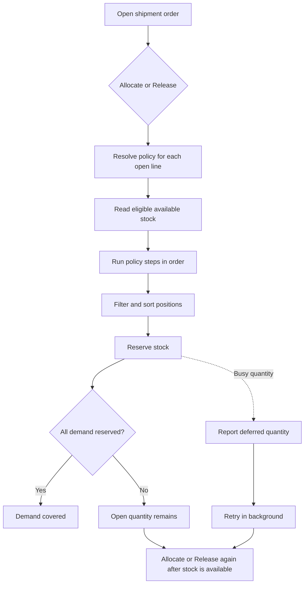

# Allocation Overview

Allocation reserves available stock for shipment order lines. It decides which
stock can be used, the order in which eligible positions are considered, and
how much to reserve from each position.

Use this page to understand the workflow. See
[Allocation Policy: Header, Steps and Criteria](11-allocation-policy-steps-and-criteria.md)
for the individual policy settings.

## Before you start

Check that:

- the SKU or its owner has an active allocation policy;
- the policy has at least one active step that matches a unit in the SKU's
  pack hierarchy;
- the SKU has the required lot, rotation, and shelf-life settings;
- stock is in an allocatable location and is not blocked by a hold;
- the order line uses the correct owner, SKU, quantity, and requested pack.

An order line keeps the policy version selected when the line is created. A
deactivated policy cannot be assigned to a new line, but existing lines keep
using their saved version. Publish and assign a replacement policy for new
work before deactivating the old one.

## How allocation works

For each open order line, Quark:

1. Calculates the quantity that is still not reserved.
2. Loads the allocation policy saved on the line.
3. Splits demand across the matching units in the pack hierarchy, from larger
   units to the base unit.
4. Runs active policy steps in sequence. A later step receives demand that an
   earlier step could not cover.
5. Applies the step's location, LPN quantity, and quantity-fit filters.
6. Sorts eligible positions by the configured sort order.
7. Reserves as much as possible from each position until the demand is covered
   or no eligible stock remains.

Before release, allocation creates reservations without handing work to a
picker. After the order is launched, an allocation top-up can also hand out
executable picking tasks.

## Start allocation from an order

Open **Sidebar > Outbound > Orders**, then open the shipment order.

With the default roles, **Operator**, **Supervisor**, **Manager**, and
**Administrator** can use **Allocate**. **Release** and **Unallocate** require
**Supervisor**, **Manager**, or **Administrator** access. Custom role grants may
differ.

### Reserve before starting work

On an order that has not been released, click **Allocate**. Quark reserves
stock but does not hand work to operators. The confirmation reports quantities
in this form:

`Order SO-100 allocated 80, short 20`

The order becomes **Allocated** when all demand is covered or
**Partially Allocated** when some demand remains open.

### Top up an order already in work

On an order that is already released, **Allocate** reserves replacement or
newly available stock. It also creates tasks for executable reservations that
do not already have tasks. The order remains in the released status family.

### Reserve and start work

Click **Release**. Quark validates the order, reserves any remaining eligible
stock, and creates work for reservations that are ready to execute.

Releasing a wave applies the same release-and-allocation process to its member
orders.

The confirmation reports both actions, for example:

`Order SO-100 released; allocated 80, short 20`

An order with uncovered demand can be released. Its status remains partial
until the remaining stock is reserved and the missing work is handed out.
After stock becomes available, click **Release** again to top up the order and
dispatch the new work.

### Return reservations to available stock

Click **Unallocate** to release reservations that have not entered work.
Reservations already being worked are kept. If every reservation is removed,
the order returns to **New** and must be released again before picking can
start.

## Which stock is eligible

A position must pass all of these checks:

| Check | What it means |
|---|---|
| Owner and SKU | Stock belongs to the same owner and SKU as the order line. |
| Available to promise | Quantity remains after existing reservations, picked quantity, and blocking holds are deducted. |
| Pack | When the customer requested a pack, only stock in that pack is eligible. When no pack was requested, the line shows the SKU's default pack, but allocation may use available stock in any pack of that SKU. Each pack is measured through its own hierarchy. |
| Location condition | The location status is **Ok** and it has no operational flag. |
| Location purpose | Stock waiting in QC, damage, returns, staging, packing, sorting, consolidation, order control, lost, destruction, return-to-vendor, or in-transit locations is not allocated. |
| Policy step | Putaway zone, location category, ABC class, and location type match the current step when those filters are set. |
| Shelf life | The lot is not expired and satisfies the SKU's minimum shelf life. A required expiration date must be present. |
| Customer lot requirements | A requested lot and any required lot attributes match the promise saved on the order line. |

An active outbound-blocking hold makes the affected balance unavailable. See
[Reason Codes and Holds](43-reason-codes-and-holds.md) for hold behavior.

### Pick faces before reserve storage

Allocation does not infer a pick zone. Configure the preference as ordered
steps, for example:

1. a step restricted to location type **Pick**;
2. a later step for the remaining eligible storage locations.

The second step receives only the quantity that the first step could not
cover.

## Rotation and selection order

The policy controls the sort order inside each step. The supported choices
include lot rotation, location route, and LPN quantity.

- **FIFO** takes the oldest value selected by **Rotate By** first.
- **LIFO** takes the newest value first.
- **FEFO** takes the earliest expiration date first.
- A position without the date used for rotation sorts after dated stock.
- A later sort field breaks ties left by the earlier field.

Shelf-life eligibility is checked before rotation. Stock that would be first
by FIFO or FEFO is still excluded when it does not meet the required shelf
life.

### Example: FEFO with a partial result

An order needs 100 EA. Two eligible lots exist:

| Lot | Expiration | Available |
|---|---:|---:|
| LOT-A | 2026-11-20 | 60 EA |
| LOT-B | 2026-12-15 | 25 EA |

With FEFO, Quark reserves 60 EA from LOT-A and then 25 EA from LOT-B. The
result is 85 allocated and 15 short. When more eligible stock arrives, run
**Allocate** or **Release** again for the remaining 15 EA.

## Partial allocation and shortages

Partial allocation is the normal result when eligible stock cannot cover the
full order quantity. Quark reserves what it can and leaves the remainder open
on the order line.

There is no separate backorder document created by allocation. The open
quantity remains on the shipment order line. Receiving new stock does not by
itself allocate that stock to the order; run **Allocate** or **Release** again.

A shortage does not mean that all on-hand stock is physically missing. Stock
may be excluded because it is held, in the wrong pack or location, below the
shelf-life threshold, or does not match the order's lot requirements.

## Busy stock and automatic retry

When another operation is updating an otherwise eligible position, Quark does
not wait for it and does not report it as a stock shortage. The message names
the quantity separately:

`deferred 20 (busy stock, try again)`

Quark retries deferred allocation in the background. If the order is still
partial after the competing operation completes, run **Allocate** or
**Release** again.

After a picker reports a short quantity, Quark also attempts to reserve
replacement stock for the same order. The original order line and its saved
policy remain in effect.

## Configuration problem or stock shortage?

| Result | Meaning | What to do |
|---|---|---|
| The message reports **short** | The policy ran, but eligible stock did not cover demand. | Check availability, holds, location filters, shelf life, lot requirements, and pack. Then replenish or correct the stock and run allocation again. |
| The message reports **deferred** | Eligible stock was busy in another operation. | Wait for that operation, then refresh. Quark retries automatically; run allocation again if demand remains. |
| **Allocate failed** names the policy | The order cannot execute its saved policy. | Fix the policy assignment or configuration. A configuration failure stops the allocation attempt for the order. |
| **Release** succeeds but reports an allocation failure | The order launch completed, but its allocation part did not. | Fix the named setup problem, then click **Release** again to reserve and hand out the missing work. |
| Cartons were not planned | The reservation succeeded, but cartonization could not prepare executable work. | Fix cartonization or pack data, then click **Release** again. See [Cartonization: how it works](30-cartonization-overview.md). |

## Common setup checks

If stock is visible but is not reserved, check these in order:

1. Confirm the shipment order line's owner, SKU, quantity, and pack.
2. Confirm the SKU or owner resolves to a published allocation policy.
3. Confirm the policy has an active step for a unit in the SKU's pack.
4. Check the stock's available quantity and active holds.
5. Check the location status, flag, type, zone, category, and ABC class.
6. Check lot expiration, minimum shelf life, and order-specific lot
   requirements.
7. Check the step's LPN quantity and quantity-fit rules.
8. Refresh the order and run **Allocate** or **Release** again.

## Current limits

The following behaviors are not available:

- ship-complete allocation that refuses every partial reservation;
- over-allocation beyond available stock;
- soft reservations that another order can take away;
- customer or order priority arbitration during allocation;
- automatic allocation merely because new stock was received;
- manual allocation preview from the order toolbar.

Allocation uses the first operation that successfully reserves the stock.
When several orders compete at the same time, busy quantity is deferred and
retried rather than assigned by order priority.
