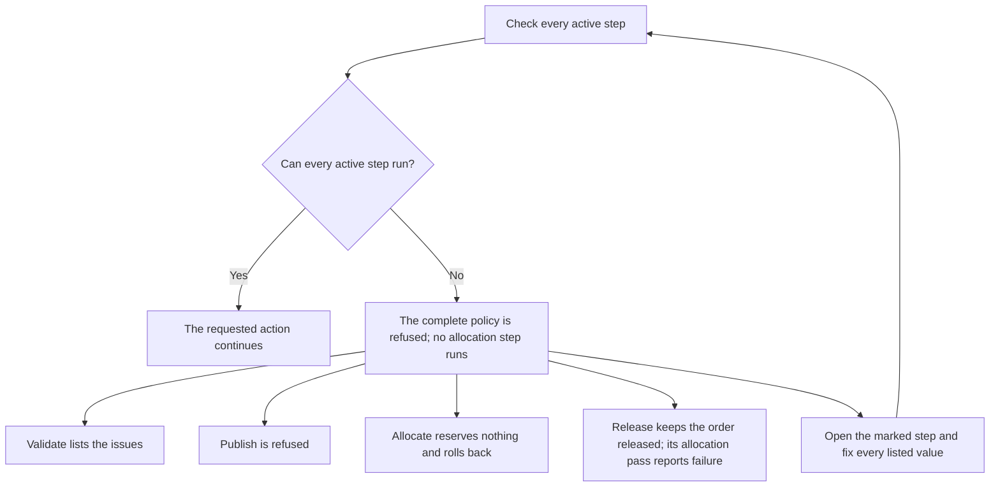

# Allocation Policy: Header, Steps and Criteria

This page lists every setting of the allocation policy. Page 10 explains how the engine thinks. Read it first if you are new.

Paths start at `crates/libs/` unless they say otherwise. `file:line` shows where to check a claim.

## 1. Where you work

| What | Menu path or API | Roles |
|---|---|---|
| Policy list and header | `Sidebar > Warehouse Configuration > Policies > Allocation Policy`. Buttons: `New`, `Delete`, `Refresh`, `Duplicate`. | Admin, Manager, Supervisor (write). Everyone with the screen can read. |
| Step editor | Click a policy row. The step page opens (navigation `nav_allocation_policy_row_opens_step_page`). | same |
| Lifecycle buttons | `Validate`, `Publish`, `Deactivate` on the policy form toolbar | same |
| SKU link | `Sidebar > Warehouse Configuration > Product Data > SKUs > open the SKU > tab Policies > Allocation Policy` | SKU editors |
| Owner default | `Sidebar > Warehouse Configuration > Product Data > Owners > open an owner of type Own > tab WH Settings > inner tab Policies > Allocation Policy` | Owner editors |
| Rotation facts | `Sidebar > Warehouse Configuration > Product Data > SKUs > open the SKU > tab Shelf Life`: `Rotation`, `Rotate By`, `Min Shelf Life on Pick` | SKU editors |

API methods (all in `app-server/src/web/rpcs/allocation_policy_rpc.rs`):

| Method | Kind | Idempotency key | Version in request | Line |
|---|---|---|---|---|
| `create_allocation_policy` | stateless command | yes | no | 91 |
| `update_allocation_policy` (header) | stateful command | yes | `expected_version` of the policy | 179 |
| `delete_allocation_policy`, `delete_many_allocation_policy` | stateless command | yes | no | 109, 126 |
| `allocation_pipeline_view` | query | no | no | 238 |
| `allocation_steps_save` | stateful command | yes | one `expected_version` per step | 270 |
| `allocation_step_add` | stateless command | yes | no | 305 |
| `allocation_step_delete` | stateful command | yes | `expected_version` of the step | 331 |
| `allocation_steps_reorder` | stateful command | yes | `expected_policy_version` | 363 |
| `allocation_policy_validate` | query | no | no | 388 |
| `allocation_policy_publish` | stateful command | yes | `expected_version` | 402 |
| `allocation_policy_deactivate` | stateful command | yes | `expected_version` | 426 |
| `allocation_policy_clone` | stateless command | yes | no | 450 |
| `get_/list_/count_allocation_policy`, `get_/list_/count_allocation_policy_detail` | reads | no | no | generated |

Steps are read-only through the generic CRUD. All step writes go through the `allocation_step*` commands (`allocation_policy_rpc.rs:208-211`).

## 2. Life cycle of a policy

A policy is a draft until you publish it. After that it never changes. To change it, copy it.

| State | `active` | `published_at` | `retired_at` | What you may do |
|---|---|---|---|---|
| Draft | false | empty | empty | Edit header and steps. Validate. Publish. Delete. |
| Published | true | set | empty | Use it. Duplicate it. Deactivate it. Nothing else. |
| Retired | false | set | set | Duplicate it. Nothing else. A retired policy cannot come back. |

The database enforces the pairs (`wms-lib-sql/sql/wms-app/migrations/028_allocation_policy_publication_lifecycle.sql:20-26`):

- `ck_allocation_policy_active_is_published`: `NOT active OR (published_at IS NOT NULL AND retired_at IS NULL)`. A policy can be active only when it is published and not retired.
- `ck_allocation_policy_retired_was_published`: `retired_at IS NULL OR (published_at IS NOT NULL AND NOT active)`. A retired policy was published and is not active.

Rules in code (`wms-outbound/src/domain/allocation_policy/aggregate.rs:38-82`):

| Action | Allowed when | Refusal text |
|---|---|---|
| Edit header, add/save/delete/reorder steps, delete policy | Draft | `allocation policy '{code}' is published and immutable; clone it to create a new draft` or `... is retired and immutable; clone it to create a new draft` |
| Publish | Draft | `allocation policy '{code}' is not a draft` |
| Deactivate | Published and active | `allocation policy '{code}' is not currently published` |

`Publish` runs the full validation first (section 6). If anything fails: `allocation policy '{code}' cannot be published: {reason}; {reason}` (`wms-outbound/src/service/policy/lifecycle.rs:60-70`). `Publish` adds 1 to `version` (`allocation_policy.rs:248-268`). `Deactivate` also adds 1 (`:272-293`).

Messages on the policy toolbar (`web-ui-server/src/extensions/customization/allocation/policy_lifecycle_action.rs:37-53`, `:122`, `:136`):

- `Validate`: `Policy is valid and can be published` or `Policy is not publishable: {reasons joined by "; "}` or `Policy validation failed`.
- `Publish`: `Policy published`.
- `Deactivate`: `Policy deactivated`.
- `Duplicate`: `Duplicated {old code} as {new code} ({n} step(s))`; errors `Select a policy to duplicate`, `Select exactly one policy to duplicate`, `That policy no longer exists — refresh the list and try again` (`policy_duplicate_action.rs:77-118`).

`Duplicate` (API `allocation_policy_clone`) makes a new **draft**. It copies the three header flags, the description and name, and every step with its `rule_num`, `sequence` and `active` (`lifecycle.rs:118-190`). The new code is the old code plus `-C`, then `-C2`, `-C3` ... The old code is cut so that the result fits 10 characters (`policy_duplicate_action.rs:36-45`, up to 20 tries).

**Warning (bug, to verify).** `Deactivate` raises `version`, but an order line keeps the version it froze. The runtime then refuses the line: `allocation policy '{code}' version mismatch for sku '{sku}': line froze version {a}, current version is {b}` (`wms-outbound/src/allocation/policy.rs:209-215`, `allocation_policy.rs:278-283`). The code comment says "deactivation blocks new bindings only; it cannot rewrite execution of an existing order" (`policy.rs:201-202`), and the integration test proves that only with a raw `UPDATE ... SET active = false` that does not bump the version (`tests/allocation_command_integration.rs:604-631`). To verify on a test warehouse: create an order line with a published policy; press `Deactivate` on that policy; press `Allocate` on the order. If you read the "version mismatch" text, the bug is confirmed. Until it is fixed, do not deactivate a policy while open orders use it. Instead, publish a new policy and move the SKU or owner default to it.

## 3. Header settings (table `allocation_policy`)

Schema: `wms-lib-sql/sql/wms-app/migrations/001_baseline.sql:1297-1312`. Lifecycle columns: migration `028`.

### 3.1 `id`

| Item | Value |
|---|---|
| UI label | `ID` (hidden on an existing record by the code-read-only render binding) |
| Column | `allocation_policy.id` |
| Type | bigint, generated. The sequence starts at 1000 (`001_baseline.sql:10124`). |
| Default | seed row has id 1 |
| What it does | Key. SKU, owner config and order lines point to it. |
| What it affects | `sku.allocation_policy_id`, `owner_config.default_allocation_policy_id`, `shipment_order_line.allocation_policy_id` (`policy.rs:41-46`) |
| When you change it | You cannot. |

### 3.2 `code`

| Item | Value |
|---|---|
| UI label | `Code` (list column and form field) |
| Column | `allocation_policy.code` |
| Type and range | text, 1 to 10 characters, unique (`allocation_policy_code_key`), spaces at both ends are cut. A blank code is refused: `allocation policy code cannot be empty` (`allocation_policy.rs:213-218`). |
| Default | none. Seed: `STD`. |
| What it does | The name people use. Shown in the SKU and owner pickers (popup value picker on `code`), in every policy error text and in `Duplicate`. |
| What it affects | Messages in `allocation/policy.rs:122-145`, `:238-257`. |
| Example | `FEFO` for a policy that takes the nearest expiry first. |
| Interactions | The code cannot be edited after the record exists. The form locks it and the API `update_allocation_policy` has no `code` field (`allocation_policy_rpc.rs:149-157`). |
| When empty | Not allowed. |
| When you change it | You cannot. Duplicate under a new code. |

### 3.3 `name`

| Item | Value |
|---|---|
| UI label | None. The field is not on any form. |
| API | `create_allocation_policy` (`name`), `update_allocation_policy` (`name`, three states: leave out = keep, `null` = clear, text = set) (`allocation_policy_rpc.rs:34-43`, `:149-176`). |
| Column | `allocation_policy.name` |
| Type and range | text up to 50 characters, may be empty (NULL) |
| Default | NULL |
| What it does | Stored only. It has no effect today. `Duplicate` copies it (`lifecycle.rs:166`). Nothing else reads it (checked with a search for `policy.name` in `wms-outbound`). |
| When you change it | Only on a draft. |

### 3.4 `descr`

| Item | Value |
|---|---|
| UI label | `Description` (list and form, required on the form) |
| Column | `allocation_policy.descr` |
| Type and range | text up to 255 characters |
| Default | empty text |
| What it does | A note for people. The list shows it. Allocation does not read it. |
| When you change it | Only on a draft. |

### 3.5 `strict_lot_rotation`

| Item | Value |
|---|---|
| UI label | None. API only (`create_allocation_policy`, `update_allocation_policy`). |
| Column | `allocation_policy.strict_lot_rotation` |
| Type | true or false |
| Default | false |
| What it does | Reserved for a future "never skip an older lot" rule. The engine does not run it. If it is **true**, `Validate` and `Publish` refuse the policy with `header flag strict_lot_rotation=true is not executable by this build` (code `UNSUPPORTED_HEADER_FLAG`) (`wms-outbound/src/service/policy/validate.rs:44-57`). Allocation itself never reads the flag. |
| What it affects | Only publication and `Duplicate` (it is copied). |
| When you change it | A policy that was already active before migration 028 and has the flag on is listed by the view `allocation_policy_publication_preflight` (migration 028) so that the owner can fix it. Runtime does not check the flag. |
| Advice | Leave it false. |

### 3.6 `allow_overallocation`

Same as 3.5. Message: `header flag allow_overallocation=true is not executable by this build`. API only. Default false. Intended meaning: reserve more than exists. Not available.

### 3.7 `speed_pick_by_uom`

Same as 3.5. Message: `header flag speed_pick_by_uom=true is not executable by this build`. API only. Default false. Intended meaning: a fast-pick mode by unit of measure. Not available.

### 3.8 `active`

| Item | Value |
|---|---|
| UI label | None. The state shows through `Published at` and `Retired at`. You change it with the buttons `Publish` and `Deactivate`. |
| Column | `allocation_policy.active` |
| Type | true or false |
| Default | false (since migration 028; before it was true). A new policy is always created as a draft, even if the caller sends `active = true` (`allocation_policy.rs:186`, `:221`). |
| What it does | `true` means published and in use. |
| What it affects | `resolve_policy`: a new order line cannot bind an inactive policy (`allocation/policy.rs:129-135`). Existing lines do not check the flag (`policy.rs:203-236`). |
| Interactions | See the check constraints in section 2. The API header update does not accept `active`. |
| When you change it | See the warning in section 2 about `Deactivate`. |

### 3.9 `published_at`, `retired_at`

| Item | Value |
|---|---|
| UI label | `Published at`, `Retired at` (list columns and read-only form fields) |
| Column | `allocation_policy.published_at`, `allocation_policy.retired_at` |
| Type | date and time with time zone, empty until the event |
| Default | empty. The seed `STD` got `published_at = add_when` from migration 028. |
| What it does | Mark the life-cycle events. Together they define Draft, Published, Retired (section 2). |
| When you change it | You cannot edit them. `Publish` sets `published_at`; `Deactivate` sets `retired_at`. |

### 3.10 `version`

| Item | Value |
|---|---|
| UI label | `Version` (read-only) |
| Column | `allocation_policy.version` |
| Type | integer, at least 1 |
| Default | 1 |
| What it does | Optimistic lock. Every write must send the version it read. A stale write is refused with code 40 (`version conflict on allocation_policy ...`) and the answer carries the current version. |
| What it affects | The order line copies it when the line is created. At allocation time the policy version must still be equal (`policy.rs:209-215`). |
| When you change it | The system adds 1 on `Publish`, `Deactivate`, header save and reorder. |

### 3.11 Audit columns

`add_who`, `add_when`, `mod_who`, `mod_when`: who and when created or changed the row. Filled by the system. No effect on allocation.

## 4. Step settings (table `allocation_policy_detail`)

A step is one rule row. Each row has its own `version`. Schema: `001_baseline.sql:1321-1346`. Row identity: unique `(allocation_policy_id, sequence)` and unique `(allocation_policy_id, rule_num)` (`001_baseline.sql:12625-12643`). Deleting a policy deletes its steps (migration `016`).

**New step defaults.** The button `Add step` creates a row with only column defaults (`service/policy/add_step.rs:60-72`): `allocation_type = Firm`, `uom_code = EA`, `sort_1 = LotRotation`, `lpn_quantity_rule = Any`, `one_pick_per_uom_location = true`, `active = true`, all other filters empty.

**The seed step of `STD`:** id 1000, `rule_num = 1`, `sequence = 0`, active, `Firm`, unit `EA`, no location filters, `Any`, no quantity fit, one pick per UOM location = true, `sort_1 = LotRotation`, `sort_2 = Location` (`001_baseline.sql:7651-7653`).

The editor has four bands: `Source`, `Conditions`, `Selection`, `Output`. Their hints are `what this step reserves, and from where`, `which stock qualifies`, `in what order positions are taken`, `how what it reserves becomes task lines`. The header of a step reads `Step {n} · rule {rule_num}`.

### 4.1 `id`, `allocation_policy_id`

Key and parent. The step belongs to one policy (foreign key, delete cascades). The editor never shows them. A save that names a step of another policy is refused: `allocation policy {id}: step(s) {ids} do not belong to this policy` (`service/policy/save_steps.rs:236-246`).

### 4.2 `rule_num`

| Item | Value |
|---|---|
| UI label | Part of `Step {0} · rule {1}`; the crumb `Step {0}`; `closed by step {0}` |
| Column | `allocation_policy_detail.rule_num` |
| Type and range | text, up to 5 characters, unique in the policy |
| Default | The system numbers it. It uses the spelling of the new `sequence`: `10`, `20`, ... If that is taken, it counts up (`wms-lib-core/src/model/policies/step_numbering.rs:78-100`). Seed: `1`. |
| What it does | The label people read. It never decides order. Order comes from `sequence`. |
| What it affects | The text `closed by step {rule_num}` and the validation text `step '{rule_num}' ...`; the pick keeps the step id and step version, not the number. |
| When you change it | You cannot. A save that carries `rule_num` is refused: `Allocation step {id}: a step's number is assigned when the step is added and never changes ...` (`allocation_policy.rs:871-876`). |

### 4.3 `sequence`

| Item | Value |
|---|---|
| UI label | The position of the card in the list. You drag cards to change it. |
| Column | `allocation_policy_detail.sequence` |
| Type and range | whole number, unique in the policy (negative numbers are used only while reordering) |
| Default | column default 0. A new step takes the highest sequence + 10 (first step: 10) (`allocation_policy.rs:636`, `step_numbering.rs:78-90`). |
| What it does | Execution order. Step with the lowest number runs first. Ties are broken by `id` (`allocation_policy.rs:1023-1040`). |
| What it affects | `trace.rs:534` (the loop over steps), the "closed by" rule |
| Example | Steps 10 (`PL`), 20 (`CS`), 30 (`EA`) run in that order. |
| Interactions | Order matters for the carry: what step 10 cannot cover goes to step 20, whatever its unit. |
| When you change it | Only through the reorder command, which checks the **policy** version (`allocation_steps_reorder`). A save that carries `sequence` is refused: `Allocation step {id}: a step's place in the pipeline moves only through the reorder command ...` (`allocation_policy.rs:891-897`). |

### 4.4 `active` (step)

| Item | Value |
|---|---|
| UI label | None. The card shows the badge `not active` and the text `switched off — the engine does not run this step`. There is no switch on the card today. |
| API | `allocation_steps_save` with `"active": false` in `fields`. |
| Column | `allocation_policy_detail.active` |
| Type | true or false |
| Default | true |
| What it does | `false` means the engine never loads the step. It is as if the row did not exist (`allocation_policy.rs:1033`). |
| What it affects | `resolve_policy`, `load_frozen_policy` (`policy.rs:137`, `:216`). If all steps are off: `allocation policy '{code}' has no active steps ...`. |
| Interactions | Off steps do not count in validation, nor in the "closed by" check. They do count when a new step gets its number. |
| When you change it | Only on a draft. |

### 4.5 `version` (step)

Optimistic lock of the step. Every save sends `expected_version` per step. If any step has moved, **nothing** is saved and the answer lists all moved steps (`save_steps.rs:130-176`). Delete also needs the version. The system adds 1 on each save.

### 4.6 `allocation_type` (band Source)

| Item | Value |
|---|---|
| UI label | `Allocation type` |
| Column | `allocation_policy_detail.allocation_type` (enum `allocation_type`) |
| Values | `Firm`, `Soft`, `SoftCartonization` (table below) |
| Default | `Firm` |
| What it does | How firmly stock is committed. Only `Firm` runs. |
| What it affects | `allocation/step.rs:202-212`. Any other value makes the whole policy unusable (section 6). |
| Example | A step with `Soft`: publish is refused with `step '20': step uses allocation_type=Soft, which this build cannot execute`. |
| When empty | Not possible (not null). |

| Value | Picker text | Meaning in this build |
|---|---|---|
| `Firm` | `Firm — reserves` | Reserves the stock now. This is the only value that runs. |
| `Soft` | `Soft` + note `not implemented yet` | Would let stock be taken away by a more important order. Refused. |
| `SoftCartonization` | `Soft + cartonization` + note `not implemented yet` | Would wait for a carton plan. Refused. |

### 4.7 `uom_code` (band Source)

| Item | Value |
|---|---|
| UI label | `Unit of measure` (picker title `Choose a unit`, search `search code or name…`) |
| Column | `allocation_policy_detail.uom_code` |
| Type and range | text, up to 10 characters, must not be blank. The picker offers the active values of the code list `UOM`. |
| Default | `EA` |
| What it does | The unit the step reserves in. The engine splits the line need over the pack rungs. A step gets the share of its own unit (plus the carry). |
| What it affects | `trace.rs:331` (units named by steps), `trace.rs:535` (the share), `trace.rs:853-878` (splitting of picks). Also `resolve_policy_for_new_line` (`policy.rs:185-194`). |
| Example | Pack `PL`=1000, `CS`=100, `EA`=1. Need 2340. Steps with units `PL`, `CS`, `EA` get 2000, 300 and 40. |
| Interactions | A rung that no active step names is not used (not even for splitting). Two steps with the same unit: the first takes the share, the second gets only the carry. If the pack does not carry the unit, the step gets only the carry (verdict `NoQuantityForUom` when the carry is also zero). The picker marks measured units. |
| When empty | A blank unit is refused at publish: `step '{rule}' has an empty UOM` (code `EMPTY_UOM`). |
| When you change it | Only on a draft. Orders already placed keep the old policy. |

### 4.8 `location_type` (band Source)

| Item | Value |
|---|---|
| UI label | `Location type` |
| Column | `allocation_policy_detail.location_type` (enum `loc_type`, may be NULL) |
| Values | See the table below. |
| Default | NULL = "Any" |
| What it does | The step looks only at locations of this type. |
| What it affects | `inventory_balance_atp.rs:462` (`l.loc_type = value`). |
| Example | Step 10 `Pick` and step 20 empty: pick faces are emptied first. |
| Interactions | The value `None` is a real location type (the text "None"), not "any". Choose the empty option for "any". `InTransit` and `Pack` locations are never used, even with an empty field (`inventory_balance_atp.rs:343`). |
| When empty | Any location type except `InTransit` and `Pack`. See the warning in page 10, section 5. |
| When you change it | Draft only. |

| Value | Allowed in a step? |
|---|---|
| `None`, `Other`, `Case`, `Pick`, `Pnd`, `Door`, `Pickto`, `Sort`, `SpeedPick` | Yes. The engine compares the text with `location.loc_type`. Their meaning is set by your location master data. |
| `QC`, `Damage`, `Rtv`, `Destroy`, `Returns`, `Stage`, `Lost` | No. Picker note: `not an allocation candidate — a hold-stage zone purpose`. Text on the card: `location type {value} is a hold-stage zone, never allocated from`. |
| `InTransit` | No. Picker note: `not an allocation candidate — the location of open pick pallets`. |
| `Pack` | No. Picker note: `not an allocation candidate — a pack station`. |

### 4.9 `putawayzone` (band Source)

| Item | Value |
|---|---|
| UI label | `Putaway zone` |
| Column | `allocation_policy_detail.putawayzone` (text up to 20, foreign key to `putawayzone.code`, may be NULL) |
| Default | NULL = "Any" |
| What it does | The step looks only at locations whose `putawayzone` equals this code. |
| What it affects | `inventory_balance_atp.rs:459` |
| Example | Zone `FAST` for a fast-pick area. |
| Interactions | A zone that is still used by a step cannot be deleted (restrict). |
| When empty | All zones. |
| When you change it | Draft only. |

### 4.10 `location_category` (band Conditions)

| Item | Value |
|---|---|
| UI label | `Location category` |
| Column | `allocation_policy_detail.location_category` (enum `loc_category`, may be NULL) |
| Values | `None`, `NoPalletization`, `Asrs`, `CantileverRack`, `CartonFlow`, `DenseStorage`, `DoubleDeepRack`, `DriveInRack`, `DriveThroughRack`, `HorizontalCarousel`, `Other`, `PalletFlowRack`, `PalletCarousel`, `PushBackRack`, `SelectiveShelving`, `ShelvingStorage`, `WorkCenter` (17 values; `wms-lib-core/src/model/location.rs:300-318`) |
| Default | NULL = "Any" |
| What it does | Only locations of this category. The value `None` is a real category, not "any". |
| What it affects | `inventory_balance_atp.rs:460` |
| Example | `SelectiveShelving` to take from shelves only. |
| When empty | All categories. |
| Counted in the band | The band header shows `{n} of 3 conditions set` or `no conditions set` (`Conditions.tsx:35-45`). |

### 4.11 `location_abc` (band Conditions)

| Item | Value |
|---|---|
| UI label | `Location ABC` |
| Column | `allocation_policy_detail.location_abc` (enum `abc_speed_type`: `A`, `B`, `C`; may be NULL) |
| Default | NULL = "Any" |
| What it does | Only locations of this velocity class. |
| What it affects | `inventory_balance_atp.rs:461` |
| Example | Step 10 `A`, step 20 empty: the fast movers' locations are used first. |
| When empty | All classes. |

### 4.12 `lpn_quantity_rule` (band Conditions)

| Item | Value |
|---|---|
| UI label | `LPN quantity` |
| Column | `allocation_policy_detail.lpn_quantity_rule` (enum `lpn_qty_rule`) |
| Values | `Any`, `EqPackPallet`, `NePackPallet` |
| Default | `Any` |
| What it does | Filters the candidate rows by comparing each row's available quantity with the **pallet quantity of the pack**. The pallet quantity is the biggest rung of the pack above the base unit (`trace.rs:466-469`). |
| What it affects | `allocation/select.rs:258-275` |
| Interactions | Runs before `Quantity fit` (intersection). An `EqPackPallet` step is never split into smaller picks, whatever `One pick per UOM / location` says (`trace.rs:858-862`). |
| When you change it | Draft only. |

| Value | Picker text | Behaviour | Example (pallet = 1000; rows: LPN 1000, LPN 999, LPN 1001, LPN 500, loose 1000) |
|---|---|---|---|
| `Any` | `Any allocatable stock` | No filter. | All five rows. |
| `EqPackPallet` | `Only positions on an LPN whose available quantity is exactly one full pallet` | Keep a row only when its available quantity equals the pallet quantity **and** it has an LPN. If the pack has no pallet rung, nothing qualifies. | Only LPN 1000. Loose 1000 is not kept. |
| `NePackPallet` | `Except positions whose available quantity is exactly one full pallet` | Drop rows whose available quantity equals the pallet quantity. Rows with more than a pallet stay. If the pack has no pallet rung, it works as `Any`. | LPN 999, LPN 1001, LPN 500. Loose 1000 is dropped too (its quantity equals the pallet). |

A full-pallet step may still take only part of a pallet: if the need is 250, it takes 250 from the 1000-pallet (`select.rs:207`). The rule filters the **source**, not the amount.

Measured units (weighed or cut) make `EqPackPallet` useless; the card warns: `{uom} is measured, so no LPN ever holds a full pallet of it — the full-pallet rule can never be met` (`never reserves`).

### 4.13 `qty_fit_rule` (band Selection)

| Item | Value |
|---|---|
| UI label | `Quantity fit` |
| Column | `allocation_policy_detail.qty_fit_rule` (enum `qty_fit`, may be NULL) |
| Values | `LowToHigh`, `ExactFit`, `BiggerFit`, `BestFit`, `HighToLow` |
| Default | NULL = no rule |
| What it does | Compares the available quantity of each position with the **need of this step** (`need_uom`). Filter and/or order. The need is fixed at the start of the step. |
| What it affects | `select.rs:296-316` (filter), `select.rs:381-395` (order) |
| Interactions | Needs `LpnQuantity` in at least one sort rank. If not, the step is refused: `step names qty_fit_rule={rule} but no sort_1..sort_4 names LpnQuantity — ...` (`step.rs:132-138`). Runs after `LPN quantity`. |
| When empty | No quantity filter. If `LpnQuantity` is ranked, it sorts by available quantity, smallest first. |
| When you change it | Draft only. |

Example for all values. Need of the step = 250. Positions (available): 100, 250, 300, 800. `LpnQuantity` is rank 1.

| Value | Picker text | Positions kept | Order | Result |
|---|---|---|---|---|
| `LowToHigh` | `Low to high — smallest available quantity first` | all | smallest first | 100, then 150 from the 250 position |
| `ExactFit` | `Exact fit — only positions holding exactly that quantity count` | only 250 | n/a | 250 from the 250 position. If no position holds exactly the need, the step finds nothing and the full need goes to the next step. |
| `BiggerFit` | `Bigger fit — only positions holding at least that quantity count` | 250, 300, 800 | smallest first | 250 from the 250 position |
| `BestFit` | `Best fit — only positions holding at most that quantity count` | 100, 250 | largest first | 250 from the 250 position |
| `HighToLow` | `High to low — largest available quantity first` | all | largest first | 250 from the 800 position |

`BestFit` and `ExactFit` can leave part of the need open. `ExactFit` with a measured unit "will nearly always reserve nothing" (card text).

### 4.14 `one_pick_per_uom_location` (band Output)

| Item | Value |
|---|---|
| UI label | `One pick per UOM / location`. The toggle text is `merged into one task line per location` (on) or `a task line per LPN` (off). |
| Column | `allocation_policy_detail.one_pick_per_uom_location` |
| Type | true or false |
| Default | true (schema, seed and `Add step`) |
| What it does | **On (true):** no change. One pick per stock position (one balance row: lot, location, LPN). **Off (false):** each draw is cut into pieces of one unit of the step's unit. A draw of 400 EA-base units in unit `CS` (100) becomes 4 picks of 100. The last piece may be smaller. |
| What it affects | `trace.rs:853-878` (`explode_step_draws`); one task is created per pick (`picking/infrastructure/tasks.rs:52-83`). |
| Example | Step unit `CS`, draw 400 from one location. On: 1 pick of 400. Off: 4 picks of 100, 4 tasks. |
| Interactions | No cut for `EqPackPallet` steps. No cut when the unit is not on the pack ladder, or its `base_qty` is zero or dust (`0.000001` or less) (`trace.rs:858-862`). A base unit step (`EA`) with Off makes one pick per each: 3456 EA = 3456 picks; there is no cap (`trace.rs:846-852`). |
| When empty | Not possible (not null). |
| When you change it | Draft only. |

**Text problem (inconsistency).** The words on the toggle say "merged into one task line per location". The code does not merge picks of different lots or LPNs. On means "one pick per position". The label is misleading when a location holds several lots or LPNs. See `trace.rs:763-833`, which says that `true` has "nothing to merge".

### 4.15 `sort_1`, `sort_2`, `sort_3`, `sort_4` (band Selection)

| Item | Value |
|---|---|
| UI label | `Sort ranks` (picker title `Choose a sort rank`). The card shows ranks `01`..`04`; the next free rank is shown as an empty slot. |
| Columns | `sort_1` (required), `sort_2`, `sort_3`, `sort_4` (may be NULL). Enum `alloc_sort`. |
| Values | `LotRotation`, `Location`, `LpnQuantity` (run). `Lpn`, `LpnRotationInLoc`, `LocationAbc` (refused). |
| Default | `sort_1 = LotRotation`, others NULL. Seed: `sort_2 = Location`. |
| What it does | The ranks are a ladder. Rank 1 is the main key. Rank 2 only breaks ties of rank 1. And so on. |
| What it affects | `select.rs:181-196` |
| Example | `LotRotation`, then `Location`: oldest lot first. Inside one lot, lower `route_sequence` first. |
| Interactions | Clearing rank 2 moves rank 3 up; the editor rewrites all four columns (`Selection.tsx`). `Quantity fit` needs `LpnQuantity` in one rank. |
| When empty | `sort_1` cannot be empty. Ranks 2 to 4 may be. If every key ties, the order follows the read order (balance id). |
| When you change it | Draft only. |

| Value | Picker text | Behaviour | Runs? |
|---|---|---|---|
| `LotRotation` | `Lot rotation — the SKU's rotation` | Follows `sku.rotation` and `sku.rotate_by` (section 7). An empty date sorts last. | Yes (`select.rs:323-363`) |
| `Location` | `Location — route order` | `location.route_sequence` as text, then `location.code`. Text order: `10` before `2`. | Yes (`select.rs:365-372`) |
| `LpnQuantity` | `LPN quantity — available quantity` | Available quantity, smallest first; largest first if `Quantity fit` is `BestFit` or `HighToLow`. | Yes (`select.rs:381-395`) |
| `Lpn` | `LPN` + `not implemented yet` | Refused. | No |
| `LpnRotationInLoc` | `LPN rotation within location` + `not implemented yet` | Refused. | No |
| `LocationAbc` | `Location ABC speed` + `not implemented yet` | Refused. | No |

A refused sort gives: `step uses sort_{n}={value}, which this build cannot execute` (`step.rs:74-75`, `:178-188`).

### 4.16 Audit columns of a step

`add_who`, `add_when`, `mod_who`, `mod_when`. No effect on allocation.

## 5. Meaning of the other values used above

| Enum | Values | Source |
|---|---|---|
| SKU `Rotation` (`sku_rotation`) | `Fifo`: oldest first. `Lifo`: newest first. `Fefo`: earliest expiration first, always by expiration date. | `select.rs:323-363`, `wms-lib-core/src/model/sku.rs:128-132` |
| SKU `Rotate By` (code list `ROTATEBY`) | `Lot` (lot number; sorts by the **creation time of the lot row**, not the code), `Mandate` (manufactured date), `ExpDate` (expiration date), `BestBy` (best by date), `DelivBy` (delivery by date) | `select.rs:40-60`, baseline `7819-7822`, `8065-8066` |
| Policy state | Draft, Published, Retired | section 2 |
| Step verdict in the preview | `selected` (took stock), `no_candidates` (the read found nothing), `no_quantity_for_uom` (step had no share and no carry), `filtered_by_fit` (positions existed but the LPN rule or quantity fit removed them all) | `trace.rs:90-97`, `:614-619` |
| Rejection counters (preview with `detail = full`) | `held`, `location_not_allocatable`, `shelf_life_failed`, `pack_mismatch`, `step_location_filter_failed`, `lpn_rule_failed`, `fit_failed`. The first five are exclusive: a row is counted in the first bucket it fails. | `trace.rs:103-125`, `inventory_balance_atp.rs:350-409` |

## 6. Validation and what the step card says

`Validate` and `Publish` use the same parser that allocation uses at run time, so they cannot disagree (`validate.rs:38-100`). Issue codes:

| Code | Text | When |
|---|---|---|
| `UNSUPPORTED_HEADER_FLAG` | `header flag {flag}=true is not executable by this build` | One of the three header flags is on |
| `NO_ACTIVE_STEPS` | `policy must have at least one active step` | No active step |
| `EMPTY_UOM` | `step '{rule_num}' has an empty UOM` | A blank unit |
| `UNSUPPORTED_STEP` | `step '{rule_num}': {reason}` where the reason is `step uses allocation_type={v}, which this build cannot execute`, or `step uses sort_{n}={v}, ...`, or `step uses location_type={v}, ...`, or the `qty_fit_rule` text from 4.13 | Any value that the engine refuses |
| `SHADOWED_STEP` | `step id {id} is unreachable because step '{rule_num}' consumes its candidate set first` | See below |

One unsupported value on an active step blocks the complete policy. The
allocator does not skip that row and continue with later steps.

**Closed steps ("closed by step N").** A later step is closed when an earlier active step with the same `uom_code` takes every position the later one could take. The rule is cautious. It says "closed" only when all of these hold (`wms-lib-core/src/model/policies/allocation_step_shadow.rs:99-120`):

- same policy, earlier `sequence`, earlier step is active and runnable;
- same unit;
- the earlier step has `LPN quantity = Any` and `Quantity fit` empty, `LowToHigh` or `HighToLow` (these do not remove positions);
- for zone, location type, category and ABC: the earlier step has no filter on that axis, or the same filter value as the later step.

Example: step 10 `EA`, no filters; step 20 `EA`, zone `FAST`. Step 20 is closed by step 10, because step 10 already takes the zone `FAST` positions. `Publish` refuses this. Put the narrow step first instead.

Marks on the card (`narration` texts, `wms-lib-core/src/model/narration/mod.rs:2071-2093`):

| Mark | Meaning |
|---|---|
| `never runs` + `This step cannot run, so the whole policy is refused until it is fixed: ...` | The step uses a refused value. Fix every listed value on the step; the allocator does not continue with the remaining steps. The order gets the error in section 4 of page 10. |
| `never reserves` | The step runs but cannot match anything (a measured unit with `EqPackPallet` or `ExactFit`). |
| `not active` | The step is switched off. |
| `closed by step {rule}` | See above. |
| Line under the last step | `whatever is still unreserved is a shortfall on the line and goes to backorder` (see page 10, section 6: there is no backorder object) |
| `No steps yet. A policy with an empty pipeline reserves nothing.` | No steps. |
| `unsaved changes`, `The steps are saved.` | Draft state of the editor |

The step editor reads one query (`allocation_pipeline_view`) and shows the sentence for each step, so you can read what the engine will do. A step that refuses the policy gets only the "never runs" sentence and the values that must be fixed.

## 7. Settings outside the policy that the engine reads

### 7.1 `sku.allocation_policy_id`

| Item | Value |
|---|---|
| UI label | `Allocation Policy` (SKU, tab `Policies`) |
| Column | `sku.allocation_policy_id` |
| Type | policy id, may be NULL. Foreign key, restrict on delete. |
| Default | NULL |
| What it does | The policy for this SKU. First choice. |
| What it affects | `SkuBmc::resolve_allocation_policy` (`wms-lib-core/src/model/sku.rs:950-968`), used when a line is created or saved (`service/order/create.rs:177`, `service/order_line/upsert.rs:108`). |
| Interactions | Wins over the owner default (`COALESCE(sku, owner)`). |
| When empty | The owner default is used. If that is empty too: `sku '{sku}' (owner {owner}) has no allocation policy ...`. |
| When you change it | Only **new** lines and lines saved again through the line editor use it. Lines already created keep their frozen policy (test: `tests/allocation_command_integration.rs:565-600`). A line can be saved again only while it is in the `New` family and has no reservation. |

### 7.2 `owner_config.default_allocation_policy_id`

| Item | Value |
|---|---|
| UI label | `Allocation Policy` (Owner, tab `WH Settings`, inner tab `Policies`; shown only for owner type `Own`) |
| Column | `owner_config.default_allocation_policy_id` |
| Type | policy id, may be NULL. Foreign key, `ON DELETE SET NULL` (`001_baseline.sql:17181-17185`). |
| Default | NULL in the schema. The seed sets `1` (`STD`) for owners 1 and 2 (`001_baseline.sql:8538-8539`). |
| What it does | The policy for every SKU of the owner that has none. |
| When empty | See 7.1. |
| When you change it | As 7.1. Note: deleting a draft policy that an owner uses sets this field to NULL without a message. |

### 7.3 `sku.rotation`

| Item | Value |
|---|---|
| UI label | `Rotation` (SKU, tab `Shelf Life`) |
| Column | `sku.rotation` (enum `sku_rotation`, not null) |
| Values | `Fifo`, `Lifo`, `Fefo` |
| Default | `Fifo` |
| What it does | Direction of the sort rank `LotRotation`. |
| What it affects | `trace.rs:916`, `select.rs:323-363` |
| Interactions | `Fefo` ignores `Rotate By` and always uses the expiration date. Used only if a step has the rank `LotRotation`. |
| Example | Page 10, example 9.1. |

### 7.4 `sku.rotate_by`

| Item | Value |
|---|---|
| UI label | `Rotate By` (SKU, tab `Shelf Life`) |
| Column | `sku.rotate_by` (text up to 20, not null) |
| Values | `Lot`, `Mandate`, `ExpDate`, `BestBy`, `DelivBy` |
| Default | `Lot` |
| What it does | Which date `Fifo` and `Lifo` sort by. |
| What it affects | `trace.rs:917-928` |
| When empty or wrong | A value outside the list stops allocation with `sku '{sku}' has rotate_by = '{value}', not a value the ROTATEBY code list defines (Lot/Mandate/ExpDate/BestBy/DelivBy)`. |

### 7.5 `sku.min_shelf_life_on_pick`

| Item | Value |
|---|---|
| UI label | `Min Shelf Life on Pick` (SKU, tab `Shelf Life`) |
| Column | `sku.min_shelf_life_on_pick` (integer days, may be NULL) |
| Default | 0 |
| What it does | A lot is a candidate only if its expiration date is LATER than `today + max(value, shelf_life, 0)` days, or it has no expiration date and none is required (the lot policy asks for one, or the SKU has `expire_days` above zero). Today is the warehouse day (`WAREHOUSE_TIMEZONE`; UTC when blank). |
| What it affects | `find_allocation_candidates` and `trace.rs` (`lot_dating::threshold`). The pick commit judges the same boundary with `value` alone and refuses `SOURCE_EXPIRED` (`judge_pick_lot`, `picking/confirmation/shelf_life.rs`). |
| Example | Value 30 on 10 Oct 2026: lots that expire on 9 Nov 2026 or earlier are skipped; 10 Nov passes. |
| When empty | Same as 0: lots that expire today or earlier are skipped. |
| Also read | `shelf_life` (minimum days at shipping, the larger of the two applies) and `expire_days` (with the lot policy, whether an expiration is required). `min_shelf_life_on_rec` is not read by allocation; it is a receiving check. |

### 7.6 `shipment_order_line.allocation_policy_id` and `allocation_policy_version`

| Item | Value |
|---|---|
| UI label | None. API fields of the line. |
| Columns | both on `shipment_order_line`; both set together or both empty (`ck_sol_allocation_policy_snapshot_pair`, migration 029) |
| What they do | The policy and its version frozen when the line was created or last saved (`resolve_policy_for_new_line`). Allocation uses exactly this policy. |
| What they affect | `trace.rs:299-313`, `policy.rs:203-236`; the pick keeps the step id and version (`reserve.rs:216-232`). |
| When empty | Allocation stops: `order line {id} has no frozen allocation policy`. Migration 029 filled lines it could; the view `allocation_policy_snapshot_unresolved_order_line` lists the rest. |
| When you change it | A line is re-bound only when it is saved again. |

### 7.7 Stock and location facts that decide eligibility

These are not policy fields. Page 10, section 5 lists them: `location.status`, `location.loc_flag`, `location.loc_type`, `location.putawayzone`, `location.loc_category`, `location.abc`, `location.route_sequence`, `location.discard_lpn`, `pack_item.is_active`, `pack_item.base_qty`, `inventory_hold` (lot, location, LPN), `inventory_hold_code.active`, `inventory_hold_code.block_outbound_flow`, and the lot dates.

## 8. What happens to existing orders when you change something

| Change | New order lines | Existing lines (no reservation yet) | Existing reservations (picks) |
|---|---|---|---|
| Edit a draft policy | No effect (a draft cannot be bound). | None. | None. |
| Publish a policy | It can now be bound. Lines freeze the new version. | None. | None. |
| Point the SKU or owner to another policy | Use the new policy. | Keep the old policy until saved again. | Keep. |
| Deactivate (retire) the policy | Refused: `... is inactive ...`. | **Bug risk:** they may fail with the version mismatch (section 2). | Keep. |
| Edit a published policy | Not possible. | Not possible. | Not possible. |
| Change `sku.rotation`, `rotate_by`, `min_shelf_life_on_pick`, `shelf_life` | Read at allocation time. | Used at the next allocation. | Keep. |
| Change location, hold or pack data | Read at allocation time. | Used at the next allocation. | A pick that is already reserved keeps its position. Allocation does not look at a reservation again, so a hold placed later does not remove it. |
| Unallocate | Not relevant. | Deletes picks whose task is still `Created`. | Picks whose task is `Assigned` or later stay. |

## 9. Known inconsistencies on this page

| # | What | Where |
|---|---|---|
| 1 | `Deactivate` raises the policy version and frozen lines then fail with a version mismatch (to verify). | `allocation_policy.rs:278-283`, `allocation/policy.rs:209-215` |
| 2 | The editor says unreserved quantity "goes to backorder". The code has no backorder. | `wms-meta-ui` `001_baseline.sql:21414` |
| 3 | The toggle text "merged into one task line per location" does not match what the engine does. | `trace.rs:763-878`, `001_baseline.sql:21431-21432` (meta-ui) |
| 4 | Stock in `QC`, `Damage`, `Rtv`, `Destroy`, `Returns`, `Stage`, `Lost` locations is not excluded unless a step names a location type. | `inventory_balance_atp.rs:337-343` |
| 5 | The comment on the view `inventory_balance_atp` says a switched-off hold code "blocks as before". The SQL and the Rust code treat a switched-off code as not blocking. | `011_a_hold_says_what_it_forbids.sql:155-156` against `:98-104` and `inventory_hold.rs:227-231` |
| 6 | The module notes in `step.rs` and `allocation_step_describe.rs` say a refused step is dropped. The code now refuses the whole policy. | `step.rs:1-36`, `allocation_step_describe.rs:62-64` against `policy.rs:147-156` |
| 7 | The older pre-flight view `allocation_policy_publication_preflight` and the backfill in migration 029 do not list `InTransit` and `Pack` as refused location types. The engine refuses them. | `028_...sql:60-62`, `029_...sql:48-50` against `step.rs:283-291` |
| 8 | `Delete` is possible only for a draft. A policy that once was published can never be deleted. The older guide says a delete is refused when an order line uses it. | `service/policy/header.rs:35-48` |
