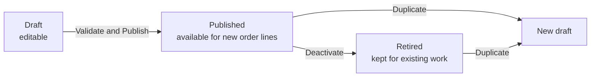

# Allocation Policy: Steps and Criteria

An allocation policy tells Quark which available stock to reserve for an order, in what order to consider it, and how to create the resulting pick work.

Read [Allocation Overview](./10-allocation-overview.md) first for stock eligibility, shortages, retries, and the difference between allocation and release. This page explains how to build the policy itself.

## Before you start

Prepare these records before you build the policy:

- the units of measure in each SKU's pack;
- any putaway zones, location categories, and location ABC classes that the policy will use;
- each SKU's lot rotation and shelf-life settings;
- any active SKU or location custom attributes that the policy will use;
- the owner and SKU that will use the policy.

Users who maintain allocation policies normally have the `Administrator`, `Manager`, or `Supervisor` role.

## Open allocation policies

Open `Sidebar > Warehouse Configuration > Policies > Allocation Policy`.

The list is the starting point for every policy action:

- `New` creates a draft policy.
- Opening a row shows its header and steps.
- `Duplicate` creates an editable draft from an existing policy.
- `Delete` removes a draft that is no longer needed.

Published and retired policies are retained as operational history. They cannot be edited or deleted.

## Create and publish a policy

1. Click `New`.
2. Enter a short, unique `Code` and a clear `Description`.
3. Save the policy.
4. Open the policy and click `Add step`.
5. Configure the step. Start with the source unit, then add conditions, selection order, and output behavior.
6. Add more steps when the first step should pass any remaining quantity to another source.
7. Put the steps in the order in which Quark should try them.
8. Click `Save`.
9. Click `Validate`. Correct every reported problem.
10. Click `Publish`.
11. Assign the published policy to a SKU or as the owner's default.

The `Code` cannot be changed after creation. Use a code that identifies the business purpose, such as `PALCASE` for a policy that tries full pallets before cases.

## Understand the policy life cycle

| State | What you can do | What it means |
| :--- | :--- | :--- |
| Draft | Edit the header and steps, validate, publish, duplicate, or delete. | The policy is not available for new order lines. |
| Published | Duplicate or deactivate. | The policy can be selected for new order lines. Its definition is locked. |
| Retired | Duplicate only. | New order lines cannot select it. Existing work keeps the policy version it already received. |

To change a published policy:

1. Duplicate it.
2. Edit and validate the new draft.
3. Publish the replacement.
4. Assign the replacement to the required SKU or owner.
5. Deactivate the old policy when it should no longer be selected for new work.

Deactivation does not rewrite open orders. An existing order line continues with the policy and version captured when that line was created.

## How steps work

Quark evaluates active steps from top to bottom. Each step receives:

- the part of demand intended for that unit of measure; and
- any quantity that an earlier step could not allocate.

The next step receives the remaining quantity. This lets one policy try a preferred stock source first and then fall back to another.

For example, a policy can:

1. take full pallets from reserve locations;
2. take full cases from case-pick locations;
3. take the remaining eaches from forward-pick locations.

The policy must contain at least one active, executable step. To assign the policy to a new order line, at least one active step unit must also exist in the SKU's pack. A step whose unit is absent from that pack receives no quantity directly from the pack split, but it can still receive quantity carried from an earlier step.

If one active step contains an unsupported option, validation blocks the complete policy; Quark does not silently skip that step.

## Configure a step

The editor groups settings into `Source`, `Conditions`, `Selection`, and `Output`.

### Source

| Field | What it controls | Recommended use |
| :--- | :--- | :--- |
| `Allocation type` | The reservation type created by the step. | Use `Firm`. Other values are not currently executable and validation will reject them. |
| `Unit of measure` | The pack level handled by this step. | Use the exact code from the SKU's pack, for example `PL`, `CS`, or `EA`. |
| `Location type` | Limits stock to one operational location type. | Use only when the process deliberately separates pick faces, case pick, or other supported stock areas. |
| `Putaway zone` | Limits stock to one putaway zone. | Use for reserve, forward-pick, temperature, or other warehouse zoning represented by your location setup. |
| `Location category` | Limits stock to one location category. | Use when category is maintained consistently on every candidate location. |
| `Location ABC` | Limits stock to locations with one ABC class. | Use for velocity-based sourcing such as fast-moving pick faces. |

Supported `Location type` values for allocation steps are `None`, `Other`, `Case`, `Pick`, `Pnd`, `Door`, `Pickto`, and `SpeedPick`. `None` selects locations whose type is `None`. Leave the field empty when location type should not restrict the step.

Operational destinations such as quality control, damage, returns, staging, packing, sorting, consolidation, control, lost, and in-transit locations are not allocation sources. Validation rejects those location types in an active step.

### Conditions

#### LPN quantity

`LPN quantity` compares the available quantity on a stock position with the base quantity of the tallest active pack rung above the base unit. In a simple `CS > EA` pack, the case rung is therefore the comparison quantity even when the pack has no separately named pallet rung.

| Value | Stock that qualifies |
| :--- | :--- |
| `Any` | No full-pallet restriction. |
| `EqPackPallet` | Stock on an LPN whose available quantity is exactly one full pallet. Loose stock does not qualify. |
| `NePackPallet` | Stock positions that are not exactly one full pallet. |

If the SKU's pack has no active rung above the base unit, `EqPackPallet` finds nothing and `NePackPallet` behaves like `Any`.

This setting filters the source position; it does not force Quark to take the complete position. A step may take part of a qualifying full-pallet position when the remaining demand is smaller.

#### Custom attributes

Use `Custom attributes` to narrow a step by values saved on the SKU or candidate location.

1. Click `Add attribute`.
2. Choose an active SKU or location attribute.
3. Choose an `Operator` and enter the typed `Value`.
4. Add another row when every selected condition must also match. Use `Remove` to delete a row.

The value editor follows the attribute type: number fields for integers, a True/False control for Boolean values, a date picker for dates, and text input for text or decimals. For `in` and `not in`, enter a comma-separated list.

| Operator | Meaning |
| :--- | :--- |
| `=` / `≠` | Equal to / not equal to the value. |
| `<` / `≤` / `>` / `≥` | Compare ordered numbers, dates, or text supported by the selected type. |
| `in` / `not in` | Match or exclude one of the comma-separated values. |
| `contains` | The text contains the value. |
| `starts with` / `ends with` | The text starts or ends with the value. |

A SKU condition is checked once for the order line. If it fails, that step provides no stock for the line. A location condition filters individual candidate locations. A record with no value does not qualify. If the policy refers to a definition that is inactive or no longer applies to the SKU owner, allocation stops with an error instead of silently ignoring the condition. Attribute conditions work together with the step's zone, location type, category, ABC, and LPN quantity settings.

Define and fill the fields first; see [Custom attributes](../04-owners-sku-uom-pack-hierarchy.md#8-custom-attributes). Before deactivating, deleting, or changing the owner scope of a referenced definition, remove or replace that condition in every allocation policy that uses it.

### Selection

#### Quantity fit

`Quantity fit` compares each stock position's available quantity with the quantity still needed at the start of the step.

| Value | Positions allowed | Order used |
| :--- | :--- | :--- |
| `LowToHigh` | All eligible positions. | Smallest available quantity first. |
| `ExactFit` | Only positions equal to the quantity needed. | Exact matches only. |
| `BiggerFit` | Only positions at least as large as the quantity needed. | Nearest larger position first. |
| `BestFit` | Only positions no larger than the quantity needed. | Largest qualifying position first. |
| `HighToLow` | All eligible positions. | Largest available quantity first. |

To use `Quantity fit`, place `LpnQuantity` in one of the sort ranks. Without that sort criterion, validation rejects the combination.

`ExactFit` and `BestFit` can intentionally leave demand for a later step. Always provide a fallback step when the warehouse must allocate the remaining quantity from another source.

#### Sort ranks

Set up to four sort criteria. Rank 1 is the primary sort; later ranks break ties.

| Value | How it sorts |
| :--- | :--- |
| `LotRotation` | Uses the SKU's `Rotation` and `Rotate By` settings. Stock without the required date sorts last. |
| `Location` | Uses the warehouse route sequence, then location code. |
| `LpnQuantity` | Uses available quantity. Direction follows `Quantity fit`; otherwise it is smallest first. |

Do not repeat the same criterion in two ranks. `Lpn`, `LpnRotationInLoc`, and `LocationAbc` are not currently executable sort criteria; validation rejects an active step that uses them.

For FEFO or FIFO behavior, put `LotRotation` first. The SKU's rotation settings remain live master data: changing them affects future allocation runs, including open lines that have not yet allocated.

### Output

`One pick per UOM / location` controls how a stock draw becomes pick lines.

| Setting | Result |
| :--- | :--- |
| On | Keep one pick for each selected stock position. This is the default. |
| Off | Split a selected draw into pieces of one step unit, with a smaller final piece when needed. |

Example: if `CS` equals 100 eaches and a selected draw contains 400 eaches, Off creates four 100-each pick lines. Be careful with `EA`: a large quantity can create a very large number of pick lines.

An `EqPackPallet` step is not split, regardless of this setting.

## Common policy patterns

### Full pallets, then cases, then eaches

| Step | Unit | Source and conditions | Selection |
| :--- | :--- | :--- | :--- |
| 1 | Pallet unit | Reserve zone; `EqPackPallet` | `LotRotation`, then `Location` |
| 2 | Case unit | Case-pick area; `Any` | `LotRotation`, then `Location` |
| 3 | Base unit | Forward-pick area; `Any` | `LotRotation`, then `Location` |

Use this pattern when the pack contains all three units and the physical warehouse separates their sources.

### Pick face first, reserve second

1. First step: forward-pick zone, `Quantity fit = BiggerFit` or `BestFit`, `Sort 1 = LpnQuantity`, and `Sort 2 = Location`.
2. Second step: reserve zone, `Any`, then lot rotation and location route.

This pattern favors an accessible pick face but still allocates when the pick face cannot cover all demand.

### Exact container first, fallback second

1. First step: `ExactFit` with `LpnQuantity` in the sort ranks.
2. Second step: `Any` or another quantity-fit rule.

This can reduce remnants, but the fallback is essential because an exact position may not exist.

## Assign the policy

A published policy can be assigned in either place:

- `Sidebar > Warehouse Configuration > Product Data > SKUs > open the SKU > Policies > Allocation Policy`;
- `Sidebar > Warehouse Configuration > Product Data > Owners > open the owner > WH Settings > Policies > Allocation Policy`.

The SKU setting has priority. If the SKU has no allocation policy, Quark uses the owner's default. A new order line captures the selected policy and its current version.

Changing the SKU or owner setting affects new order lines. It does not silently move existing lines to the replacement policy.

## Validate before publication

`Validate` checks the complete draft. Correct all reported problems before publication. Typical causes are:

| Problem | What to check |
| :--- | :--- |
| No executable step | Add and save at least one active step. |
| Unsupported allocation type, source, or sort | Replace it with an executable value from this guide. |
| Quantity fit without quantity sorting | Add `LpnQuantity` to a sort rank. |
| Duplicate sort criteria | Keep each sort criterion in only one rank. |
| Earlier step consumes the same candidates | Narrow the earlier step or change the later step's source and conditions so that it provides a real fallback. |

Validation proves that the policy structure uses supported settings. It does not test the policy against a particular SKU pack and cannot prove that warehouse master data will provide matching stock. Test the published policy with representative SKUs, packs, lots, LPN quantities, locations, and shortages before production use.

## Go-live check

Before assigning a policy broadly:

- confirm each affected SKU pack overlaps at least one active step unit, and test how carry behaves across the remaining steps;
- confirm zone, category, ABC, and location type values are populated on candidate locations;
- confirm lot rotation and shelf-life settings on dated SKUs;
- test full demand, partial demand, no eligible stock, held stock, and stock busy in another operation;
- verify the number and size of generated pick lines;
- test both direct allocation and wave release;
- publish the replacement before retiring the old policy;
- keep a fallback step when a restrictive first step may leave quantity open.

For how Quark handles shortages, deferred stock, retries, and short-pick replacement, return to [Allocation Overview](./10-allocation-overview.md).
