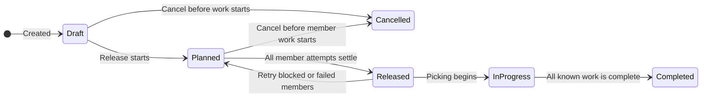

# Waves Overview

A wave is a reviewed group of shipment orders that enter the normal release process together. Use waves to control which orders are launched together and which sort station receives them.

## Where to work with waves

Open `Sidebar > Management & Control > Orders & Waves` and choose one of two screens:

| Screen | Use it for |
|---|---|
| `Waves` | Create a wave by hand, add or remove orders, assign a sort station, release the wave, cancel it or retry blocked orders. |
| `Wave strategies` | Select orders by rules, group and size waves, schedule creation, preview a run and choose whether created waves are released automatically. |

There is no RF screen for wave administration. After release, warehouse operators receive the ordinary picking work for the member orders.

## Manual wave or wave strategy?

| Choose | When |
|---|---|
| Manual wave | A supervisor knows the exact orders that must travel together or needs to review each member before release. |
| Wave strategy | The same selection and grouping rules are used repeatedly, or waves must be created on a schedule. |

Both ways create the same kind of wave. A strategy saves time by proposing the composition; it does not bypass order validation or the normal release path.

## Wave life cycle

| Wave status | Meaning |
|---|---|
| `Draft` | Composition can still be reviewed and edited. |
| `Planned` | Member orders are queued for release. Do not release them separately. |
| `Released` | No member is currently waiting or being processed. Always review the member counts: some members may still be blocked or failed. |
| `InProgress` | Warehouse work for the wave has started. |
| `Completed` | All known work for the wave is complete. |
| `Cancelled` | The wave was stopped before protected member work prevented cancellation. |

## What happens to each order

Each member has its own result. One problem order does not undo an order that released successfully.

| Member status | Meaning | What to do |
|---|---|---|
| `Draft` | The order is saved in a draft wave. | Finish reviewing the composition. |
| `Pending` | Release is queued. | Wait. |
| `Processing` | Release is running. | Wait for the saved result. |
| `Released` | The order released successfully. | Continue with picking. |
| `Skipped` | The order was already released, so the wave did not repeat it. | Review the order's existing work; no retry is needed. |
| `Blocked` | A business condition prevented the order from completing the wave release step. | Open the saved detail, correct the order or setup, then retry. |
| `Failed` | An operational failure ended the attempt. | Confirm the cause is resolved, then retry. |

Release is performed separately for every order. Stock shortage can still produce a partially released order and backorder work; it does not make the whole wave fail.

## Create a manual wave

1. Open `Sidebar > Management & Control > Orders & Waves > Waves`.
2. Click `New Wave`, enter a unique `Wave code`, and click `Create`.
3. Open `Composition and progress`.
4. Click `Add Order` and choose an unreleased order.
5. Repeat until the complete intended composition is visible.
6. Optional: use `Station` to select a configured `Sort` station.
7. Remove any wrong member while the wave is still `Draft`.
8. Click `Release` and review the confirmation.

An order cannot belong to two active waves. An already released, cancelled or closed order cannot be added as a normal draft member.

## Create waves from a strategy

1. Open `Wave strategies` beside the `Waves` screen.
2. Select an active strategy with no unsaved changes.
3. Click `Run now…`.
4. Review `Matched`, `In another wave`, the proposed waves and the `Not included in this run` count. The current screen does not list the excluded orders or reasons.
5. Click `Create waves` only when the proposed grouping, limits, station and release state are correct.

The preview changes nothing. A confirmed run can create several waves. Depending on the strategy, each wave is released at once, left as `Draft`, or saved with a later release time.

See [Wave Strategy Settings](13-wave-policy-settings.md) for filters, grouping, schedules and release choices.

## Cancel or retry

Use `Cancel Wave` only before protected member work starts. Cancellation is refused after a member is already processing, released or skipped.

When the wave has settled:

1. Open `Composition and progress`.
2. Read the saved detail for every `Blocked` or `Failed` member.
3. Correct the order, stock setup, policy or other reported cause.
4. Click `Retry blocked`.
5. Review the new member results after the wave settles again.

Retry queues only blocked and failed members. Successful and skipped members are not repeated.

## Common problems

| What you see | Likely cause | What to do |
|---|---|---|
| Order cannot be added | It is released, terminal or claimed by another active wave. | Open the order and the other wave before changing the plan. |
| `Release` is unavailable | The wave is not a releasable draft or another action is still running. | Refresh and review the current status. |
| A member is `Blocked` | The order failed a business check or its automatic allocation step needs attention. | Read the member detail, correct the named cause and use `Retry blocked`. |
| A member is `Failed` | A technical or operational attempt failed. | Confirm the service or data issue is resolved, then retry. |
| A strategy run omits an order | The order misses a filter, exceeds a wave limit or already belongs to an active wave. | Cancel the preview and review the strategy filters, limits and the order. The current screen shows only the excluded count. |
| Another user changed the wave or strategy | Your open card is older than the saved version. | Refresh, review the current composition and repeat only the intended change. |

## Related pages

- [Wave Strategy Settings](13-wave-policy-settings.md)
- [Outbound Setup](../06-outbound-setup.md#4-waves-and-wave-strategies)
- [Journey: Wave Build and Release](../../diagrams/allocation/12-journey-wave.md)
