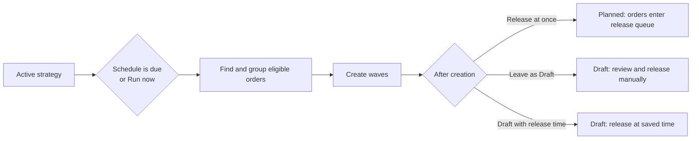

# Wave Strategy Settings

A wave strategy selects unreleased orders, divides them into waves and decides when those waves are created and released. Use this page to configure and safely test a strategy from the Web UI.

## What you will do

1. Open or create a wave strategy.
2. Choose which orders it may take.
3. Set the grouping and wave-size limits.
4. Choose a schedule and the next action for each created wave.
5. Preview the result before creating any waves.

## Before you start

- Open `Sidebar > Management & Control > Orders & Waves > Wave strategies`.
- An administrator or manager can change and run strategies.
- A supervisor or viewer can open the card in read-only mode. Operators do not have access to this administration screen.
- To send created waves to a station, first configure a `Sort` location with station positions.
- Orders already claimed by another active wave are never taken by this strategy.

## 1. Create or copy a strategy

Use `More > New strategy…` to create an empty strategy. The system assigns the next code, such as `WS-01`. A new strategy is inactive and starts with safe defaults: `New` orders, manual runs, one wave per run, up to 50 orders, and no automatic release.

Use `More > Duplicate` when an existing strategy is a close starting point. The copy receives a new code and is inactive, so it cannot run before you review and activate it.

The left side of the screen lists every strategy by `Code`, `Name` and `Status`. Select a row to open its card.

## 2. Complete the strategy card

The card is divided into four sections.

### Strategy

| Field | How to use it |
|---|---|
| `Code` | Read-only system code. Use it when you discuss a strategy with support or another administrator. |
| `Name` | Required description of the purpose, for example `Morning carrier waves`. Maximum 200 characters. |

### Which orders

| Field | How to use it |
|---|---|
| `Order statuses` | Select at least one of `New`, `Partially allocated` or `Allocated`. Only unreleased orders in the selected states are candidates. |
| `Orders without ship-by date` | Choose `take` to include undated orders when a ship-by horizon is used, or `skip` to leave them out. |
| `Ship by within, days` | Optional horizon from today. `0` means today and overdue orders; the allowed range is 0–3650 days. Leave it empty for no date limit. |
| `Carrier` | Optional carrier filter. `Any` accepts orders with any carrier, including no carrier. |
| `Order priority from` | Optional lower priority bound from 1 to 99. |
| `Owner` | Shows the owner restriction. `Any` means the strategy is not restricted to one owner. This field is read-only on this screen. |

> The strategy also ignores cancelled or released orders and orders that are already in another active wave.

> An older or integration-created strategy can also contain an upper priority limit. This screen preserves that limit when you save but does not display it. If higher-numbered orders are unexpectedly absent from `Matched`, ask your integrator or support team to review the saved strategy before changing it.

### How to build waves

| Field | How to use it |
|---|---|
| `Group by — one wave per group` | Select any combination of `Carrier`, `Ship-by date`, `Dispatch` and `Owner`. Different values go to different waves. With no selection, all matching orders share one group. |
| `Max orders per wave` | Required. From 1 to 1000. When a wave reaches the limit, the next order starts another wave. |
| `Max lines per wave` | Optional. From 1 to 100000. An order is never split; an order larger than the limit is left out. |
| `Waves per run, max` | Required. From 1 to 20. Extra eligible orders wait for a later run. |
| `Sort station` | Optional destination for the generated waves. Only configured `Sort` stations are offered. Choose `No station` if the station will be assigned later. |

### When and what next

Choose one schedule:

| Schedule | Result |
|---|---|
| `Manual only` | The strategy runs only when an authorized user clicks `Run now…`. |
| `Every N minutes` | Runs every 1–10080 minutes while the strategy is active. |
| `At times on weekdays` | Runs at the listed `HH:MM` times in the warehouse time zone. Enter several times separated by commas, for example `07:00, 13:00`. Select at least one day; up to 24 times are allowed. |

The schedule decides **when waves are created**. Separately, `After a wave is created` decides what happens to each wave:

| Choice | Result |
|---|---|
| `Release at once` | The wave becomes `Planned` immediately and its orders enter the normal release queue. |
| `Leave as Draft` | The wave remains editable. Review it on the `Waves` screen and release it manually. |
| `Draft with release time` | The wave remains `Draft` until the configured delay expires, then release starts. `Release after, min` accepts 1–10080. |

## 3. Save and activate

1. Click `Save…`.
2. Review every changed field in the `Was` and `Will be` columns.
3. Click `Save` only when the result is correct.
4. Use `More > Activate…` when the strategy is ready to run.

Unsaved changes disable `Run now…`, `Activate…` and `Deactivate…`. Hover over a disabled action to see the reason.

Deactivating a strategy stops future scheduled runs. Waves already created are not changed. Activating it resumes scheduled work from the next applicable time.

## 4. Preview and run now

`Run now…` is available only for an active strategy with no unsaved changes.

1. Select the strategy and click `Run now…`.
2. Review the summary:
   - `Matched` — orders that meet the filters;
   - `In another wave` — matching orders that cannot be taken;
   - `Waves` — waves this run will create;
   - `Orders` — orders that will be placed in those waves.
3. Review each proposed wave: `Group`, `Orders`, `Lines` and its release state.
4. Check the `Not included in this run` count. The current screen shows the count, not the order list or individual reasons. If it is unexpected, cancel the run and review the filters, limits and orders before trying again.
5. Click `Create waves` only after the preview is correct.

The preview does not change orders or create waves. The confirmed run can create several waves. The card then shows `Last run` and the created wave codes.

> A `Draft` wave can still be edited from the `Waves` screen. An order already in an active wave is skipped even when it matches this strategy.

## 5. Handle conflicts and refusals

| What you see | What it means | What to do |
|---|---|---|
| `Save changes first` | The card differs from the saved version. | Save and review the changes before running or changing status. |
| `Strategy is inactive` | An inactive strategy cannot create waves. | Review it, save it, then use `Activate…`. |
| `Wave strategy … changed — refresh.` | Another user saved a newer version while your card was open. Nothing from your command was written. | Click `Refresh & review`, compare the current card, and reapply only the intended changes. |
| A field-range message | A required value is empty or outside its allowed range. | Correct the highlighted field and open the review again. |
| A release warning after creation | The system created the wave but could not release it automatically. | Open the wave on the `Waves` screen. It remains `Draft`; correct the reported problem and release it there. |

Server refusals stay inside the command window so you can correct the card without losing context.

## Related pages

- [Waves Overview](12-wave-overview.md)
- [Outbound Setup](../06-outbound-setup.md)
- [Journey: Wave Build and Release](../../diagrams/allocation/12-journey-wave.md)
