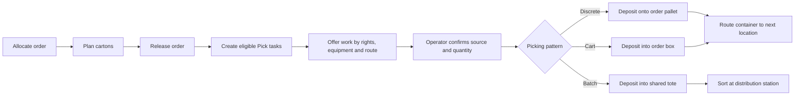

# Picking Overview

Picking turns released order demand into directed warehouse work. Quark chooses eligible work for the operator, guides the source checks, moves the confirmed quantity to its outbound container, and routes the completed container to the next location.

This page helps an administrator choose a picking pattern and understand which settings control it. For terminal instructions, see [Picking](../../operator/09-picking.md) and [Batch picking and distribution station](../../operator/14-batch-picking-and-distribution-station.md).

## The five warehouse work patterns

Quark supports five warehouse work patterns.

| Pattern | Use it when | Where picked goods go |
| :--- | :--- | :--- |
| Discrete pick | One operator should pick one order at a time. | An order pallet that travels with the picker. A large order may use several pallets. |
| Cart picking into order boxes | One trip should collect several orders. | Each cart position holds the box for one order. |
| Aggregated cart step | Several boxes on the cart need the same SKU from the same source. | The operator visits the source once, then distributes the required quantities into the order boxes. |
| Batch picking for a distribution station | A wave should be collected into shared totes and sorted afterwards. | A shared tote first, then order or store boxes at the distribution station. |
| Paper picking | The warehouse records work from a paper sheet at a workstation. | A pick pallet that remains in transit until the user selects `Place Pallet`. |

The picking policy selects the first three patterns. A released wave assigned to a distribution station enables batch picking. Paper picking is recorded from the web workstation and intentionally has no RF picking path.

## What controls a pick

Picking combines several independent settings.

| Decision | Controlled by |
| :--- | :--- |
| Which stock is reserved | The allocation policy assigned to the order line. |
| Which outbound box is planned | The cartonization policy. |
| Which operator can receive the work | Task permissions, `Pick Execution`, work-area zones, and equipment restrictions. |
| Which task is offered first | Order priority, source route sequence, and task age. |
| Whether the equipment can handle it | Equipment weight limits and excluded zones. |
| Pallet, cart, or aggregated cart work | The picking policy selected for the work area and equipment. |
| What the operator must scan at the source | The source-confirmation settings in the applicable picking policy. |
| Where a finished pallet or cart goes | The picking policy, the owner's delivery location, the task destination, and configured stations. |
| What happens when stock is missing | The selected pick-short reason and its published actions. |
| Whether the source is counted afterwards | `On an Emptied Location`, count triggers, and pick-short actions. |

Use these related pages to configure the process:

- [Picking Policy Settings](21-picking-policy-settings.md)
- [Work Areas, Equipment and Operator Permissions](22-work-areas-equipment-and-permissions.md)
- [Pick Short Reasons](23-pick-short-reasons.md)
- [Inventory Count Policy and Count Settings](24-inventory-count-policy.md)

## From order to completed pick

1. Allocation reserves eligible stock and creates pick lines.
2. Cartonization decides whether the line belongs in a planned carton, ships as-is, bypasses carton planning, or must wait for correction.
3. Releasing the order refreshes allocation and creates tasks for pick lines that are ready to execute. A line with pending or blocked cartonization does not create executable work.
4. Each task keeps the source, destination, owner, SKU, lot, unit, quantity, source container, weight when known, and order priority.
5. An eligible operator requests work. Quark applies rights, equipment limits, work-area coverage, source availability, holds, and route order.
6. The terminal shows any pick instruction and then requests the configured source proof.
7. At confirmation, Quark checks the stock, hold state, lot requirements, and minimum shelf life again before moving the goods.
8. The operator completes the pallet, cart, or station route and sends the goods to the next location.

Allocating an unreleased order does not create RF work. Release is the boundary that creates executable picking tasks.

## How Quark chooses work

When an operator asks for the next pick, Quark follows this order:

1. Require the operator to finish a live `Station Route`, if one exists.
2. Continue the operator's live cart assignment, if one exists.
3. Require delivery of a previous carrier that still contains picked goods.
4. Confirm that the operator is active and has Pick permission in a reachable work area.
5. Apply equipment exclusions and lifting capacity.
6. Continue the operator's own open task before taking a new task from the pool.
7. Consider ready Pick tasks from allowed zones whose orders, locations, stock, and carton plans are still executable.
8. Order candidates by order priority, then source `Route Sequence`, then age.
9. Assign the first eligible task for a limited time.

Every successful scan or action renews the task time limit. If the operator remains inactive for too long, the task returns to the pool and must be requested again.

A cart assignment claims all tasks for its selected boxes together. If another operator changes one of those tasks at the same moment, the cart start is refused and the operator requests work again; Quark does not build a partial cart from an inconsistent selection.

## Configure discrete pallet picking

Use `Picking > Discrete Pick` when the operator should take one order at a time. This entry uses the published `DISCRETE` policy for source confirmation.

The operator path is:

1. Request pick work.
2. Review the source location, SKU, quantity, lot details, and any instructions.
3. Scan or enter the source proof requested by the policy.
4. Open an empty pick pallet when prompted.
5. Confirm the pick and place the goods on that pallet.
6. Continue picks for the same order and destination on the open pallet.
7. Press F2 to close the pallet, then scan the pallet and its destination.

The first deposit fixes the pallet's destination. A destination set by a supervisor on the order takes priority. Otherwise Quark starts from the owner's picker-carrier delivery location or the task destination, and may route the pallet through the configured packing or order-control station when the policy permits that station type. The final destination type must be allowed by `Pallet Drop Cell Types`.

One operator can have only one open pick pallet. Before starting a different order or destination, close the current pallet. Closing another operator's pallet requires the corresponding permission or supervisor authority.

### Discrete work through Pick by Area

`Pick by Area` can also produce one-order pallet work when the selected policy uses `Unit = Order`.

- Source-confirmation fields still come from the published `DISCRETE` policy.
- For picks inside the selected area's zones, the area policy controls the pallet destination types and emptied-location behavior.
- If the pick is outside that area, the pallet uses `DISCRETE`.

Test this distinction whenever an area-specific policy sends pallets to packing or order control.

## Configure cart picking

Use `Pick by Area` with a published policy configured for planned targets and a carrier. The work area's equipment mapping selects the policy; when no equipment-specific mapping exists, Quark uses the area's default and then the standard discrete fallback.

Before use, configure:

- a picking policy with `Unit = Planned target` and `Carrier Required = Yes`;
- `Target = Scan the container` and `Deposit Mode = Direct to target`;
- a handling-unit type with `Holds Containers`, enough `Positions`, and `Active` enabled;
- an empty registered cart of that type;
- work-area Pick permissions and `Pick Execution` for the operator;
- a common delivery location for the boxes selected into one cart trip.

The number of boxes in one trip is the lower of the policy's `Max Targets` and the cart type's `Positions`.

The operator path is:

1. Select `Pick by Area`, the work area, and equipment.
2. Scan the empty cart.
3. Scan one suitable empty box into each assigned position.
4. Follow the route by source `Route Sequence`.
5. Confirm the source and scan the correct position box for every deposit.
6. Handle missing stock, a full box, or a damaged box when needed.
7. Deliver the cart. With `Completion = Confirm at the drop location`, scan the expected delivery location. With `Completion = Complete`, finish where the cart stands unless a supervisor has retargeted the carrier; a retargeted carrier must be delivered to the named location.

The operator can dissolve an assignment before the first pick is committed. After goods have been picked, supervisor authority is required.

## Use aggregated cart steps

Set `Quantity = Aggregated` on the cart policy when the operator should visit a shared source once and distribute goods across several order boxes.

Quark combines consecutive cart stops only when their source facts are compatible, including owner, SKU, location, source LPN, and lot proof. Serial-tracked picks remain individual stops. Each order-box quantity is still committed or shorted separately, so a problem with one box does not discard successful work for the others.

Use `Quantity = Per pick` when each order-box line should remain a separate source stop.

## Use batch picking and a distribution station

For a sort-after-pick process:

1. Configure the distribution station and its positions.
2. Assign the released wave to that station.
3. The picker opens `Station Route` and collects the route into shared totes.
4. At the station, the operator distributes the picked goods into order or store boxes.

The route still uses the same source confirmation, lot, LPN, and pick-short rules. See [Batch picking and distribution station](../../operator/14-batch-picking-and-distribution-station.md) for the complete terminal flow and exceptions.

## Configure source proof

The picking policy can require or display:

- `Source Location`;
- `Item`;
- `Reserved LPN` when the source stock is containerized;
- `Loose Lot Source` proof;
- configured lot attributes.

The selected plan may add a location or LPN scan when it is needed to prove the lot, even if the individual field appears less restrictive. Test loose single-lot stock, loose mixed-lot stock, and containerized stock before rollout.

At the final confirmation, the system rechecks the real stock and holds. A successful earlier scan does not guarantee that a later commit will succeed if another operation changed the source.

## Prepare the warehouse

Before enabling picking for operators:

1. Configure source zones and their `Picking To Location`.
2. Create work areas and assign their zones.
3. Configure equipment profiles and exclusions where required.
4. Give each operator Pick task permission in the correct area and enable `Pick Execution`.
5. Publish `DISCRETE` for pallet picking. Publish and assign a planned-target policy for cart picking.
6. Register carrier types and carts when the process uses carts.
7. Install and publish the warehouse's approved pick-short reasons. The General Distribution reference configuration provides `SHORT`, `LPN_NOT_FOUND`, and `WRONG_LOCATION`; warehouse Bootstrap alone does not create them.
8. Choose emptied-location and count behavior.
9. Test the complete route with representative orders before broad rollout.

## Test important exceptions

Test at least these cases:

- source location on hold or in a non-operational state;
- source LPN on hold, moved, or replaced with an allowed same-lot LPN;
- stock below the SKU's minimum shelf life on pick;
- insufficient stock and every published pick-short reason;
- full and damaged cart boxes;
- cart with too few positions or an ineligible handling-unit type;
- wrong destination at pallet close or cart delivery;
- task timeout and operator reconnection;
- two operators requesting the same work at the same time;
- source location becoming empty and its configured count follow-up;
- order control, packing, or staging as the next step.

## Understand changes to live work

| Change | New work | Work already held or in progress |
| :--- | :--- | :--- |
| Publish a new `DISCRETE` revision | Future discrete proof plans use it. | An open proof keeps its current plan; stock is still rechecked at commit. An open pallet keeps its destination rules. |
| Publish a new cart policy revision | Future cart assignments use it. | A live cart assignment keeps its frozen policy copy. |
| Change the area's policy assignment | Used for the next cart start and when a one-order `Pick by Area` pallet is opened. | A held one-order task with no open pallet can use the new assignment. A live cart and an already-open pallet keep their frozen policy. |
| Change permissions, zones, or equipment | Used at the next dispatch. | Work already held by the operator continues until completion or timeout. |
| Publish a pick-short reason change | Used by the next short report. | Earlier short decisions are not rewritten. |
| Change task timeouts | Used at the next claim or renewal. | The next renewal applies the current timeout. |

## Troubleshoot no eligible work

When the terminal shows `No eligible Pick work`, check:

1. the order is released and the pick line has executable cartonization;
2. a Pick task exists and is not already assigned, cooling down, or escalated;
3. the operator is active, has Pick permission, and has `Pick Execution` enabled;
4. the task's source zone belongs to an allowed work area;
5. the selected equipment does not exclude the zone and can lift the task;
6. the source location and stock are operational and not on hold;
7. the correct published picking policy is assigned to the area and equipment;
8. a previous cart or pallet does not need to be completed first.

For field-by-field settings, continue with [Picking Policy Settings](21-picking-policy-settings.md).
