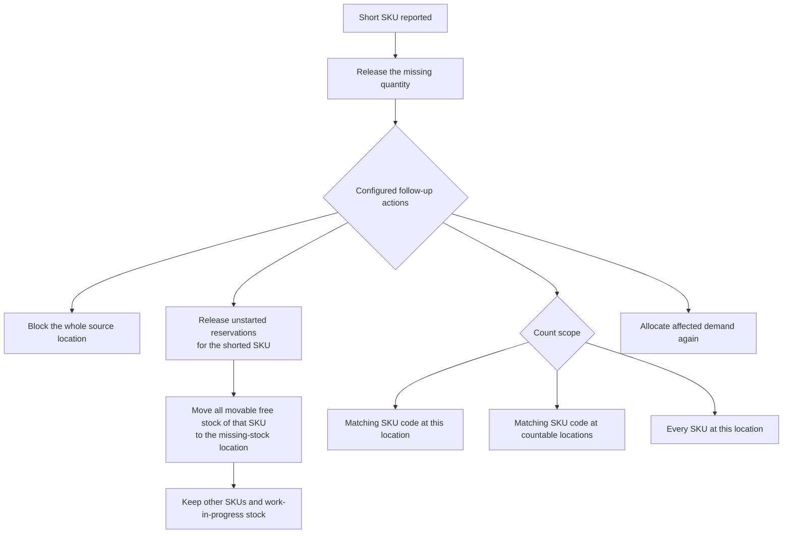

# Pick Short Reasons

A pick is short when an operator finds less stock than the pick requires. A
published short reason controls whether the operator may report a partial or
zero quantity and what the warehouse does next.

Use short reasons to keep the floor response consistent: release the missing
quantity, protect the source location, request a count and try allocation again
from eligible stock.

## Before you start

- Open `Sidebar > Warehouse Configuration > Reason Codes > Pick Short Reasons`.
- An **Admin** or **Manager** can create, publish and retire reasons. A
  **Supervisor** can review them.
- Agree the reason codes and follow-up actions with warehouse operations before
  publishing them.
- Check the **Missing To Location** on each affected putaway zone before using
  an action that relocates remaining stock.

:::important General Distribution profile

`SHORT`, `LPN_NOT_FOUND` and `WRONG_LOCATION` belong to the **General
Distribution reference configuration**. Warehouse Bootstrap does not create
them.

After selecting the General Distribution profile, confirm that its reviewed
configuration has been explicitly applied through the supported onboarding or
administration workflow. If it has not, create, review and publish equivalent
reasons before picking starts. Other warehouse profiles may use different
approved codes.

:::

## What the operator does

1. The operator chooses **Short** on the current pick.
2. The terminal asks for **Found qty**.
3. The operator enters a published **Reason** and, when needed, a **Note**.
4. The terminal shows **Confirm Short**. The operator reviews and confirms the
   result.

The found quantity must be lower than the remaining pick quantity. If the
operator found the complete quantity, they complete the normal pick instead.

For example, if the pick requires 100 and the operator finds 40, the system
moves 40 to the current pallet or order box and records 60 as the shortage.

## General Distribution reference reasons

| Code | Use it when | Allow Partial | Allow Zero |
|---|---|---:|---:|
| `SHORT` | Physical stock is below the system quantity. | On | On |
| `LPN_NOT_FOUND` | The pallet named by the pick is not in the source location. | Off | On |
| `WRONG_LOCATION` | The stock named by the pick is not where the system says it is. | On | On |

`LPN_NOT_FOUND` does not allow a partial result because the expected pallet is
either present or absent.

## Create and publish a reason

1. Select **New Revision**.
2. Enter the **Code** and **Description**.
3. Set **Allow Partial** and **Allow Zero**.
4. Select **Save**.
5. Add and configure the actions required by the warehouse process.
6. Review the complete revision, then select **Publish**.
7. Test the reason with a controlled pick before releasing it to operators.

Only a published revision is available on the floor. Publishing a new revision
retires the previously published revision of the same code.

### Reason fields

| Field | Meaning |
|---|---|
| **Code** | The short code entered on the terminal. Use a clear, approved uppercase code. |
| **Description** | A plain-language explanation of when the operator should use the reason. |
| **Allow Partial** | Lets the operator report that some, but not all, of the quantity was found. |
| **Allow Zero** | Lets the operator report that none of the quantity was found. |
| **Status** | **Draft**, **Published** or **Retired**. Only **Published** is usable on the floor. |

The operator note can contain up to 200 characters.

## Configure follow-up actions

Every published reason must include an enabled **ReleaseCurrentRemainder**
action. It releases the missing part of the current reservation so the order can
continue through the configured recovery process.

The current workflow uses these actions:

| Action | What it does |
|---|---|
| **ReleaseCurrentRemainder** | Releases the part of the current pick that was not found. |
| **BlockSourceLocation** | Stops new allocation and new pick work for the whole source location until the discrepancy is resolved. This also affects other SKUs stored there. |
| **ReleaseRelatedReservations** | Releases eligible, not-yet-started reservations for the shorted SKU at the source location. |
| **RelocateResidualToMissing** | Moves all movable free stock of the shorted SKU at the source location to the zone's **Missing To Location** or to a configured fixed location. Other SKUs stay in place. |
| **CreateInventoryCount** | Requests a count of the matching SKU code at this location, the matching SKU code across countable locations, or the entire source location. |
| **ReallocateReleasedDemand** | Tries allocation again for the selected orders, excluding blocked stock. |

Leave compatibility choices that are not part of the current warehouse design
unchanged unless the implementation team has provided an approved setup.

### Recommended General Distribution sequence

For the three reference reasons, review a sequence that:

1. releases the missing quantity from the current pick;
2. blocks the source location;
3. releases eligible related reservations;
4. relocates eligible residual stock to the configured missing-stock location;
5. requests an inventory count; and
6. allocates the current and affected orders again.

For residual relocation, set both **RelocateResidualToMissing** and
**ReleaseRelatedReservations** to **CurrentSkuAtLocation**. Use either the
zone's **Missing To Location** or an approved fixed location. The relocation
moves all movable free stock of the shorted SKU at the source, across its lots.
It does not move another SKU from a mixed location, and it does not take stock
already reserved for work in progress. A serial-tracked balance that still has
an active reservation cannot be split, so its free remainder stays with the
reserved quantity at the source.

Choose the count scope separately:

| Count scope | What the warehouse counts |
|---|---|
| **CurrentSkuAtLocation** | The matching SKU code at the source location. |
| **CurrentSkuEverywhere** | The matching SKU code at the source, plus that code at each other countable location where it is held. Locations already blocked or being counted are skipped. |
| **EntireLocation** | Every SKU at the source location. Use this only when the discrepancy calls the whole location into question. |

**CurrentSkuEverywhere** does not create a second count when the SKU is held
nowhere else. Count requests match the SKU code, not the owner. If different
owners reuse the same SKU code, their matching stock can enter the same count.
Reallocation may cover the current order, orders whose
reservations were released, or both.

Do not publish the revision until the destination, scope and order coverage have
been reviewed together.

## What happens after a short pick

1. The quantity found moves to the operator's current pallet or order box. A
   zero short moves no stock.
2. The missing quantity is released from the current pick.
3. The pick and task record the shortage, reason and note.
4. If configured, the source location is blocked from new allocation and new
   work.
5. If configured, eligible related reservations for the shorted SKU are
   released. Work already started by another operator is not taken away from
   them.
6. If configured, all movable free stock of the shorted SKU at that location is
   moved to the configured missing-stock location. Other SKUs stay. If the
   shorted SKU was in a mixed box, the box stays and the free quantity may move
   without that box. A serial-tracked balance with an active reservation stays
   together at the source.
7. If configured, a count is requested with the selected scope. A
   **CurrentSkuEverywhere** request skips another location that is already
   blocked or being counted.
8. If configured, allocation runs again for the selected orders.

The system keeps the published reason revision and its enabled actions with the
shortage. Publishing a later revision does not rewrite a shortage that has
already been recorded.

## Change a live reason safely

1. Create a new draft revision instead of changing the published revision.
2. Review the partial and zero settings.
3. Review every enabled action, destination, scope and order coverage.
4. Test the draft configuration in a controlled warehouse flow.
5. Publish the revision.
6. Tell operators if the code or the conditions for using it changed.

Retire a reason only when another approved published revision or replacement
code is ready. If no revision of a code is published, the terminal cannot accept
that code for a new short pick.

## Operational checks

After a test shortage, confirm that:

- the found quantity is on the correct pallet or order box;
- the missing quantity is no longer reserved by the current pick;
- the source location is blocked when the reason requires it;
- work already started by another operator remains assigned to them;
- eligible unstarted reservations were released when the reason requires it;
- all movable free stock of the shorted SKU moved to the intended missing-stock
  location when relocation is configured, while other SKUs stayed at the
  source;
- a count request is visible to the responsible team when the reason requests
  one; and
- the affected demand was considered for allocation again when reallocation is
  configured.

Short-pick recovery does not create a replenishment by itself. Replenishment is
controlled by the replenishment policy and the minimum and maximum quantities
of pick locations.

## If something goes wrong

| Symptom | Meaning | What to do |
|---|---|---|
| The terminal does not accept a reason code | The code has no published revision, or it does not allow the entered quantity. | Check the published revision and its **Allow Partial** and **Allow Zero** settings. Give the operator an approved code. |
| The revision cannot be published | A required release action is missing, or the relocation, count or reallocation settings are incompatible. | Enable **ReleaseCurrentRemainder**. If residual relocation is enabled, add **ReleaseRelatedReservations**, confirm the destination and set both actions to **CurrentSkuAtLocation**. Review the count and reallocation scopes separately. |
| Allocation continues to avoid the source | The location is still blocked while the discrepancy is unresolved. | Complete or resolve the requested count, then confirm that the location is available again. |
| Other SKUs at the source did not move | This is expected. Residual relocation covers only the shorted SKU. | Leave the other SKUs in place. Investigate them separately only when there is evidence of another discrepancy. |
| Residual stock of the shorted SKU did not move | No valid missing-stock destination was available, or the stock was still reserved for work already in progress. | Check the zone's **Missing To Location**, the configured fixed destination and the work still active at the source. |
| A **CurrentSkuEverywhere** count did not include another location | That location was already blocked or being counted when the request ran. | Resolve the existing block or count, then request a controlled follow-up count if it is still needed. |
| Demand was not allocated again | No eligible stock was available, or the reallocation order coverage did not include the order. | Review available stock and the **Order Scope** of the reallocation action. |

## Related guides

- [Warehouse Profile and Assisted Onboarding](../10a-warehouse-profile-and-assisted-onboarding.md)
- [Picking Overview](20-picking-overview.md)
- [Picking Policy Settings](21-picking-policy-settings.md)
- [Putaway Zone Settings](02-putaway-zone-settings.md)
- [Inventory Count Policy](24-inventory-count-policy.md)
- [Replenishment Status](35-replenishment-status.md)
