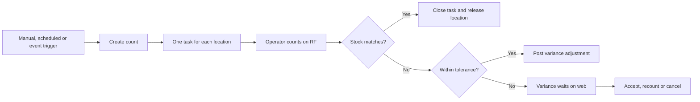

# Inventory counts, cycle policies and tolerances

Inventory counts compare the stock recorded by Quark WMS with the stock an
operator finds at a location. A difference does not change inventory until the
system accepts it or an authorised user accepts the variance.

This guide explains how to create counts, schedule cycle counts, configure
tolerances and resolve differences.

## How the process fits together

A count can contain several locations, but each location is a separate task and
attempt. Task statuses include **Open**, **Variance**, **Closed**,
**Recounted** and **Cancelled**.

## Ways a count starts

| Trigger | Configuration | Count type |
|---|---|---|
| A cycle policy finds due locations or SKUs | **Cycle Count Policies** | Cycle |
| A supervisor creates a count on the web | **Inventory Counts > New** | Full or Selective |
| A pick-short reason requests a count | **Pick Short Reasons** | Event |
| Picking empties a source location, or the empty confirmation contradicts stock | Picking policy **On an Emptied Location** | Event |
| An adjustment reason requests a follow-up count | Adjustment reason **Count After Posting** | Event |
| Directed putaway uses an acknowledged deviation | System setting **COUNT_ON_PUTAWAY_DEVIATION** | Event |
| An order is cancelled after its pick source was confirmed | System setting **COUNT_ON_PICK_CANCELLED** | Event |
| An operator reports unexpected stock | Always | Event |
| Packing finds excess stock | Packing excess workflow | Event |
| A distribution station finds excess stock | Distribution-station excess workflow | Event |
| Order Control sends a missing container to count | **Order Control > Request Count** | Event |

An event request counts one location. If an open task or unresolved variance
already covers that location, the request joins the existing work instead of
creating a duplicate.

Locations of type **InTransit** or **Lost** are not countable.

## Hard and soft counts

| Freeze | Behavior |
|---|---|
| **Hard** | The location is protected from physical stock changes while it is counted. Moves, adjustments, deposits and pick confirmation are blocked; allocation may still reserve stock because it does not change physical quantity. |
| **Soft** | Stock may continue moving. The comparison includes movements committed after the count snapshot. |

A location must be available for counting when either mode starts. Use **Hard**
for controlled stocktakes and **Soft** when stopping the operation is not
practical.

:::warning Overrides during a hard count
Some movement, adjustment and pick-confirmation refusals can be authorised with
a reasoned supervisor override. The reason is recorded and the count may need
to be repeated because the underlying stock changed. Receiving into a counted
location has no such override: use another destination or wait for the count.
:::

## Create a manual count

Open **Sidebar > Management & Control > Inventory > Inventory Counts**.
**Admin**, **Manager** and **Supervisor** can create and manage counts.
**Viewer** can read them but cannot make decisions.

1. Click **New**.
2. Choose **Type**:
   - **Selective** for selected locations or items.
   - **Full** for whole zones.
3. Choose **Scope**:
   - **Whole location** counts everything at each location.
   - **Only the item** limits the count by the entered **SKUs**, **Lots** and
     **LPNs**.
4. For **Only the item**, enter the item filters.
5. Choose **Mode**: **Blind** or **Informed**.
6. Choose **Freeze**: **Hard** or **Soft**.
7. Set **Recounts per Location** and add a **Comment** if required.
8. Save the count header.
9. For **Whole location**, click **Add Locations** and select individual
   locations or zones. Adding them creates the tasks and applies the freeze.

For **Only the item**, Save resolves the matching countable locations and adds
them immediately. A location already covered by another live count cannot be
added.

### Blind and informed modes

- **Blind** hides the system quantity from the counter.
- **Informed** shows the expected stock on the first attempt.
- A recount is blind even when the original count was informed.

The operator never enters zero as a counted quantity. To report an empty
location, the operator uses **Empty**.

## Operator RF flow

The operator opens **Inventory > Count Location**:

1. At **Count — Work Area**, scan a work area or press Enter for all permitted
   count work.
2. At **Count — Next Location**, request the next task.
3. At **Count — Go To Location**, go to and scan the assigned location.
4. Record each item found.
5. At **Count — Finish**, choose **Done**, **Empty** or **Leave**.
6. Review the **Counted** result.

An operator needs a **Count** task permission for a work area that contains the
location's zone. Equipment exclusions also apply.

## Resolve a variance

Open the count and select a location in **Variance**.

| Action | Result |
|---|---|
| **Accept Variance** | Posts an inventory adjustment and closes the task. A Hard count targets the observed quantity; a Soft count applies the observed difference to the current stock. |
| **Recount** | Creates another blind attempt for a different counter, subject to the recount limit. |
| **Cancel Count** | Cancels remaining work and releases the locations. |

**Admin**, **Manager** and **Supervisor** can use these actions. A variance above
the configured manager threshold requires the separate large-variance
authority, assigned by default to **Admin** and **Manager**.

When accepting a variance:

1. Click **Accept Variance**.
2. Choose a **Cause**.
3. Add a **Comment** when useful.
4. Click **Accept**.

The accepted variance uses the adjustment reason **COUNT_VARIANCE**. It is
posted in the same operation. A Hard count sets stock to the counted quantity.
A Soft count preserves intervening movements and applies the observed variance:
current quantity plus counted quantity minus the expected quantity. Acceptance
is refused if that reconciliation cannot produce valid stock, the result would
be below reserved or picked quantity, or another adjustment precondition fails.

## Configure a cycle count policy

Open **Sidebar > Warehouse Configuration > Counting > Cycle Count Policies**.
**Admin**, **Manager** and **Supervisor** can maintain and run policies;
**Viewer** has read-only access.

1. Click **New**.
2. Review the generated **Code** and enter a **Description**.
3. Select the policy **Basis**:
   - **Locations** selects locations by topology and ABC fields.
   - **Items** selects SKUs and counts them wherever countable stock exists.
4. Define a narrow scope.
5. Enter **Every (days)**.
6. Enter **Locations per Run**. For an item policy, this limits SKUs per run.
7. Choose **Mode** and **Freeze**.
8. Set **Recounts per Location**.
9. Decide whether **Trust Empty Confirmations** is appropriate.
10. Save the policy and use **Run Now** for a controlled test.

Only active, saved policies run. Editing or deactivating a policy does not
change counts already created.

### Location-based scope

Set at least one of these fields:

| Field | Meaning |
|---|---|
| **Zone** | Only locations in the selected zone. |
| **Location Type** | Only the selected operational location type. |
| **ABC** | Only locations with that ABC class. |
| **Aisle** | Only locations in that aisle. |

When several fields are set, a location must match all of them. A policy over
every warehouse location is refused; narrow it to a practical cycle-count
scope.

### Item-based scope

Set **SKU ABC**, **SKU group**, or both. When both are set, a SKU must match
both. The policy selects active SKUs that hold stock in countable locations and
are due under **Every (days)**.

A count of a complete location does not mark an item-policy SKU as counted. The
SKU is considered counted for this policy when an item-scoped count for that SKU
closes.

### Cadence and run size

- **Every (days)** accepts 1 to 3650.
- **Locations per Run** accepts 1 to 10000.
- Never-counted work is selected first, followed by the work that has waited
  longest.
- **Last Run** shows the last warehouse day on which the policy ran.
- The scheduler evaluates active policies regularly and runs each at most once
  per warehouse day. **Run Now** is available for an additional controlled run.

The warehouse time zone determines the day boundary.

## Trust empty confirmations

When **Trust Empty Confirmations** is on for a location-based policy, a correct
empty confirmation made during picking can postpone the next cycle count. A
confirmation that contradicted system stock is not trusted and may request a
count instead.

Use this only where the picking confirmation is a reliable physical check.

## Configure count tolerances

Open **Sidebar > Warehouse Configuration > Counting > Count Tolerances**.
There is one row for each SKU ABC class: **A**, **B** and **C**. A SKU with no
class uses class **B**.

Only **Admin** and **Manager** can change tolerances. **Supervisor** and
**Viewer** can read them.

| Field | Meaning |
|---|---|
| **Accept up to (units)** | Maximum absolute quantity difference for automatic acceptance. |
| **Accept up to (%)** | Maximum difference as a percentage of expected quantity. |
| **Accept up to (value)** | Maximum variance value, using the SKU cost when available. |
| **Manager above (value)** | Variances above this value require large-variance authority. |

Automatic acceptance requires every differing line to meet every configured
rule for its class. A class with neither a units nor percentage rule does not
auto-accept variances. An expected quantity of zero cannot satisfy a percentage
rule.

Leave tolerances empty when every difference must be reviewed.

## Maintain variance causes

The **Accept Variance** window offers active variance causes such as pick error,
putaway error, receiving error, damage, theft or loss, count error and not
established. **Within tolerance** is reserved for automatic decisions and is not
offered to a supervisor.

To add a warehouse-specific cause:

1. Open **Sidebar > Warehouse Configuration > Settings & Reference Data > Code
   List**.
2. Open the count variance cause list.
3. Click **New Value**.
4. Enter **Code**, **Display Order**, **Description** and **Active**.
5. Save.

Deactivating a cause removes it from later decisions; earlier accepted
variances keep their recorded cause.

## Configure event triggers

### Emptied locations

On a picking policy, **On an Emptied Location** has three values:

- **Nothing** does nothing.
- **Count the location** requests a count after a full pick leaves the source
  empty.
- **Ask the operator whether it is empty** requests a count when the answer
  contradicts recorded stock.

The setting affects later picks only.

### Pick shorts

A pick-short reason can request an inventory count and may also block the
source location. See [Pick short reasons](23-pick-short-reasons.md).

### Posted adjustments

Under **Adjustment Reasons**, select a reason and switch **Count After Posting**
on or off. When on, posting an adjustment requests a count for each affected
location. A variance adjustment created by an inventory count does not request
another count.

### Putaway deviation and cancelled pick

In **System Settings**:

- set **COUNT_ON_PUTAWAY_DEVIATION** to `1` to count a destination after an
  acknowledged directed-putaway deviation;
- set **COUNT_ON_PICK_CANCELLED** to `1` to count a source when an order is
  cancelled after the operator already confirmed that source.

Use `0` to keep either trigger off. See [System settings](42-system-settings.md).

## Troubleshooting

| Symptom | What to check |
|---|---|
| No count work is offered | Operator **Count** permission, work-area zones, equipment exclusions and whether eligible tasks exist. |
| A location cannot be added | Location status and flags, location type, and another live count. |
| **Run Now** starts nothing | Policy is active and saved, scope matches countable stock, and work is due. |
| A variance cannot be accepted | Reservations, picked quantity, Hard-count stock changes, Soft reconciliation and the manager threshold. |
| Recount is unavailable | **Recounts per Location** has been exhausted. |
| A daily policy uses the wrong date | Warehouse time zone in **System Settings**. |

## Before go-live

- Run one blind hard count and resolve a variance.
- Run one informed count and confirm that its recount is blind.
- Test the operator's work-area permissions.
- Test a soft count while stock moves.
- Test every enabled event trigger.
- Review tolerances with Finance or Inventory Control before enabling automatic
  adjustments.
- Test the manager threshold with both Supervisor and Manager roles.
- Confirm the cycle policy scope does not unintentionally cover the whole
  warehouse.

## Related guides

- [Picking policy settings](21-picking-policy-settings.md)
- [Pick short reasons](23-pick-short-reasons.md)
- [System settings](42-system-settings.md)
- [Inventory count operator guide](../../operator/08-inventory-count.md)
