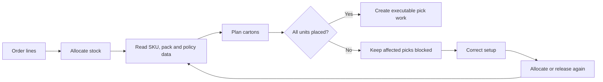

# Cartonization: how it works

Cartonization plans which shipping cartons should receive the items reserved
for an order. The plan gives pickers a destination carton and gives the packing
station an expected carton and weight context.

Cartonization is planning, not packing. The warehouse still picks the goods and
the packer still verifies the real carton.

Use this page to understand the workflow. For every field on the policy screen,
see [Cartonization policy settings](31-cartonization-policy-settings.md).

## When the plan is created

The system attempts cartonization during order allocation and release. There is
no separate **Run cartonization** action.

If planning fails as a whole, the stock reservation remains. The system does
not keep a half-written carton plan, and affected picks are not offered to an
operator. Correct the data and allocate or release the order again.

## What the system reads

For every reserved pick, the system resolves the pack level for the pick's unit
of measure and then reads its physical data.

| Input | Where to maintain it | Why it matters |
|---|---|---|
| **Cartonization Policy** | SKU **Policies**, or the owner's default when the SKU has no policy | Selects the packing rules and candidate cartons. |
| **Length**, **Width**, **Height** | Pack level | Determines whether the item fits. |
| **Weight** | Pack level | Checks the carton gross-weight limit. |
| **Rotation Rule** | Pack level | Determines which item orientations may be tried. |
| **Cartonize** | Pack level | Sends this pack level to the carton solver. |
| **Ship As Is** | Pack level | Treats a complete factory package as its own shipping package. |
| Candidate carton dimensions and limits | **Cartonization Policy** | Defines the cartons the solver may open. |

:::warning Serial-tracked stock
Packing serial-tracked stock is not supported. Cartonization does not bypass
this restriction; serial-tracked stock cannot be opened or closed through
packing.
:::

## Which picks use a planned carton

The system handles a pick in one of three ways:

| Result | Meaning |
|---|---|
| **Planned** | The pick goes to a carton from the plan. |
| **Ship As Is** | A complete factory package travels as its own package. This comes from the pack level, not from an exception setting. |
| **Not cartonized** | The pick follows its normal destination because its pack level is not cartonized or no cartonization policy resolves. |

A policy is resolved from the SKU first. If the SKU has no cartonization policy,
the system uses the owner's default cartonization policy. Assigning a policy to
the SKU therefore takes precedence over the owner default. If the policy named
on the SKU is inactive, planning stops; the system does not fall back to the
owner default.

If the order-line unit of measure has no matching pack level, the complete
cartonization attempt fails and the affected pick is not executable. Add or
correct that pack level, then allocate or release the order again.

## How cartons are selected

The solver works from the largest item groups down. It tries active candidate
cartons in their configured order, checks the permitted orientations, carton
dimensions, gross-weight limit and unit limit, and opens another carton when
required. It then checks whether the contents of a new carton can fit into a
smaller active candidate.

The **Split Rule** controls whether all units of one pick must remain together:

- **Allow** lets units from one pick use more than one carton.
- **Prevent** requires the complete pick to fit into one carton.

The same inputs produce the same plan. The solver has a configured work budget;
if the budget is exhausted, no partial plan is published. Reduce the candidate
set or review the solver limits before trying the order again.

## Why an item is not placed

The order shows a cartonization exception when a unit cannot be placed.

| Reason | What it means | What to check |
|---|---|---|
| **No dimensions** | Length, width or height is missing or zero. | The selected pack level. |
| **No candidate cartons** | The policy has no active carton available. | Policy cartons and their **Active** values. |
| **Splitting not allowed** | Each unit could fit, but the complete pick does not fit into one carton. | **Split Rule**, quantity and carton sizes. |
| **No weight** | Weight is unknown and a candidate carton has a gross-weight limit. | Pack-level weight. |
| **Overweight** | Carton tare plus contents exceeds every suitable carton's gross-weight limit. | Item weight, tare weight and gross limit. |
| **Nothing fits** | No active candidate satisfies size, orientation and unit limits. | Carton dimensions, rotation and maximum units. |

All six exception actions currently stop the affected pick. New policy saves
accept **Stop**; legacy **Ship As Is** exception values are not a supported
fallback. Use the pack-level **Ship As Is** setting only for a genuine complete
factory package.

## Recover a blocked pick

1. Open the order and review its cartonization exception.
2. Correct the pack level or cartonization policy named by the exception.
3. If the policy changed, make sure it is active and still has at least one
   complete active carton.
4. Allocate or release the order again.
5. Confirm that the pick now shows **Planned**, **Ship As Is** or **Not
   cartonized**, as intended.

Changing master data does not rewrite cartons already being worked. Replanning
protects cartons that already contain picked goods and plans only eligible
remaining work around them.

## Configure a policy safely

Open **Sidebar > Policies > Cartonization Policy**. **Admin** and **Manager**
can create and maintain policies.

1. Create the policy inactive.
2. Enter a unique **Code**, **Name** and **Description**.
3. Choose the **Split Rule** and review the solver limits.
4. Add at least one carton with positive inner dimensions and valid limits.
5. Mark the cartons that may be used as **Active**.
6. Activate and save the policy.
7. Assign it to a test SKU or as an owner default.
8. Allocate and release a small test order before wider use.

An active policy must have at least one complete active carton. Only the
**Minimum cartons** objective is supported. **Solver**, **Algorithm** and
**Maximum Candidates** are retained on the policy but do not change the current
calculation.

## Box full during cart picking

A real carton on a picking cart can fill before the plan expects it. The
operator uses the RF
**Box Full** action and selects a reason, such as incorrect master-data
dimensions, protective packaging, an impossible orientation, deformed goods or
carton, or a layout that was not feasible on the floor.

The **Box Full** action at a distribution station is a different flow. It does
not ask for these reasons; it closes and routes the full box onward.

The full carton remains closed on the cart. The system attempts to replan the
remaining unpicked goods into new cartons. If automatic recovery cannot finish,
the exception appears under **Task Manager > Pick Target Exceptions**.

For an exception that is ready for another attempt:

1. Correct the pack or policy data first.
2. Open **Pick Target Exceptions**.
3. Select exactly one **PlannedCarton** row in **RecoveryRequired**.
4. Click **Retry**.

**Retry** is available to **Admin**, **Manager** and **Supervisor**. Repeating it
without changing the cause normally produces the same result. Before retrying,
the system hands over affected picks that are still on the carrier and returns
their tasks to the pool.

## Packing checks after cartonization

At the packing station:

- measured weight is required before a carton can close;
- the expected weight uses the contents plus the carton tare;
- the measured weight is recorded, but no configurable weight-tolerance band is
  enforced;
- goods from different orders cannot share one packing carton;
- unexpected or short contents are refused;
- serial-tracked stock cannot be opened or closed through packing.

Changing a policy carton's tare later does not change containers that already
exist.

## Before go-live

- Test one order that fits one carton.
- Test one order that needs several cartons.
- Test **Split Rule = Prevent** with a quantity that cannot fit together.
- Remove a dimension or weight in a test pack and confirm the exception.
- Test a factory package with **Ship As Is**.
- Test **Box Full**, correct the cause and run **Retry**.
- Confirm that blocked picks are not offered on RF.
- Confirm the packing station requires and records measured weight.

## Related guides

- [Cartonization policy settings](31-cartonization-policy-settings.md)
- [Picking overview](20-picking-overview.md)
- [Picking](../../operator/09-picking.md)
- [Packing](../../operator/10-packing-verify.md)
