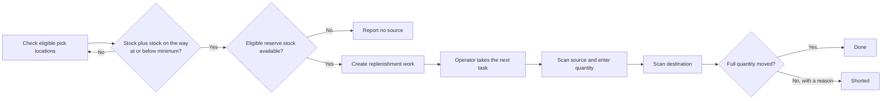

# Replenishment

Replenishment keeps pick locations supplied from reserve stock. The planner
checks eligible pick locations, creates work when stock reaches the minimum,
and sends the work to an operator's RF terminal.

This guide covers min/max replenishment. It explains the setup, the planning
rule, the supervisor screen, and the operator flow.

## How the process works

The planner creates work when the quantity already in the pick location plus
the quantity already on the way is at or below the location minimum. It plans
enough stock to move toward the maximum, in whole units of the location UOM.

Stock already on the way counts toward the level. Running the planner again
does not create a duplicate for the same shortage.

## Before you start

Configure all of the following:

1. Give the pick location a **Min Qty**, **Max Qty**, and **UOM**.
2. Open the location's putaway zone and select **Replenishment Allowed**.
3. Assign a **Replenishment Policy** to the SKU.
4. Keep eligible reserve stock for the same owner and SKU in a **Case**,
   **Pick**, or **SpeedPick** location. The source must be available, have no
   blocking location flag, and must not be one of that SKU's pick locations.
5. Give the operator access to replenishment work in the applicable work area.

The location UOM must still exist in the SKU's active pack. If it does not,
the planner cannot convert the minimum and maximum to base units and skips the
location.

Continuously serial-tracked SKUs are not included in min/max planning.

## Configure the replenishment policy

Open **Warehouse Configuration > Policies > Replenishment Policy**, then open
a policy from the list.

The policy controls task priority:

| Field | Meaning |
|---|---|
| **Urgent (1) from reserved, %** | Priority 1 when some stock is reserved and at least this share of stock in the pick location is reserved. |
| **Important (2) from reserved, %** | Priority 2 when some stock is reserved and at least this share is reserved. Lower reserved shares, including no reservation, use priority 3. |
| **Empty location is urgent** | Gives an empty pick location priority 1. When cleared, an empty location uses priority 3. |

Both percentages must be between 0 and 100. The urgent percentage cannot be
lower than the important percentage.

The SKU's **Replenishment Policy** is the policy used by the planner. The
owner's default replenishment policy is not used as a fallback in the current
version, so assign the policy on every replenished SKU.

## Enable a zone

Open **Warehouse Configuration > Topology > Putaway Zones**, open the zone,
and select **Replenishment Allowed**.

Only pick locations in enabled zones are included in min/max planning.
Clearing the checkbox prevents new replenishment work from being planned for
the zone. It does not cancel work that already exists.

The zone's **Replenishment Threshold** field is saved for future use. The
current min/max planner uses each location's **Min Qty** and **Max Qty**, not
the zone threshold.

## Plan and monitor work

Open **Management & Control > Inventory > Replenishment**.

The list shows the destination pick location, SKU, lot, source location,
quantity, UOM, priority, status, short reason, and planning time.

- Select **Replenish Now** to run a planning pass immediately.
- Select an open row and choose **Call Off** to cancel that work.
- Select **Refresh** to reload the list.

The background planner also checks the warehouse regularly, so the button is
mainly useful after setup changes or when a supervisor wants to plan without
waiting for the next pass.

The planner uses free stock and follows the SKU's rotation rule when ordering
candidate sources. A source must be in **Ok** status with no location flag,
must not be one of the SKU's own pick locations, and must have free stock after
reservations, picked stock, holds, and quantities already promised to open
replenishments are deducted. If one source cannot supply the whole need, the
planner can create work from more than one source. If no eligible source has
at least one whole location UOM, the pick location is reported without a
source and no task is created for that pass.

## Complete replenishment on the RF terminal

1. Open **Inventory > Replenish**. The terminal assigns the next eligible
   task. A task already assigned to you is returned first.
2. At the displayed source location, scan the location.
3. Check the planned quantity and enter the quantity taken.
4. If you took less than planned, enter a short reason.
5. At the displayed pick location, scan the location.
6. The terminal moves the confirmed quantity and closes the task. Press
   **Enter** for the next task.

The terminal rejects the wrong source or destination. A confirmed quantity
must be above zero and cannot exceed the planned quantity. A partial quantity
is accepted only with a reason.

Leaving the flow does not immediately release an assigned task. While its task
lease is still active, opening **Replenish** again offers the same task first.
After the lease expires, the task can return to the shared work pool.

## Statuses

| Status | Meaning |
|---|---|
| **Open** | Planned and waiting, or assigned to an operator. |
| **Done** | The full planned quantity reached the pick location. |
| **Shorted** | The operator moved less than planned and entered a reason. |
| **Cancelled** | A supervisor called off the open work. |

## When no work is created

Check these conditions:

- **Replenishment Allowed** is selected on the pick location's zone.
- Stock in the pick location plus stock on the way is at or below **Min Qty**.
- **Max Qty** is above the current level by at least one whole location UOM.
- The location UOM belongs to the SKU's active pack.
- The SKU has a replenishment policy.
- Eligible reserve stock is free and available.
- The SKU is not continuously serial tracked.

## Before production rollout

Run one isolated warehouse pilot with your real
location UOMs, work-area permissions, source location types, and operator RF
profile. Confirm one full task, one partial task with a reason, and one
supervisor cancellation.
