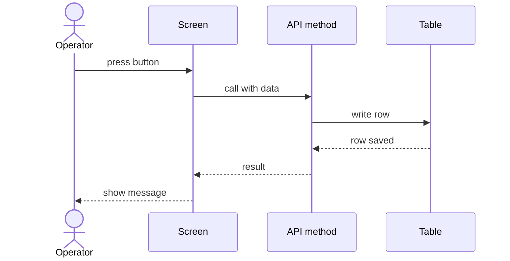
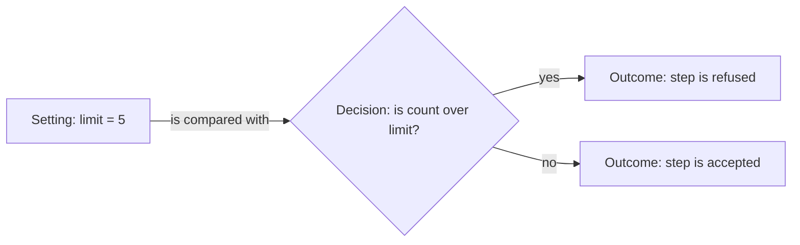
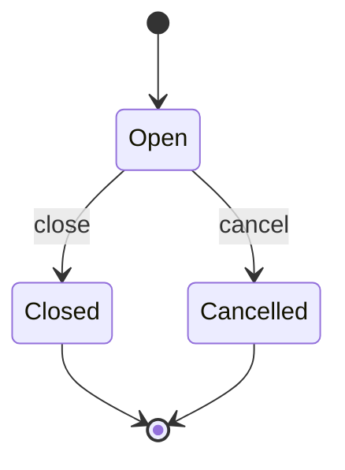

# How to read the diagrams

Each example below is a tiny example, not a product flow.
The names in it are made up to show the shape of the diagram.
Product diagrams are grouped in the area pages that follow.

## Sequence: who calls whom

**What this shows.** The order of calls between four actors. This is an example, not a product flow.

Read it from top to bottom. A solid arrow is a call. A dashed arrow is the reply.

## Influence: setting, decision, outcome

**What this shows.** How one setting changes one decision and what you then see. This is an example, not a product flow.

Read it from left to right: setting, decision, outcome.

## State: statuses

**What this shows.** The statuses of a record and the changes between them. This is an example, not a product flow.

Each box is a status. Each arrow is an allowed change. An arrow from the dot is the start. An arrow to the dot is the end.

## Related pages

- [Diagrams overview](00-README.md)
