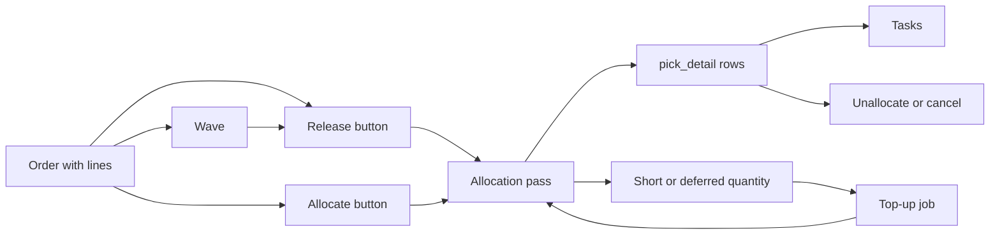

# Diagrams: Order, Release and Allocation

These pages draw the path of an outbound order from the `Release` button to the reserved stock, and they show which setting changes which decision on that path. Every arrow comes from the code on the main branch. Each page ends with a table that names the file and line.

Two kinds of page.

- **Journey pages (10 to 14)** are sequence diagrams: who calls what, and what is written.
- **Influence pages (20 to 28)** answer the question "if I change this setting, what changes, and what do I see?"

## 1. Where the pages fit

**What this shows.** The ways stock gets reserved and freed, and the page that draws each one.

| Box | Page |
|---|---|
| Release button, Allocate button | [10 Release and Allocate an order](10-journey-release.md) |
| Allocation pass (one line) | [11 Allocation of one line](11-journey-allocate-line.md) |
| Wave | [12 Wave build and release](12-journey-wave.md) |
| Unallocate or cancel | [13 Unallocate and cancel](13-journey-unallocate-cancel.md) |
| Top-up job, short pick | [14 Top-up after a lock collision or a short pick](14-journey-top-up.md) |

## 2. Which setting is on which page

| Question | Page |
|---|---|
| Which stock may a step use? (`Putaway zone`, `Location type`, `Location category`, `Location ABC`, `Unit of measure`, step order) | [20](20-influence-policy-source.md) |
| In which order is the stock taken, and how many picks come out? (`LPN quantity`, `Quantity fit`, `Sort ranks`, `One pick per UOM / location`) | [21](21-influence-policy-selection.md) |
| Which policy does an order line use? (SKU policy, owner default, publish, deactivate, freeze) | [22](22-influence-policy-binding.md) |
| Which lot goes first, and which lots are too old? (`Rotation`, `Rotate By`, `Min Shelf Life on Pick`, Lot Policy) | [23](23-influence-sku-lot-rotation.md) |
| What does a hold or a blocked location do? (hold code flags, location status and flag) | [24](24-influence-holds.md) |
| What does a wave policy field do? | [25](25-influence-wave-policy.md) |
| Which order, line, pack and owner facts are read? | [26](26-influence-order-and-pack.md) |
| What does a reservation protect? | [27](27-reservation-protects-stock.md) |
| How is the status of an order computed? | [28](28-order-status.md) |

## 3. Words used on these pages

| Word | Meaning |
|---|---|
| Open quantity (need) | `qty_ordered - qty_cancelled - qty_allocated` of a line, in base units |
| Step | One rule row of an allocation policy. Steps run by `sequence` |
| Carry | What a step could not cover. The next step gets it on top of its own share |
| Candidate row | A stock row (`inventory_balances`) that passes the fixed rules and the step filters |
| Available quantity (`atp`) | `qty - qty_allocated - qty_picked`, and 0 if a blocking hold covers the row |
| Draw | The quantity a step takes from one candidate row |
| Pick | One `pick_detail` row: lot, location, LPN, quantity, unit. It records the policy and the step that made it |
| Short | The part of the open quantity that no step could reserve |
| Deferred | The part that was not reserved because another transaction held the row. It is not counted as short |

## 4. What the code does not have

These are things a reader may expect. The code has nothing for them, so no diagram shows them.

- **Backorder.** There is no backorder object, flag or table. The open quantity stays on the line and the next `Allocate` or `Release` looks for it again. The text under the last step of the step editor still says `goes to backorder`.
- **Priority between orders in `Allocate`.** The command that locks the stock first wins. Order priority is copied to the task and is used by the wave policy only.
- **Reserving by itself when stock arrives.** Nothing allocates on arrival. A top-up runs only after a lock collision, or after a short pick whose reason asks for it.
- **Soft allocation, over-allocation, strict lot rotation, fast pick by unit.** The values exist in the data model. The build refuses to run a policy that uses them.
- **Pick zones and reserve zones as settings.** The only tools are the step fields `Location type`, `Putaway zone`, `Location category` and `Location ABC`.
- **A finished wave.** No code moves a wave to `Completed`.
- **Sorting, loading and shipping after the pick.** The folder `flow/` of `wms-outbound` is the router that decides what a picked unit needs next. It starts after picking is complete and is not part of allocation. See the picking and packing pages.

## 5. Stored only. It has no effect today.

Fields that exist and can be edited, but that no allocation, release or wave code reads for a decision.

| Field | Note | Code |
|---|---|---|
| `allocation_policy.name`, `allocation_policy.descr` | Labels | `crates/libs/wms-outbound/src/service/policy/lifecycle.rs:160-190` |
| `allocation_policy.strict_lot_rotation`, `allocation_policy.allow_overallocation`, `allocation_policy.speed_pick_by_uom` | Read only by the publish check, which refuses a policy that has one on. Allocation never reads them | `crates/libs/wms-outbound/src/service/policy/validate.rs:44-57` |
| `allocation_policy_detail.rule_num` | The label of the step. Order comes from `sequence` | `crates/libs/wms-outbound/src/allocation/step.rs:102-125` |
| `order_type.requires_release`, `order_type.allows_partial_ship` | No code reads them | `crates/libs/wms-lib-core/src/model/outbound/order_type.rs:18-30` |
| `wave_policy.code`, `wave_policy.description` | Labels | `crates/libs/wms-lib-core/src/model/outbound/wave_policy.rs:66-89` |
| `wave_order.priority` | Written, never read | `crates/libs/wms-lib-core/src/model/outbound/wave.rs:452-488` |
| `wave_order.sequence` | Only the order of the member list in `wave_get` | `crates/libs/wms-lib-core/src/model/outbound/wave.rs:379-393` |
| `wave.completed_at`, wave statuses `InProgress` and `Completed` | Never set | `crates/libs/wms-lib-core/src/model/outbound/wave.rs:21-28` |
| `inventory_hold_code.rank` | The code comment says that nothing reads it | `crates/libs/wms-lib-core/src/model/policies/inventory_hold_code.rs:38-48` |
| `inventory_hold_code.overridable`, `inventory_hold_code.block_inbound_flow` | Not read by allocation. They matter for moves and receiving | `crates/libs/wms-lib-core/src/model/inventory/inventory_hold.rs:223-232` |
| Pick short reason actions `HoldInventory`, `HoldContainer`, `RequestSupervisorReview`; field `supervisor_review` | No code runs these actions. No code reads the field | `crates/libs/wms-lib-core/src/model/outbound/pick_short_reason.rs:22-32`, `crates/libs/wms-outbound/src/domain/pick_short_reason/aggregate.rs:153-160` |
| `sku.abc`, `sku.min_shelf_life_on_rec` | Not read by allocation. `Location ABC` of a step uses the ABC class of the location. (`sku.shelf_life` and `sku.expire_days` are read: the reserve limit and whether an expiration is required.) | `crates/libs/wms-outbound/src/allocation/trace.rs:904-950` |
| `owner_config.default_lot_policy_id` | No code reads it | `crates/libs/wms-lib-core/src/model/owners/owner_config.rs:104` |

## 6. Not confirmed by code

| Point | To verify |
|---|---|
| Whether a step without `Location type` really reserves stock that sits in a `QC`, `Returns` or `Lost` location. The query does not exclude these types | Put 10 units in a `Returns` location with no hold. Run `shipment_order_allocate_preview` for that SKU. Look for the position |
| Whether `Deactivate` of a policy makes the open lines fail with `version mismatch` | Create a line with a published policy, press `Deactivate`, press `Allocate`, read the message (see [page 22](22-influence-policy-binding.md)) |
| Whether a date that the Lot Policy does not ask for stays empty on the lot | Receive a lot with `Show` off for the expiration date and look at the rotation order in the preview (see [page 23](23-influence-sku-lot-rotation.md)) |
| The seeded pick short reasons and their action sets | Read the seed of `pick_short_reason_action` in the `wms-app` migrations (see [page 14](14-journey-top-up.md)) |

## Related pages

- [Allocation overview (policy reference)](../../admin/policies/10-allocation-overview.md)
- [Allocation policy: steps and criteria](../../admin/policies/11-allocation-policy-steps-and-criteria.md)
- [Waves overview](../../admin/policies/12-wave-overview.md)
- [Wave policy settings](../../admin/policies/13-wave-policy-settings.md)
- [Reason codes and holds](../../admin/policies/43-reason-codes-and-holds.md)
- [Outbound setup](../../admin/06-outbound-setup.md)
- [API: command types and concurrency](../../api/04-command-types-and-concurrency.md)
