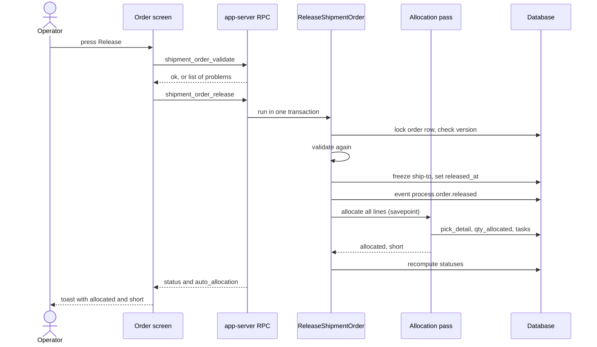
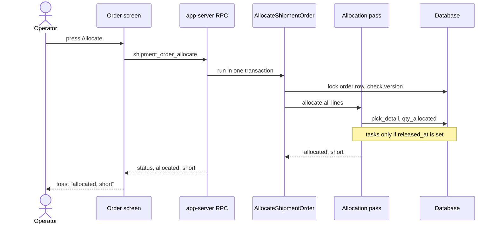

# Journey: Release and Allocate an Order

Two buttons on the order screen reserve stock: `Release` and `Allocate`. This page shows what each button calls, in which order, and what is written. The stock choice itself is drawn on [page 11](11-journey-allocate-line.md).

## 1. What happens when the operator presses `Release`

**What this shows.** The calls and writes from the button to the toast, for an order that was never released.

Reading notes.

- The screen calls the dry run `shipment_order_validate` first. If it finds a problem, the toast is `Cannot release: ...` and nothing is sent to `shipment_order_release`.
- The server validates again under the order lock, because a SKU can be switched off between the two calls. A problem there gives `cannot release: ...`, and nothing is written.
- The allocation pass runs inside a savepoint. If it fails (for example a bad allocation policy), only the allocation is rolled back. The order stays released, and the toast reads `Order {number} released; allocation failed: {reason}`.
- A shortage of stock is not a failure. The order is released with a partial reservation.
- If the order was already released and its status is `PartiallyReleased`, `Release` skips the freeze and the event. It only runs the allocation pass again.

### Where it comes from

| Step in the diagram | Code |
|---|---|
| Button calls the dry run, then the release | `crates/services/web-ui-server/src/extensions/customization/shipment_order/release_action.rs:51`, `crates/services/web-ui-server/src/extensions/customization/shipment_order/release_action.rs:73` |
| Toast `Cannot release: ...` | `crates/services/web-ui-server/src/extensions/customization/shipment_order/release_action.rs:67` |
| RPC method list and roles (`shipment_order_release`: Admin, Manager, Supervisor) | `crates/services/app-server/src/web/rpcs/shipment_order_commands_rpc.rs:46-59` |
| Lock the order row, compare the version | `crates/libs/wms-outbound/src/service/shared/middleware.rs:96-108` |
| Validate again, refuse with `cannot release: ...` | `crates/libs/wms-outbound/src/service/order/release.rs:179-185` |
| Already released: go to the "release again" path | `crates/libs/wms-outbound/src/service/order/release.rs:187-189`, `crates/libs/wms-outbound/src/service/order/release.rs:292-318` |
| Freeze ship-to, write `released_at`, publish the event | `crates/libs/wms-outbound/src/service/order/release.rs:191-243` |
| Allocation in a savepoint, failure becomes `auto_allocation_error` | `crates/libs/wms-outbound/src/service/order/release.rs:262-266`, `crates/libs/wms-outbound/src/service/order/release.rs:354-384` |
| Recompute statuses at the end | `crates/libs/wms-outbound/src/service/order/release.rs:274` |
| Release checks (status, lines, ship-to is a customer, SKU active and pack carries the UOM) | `crates/libs/wms-outbound/src/service/order/validate.rs:60-135` |
| Event code `process.order.released` | `crates/libs/wms-lib-core/src/model/integration/event_payloads/order.rs:73` |
| Toast text | `crates/services/web-ui-server/src/extensions/customization/shipment_order/release_action.rs:128-141` |

## 2. What the `Allocate` button does differently

**What this shows.** `Allocate` runs the same allocation pass as `Release`, without the launch.

Reading notes.

- `Allocate` does not freeze the ship-to and does not set `released_at`. On a `New` order it reserves stock and creates no task.
- On an order that is already released, `Allocate` tops up the stock and hands out tasks for picks that have none.
- A configuration fault (no policy, inactive policy, unsupported step) stops the whole command. Nothing is reserved for any line, because the transaction rolls back. `Release` is different: it keeps the launch and reports `allocation failed`.
- The order status must not be `Closed`, `Cancelled` or `Picked`.

### Where it comes from

| Step in the diagram | Code |
|---|---|
| Button calls `shipment_order_allocate` | `crates/services/web-ui-server/src/extensions/customization/shipment_order/allocate_action.rs:81` |
| Roles of `shipment_order_allocate`: Admin, Manager, Supervisor, Operator | `crates/services/app-server/src/web/rpcs/shipment_order_commands_rpc.rs:46-59` |
| Command wrapper (order lock, version) | `crates/libs/wms-outbound/src/service/order/allocate.rs:206-229` |
| Status gate: terminal or `Picked` is refused | `crates/libs/wms-outbound/src/service/order/allocate.rs:310-315` |
| Tasks are created only when the order has `released_at` | `crates/libs/wms-outbound/src/service/order/allocate.rs:407-437` |
| Toast `Order {number} allocated {n}, short {m}`, the busy-stock suffix `; deferred {d} (busy stock, try again)`, and the suffix `; N task(s) handed out` | `crates/services/web-ui-server/src/extensions/customization/shipment_order/allocate_action.rs` |

## Related pages

- [Allocation of one line](11-journey-allocate-line.md)
- [Wave journey](12-journey-wave.md)
- [Unallocate and cancel](13-journey-unallocate-cancel.md)
- [Order status after allocation](28-order-status.md)
- [Allocation overview (policy reference)](../../admin/policies/10-allocation-overview.md)
- [Outbound setup](../../admin/06-outbound-setup.md)
