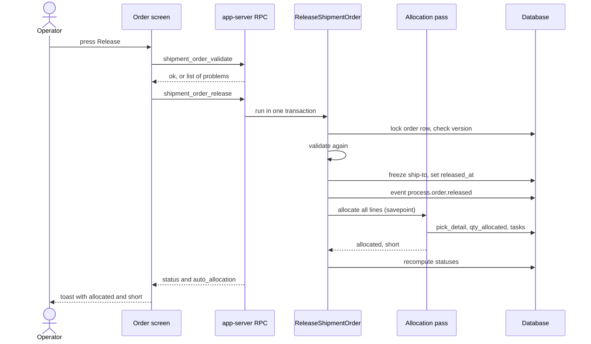
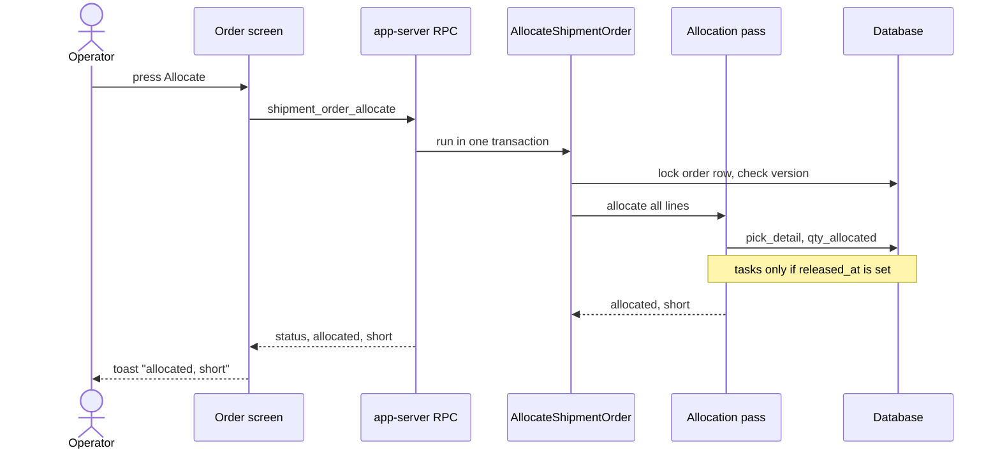

# Journey: Release and Allocate an Order

Two buttons on the order screen reserve stock: `Release` and `Allocate`. This page shows what each button calls, in which order, and what is written. The stock choice itself is drawn on [page 11](11-journey-allocate-line.md).

## 1. What happens when the operator presses `Release`

**What this shows.** The calls and writes from the button to the toast, for an order that was never released.

Reading notes.

- The screen calls the dry run `shipment_order_validate` first. If it finds a problem, the toast is `Cannot release: ...` and nothing is sent to `shipment_order_release`.
- The server validates again under the order lock, because a SKU can be switched off between the two calls. A problem there gives `cannot release: ...`, and nothing is written.
- The allocation pass runs inside a savepoint. If it fails (for example a bad allocation policy), only the allocation is rolled back. The order stays released, and the toast reads `Order {number} released; allocation failed: {reason}`.
- A shortage of stock is not a failure. The order is released with a partial reservation.
- If the order was already released and its status is `PartiallyReleased`, `Release` skips the freeze and the event. It only runs the allocation pass again.
## 2. What the `Allocate` button does differently

**What this shows.** `Allocate` runs the same allocation pass as `Release`, without the launch.

Reading notes.

- `Allocate` does not freeze the ship-to and does not set `released_at`. On a `New` order it reserves stock and creates no task.
- On an order that is already released, `Allocate` tops up the stock and hands out tasks for picks that have none.
- A configuration fault (no policy, inactive policy, unsupported step) stops the whole command. Nothing is reserved for any line, because the transaction rolls back. `Release` is different: it keeps the launch and reports `allocation failed`.
- The order status must not be `Closed`, `Cancelled` or `Picked`.
## Related pages

- [Allocation of one line](11-journey-allocate-line.md)
- [Wave journey](12-journey-wave.md)
- [Unallocate and cancel](13-journey-unallocate-cancel.md)
- [Order status after allocation](28-order-status.md)
- [Allocation overview (policy reference)](../../admin/policies/10-allocation-overview.md)
- [Outbound setup](../../admin/06-outbound-setup.md)
