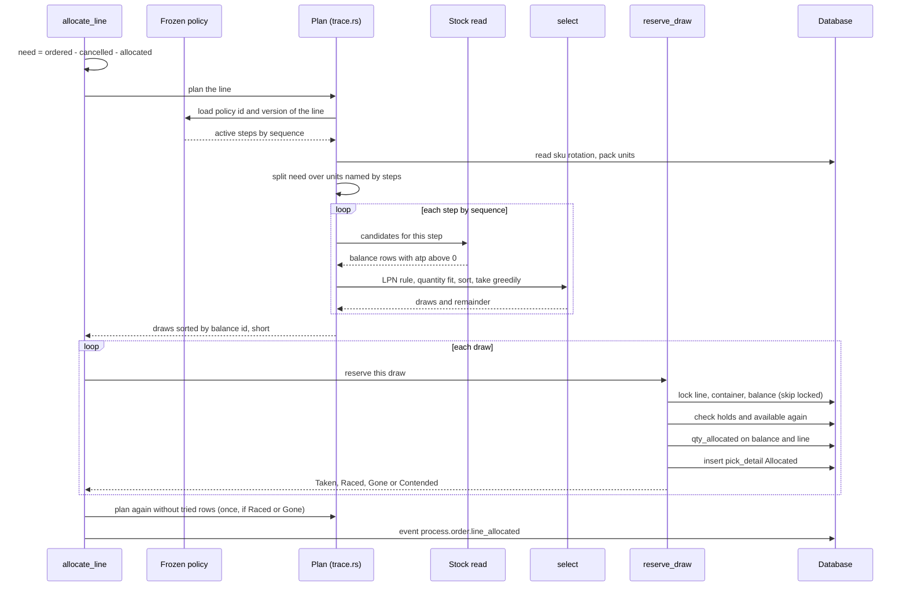
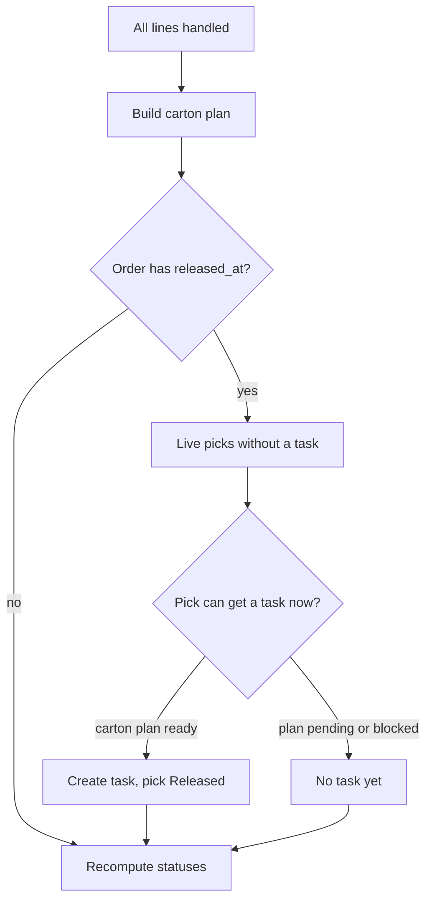

# Journey: Allocation of One Order Line

The allocation pass handles the lines of an order one by one, in `line_no` order. This page follows one line from "how much is open" to the `pick_detail` rows.

## 1. From the open quantity to the picks

**What this shows.** The planning phase reads stock but locks nothing. The reserving phase locks each chosen stock row and writes. A line that loses a race is planned once more.

Reading notes.

- If the open quantity is zero or less, the line is skipped without a message.
- Configuration faults are errors, not shortages. They stop the command: no policy on the line, policy version changed, no active step, a step the build cannot run, a pack with no active unit, a policy that names no unit of the pack, a `rotate_by` outside the code list.
- A step that has no share and no carry is skipped without reading stock (verdict `no_quantity_for_uom`).
- The pick keeps the policy id, the policy version, the step id and the step version that made it.
- `Contended` means the row (or its LPN) was locked by another transaction. The quantity is counted as deferred, not as short, and is not retried inside this command (see [page 14](14-journey-top-up.md)).
- The result of a line: `reserved_now` (allocated), `stock_short`, `contention_deferred`. `short = need - allocated - deferred`.
## 2. What the whole pass does after the last line

**What this shows.** The three things that follow the line loop.

Reading notes.

- A failure of the carton plan does not undo the reservation. The error is returned in `cartonization_error`.
- The task step looks at all live picks of the order that have no task, not only the picks of this run.
- A pick gets a task only when its carton outcome is executable (`Planned` with a carton, `ShipAsIs` with the factory-package proof, or `Bypassed`). `Pending` and `Blocked` picks wait.
- The task carries the order priority and, if the order is in a wave, the wave id.
## Not shown here

- The carton plan itself (policy, boxes, weights) belongs to the cartonization area.
- What the operator does with the task belongs to the picking area. See [picking](../../operator/09-picking.md).

## Related pages

- [Release and Allocate an order](10-journey-release.md)
- [Which stock is eligible](20-influence-policy-source.md)
- [How the stock is chosen](21-influence-policy-selection.md)
- [Allocation overview (policy reference)](../../admin/policies/10-allocation-overview.md)
- [Allocation policy: steps and criteria](../../admin/policies/11-allocation-policy-steps-and-criteria.md)
