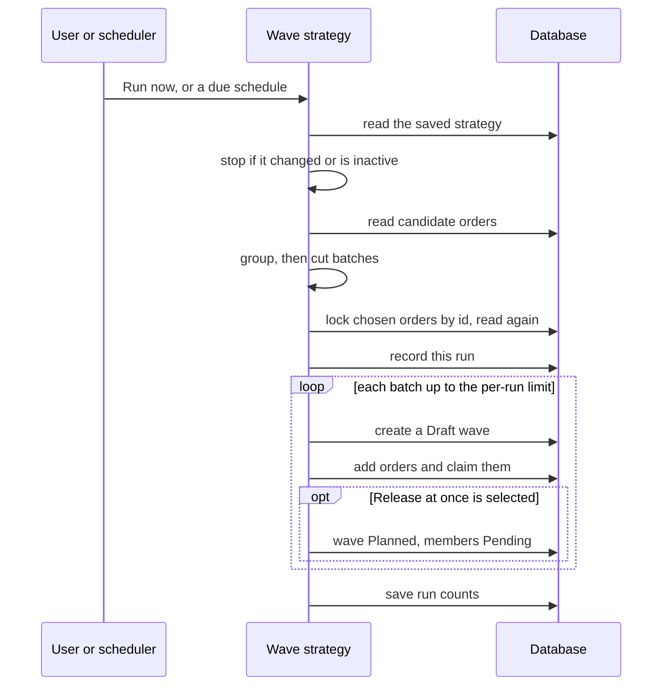
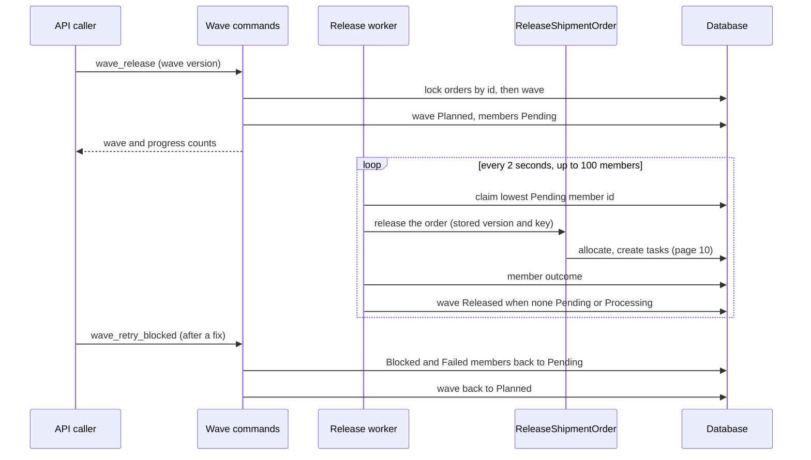
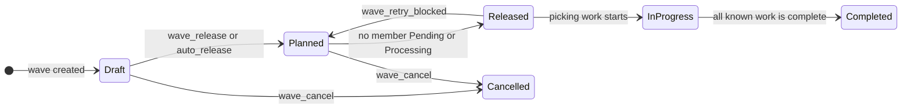
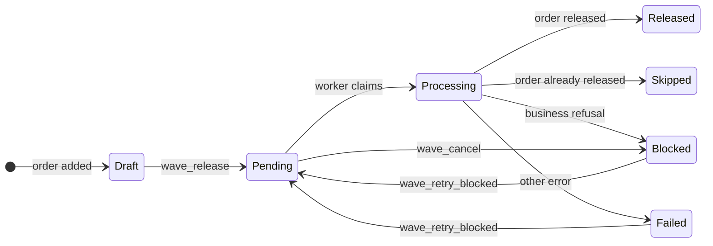

# Journey: Wave Build and Release

A wave groups orders that are released together. Use `Management & Control > Orders & Waves > Waves` for manual waves and `Wave strategies` for rule-based or scheduled creation. There is no RF administration screen. A wave does not allocate by itself: each member follows the same release path as the `Release` button (see [page 10](10-journey-release.md)).

## 1. How a policy builds waves

**What this shows.** One build, started with `Run now…` or by an active strategy at its scheduled time.

Reading notes.

- The filters, the grouping and the size limits come from the wave policy. They are drawn on [page 25](25-influence-wave-policy.md).
- The build is one transaction. A scheduled slot that fails is rolled back and then recorded as a run with `outcome = Failed`. The schedule moves to the next slot.
- The scheduler wakes every 5 seconds and takes at most 10 due slots per warehouse. A policy row is taken with "skip locked", so two servers never build the same slot.
- Every member gets a claim row. An order with a claim cannot enter another wave.
## 2. How a wave releases its orders

**What this shows.** `wave_release` only queues the work. A worker releases the orders one by one.

Reading notes.

- The plan places members in priority and ship-date order, and an available worker prefers the earliest pending member. This is not a strict stock-priority guarantee: when several application workers run, different members can release concurrently.
- Every member is released in its own transaction. No transaction covers a whole wave.
- The member outcome is `Released`, `Skipped` (the order was already released), `Blocked` (business refusal, not found, bad transition, version conflict) or `Failed` (anything else).
- A wave that shows `Released` is only "settled". Members can still be `Blocked` or `Failed`. Read the member counts.
- A shortage of stock does not block a member; the order can release partially. If automatic allocation itself fails, the order launch remains committed but the wave member becomes retryable `Blocked`. Correct the allocation problem and retry that member.
## 3. Statuses of a wave and of a member

**What this shows.** Release states followed by the picking-life-cycle states reconciled from current work evidence.

Status of the wave (`wave.status`):

Status of a member (`wave_order.status`):

Reading notes.

- `wave_cancel` is refused when a member is `Processing`, `Released` or `Skipped`. Queued members become `Blocked` with `last_error_code = WAVE_CANCELLED`, and the claims of the wave are deleted.
- A `Processing` member that nobody finishes within 300 seconds is claimed again by the worker.
After release, a non-station wave becomes `InProgress` when pick or task work exists. A station wave waits until its first shared tote reaches the station. `Completed` requires all known work to be finished, no broken work links and all station positions to be free. Sorting, loading and shipping after picking are separate processes.

## Related pages

- [Wave policy: which setting changes what](25-influence-wave-policy.md)
- [Release and Allocate an order](10-journey-release.md)
- [Waves overview (policy reference)](../../admin/policies/12-wave-overview.md)
- [Wave policy settings (policy reference)](../../admin/policies/13-wave-policy-settings.md)
