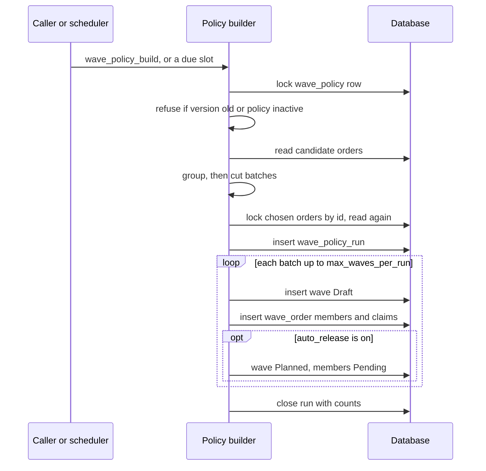
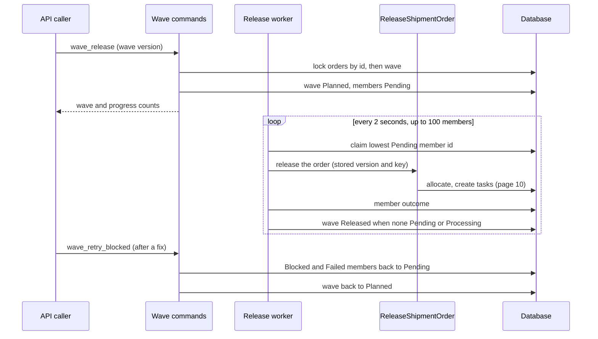
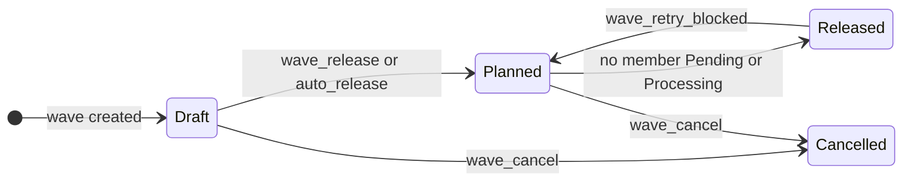
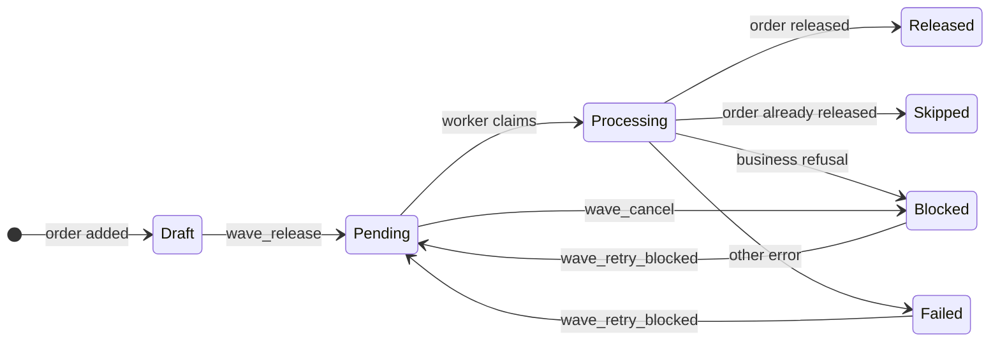

# Journey: Wave Build and Release

A wave groups orders that are released together. There is no web screen or RF screen for waves. Everything runs through the API methods `wave_*` and `wave_policy_*` and through two background loops of `app-server`. A wave does not allocate by itself. For every member it runs the same `ReleaseShipmentOrder` command as the `Release` button (see [page 10](10-journey-release.md)).

## 1. How a policy builds waves

**What this shows.** One build, started by hand (`wave_policy_build`) or by the scheduler for a due slot.

Reading notes.

- The filters, the grouping and the size limits come from the wave policy. They are drawn on [page 25](25-influence-wave-policy.md).
- The build is one transaction. A scheduled slot that fails is rolled back and then recorded as a run with `outcome = Failed`. The schedule moves to the next slot.
- The scheduler wakes every 5 seconds and takes at most 10 due slots per warehouse. A policy row is taken with "skip locked", so two servers never build the same slot.
- Every member gets a claim row. An order with a claim cannot enter another wave.
## 2. How a wave releases its orders

**What this shows.** `wave_release` only queues the work. A worker releases the orders one by one.

Reading notes.

- The worker takes members in the order of the member id. For a wave from a policy, that is the order of the plan: lowest order priority number first, then earliest requested ship date, then lowest order id. So the first order of a wave reserves its stock first. `wave_order.priority` and `wave_order.sequence` do not change this.
- Every member is released in its own transaction. No transaction covers a whole wave.
- The member outcome is `Released`, `Skipped` (the order was already released), `Blocked` (business refusal, not found, bad transition, version conflict) or `Failed` (anything else).
- A wave that shows `Released` is only "settled". Members can still be `Blocked` or `Failed`. Read the member counts.
- A shortage of stock does not block a member. A bad allocation policy does not block it either: the order still launches, and the allocation error stays in the order release result, not in the wave.
## 3. Statuses of a wave and of a member

**What this shows.** Every change of status that code performs. `InProgress` and `Completed` exist in the enum, but no code sets them.

Status of the wave (`wave.status`):

Status of a member (`wave_order.status`):

Reading notes.

- `wave_cancel` is refused when a member is `Processing`, `Released` or `Skipped`. Queued members become `Blocked` with `last_error_code = WAVE_CANCELLED`, and the claims of the wave are deleted.
- A `Processing` member that nobody finishes within 300 seconds is claimed again by the worker.
## Not shown here

- Nothing in the code moves a wave to `Completed`, so there is no "wave finished" step to draw. The field `wave.completed_at` is never written.
- Sorting, loading and shipping after the pick are not part of a wave in the code.

## Related pages

- [Wave policy: which setting changes what](25-influence-wave-policy.md)
- [Release and Allocate an order](10-journey-release.md)
- [Waves overview (policy reference)](../../admin/policies/12-wave-overview.md)
- [Wave policy settings (policy reference)](../../admin/policies/13-wave-policy-settings.md)
