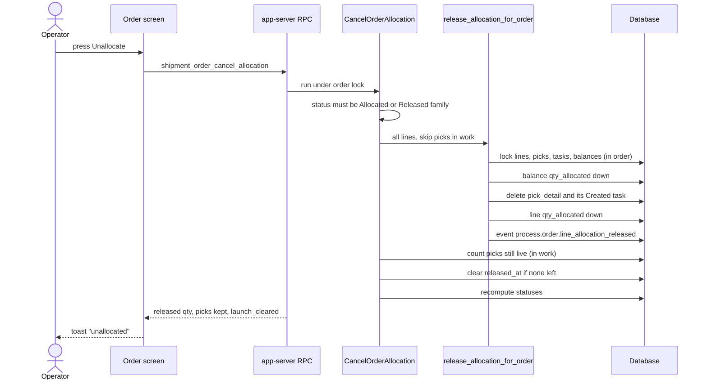
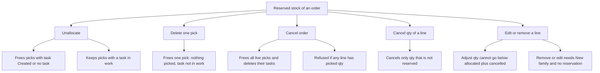

# Journey: Unallocate and Cancel

Stock that an order has reserved comes back in four ways: the `Unallocate` button, deleting one pick, cancelling the order, and a short pick (see [page 14](14-journey-top-up.md)). This page shows what each one frees and what it keeps.

## 1. What the `Unallocate` button does

**What this shows.** `Unallocate` frees the picks that nobody works on and keeps the rest.

Reading notes.

- A pick is "in work" when its task has a status other than `Created`. Those picks stay, with their task and their reservation.
- If the order was released and no live pick is left, the release marker is cleared. The order goes back to `New`, and the toast adds `order back to New`.
- If some picks stay, the toast adds `N pick(s) in work kept`.
- The statuses accepted by the button: `PartiallyAllocated`, `Allocated`, `PartiallyReleased`, `Released`. Any other status is refused as an invalid transition.
- The freed stock is available again at once. Nothing allocates it again by itself. Somebody must press `Allocate` or `Release`.
## 2. Which action frees which reservation

**What this shows.** The five actions that touch a reservation, and the rule each one applies.

Reading notes.

- `Cancel order` uses the scope "all". It frees every live pick (`Allocated` or `Released`), also those with a task in work, and deletes the task of each. It is refused only when some line already has picked quantity.
- `Cancel qty` works on `ordered - cancelled - max(allocated, shipped)`. A reserved unit cannot be cancelled. Unallocate it first.
- `Adjust qty` sets a new absolute quantity. It is refused below `allocated + cancelled`.
- Removing a line, or changing a line through the editor, is allowed only while the order is in the `New` family without a release marker, and only if the line has no reserved quantity. The refusal text says: `release the reservation first (Unallocate or delete its picks)`.
- Unallocating does not change the policy of a line. The line keeps the policy it froze when it was created or last saved (see [page 22](22-influence-policy-binding.md)).
## Related pages

- [Release and Allocate an order](10-journey-release.md)
- [Top-up and short pick](14-journey-top-up.md)
- [What a reservation protects](27-reservation-protects-stock.md)
- [Order status after allocation](28-order-status.md)
- [Allocation overview (policy reference)](../../admin/policies/10-allocation-overview.md)
