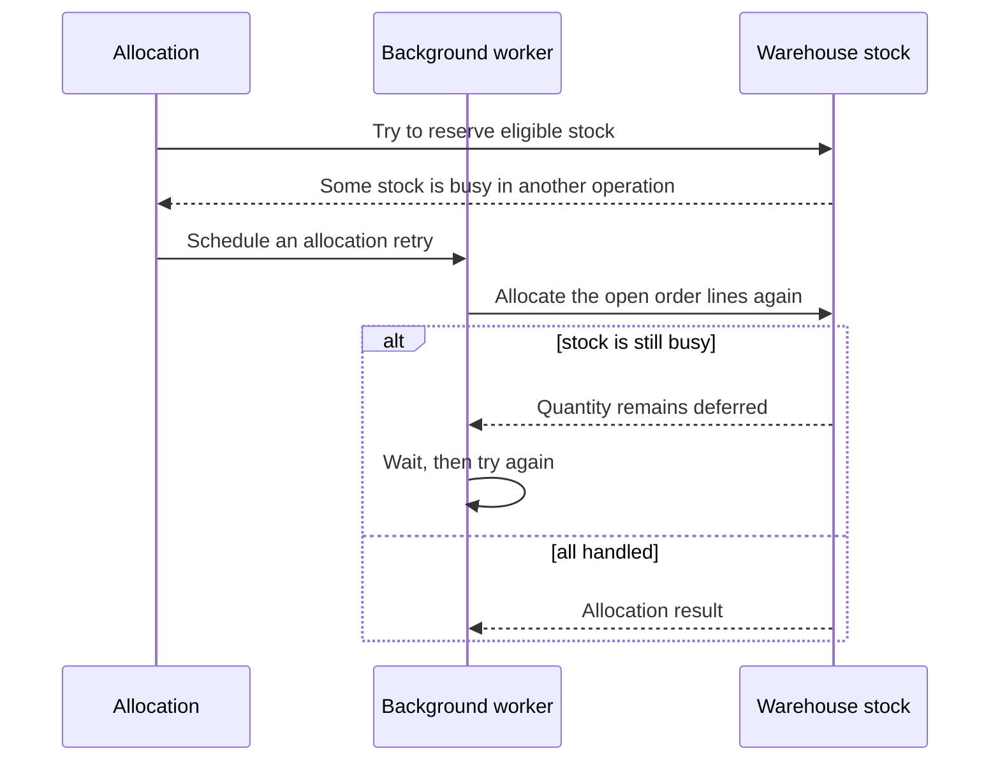
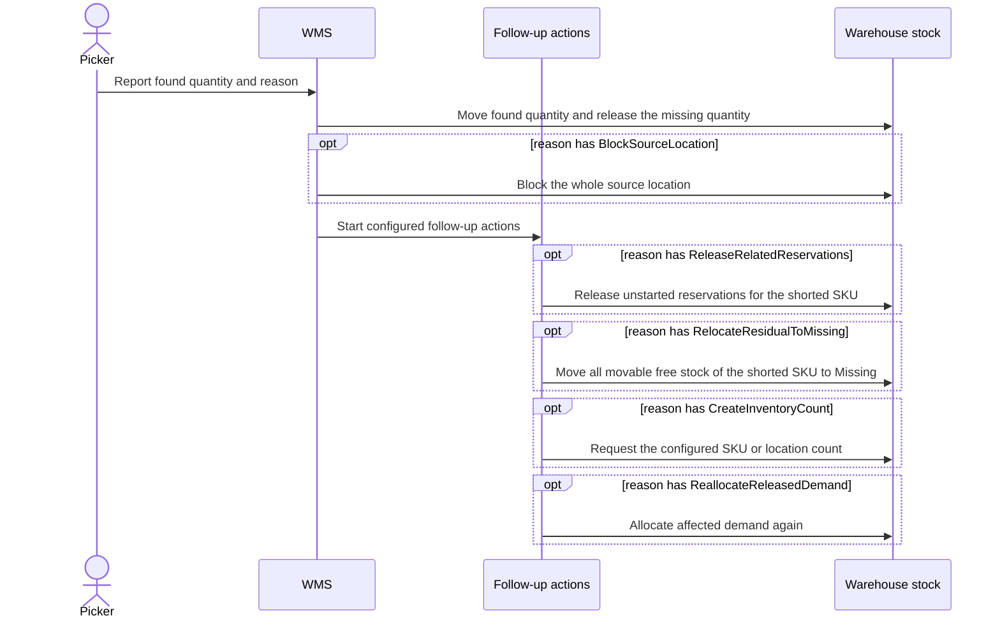

# Journey: Allocation Retry After Contention or a Short Pick

Two recovery paths can try allocation again: an automatic retry after two
operations reach the same stock at once, and the configured follow-up to a
short pick. Both apply the same allocation rules as the **Allocate** action.

## 1. Stock contention: automatic retry

**What this shows.** Two allocation operations reached the same stock at the
same moment. The second operation continued without waiting, and a background
worker tries its open quantity again.

Reading notes.

- Stock contention means another operation is changing the same balance or LPN
  at that moment. Allocation does not wait and does not record the deferred
  quantity as a warehouse shortage.
- The background worker makes up to three attempts. It waits 15 seconds before
  the second attempt and 30 seconds before the third.
- Each retry reads the order as it is at that time. A line with no open quantity
  is skipped.
- Stock taken by the other operation is no longer available to the retry. The
  retry reserves what remains eligible; the line remains short when that is not
  enough.
## 2. Short pick: release, isolate and allocate again

**What this shows.** The picker could not find the full quantity. The pick reason decides which of the follow-up actions run.

Reading notes.

- The action `ReleaseCurrentRemainder` is required in every published reason. It gives the missing quantity back to the line. The line is then short again by that quantity.
- **BlockSourceLocation** blocks the whole source location. While it is blocked,
  new allocation uses other eligible locations. This can affect other SKUs in
  a mixed location.
- For a reason that relocates residual stock, both
  **ReleaseRelatedReservations** and **RelocateResidualToMissing** use
  **CurrentSkuAtLocation**. Only reservations for the shorted SKU whose work has
  not started are released. Work in progress is kept.
- `ReallocateReleasedDemand` has an order scope: `CurrentOrder`, `OrdersWithReleasedReservations` or `CurrentAndAffectedOrders` (also when the scope is empty). An order that is still short after it does not fail the follow-up: the short is its outcome.
- **RelocateResidualToMissing** moves every movable free lot of the shorted SKU
  at the source. Other SKUs stay. A mixed box stays at the source; the free
  shorted quantity can leave it without the box. A serial-tracked balance with
  an active reservation cannot be split, so its free remainder stays with the
  reserved quantity at the source.
- **CreateInventoryCount** can count the matching SKU code at the source, that
  code across countable locations, or every SKU at the source. Count requests
  match the SKU code, not the owner. A count across locations skips a location
  that is already blocked or being counted.
## Related pages

- [Release and Allocate an order](10-journey-release.md)
- [Unallocate and cancel](13-journey-unallocate-cancel.md)
- [Holds and location state](24-influence-holds.md)
- [Pick short reasons (policy reference)](../../admin/policies/23-pick-short-reasons.md)
- [Picking (operator)](../../operator/09-picking.md)
