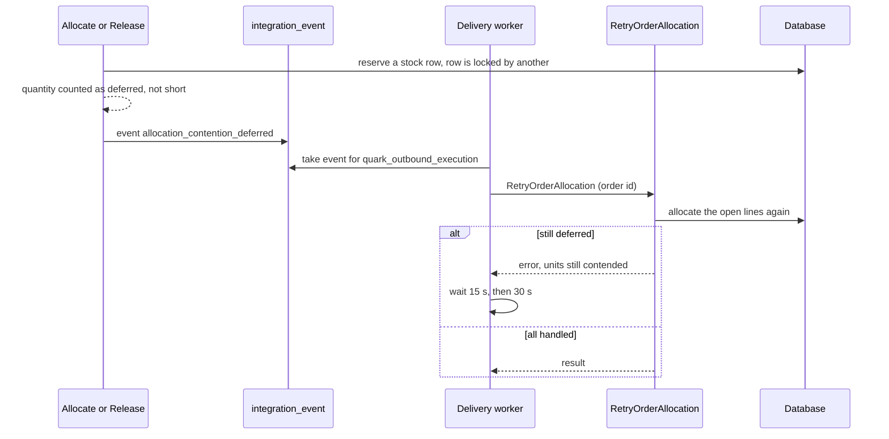
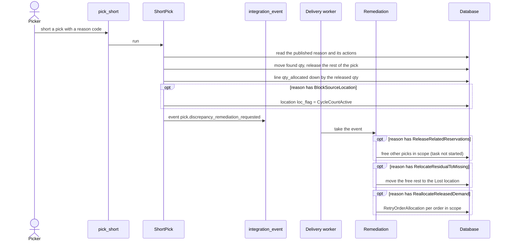

# Journey: Top-up After a Lock Collision or a Short Pick

Nothing allocates when new stock arrives. Two background paths do reserve again: the retry after a lock collision, and the follow-up of a short pick. Both call the command `RetryOrderAllocation`, which runs the same allocation pass as the `Allocate` button.

## 1. Lock collision: the retry job

**What this shows.** Two commands wanted the same stock row at the same moment. The second one did not wait. Its quantity is "deferred", and a background job tries again.

Reading notes.

- A row is "contended" when its balance row, or its LPN container, is locked by another transaction. The reserve step uses "skip locked" and never waits.
- The event is published by `Allocate` and `Release`, not by the retry itself.
- The subscriber has 3 delivery attempts. After a failed attempt, the next one is due after 15 seconds, then 30 seconds. After the third failed attempt the delivery is marked `failed` and nobody tries again.
- The retry has no order version in its request. It reads the lines as they are now. A line that has no open quantity is skipped.
- The stock that the other transaction took is simply not there at the retry. The retry reserves what is left. If it is less than the need, the line stays short.
- The same subscriber also listens to `process.order.line_allocation_short`. The only code that publishes this event is `short_pick`, and the code comment says it has no production caller yet. The real short-pick path is in section 2.
## 2. Short pick: release, quarantine, reserve again

**What this shows.** The picker could not find the full quantity. The pick reason decides which of the follow-up actions run.

Reading notes.

- The action `ReleaseCurrentRemainder` is required in every published reason. It gives the missing quantity back to the line. The line is then short again by that quantity.
- Allocation skips a location whose `loc_flag` is not `None`. So after `BlockSourceLocation`, the reserve again draws from other locations.
- `ReleaseRelatedReservations` has a scope: `CurrentPick`, `SameSourceStock`, `CurrentSkuAtLocation` or `EntireLocation`. Only picks whose task is `Created` with nothing done, or that have no task, are freed. A pick with a task in work is kept.
- `ReallocateReleasedDemand` has an order scope: `CurrentOrder`, `OrdersWithReleasedReservations` or `CurrentAndAffectedOrders` (also when the scope is empty). An order that is still short after it does not fail the follow-up: the short is its outcome.
- `RelocateResidualToMissing` is accepted only together with `BlockSourceLocation` and `ReleaseRelatedReservations`, and only for the scope `EntireLocation`.
- The actions `HoldInventory`, `HoldContainer` and `RequestSupervisorReview` are in the list of action types, but no code runs them. No code reads the field `supervisor_review`.
## Related pages

- [Release and Allocate an order](10-journey-release.md)
- [Unallocate and cancel](13-journey-unallocate-cancel.md)
- [Holds and location state](24-influence-holds.md)
- [Pick short reasons (policy reference)](../../admin/policies/23-pick-short-reasons.md)
- [Picking (operator)](../../operator/09-picking.md)
