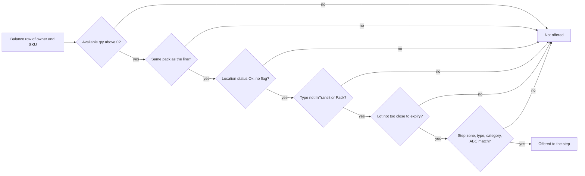
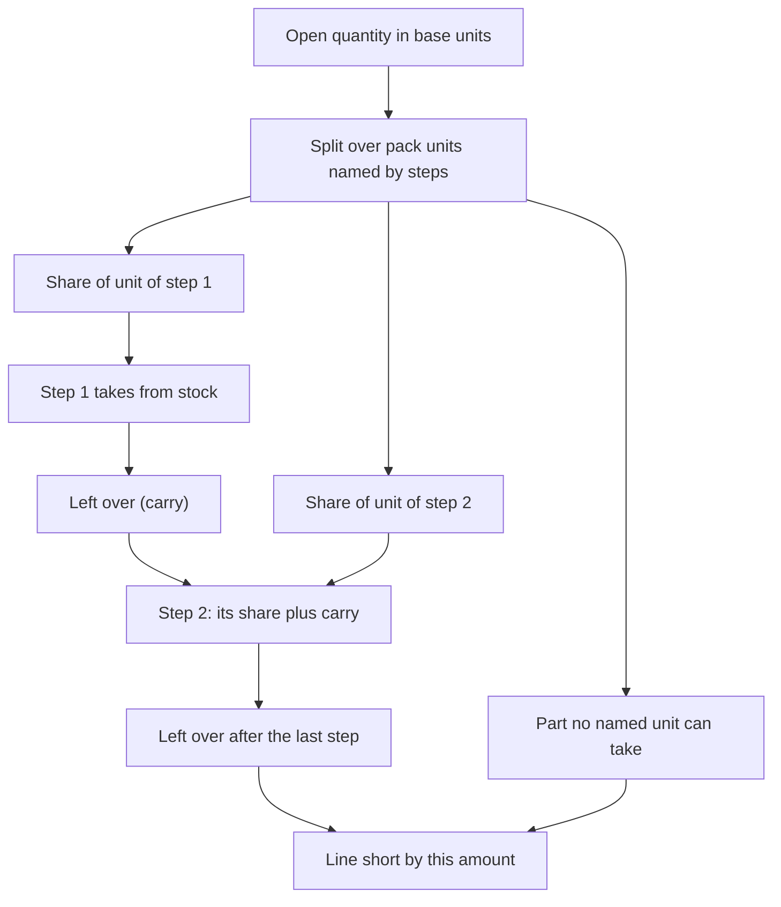

# Influence: Which Stock a Step May Use

The allocation policy is a list of steps. Each step has a source part (what it may reserve, and from where) and a conditions part. This page shows which step field removes which stock from the list, and which unit of measure gets which part of the need. How the remaining stock is ordered is on [page 21](21-influence-policy-selection.md).

## 1. Fixed rules and step fields that cut the stock list

**What this shows.** A stock row (balance row of the order's owner and SKU) must pass the fixed rules, and then the step's own filters. A row that fails is not offered to the step. If no other step can cover the need, the line is short.

The first five questions cannot be switched off. The last one is made of four step fields, and an empty field means "any".

| Setting (screen label) | Column | What it changes | Visible outcome |
|---|---|---|---|
| `Putaway zone` | `allocation_policy_detail.putawayzone` | Keeps rows in locations of this zone only | Stock in other zones is not reserved by this step |
| `Location type` | `allocation_policy_detail.location_type` | Keeps rows in locations of this type only. The value `None` is a real type, not "any" | Step 10 `Pick` and step 20 empty: pick faces are used first |
| `Location category` | `allocation_policy_detail.location_category` | Keeps rows in locations of this category only | Shelves only, racks only, and so on |
| `Location ABC` | `allocation_policy_detail.location_abc` | Keeps rows in locations of this velocity class (the `abc` of the location, not of the SKU) | Fast-mover locations first when step 10 names `A` |
| `Allocation type` | `allocation_policy_detail.allocation_type` | Only `Firm` runs. `Soft` and `SoftCartonization` make the whole policy refuse to run | Error text: `step uses allocation_type=Soft, which this build cannot execute`. Nothing is reserved |
| Step `active` | `allocation_policy_detail.active` | A switched-off step is not loaded, as if the row did not exist | The step reserves nothing. If all steps are off the policy is refused |

Reading notes.

- A location type that is a hold-stage zone (`QC`, `Damage`, `Rtv`, `Destroy`, `Returns`, `Stage`, `Lost`), `InTransit` or `Pack` cannot be chosen in a step. The policy is refused at validation.
- When a step has no `Location type`, protect stock in `QC`, `Returns`, `Lost` and other non-pick locations with a location hold. Held stock is removed from the available quantity. See [page 24](24-influence-holds.md).
- The available quantity already takes holds out. See [page 24](24-influence-holds.md).

### Where it comes from

| Rule | Code |
|---|---|
| Candidate read: owner, SKU, `atp`, pack, location status and flag, fixed types, step filters, shelf life | `crates/libs/wms-lib-core/src/model/inventory/inventory_balance_atp.rs:430-473` |
| Fixed types `InTransit`, `Pack`, and the note about `Lost` | `crates/libs/wms-lib-core/src/model/inventory/inventory_balance_atp.rs:325-343` |
| Step fields become criteria | `crates/libs/wms-outbound/src/allocation/trace.rs:558-567` |
| Refused values: `allocation_type`, location types | `crates/libs/wms-outbound/src/allocation/step.rs:202-226`, `crates/libs/wms-outbound/src/allocation/step.rs:272-297` |
| Only active steps are loaded | `crates/libs/wms-outbound/src/allocation/policy.rs:136-148` |
| The whole policy is refused when one active step cannot run | `crates/libs/wms-outbound/src/allocation/policy.rs:150-156`, `crates/libs/wms-outbound/src/allocation/policy.rs:238-257` |
| Screen labels | `crates/libs/wms-lib-sql/sql/wms-meta-ui/migrations/001_baseline.sql:21421-21430` |
| Seeded policy `STD` and its one step | `crates/libs/wms-lib-sql/sql/wms-app/migrations/001_baseline.sql:7644-7652` |

## 2. Unit of measure and the carry between steps

**What this shows.** The open quantity is split over the units of the pack that an active step names. Each step gets the share of its own unit plus what earlier steps could not cover.

| Setting (screen label) | Column | What it changes | Visible outcome |
|---|---|---|---|
| `Unit of measure` | `allocation_policy_detail.uom_code` | Names the pack unit this step reserves in | A unit that no active step names is not used at all |
| Step order (drag the card) | `allocation_policy_detail.sequence` | The step with the lowest number runs first. Ties go by step id | What step 10 cannot cover goes to step 20, whatever its unit |
| Two steps with the same unit | `allocation_policy_detail.uom_code` | The first takes the share. The second sees only the carry | Step 20 reserves only what step 10 could not find |

Example. Pack `PL` = 1000, `CS` = 100, `EA` = 1. The line needs 2340 base units. Steps 10, 20, 30 name `PL`, `CS`, `EA`.

| Step | Share of its unit | Carry in | Needs |
|---|---|---|---|
| 10 `PL` | 2000 | 0 | 2000 |
| 20 `CS` | 300 | what step 10 missed | 300 plus carry |
| 30 `EA` | 40 | what step 20 missed | 40 plus carry |

If the pallet stock is only 1000, step 10 takes 1000 and carries 1000. Step 20 then needs 1300, and so on. What the last step cannot cover is the shortfall.

Reading notes.

- The base unit (`base_qty` = 1) takes the whole rest, also a fraction. Every other unit takes whole units only.
- If the policy has no step for the base unit, the remainder after the whole larger units is a gap. It goes to `short` at once, and stock is never searched for it.
- A step whose unit is not in the pack gets only the carry. A step with no share and no carry is skipped without a stock read.
- A pack unit counts only if it is active and its `base_qty` is above 0.
- A new line is refused if no active step names any unit of its pack: `allocation policy '{code}' has no executable step for sku '{sku}' pack hierarchy`.

### Where it comes from

| Rule | Code |
|---|---|
| Pack units: active, `base_qty` above 0, biggest first | `crates/libs/wms-outbound/src/allocation/plan.rs:83-102` |
| Units named by steps; the split; the gap | `crates/libs/wms-outbound/src/allocation/trace.rs:330-436` |
| Greedy split, base unit takes the rest | `crates/libs/wms-lib-core/src/model/pack/breakdown.rs:72-110` |
| Step loop: share plus carry, skip when both are zero | `crates/libs/wms-outbound/src/allocation/trace.rs:534-553` |
| `short` = gap + carry of the last step | `crates/libs/wms-outbound/src/allocation/trace.rs:693-698` |
| Steps run in `sequence` order | `crates/libs/wms-lib-core/src/model/policies/allocation_policy.rs:1023-1040` |
| New line needs a step for a unit of its pack | `crates/libs/wms-outbound/src/allocation/policy.rs:169-198` |
| Message when the policy and the pack share no unit | `crates/libs/wms-outbound/src/allocation/trace.rs:726-761` |

## Related pages

- [How the stock is chosen](21-influence-policy-selection.md)
- [Where the policy of a line comes from](22-influence-policy-binding.md)
- [Holds and location state](24-influence-holds.md)
- [Allocation policy: steps and criteria](../../admin/policies/11-allocation-policy-steps-and-criteria.md)
- [Allocation overview](../../admin/policies/10-allocation-overview.md)
