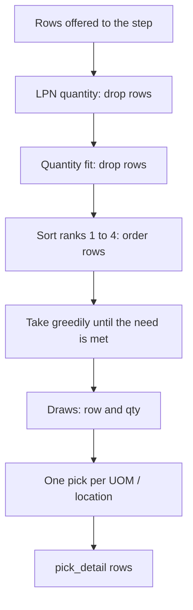
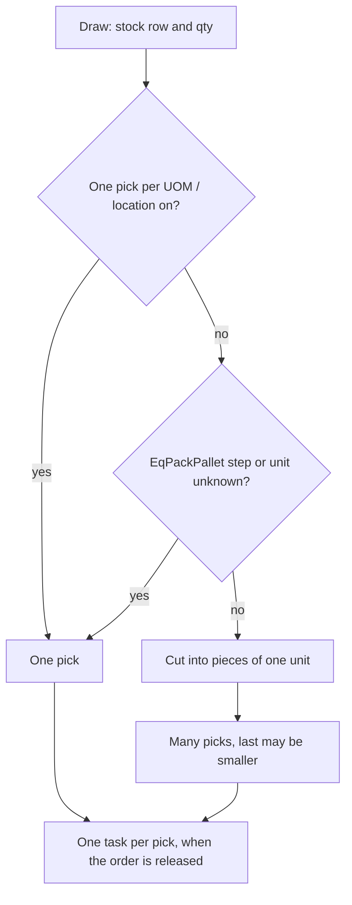

# Influence: How a Step Chooses and Splits the Stock

[Page 20](20-influence-policy-source.md) shows which stock a step may see. This page shows what the step does with it: which rows it drops, in which order it takes the rest, and how many picks come out.

## 1. From the offered rows to a draw

**What this shows.** The fixed order of the selection part of a step. Each of the four settings acts at one place.

| Setting (screen label) | Column | Values and what each does | Visible outcome |
|---|---|---|---|
| `LPN quantity` | `allocation_policy_detail.lpn_quantity_rule` | `Any`: no filter. `EqPackPallet`: keep only rows on an LPN whose available qty is exactly one pallet of the pack. `NePackPallet`: drop rows whose available qty is exactly one pallet | Whole pallets are used first, or never. Loose stock never counts as a whole pallet |
| `Quantity fit` | `allocation_policy_detail.qty_fit_rule` | `ExactFit`: keep rows whose available qty equals the need of the step. `BiggerFit`: keep rows with at least the need. `BestFit`: keep rows with at most the need, largest first. `LowToHigh`: no filter, smallest first. `HighToLow`: no filter, largest first | The row that fits the need best is used. If no row passes, the step finds nothing and its whole need goes to the next step |
| `Sort ranks` (1 to 4) | `allocation_policy_detail.sort_1` to `sort_4` | `LotRotation`: by the SKU rotation (see [page 23](23-influence-sku-lot-rotation.md)). `Location`: by `route_sequence` as text, then by location code. `LpnQuantity`: by available qty, smallest first. `Lpn`, `LpnRotationInLoc`, `LocationAbc`: the whole policy is refused | Rank 1 is the main key. Rank 2 breaks the ties of rank 1, and so on. If every key ties, the order of the stock row id decides |
| `One pick per UOM / location` | `allocation_policy_detail.one_pick_per_uom_location` | On: one pick per drawn stock row. Off: each draw is cut into pieces of one unit of the step's unit | Off gives many small picks and many tasks |

Reading notes.

- `Quantity fit` needs `LpnQuantity` in at least one sort rank. Without it the policy is refused: `step names qty_fit_rule=... but no sort_1..sort_4 names LpnQuantity`.
- The "pallet" of the rule is the biggest unit of the pack above the base unit. If the pack has no such unit, `EqPackPallet` keeps nothing and `NePackPallet` keeps everything.
- Quantities are compared with a small tolerance, not exactly.
- The need used by `Quantity fit` is the need of this step: its share plus the carry of earlier steps.
- `route_sequence` is compared as text, so `10` comes before `2`.
- An `EqPackPallet` step may still take part of a pallet. The rule filters the source row, not the amount taken.
- A row that an earlier step of the same plan already used is reduced first. A pallet that was broken into by an earlier step no longer counts as a whole pallet.
- The quantities in the example below are only for illustration. For a need of 250 and available quantities 100, 250, 300 and 800: `ExactFit` takes 250 from the row of 250. `BiggerFit` takes 250 from the row of 250. `BestFit` takes 250 from the row of 250. `HighToLow` takes 250 from the row of 800. `LowToHigh` takes 100, then 150 from the row of 250.

### Where it comes from

| Rule | Code |
|---|---|
| Order inside a step: LPN rule, quantity fit, sorts, greedy take | `crates/libs/wms-outbound/src/allocation/select.rs:162-216` |
| LPN quantity rule | `crates/libs/wms-outbound/src/allocation/select.rs:258-275` |
| Quantity fit filters | `crates/libs/wms-outbound/src/allocation/select.rs:296-316` |
| Pallet quantity of the pack: the tallest unit above the base unit | `crates/libs/wms-outbound/src/allocation/trace.rs:466-469` |
| Sort by location and by LPN quantity | `crates/libs/wms-outbound/src/allocation/select.rs:368-392` |
| Sorts are stable and run from the last rank to the first | `crates/libs/wms-outbound/src/allocation/select.rs:181-196` |
| Rows arrive ordered by stock row id | `crates/libs/wms-lib-core/src/model/inventory/inventory_balance_atp.rs:465` |
| Refused sorts | `crates/libs/wms-outbound/src/allocation/step.rs:178-199` |
| Quantity fit without `LpnQuantity` rank is refused | `crates/libs/wms-outbound/src/allocation/step.rs:129-139` |
| Earlier steps of the same plan reduce the same row | `crates/libs/wms-outbound/src/allocation/trace.rs:583-590` |

## 2. From a draw to picks

**What this shows.** The last setting decides how many `pick_detail` rows, and so how many tasks, one draw makes.

Reading notes.

- When the setting is off and the step unit is the base unit, a draw of 3456 units makes 3456 picks. There is no limit in the code.
- The label of the switch on the step card says `merged into one task line per location`. The code does not merge picks of different lots or LPNs. "On" means "one pick per stock row".
- The pick keeps the policy id, policy version, step id and step version of the step that made it.

### Where it comes from

| Rule | Code |
|---|---|
| Cut a draw into pieces of one unit; no cut for on, `EqPackPallet`, unknown unit | `crates/libs/wms-outbound/src/allocation/trace.rs:853-878` |
| Pick stores the policy and step it came from | `crates/libs/wms-outbound/src/allocation/reserve.rs:216-232` |
| One task per pick | `crates/libs/wms-outbound/src/picking/infrastructure/tasks.rs:119-143` |
| Default of the switch is on | `crates/libs/wms-lib-sql/sql/wms-app/migrations/001_baseline.sql:1339` |

## Related pages

- [Which stock a step may use](20-influence-policy-source.md)
- [SKU rotation and lot dates](23-influence-sku-lot-rotation.md)
- [Allocation of one line](11-journey-allocate-line.md)
- [Allocation policy: steps and criteria](../../admin/policies/11-allocation-policy-steps-and-criteria.md)
