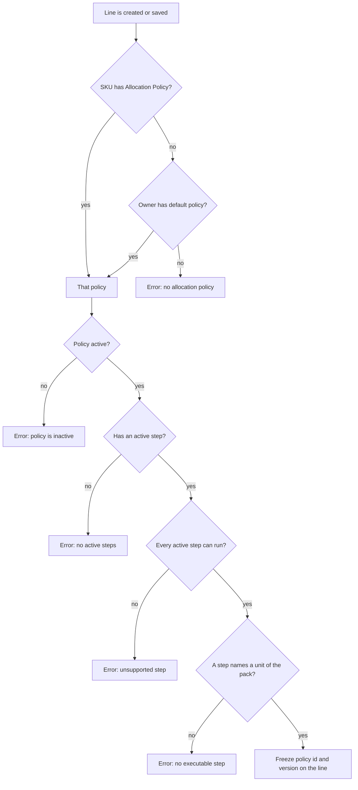
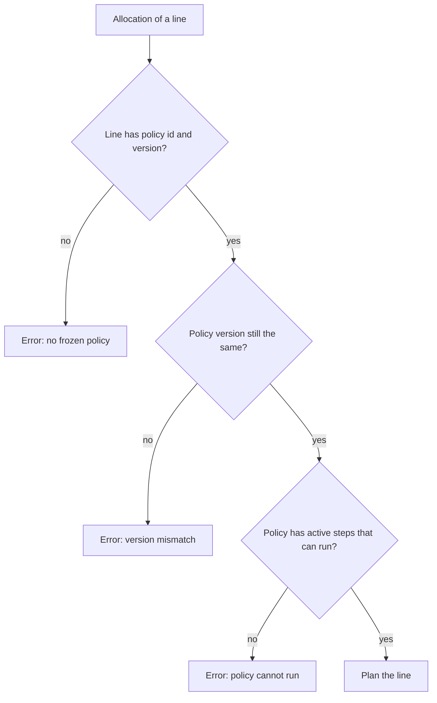
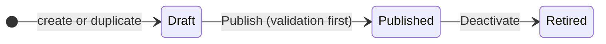

# Influence: Where the Policy of a Line Comes From

An order line does not look up its allocation policy at allocation time. It looks the policy up when the line is created or saved, and freezes the policy id and the policy version on the line. This page shows the lookup, the checks around it, and the life of a policy.

## 1. The lookup when a line is created or saved

**What this shows.** Which setting is read, in which order, and which message the user sees when a check fails.

| Setting (screen label) | Column | What it changes | Visible outcome |
|---|---|---|---|
| SKU, tab `Policies`, `Allocation Policy` | `sku.allocation_policy_id` | The policy of every new or re-saved line of this SKU. Wins over the owner default | Lines already created keep their old policy |
| Owner, tab `WH Settings`, inner tab `Policies`, `Allocation Policy` | `owner_config.default_allocation_policy_id` | The policy for SKUs that have none | Deleting a policy sets this field to empty |
| Line fields (API only) | `shipment_order_line.allocation_policy_id`, `shipment_order_line.allocation_policy_version` | The policy and version that allocation will use for this line | Pick rows record the same policy and step |

Messages (the text in braces is replaced by the real value).

| Failed check | Message |
|---|---|
| No policy on SKU or owner | `sku '{sku}' (owner {owner}) has no allocation policy — neither the sku nor its owner's default names one; assign one before allocating` |
| Inactive | `allocation policy '{code}' is inactive — sku '{sku}' cannot allocate against a disabled policy; activate '{code}' or point the sku/owner at a different one` |
| No active step | `allocation policy '{code}' has no active steps — ...` |
| A step cannot run | `allocation policy '{code}' has unsupported active step(s) and cannot execute safely — ...` |
| No step for the pack | `allocation policy '{code}' has no executable step for sku '{sku}' pack hierarchy` |

Reading notes.

- The lookup is done for a new order, and again when a line is saved through the line editor. A line can be saved again only while the order is in the `New` family, before release, and the line has no reserved quantity.
- The SKU is read first. The owner default is used only if the SKU field is empty.
- The release checks of the order do not repeat this lookup.

### Where it comes from

| Rule | Code |
|---|---|
| `COALESCE(sku policy, owner default)` | `crates/libs/wms-lib-core/src/model/sku.rs:950-968` |
| The five checks and their messages | `crates/libs/wms-outbound/src/allocation/policy.rs:112-198` |
| Lookup at order create | `crates/libs/wms-outbound/src/service/order/create.rs:177` |
| Lookup at line save | `crates/libs/wms-outbound/src/service/order_line/upsert.rs:108` |
| Line editable only in the New family with nothing reserved | `crates/libs/wms-outbound/src/service/shared/mutability.rs:36-91` |
| Foreign key of the owner default: `ON DELETE SET NULL` | `crates/libs/wms-lib-sql/sql/wms-app/migrations/001_baseline.sql:17185` |

## 2. What allocation checks on the frozen policy

**What this shows.** At allocation time the line is loaded with exactly the policy it froze.

Reading notes.

- The `active` flag of the policy is not checked at this point. Only new bindings check it.
- Any of these errors stops the `Allocate` command for the whole order. In `Release` the order is launched, and the toast shows `allocation failed: {reason}`.
- A published policy cannot be edited, so its version does not change by itself. The version changes on `Publish` and on `Deactivate`.
- Known problem (to verify). `Deactivate` adds 1 to the version. A line that froze the old version then fails with `allocation policy '{code}' version mismatch for sku '{sku}': line froze version {a}, current version is {b}`. The code comment says that "deactivation blocks new bindings only". To verify on a test warehouse: create an order line with a published policy, press `Deactivate` on that policy, press `Allocate` on the order, and read the message. Until this is clear, do not deactivate a policy while open orders use it.

### Where it comes from

| Rule | Code |
|---|---|
| Missing snapshot | `crates/libs/wms-outbound/src/allocation/trace.rs:296-312` |
| Version compare, active steps, parse | `crates/libs/wms-outbound/src/allocation/policy.rs:203-230` |
| The comment "deactivation blocks new bindings only" | `crates/libs/wms-outbound/src/allocation/policy.rs:201-202` |
| `Deactivate` sets `active = false` and adds 1 to the version | `crates/libs/wms-lib-core/src/model/policies/allocation_policy.rs:272-293` |
| `Publish` also adds 1 to the version | `crates/libs/wms-lib-core/src/model/policies/allocation_policy.rs:248-268` |

## 3. Life of a policy

**What this shows.** The three states of a policy and the commands that move it.

| State | Edit header and steps | Used by new lines |
|---|---|---|
| Draft | yes | no (inactive) |
| Published | no. Duplicate it to change it | yes |
| Retired | no | no |

`Publish` runs the same parser that allocation uses. It refuses the policy with a message that lists every reason:

| Code | Reason |
|---|---|
| `UNSUPPORTED_HEADER_FLAG` | `strict_lot_rotation`, `allow_overallocation` or `speed_pick_by_uom` is on |
| `NO_ACTIVE_STEPS` | the policy has no active step |
| `EMPTY_UOM` | an active step has a blank unit |
| `UNSUPPORTED_STEP` | an active step uses a refused value |
| `SHADOWED_STEP` | an earlier step with the same unit takes every row the later step could take |

Reading notes.

- The three header flags are read only by this check. Allocation itself never reads them, and none of them has a working meaning in this build. They are listed as "stored only" on the [overview page](00-overview.md).
- `Duplicate` creates a new draft with the same header flags and steps. The new code is the old code plus `-C`, `-C2` and so on.

### Where it comes from

| Rule | Code |
|---|---|
| Draft, Published, Retired and the edit rules | `crates/libs/wms-outbound/src/domain/allocation_policy/aggregate.rs:6-84` |
| Publish: lifecycle check, validation, SQL | `crates/libs/wms-outbound/src/service/policy/lifecycle.rs:36-74` |
| Validation issues | `crates/libs/wms-outbound/src/service/policy/validate.rs:38-100` |
| Shadow rule | `crates/libs/wms-lib-core/src/model/policies/allocation_step_shadow.rs:99-120` |
| Header flags are not read elsewhere in the engine | `crates/libs/wms-outbound/src/service/policy/validate.rs:44-57` |
| `Duplicate` copies header flags and steps | `crates/libs/wms-outbound/src/service/policy/lifecycle.rs:125-190` |
| New code is the old code plus `-C`, `-C2`, ... | `crates/services/web-ui-server/src/extensions/customization/allocation/policy_duplicate_action.rs:25-45` |
| RPC methods of the policy editor | `crates/services/app-server/src/web/rpcs/allocation_policy_rpc.rs:91-450` |

## Related pages

- [Which stock a step may use](20-influence-policy-source.md)
- [Release and Allocate an order](10-journey-release.md)
- [Allocation policy: steps and criteria](../../admin/policies/11-allocation-policy-steps-and-criteria.md)
- [Owner settings and policy resolution](../../admin/policies/41-owner-settings-and-policy-resolution.md)
