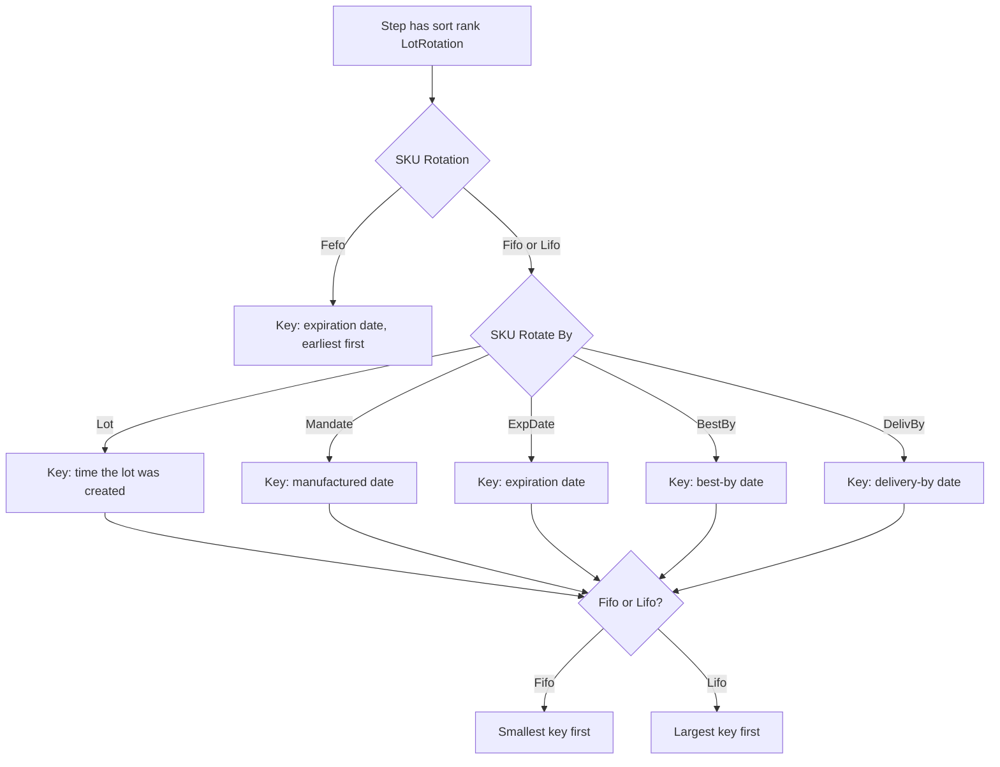
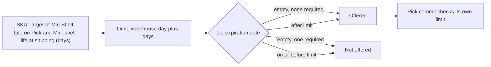
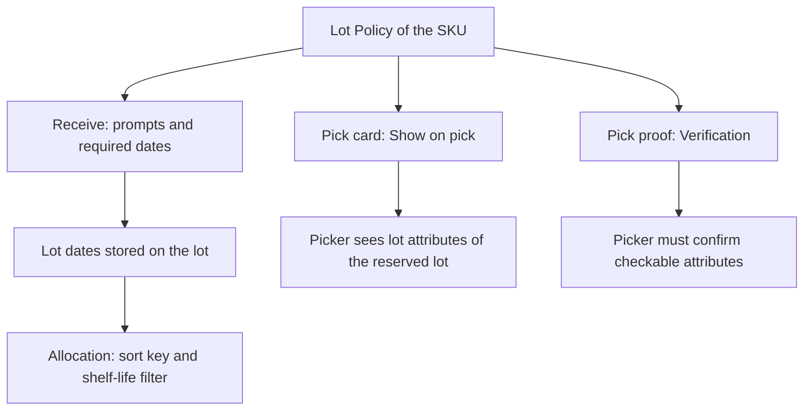

# Influence: SKU Rotation, Shelf Life and Lot Policy

Three groups of settings touch the lots of a SKU. The SKU fields on the `Shelf Life` tab decide which lot is reserved first and which lots are too old. The lot dates come from the lot record. The Lot Policy does not take part in the choice of stock. It decides what the receiver is asked and what the picker sees.

## 1. Which date orders the lots

**What this shows.** How `Rotation` and `Rotate By` of the SKU become the sort key of the sort rank `LotRotation`.

| Setting (screen label) | Column | What it changes | Visible outcome |
|---|---|---|---|
| `Rotation` (SKU, tab `Shelf Life`) | `sku.rotation` (`Fifo`, `Lifo`, `Fefo`) | Direction of the sort. `Fefo` ignores `Rotate By` and always uses the expiration date | Which lot's stock is in the first pick |
| `Rotate By` (SKU, tab `Shelf Life`) | `sku.rotate_by` (`Lot`, `Mandate`, `ExpDate`, `BestBy`, `DelivBy`) | Which date `Fifo` and `Lifo` sort by. A text outside the list stops allocation | Error: `sku '{sku}' has rotate_by = '{value}', not a value the ROTATEBY code list defines` |
| `Sort ranks` of the step | `allocation_policy_detail.sort_1` to `sort_4` | Rotation is applied only if one rank is `LotRotation` | Without that rank the SKU rotation has no effect |

Reading notes.

- `Lot` does not sort by the lot code. It sorts by the time the lot record was created.
- A lot with an empty date for the chosen key goes last, in `Fifo` and in `Lifo`.
- If two lots tie, the next sort rank of the step decides (see [page 21](21-influence-policy-selection.md)).
- The rotation is read once per line, from the SKU of the line, at allocation time. A change on the SKU is used by the next allocation. Reservations already made stay.

### Where it comes from

| Rule | Code |
|---|---|
| SKU facts read: rotation, `rotate_by`, minimum shelf life | `crates/libs/wms-outbound/src/allocation/trace.rs:904-950` |
| `Fefo` uses the expiration date; the other keys | `crates/libs/wms-outbound/src/allocation/select.rs:323-343` |
| Direction, empty dates last | `crates/libs/wms-outbound/src/allocation/select.rs:345-366` |
| Lot dates and lot creation time come with the candidate rows | `crates/libs/wms-lib-core/src/model/inventory/inventory_balance_atp.rs:449-453` |
| Rank `LotRotation` is one of three working ranks | `crates/libs/wms-outbound/src/allocation/step.rs:178-199` |
| Screen labels `Rotate By`, `Min Shelf Life on Pick` | `crates/libs/wms-lib-sql/sql/wms-meta-ui/migrations/001_baseline.sql:10469`, `crates/libs/wms-lib-sql/sql/wms-meta-ui/migrations/001_baseline.sql:10197` |

## 2. Which lots are too close to expiry

**What this shows.** The settings `Min Shelf Life on Pick` and `Shelf Life` remove lots from the list before any sorting. The pick boundary is checked again when the picker confirms.

| Setting (screen label) | Column | What it changes | Visible outcome |
|---|---|---|---|
| `Min Shelf Life on Pick`, `Shelf Life` | `sku.min_shelf_life_on_pick`, `sku.shelf_life` | A lot is offered only if it expires LATER than `today + max(Min Shelf Life on Pick, Shelf Life, 0)`, or has no expiration date and none is required. Empty counts as 0 | A lot that is too close to expiry is not reserved, and the line is short if no other lot can cover it |

Reading notes.

- Today is the warehouse day (`WAREHOUSE_TIMEZONE`; blank reads as UTC). A lot expiring today is expired.
- A lot with no expiration date is offered, unless an expiration is required: the lot policy asks for one, or the SKU has `expire_days` above zero. Then it is not offered.
- Value 0 or empty: only lots that expire today or earlier are dropped.
- At pick confirmation, the code refuses a lot that does not expire later than today + `Min Shelf Life on Pick` with the refusal `SourceExpired`. A pick that was reserved long ago can meet this refusal.
- `Shelf Life` is the minimum days of life at shipping; allocation reserves only lots that will still clear it. `min_shelf_life_on_rec` is a receiving check. `expire_days` is read at receiving, where it works out a missing expiration.

### Where it comes from

| Rule | Code |
|---|---|
| Limit date from the SKU values | `crates/libs/wms-outbound/src/allocation/trace.rs` (`lot_dating::threshold`), `crates/libs/wms-inventory/src/domain/lot_dating/aggregate.rs` |
| SQL filter on the expiration date | `find_allocation_candidates` in `crates/libs/wms-lib-core/src/model/inventory/inventory_balance_atp.rs` |
| The pick limit at commit | `judge_pick_lot` in `crates/libs/wms-outbound/src/domain/pick_confirmation/evidence.rs`, `prove_source` in `crates/libs/wms-outbound/src/picking/confirmation/at_commit.rs` |
| SKU values read at commit | `crates/libs/wms-outbound/src/picking/confirmation/shelf_life.rs` (`reserved_lot_verdict`) |

## 3. What the Lot Policy changes

**What this shows.** The Lot Policy of the SKU acts at receiving and at picking. It does not choose which lot is reserved.

Reading notes.

- Allocation reads the dates that are stored on the lot record. It never reads the Lot Policy.
- `Show on pick` and `Verification` of the Lot Policy change what the picker sees and has to confirm for the reserved lot. The picking area describes this.
- The owner field `owner_config.default_lot_policy_id` exists, but no code reads it. The SKU field `sku.lot_policy_id` is the only selector.
- Not confirmed by code: that a date the Lot Policy does not ask for at receiving stays empty on the lot, and so sorts last under rotation. The policy page says an unshown date gets no prompt, but a value that is sent anyway is still saved. To verify: receive a lot with `Show` off for the expiration date, then run `shipment_order_allocate_preview` on a SKU with `Fefo` and look at the order of the positions.

### Where it comes from

| Rule | Code |
|---|---|
| Allocation reads lot dates, not the policy | `crates/libs/wms-lib-core/src/model/inventory/inventory_balance_atp.rs:449-453` |
| Pick card shows the attributes marked `show_on_pick` | `crates/libs/wms-outbound/src/picking/confirmation/lot_display.rs:43-80` |
| Attributes the picker can be asked about, by `Verification` | `crates/libs/wms-outbound/src/domain/pick_confirmation/plan.rs:139-153` |
| Lot Policy is chosen by the SKU only | `crates/libs/wms-outbound/src/picking/confirmation/source_facts.rs:215-235` |
| No code reads `default_lot_policy_id` | `crates/libs/wms-lib-core/src/model/owners/owner_config.rs:104` |

## Related pages

- [How a step chooses stock](21-influence-policy-selection.md)
- [Which stock a step may use](20-influence-policy-source.md)
- [Lot policy and attributes (policy reference)](../../admin/policies/32-lot-policy-and-attributes.md)
- [SKU level settings (policy reference)](../../admin/policies/34-sku-level-settings.md)
