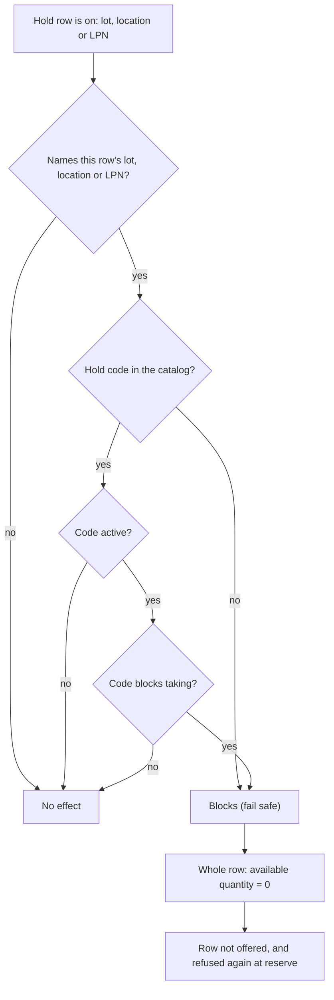
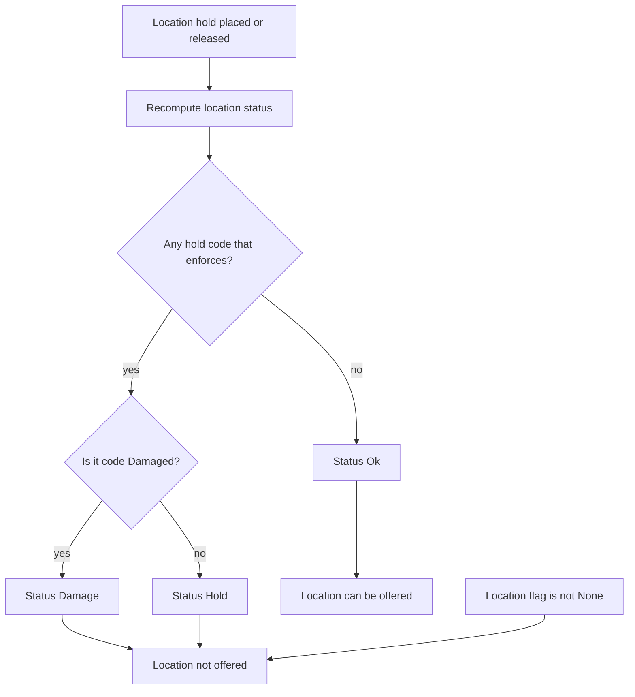
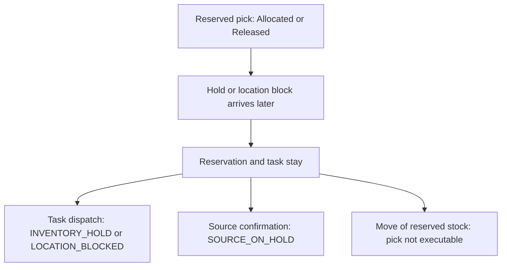

# Influence: Holds and Location State

Allocation never takes held stock, and nobody can confirm a hold away. Two things remove stock from the list: a hold that covers the stock row, and a location that is not in the state `Ok`. This page shows both routes, and what a hold does to a reservation that already exists.

## 1. Route A: a hold row covers the stock row

**What this shows.** When a hold row removes the whole stock row from the available quantity. The check runs twice: when stock is read, and again under the row lock when it is reserved.

| Setting (screen label) | Column | What it changes | Visible outcome |
|---|---|---|---|
| Hold scope: lot, location or LPN | `inventory_hold.lot`, `inventory_hold.loc`, `inventory_hold.lpn` | Which stock rows the hold covers. A hold of a lot covers that lot in every location. A hold has no quantity and no SKU | The whole row counts as held. There is no partial hold |
| Hold is on | `inventory_hold.is_hold_on` | Only a hold that is on counts | Release (button, API, or the auto-release) brings the stock back |
| Hold code `active` | `inventory_hold_code.active` | A switched-off code blocks nothing | Stock of holds with that code is available again |
| `Blocks taking` | `inventory_hold_code.block_outbound_flow` | Only a code that blocks taking removes stock from allocation | `Damaged` blocks taking and does not block putting |
| Code missing from the catalog | (no row) | Blocks. This is the fail-safe | A hold with an unknown code removes stock |
| Auto-release time | `inventory_hold.auto_release_date` | A loop releases holds whose time has passed. Without a value the time is 100 years ahead | The hold ends by itself |

Reading notes.

- The columns `enforce` and `overridable` of the hold code are not read here. A hold row with a code that does not enforce (`None`, `Ok`, `NotHold`) still removes the stock, because `Blocks taking` is on for these codes. Do not place holds with those codes.
- `Blocks putting` (`block_inbound_flow`) is not read by route A. It is read by receiving and by moves. Route B reads it only to decide whether a code enforces at all.
- The auto-release loop runs every 5 minutes.
- Nothing allocates again when a hold ends. Somebody must press `Allocate` or `Release`, or a retry must fire.

### Where it comes from

| Rule | Code |
|---|---|
| Available quantity and held quantity in the view, `LEFT JOIN` on the code catalog, `active`, `block_outbound_flow` | `crates/libs/wms-lib-sql/sql/wms-app/migrations/011_a_hold_says_what_it_forbids.sql:77-114` |
| Seed: `Damaged` blocks taking and not putting | `crates/libs/wms-lib-sql/sql/wms-app/migrations/011_a_hold_says_what_it_forbids.sql:67-70` |
| Reserve re-check uses the same predicate | `crates/libs/wms-lib-core/src/model/inventory/inventory_hold.rs:223-232`, `crates/libs/wms-lib-core/src/model/inventory/inventory_hold.rs:399-418` |
| Reserve step: held counts as available 0 | `crates/libs/wms-outbound/src/allocation/reserve.rs:168-183` |
| Candidate read uses the view column `atp` | `crates/libs/wms-lib-core/src/model/inventory/inventory_balance_atp.rs:454-455` |
| `enforce` and `overridable` are not part of that predicate | `crates/libs/wms-lib-core/src/model/inventory/inventory_hold.rs:381-394` |
| Seeded hold codes | `crates/libs/wms-lib-sql/sql/wms-app/migrations/001_baseline.sql:8227-8243` |
| A hold row has exactly one of lot, location, LPN; default auto-release 36500 days | `crates/libs/wms-inventory/src/service/hold.rs:370-400` |
| Auto-release loop, every 5 minutes | `crates/services/app-server/src/services/cleanup_tasks.rs:113`, `crates/services/app-server/src/services/cleanup_tasks.rs:458-485`, `crates/services/app-server/src/services/cleanup_tasks.rs:540-578` |
| API: place and release holds (Admin, Manager) | `crates/services/app-server/src/web/rpcs/hold_rpc.rs:24-27` |
| API: edit hold codes | `crates/services/app-server/src/web/rpcs/inventory_hold_code_rpc.rs:14` |

## 2. Route B: a location hold changes the location state

**What this shows.** A hold on a location also changes the status of the location. Allocation reads only locations with status `Ok` and no flag.

| Setting (screen label) | Column | What it changes | Visible outcome |
|---|---|---|---|
| Hold code `enforce` | `inventory_hold_code.enforce` | A code that does not enforce does not change the location status | Location stays `Ok`. Route A can still remove the stock |
| Hold code `active` | `inventory_hold_code.active` | A switched-off code is treated as not enforcing | Same as above |
| `Blocks putting` or `Blocks taking` | `inventory_hold_code.block_inbound_flow`, `inventory_hold_code.block_outbound_flow` | A code enforces if it blocks at least one direction | Location becomes `Hold` or `Damage`. All its stock is out of allocation |
| Location status | `location.status` (`Ok`, `Hold`, `Damage`) | Only `Ok` is offered | Stock in a `Hold` or `Damage` location is not reserved |
| Location flag | `location.loc_flag` (`None`, `CycleCountActive`, `SanitationActive`, `MaintenanceActive`, `ReceivingHoldoff`) | Only `None` is offered | A short pick with `BlockSourceLocation` sets `CycleCountActive` and so closes the location for allocation |

Reading notes.

- Only a location hold changes the location status. A hold on a lot or an LPN uses route A only.
- A hold on a location of type `InTransit` is refused: `location {loc} holds only open pick pallets: it takes no location hold`.
- `Release` of the hold recomputes the status again.

### Where it comes from

| Rule | Code |
|---|---|
| Recompute after place or release | `crates/libs/wms-inventory/src/service/hold.rs:216-245`, `crates/libs/wms-inventory/src/service/hold.rs:439-482` |
| `Damage`, `Hold`, `Ok` from the enforcing codes | `crates/libs/wms-inventory/src/service/hold.rs:495-516` |
| A code enforces if it blocks either direction; `active` lowers `enforce` | `crates/libs/wms-inventory/src/movement/hold_policy.rs:150-190`, `crates/libs/wms-inventory/src/movement/hold_policy.rs:209-221` |
| Allocation filters `status = 'Ok'` and `loc_flag = 'None'` | `crates/libs/wms-lib-core/src/model/inventory/inventory_balance_atp.rs:457` |
| `BlockSourceLocation` sets the flag | `crates/libs/wms-lib-core/src/model/location.rs:1239-1252` |
| Location hold on an `InTransit` location is refused | `crates/libs/wms-inventory/src/service/hold.rs:278-298` |
| Location flag values | `crates/libs/wms-lib-core/src/model/location.rs:248-254` |

## 3. A hold after the reservation

**What this shows.** A reservation is not removed when a hold arrives later. The hold stops the pick at three later gates.

Reading notes.

- Allocation does not look at an existing reservation again. The stock stays reserved for the order, but the picker cannot take it until the hold is released, or until somebody unallocates the pick.
- The dispatch gate also checks the location: status `Ok` and flag `None`. It tolerates the flag `CycleCountActive` only for a picker who finishes work that was already started at that location.

### Where it comes from

| Gate | Code |
|---|---|
| Dispatch: location status and flag, then hold | `crates/libs/wms-outbound/src/picking/infrastructure/dispatch.rs:156-176` |
| Reason codes of the dispatch gate | `crates/libs/wms-outbound/src/picking/infrastructure/dispatch.rs:44-62` |
| Source confirmation refuses a held source | `crates/libs/wms-outbound/src/picking/confirmation/at_commit.rs:139-145`, `crates/libs/wms-outbound/src/domain/pick_confirmation/refusal.rs:71-91` |
| Reserved move refuses a held source | `crates/libs/wms-inventory/src/picking/reserved_pick.rs:315-328` |

## Related pages

- [Which stock a step may use](20-influence-policy-source.md)
- [What a reservation protects](27-reservation-protects-stock.md)
- [Reason codes and holds (policy reference)](../../admin/policies/43-reason-codes-and-holds.md)
- [Holds list](../../reference/inventory/20-holds-list.md)
- [Hold form](../../reference/inventory/21-hold-form.md)
