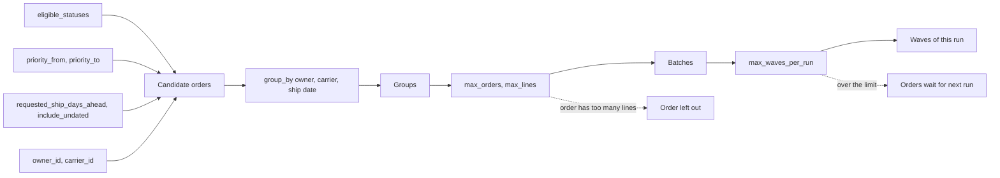
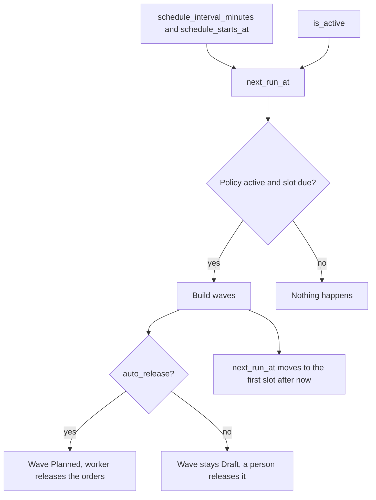
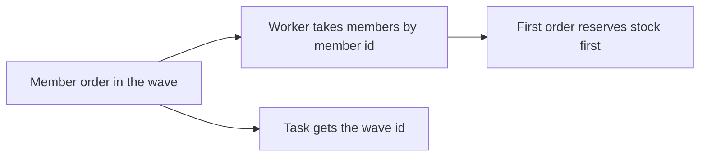

# Influence: Wave Policy

A wave policy is one flat record. Its fields decide which orders enter a wave, how they are grouped and cut, when the build runs, and whether the wave is released without a person. There is no screen for it. Every field is set through the API methods `wave_policy_create` and `wave_policy_save` (key `data.policy.<field>`).

## 1. Which orders go into which wave

**What this shows.** The filters, the grouping and the size limits, in the order the builder applies them.

| Field | What it changes | Visible outcome |
|---|---|---|
| `eligible_statuses` | Only orders with a status from this list. Allowed values: `New`, `PartiallyAllocated`, `Allocated`. The list must not be empty | An order in another status is never a candidate |
| `priority_from`, `priority_to` | Order priority from and to, both included (1 to 99). A smaller number is earlier | Orders outside the range are not candidates |
| `requested_ship_days_ahead` | Orders whose requested ship date is on or before today plus N days. Late orders pass. `0` means today and late | Empty means no date filter at all |
| `include_undated` | With a ship-date limit set, lets orders without a ship date pass | Without the limit it has no effect |
| `owner_id` | Orders of this owner only | Empty means all owners |
| `carrier_id` | Orders with this carrier only. An order without a carrier does not pass | Empty means all carriers and orders without a carrier |
| `group_by_owner`, `group_by_carrier`, `group_by_requested_ship_date` | Orders with different values of a flagged key never share a wave. An order without a carrier or a date forms its own group | One wave holds one owner, one carrier or one date, as flagged |
| `max_orders` (1 to 1000) | The most orders in one wave | The next order starts a new wave |
| `max_lines` (1 to 100000, may be empty) | The most not-cancelled lines in one wave. An order is never split | An order that alone has more lines is left out in every run, with the reason `order exceeds max_lines and cannot be split` |
| `max_waves_per_run` (1 to 20) | The most waves one build creates | The rest is left for the next run, with the reason `deferred by max_waves_per_run` |

Always true, whatever the policy says: the order has not been released and not cancelled, it has no claim from another wave, and it has at least one line that is not cancelled. The candidates are read in this order: lowest priority number, then earliest ship date (undated last), then lowest order id. At most 50 000 are read.

Reading notes.

- Groups are numbered in the order of their first order. Batches follow the groups in that order. So the group with the best-priority order is cut first.
- After the policy has chosen the orders, the first read is repeated for the chosen ids under the order locks. An order that changed in between is dropped with the reason `eligibility changed while acquiring order locks`.
- Preview (`wave_policy_preview`) shows the same plan and writes nothing.
- The save is a full replace. A field that is left out becomes empty or false. In particular, leaving out `auto_release` turns it off.

### Where it comes from

| Rule | Code |
|---|---|
| Candidate SQL: statuses, priority, ship date, owner, carrier, claim, order | `crates/libs/wms-lib-core/src/model/outbound/wave_policy.rs:311-344` |
| Value checks and limits | `crates/libs/wms-outbound/src/waves/policy.rs:355-420` |
| Grouping, batches, line and order limits, run limit | `crates/libs/wms-outbound/src/waves/policy.rs:430-510` |
| Second read under locks and the reason texts | `crates/libs/wms-outbound/src/waves/policy.rs:239-343` |
| Allowed statuses | `crates/libs/wms-outbound/src/waves/policy.rs:26` |
| Wave codes are made by the system: `A` + run id + `-` + batch | `crates/libs/wms-outbound/src/waves/policy.rs:518-524` |
| Wire shape: required and optional keys | `crates/libs/wms-lib-core/src/model/outbound/wave_policy.rs:66-89` |
| Roles: policy create, save, build: Admin, Manager | `crates/services/app-server/src/web/rpcs/wave_rpc.rs:15-22` |

## 2. When the build runs and who releases the wave

**What this shows.** The schedule fields and `auto_release`.

| Field | What it changes | Visible outcome |
|---|---|---|
| `schedule_interval_minutes` (1 to 10080) and `schedule_starts_at` | Both or none. The first slot is the start time, then every interval | Several missed slots give one catch-up run. The next slot is the first one after now |
| `is_active` | An inactive policy cannot be built and is never scheduled. A save with `false` clears `next_run_at` | Error on build: `wave policy {id} is inactive`. Preview still works |
| `auto_release` | On: each wave is made `Planned` and its members `Pending` in the same transaction | The orders are released by the worker within seconds. Off: a person calls `wave_release` |
| `version` | `wave_policy_save` and `wave_policy_build` must send the version they read | A stale version gives the code 40 error with the current policy |

Reading notes.

- A scheduled build runs as the system user. A build by hand runs as the caller. The worker releases the orders as the user who requested the release.
- A wave built with `auto_release` shows `Released` when the worker has finished, even if some members are `Blocked` or `Failed`.
- Nobody tells the operator about a blocked member except `wave_get` and the server log.

### Where it comes from

| Rule | Code |
|---|---|
| Due policy: active and `next_run_at <= now`, skip locked | `crates/libs/wms-lib-core/src/model/outbound/wave_policy.rs:261-278` |
| `next_run_at` after create and save | `crates/libs/wms-lib-core/src/model/outbound/wave_policy.rs:193-257` |
| Next slot is the first boundary after now | `crates/libs/wms-lib-core/src/model/outbound/wave_policy.rs:283-305` |
| `auto_release` prepares the release | `crates/libs/wms-outbound/src/waves/policy.rs:288-294` |
| Inactive policy refuses a build; version check | `crates/libs/wms-outbound/src/waves/policy.rs:225-236` |
| Scheduler loop | `crates/libs/wms-outbound/src/waves/scheduler.rs:36-108` |

## 3. What a wave changes in allocation

**What this shows.** The two places where a wave touches stock or tasks.

Reading notes.

- The worker takes members in the order of the member id. For a wave from a policy the members are added in the plan order, so the order with the smallest priority number reserves first.
- The stock choice for each order is the same as for a single release. A wave has no stock rule of its own.
- A task of an order that is in a wave carries `wave_id`. The claim stays after the release, so a later top-up task carries it too.

### Where it comes from

| Rule | Code |
|---|---|
| Members are claimed by lowest id | `crates/libs/wms-lib-core/src/model/outbound/wave.rs:608-641` |
| Members added in plan order | `crates/libs/wms-outbound/src/waves/policy.rs:270-293` |
| Wave id for tasks | `crates/libs/wms-outbound/src/waves/task_grouping.rs:8-18`, `crates/libs/wms-outbound/src/service/order/allocate.rs:427-434` |

## Stored only. It has no effect today.

| Field | Note |
|---|---|
| `wave_policy.code` | Only a label and the sort key of the list. Wave codes are not built from it |
| `wave_policy.description` | Returned by the API, read by nothing |
| `wave_order.priority` | Copied from the order priority by the builder, or given in `wave_add_order`. Read by nothing |
| `wave_order.sequence` | Position in the batch. It only sets the order of the member list that `wave_get` returns. It does not change the release order |
| `wave.completed_at`, statuses `InProgress`, `Completed` | Never set |

### Where it comes from

| Rule | Code |
|---|---|
| Member list sorted by `sequence` | `crates/libs/wms-lib-core/src/model/outbound/wave.rs:379-393` |
| `priority` of a member is only written | `crates/libs/wms-lib-core/src/model/outbound/wave.rs:452-488` |
| Statuses exist but are never assigned | `crates/libs/wms-lib-core/src/model/outbound/wave.rs:21-28` |

## Related pages

- [Wave build and release](12-journey-wave.md)
- [Release and Allocate an order](10-journey-release.md)
- [Waves overview (policy reference)](../../admin/policies/12-wave-overview.md)
- [Wave policy settings (policy reference)](../../admin/policies/13-wave-policy-settings.md)
