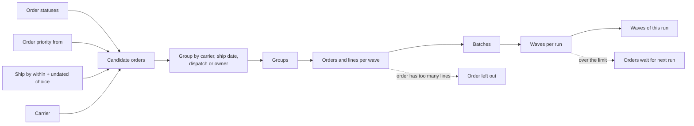
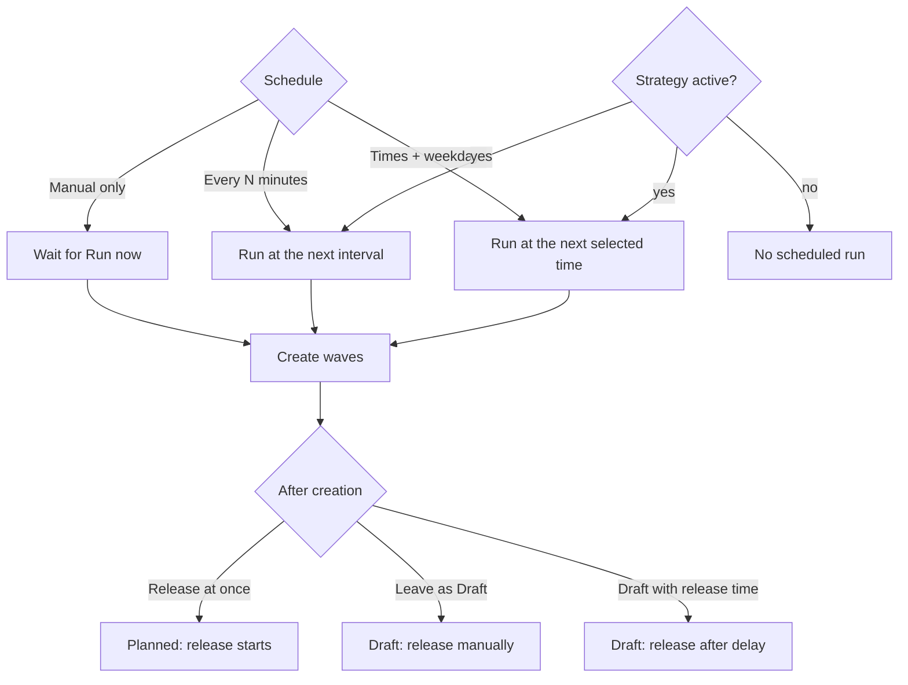
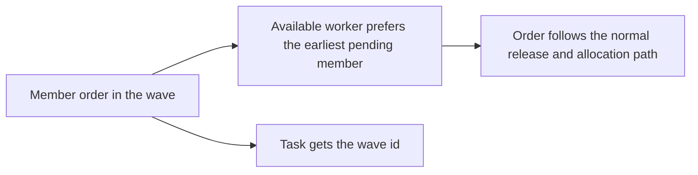

# Influence: Wave Strategy

A wave strategy decides which orders enter a wave, how they are grouped and limited, when creation runs, and whether each wave is released automatically. Configure it in `Management & Control > Orders & Waves > Wave strategies`; use `Run now…` to inspect the plan before creating waves.

## 1. Which orders go into which wave

**What this shows.** The filters, the grouping and the size limits, in the order the builder applies them.

| Field | What it changes | Visible outcome |
|---|---|---|
| `Order statuses` | Takes `New`, `Partially allocated` and/or `Allocated` orders. Select at least one | An order in another status is not a candidate |
| `Order priority from` | Sets the lower priority bound from 1 to 99 | Orders outside the saved range are not candidates |
| `Ship by within, days` | Takes orders due on or before today plus N days. Late orders pass; `0` means today and late | Empty means no date limit |
| `Orders without ship-by date` | With a date limit, decides whether undated orders are taken or skipped | Without a date limit it has no effect |
| `Carrier` | Takes orders for the selected carrier | `Any` also accepts orders without a carrier |
| `Group by — one wave per group` | Different carrier, ship-by date, dispatch or owner values do not share a wave when that option is selected | With no option selected, all matching orders share one group |
| `Max orders per wave` (1 to 1000) | The most orders in one wave | The next order starts a new wave |
| `Max lines per wave` (1 to 100000, optional) | The most active lines in one wave. An order is never split | An order that is larger than the limit is shown under `Not included in this run` |
| `Waves per run, max` (1 to 20) | The most waves one run creates | Remaining eligible orders wait for a later run |

Always true, whatever the policy says: the order has not been released and not cancelled, it has no claim from another wave, and it has at least one line that is not cancelled. The candidates are read in this order: lowest priority number, then earliest ship date (undated last), then lowest order id. At most 50 000 are read.

Reading notes.

- Groups are numbered in the order of their first order. Batches follow the groups in that order. So the group with the best-priority order is cut first.
- After the policy has chosen the orders, the first read is repeated for the chosen ids under the order locks. An order that changed in between is dropped with the reason `eligibility changed while acquiring order locks`.
- `Run now…` shows the same plan before confirmation and writes nothing while you review it.
- `Save…` shows a `Was` / `Will be` comparison before it writes the complete card.
## 2. When the build runs and who releases the wave

**What this shows.** The schedule and the separate choice of what happens after wave creation.

| Field | What it changes | Visible outcome |
|---|---|---|
| `Manual only` | No schedule | An authorized user starts the preview with `Run now…` |
| `Every N minutes` | Interval from 1 to 10080 minutes | Runs at each due interval while active |
| `At times on weekdays` | One or more `HH:MM` times and at least one weekday | Runs only at the selected weekly times |
| `Active` / `Inactive` | Controls manual creation and future scheduled runs | Deactivation leaves existing waves unchanged |
| `Release at once` | Starts normal release as soon as each wave is created | Wave becomes `Planned` |
| `Leave as Draft` | Keeps each created wave editable | A user reviews and releases it on `Waves` |
| `Draft with release time` | Saves a release delay from 1 to 10080 minutes | Wave stays `Draft` until its release time |

Reading notes.

- `Last run` on the strategy card shows the most recent result and created wave codes.
- If an automatic release is refused, the affected wave remains `Draft` and the run reports why; open it on `Waves` after correcting the problem.
- A released wave can settle with individual members in `Blocked` or `Failed`; review the member counts on the wave card.
## 3. What a wave changes in allocation

**What this shows.** The two places where a wave touches stock or tasks.

Reading notes.

- Strategy planning orders members by order priority, ship-by date and order id. An available worker prefers the earliest pending member, but several workers can release different members concurrently. Do not use the wave order as a strict stock-priority guarantee.
- The stock choice for each order is the same as for a single release. A wave has no stock rule of its own.
- A task of an order that is in a wave carries `wave_id`. The claim stays after the release, so a later top-up task carries it too.
## Related pages

- [Wave build and release](12-journey-wave.md)
- [Release and Allocate an order](10-journey-release.md)
- [Waves overview (policy reference)](../../admin/policies/12-wave-overview.md)
- [Wave strategy settings](../../admin/policies/13-wave-policy-settings.md)
