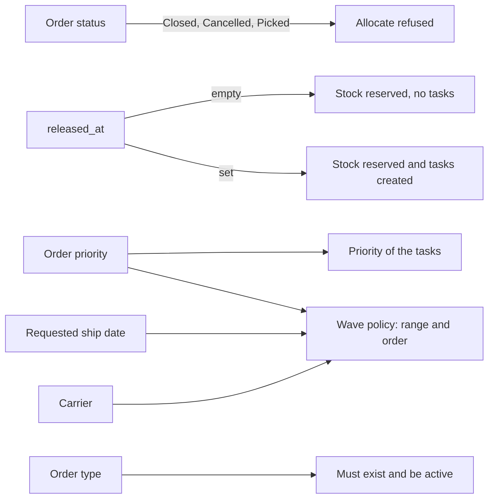
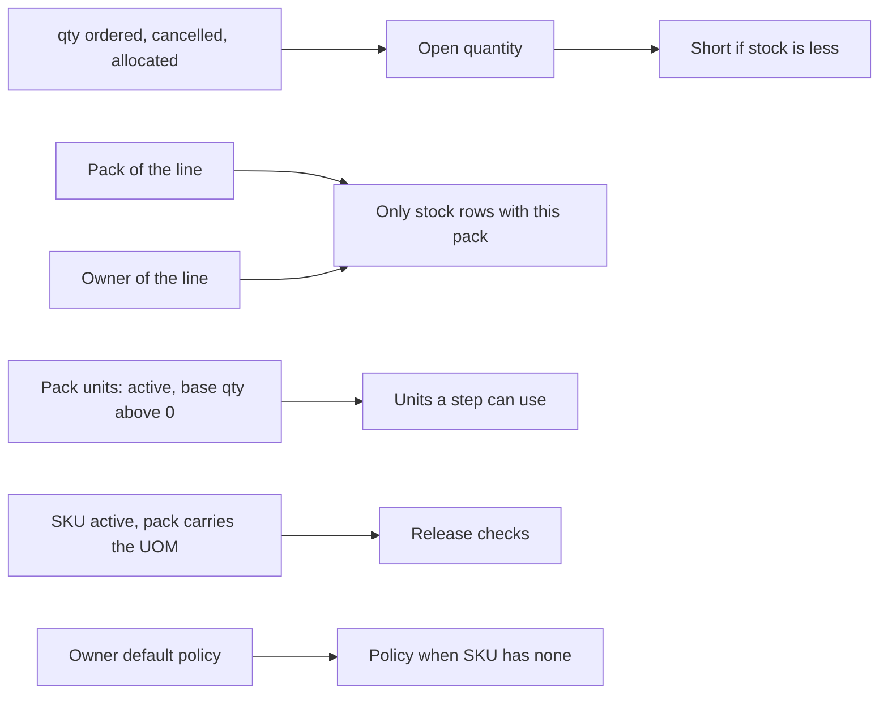

# Influence: Order, Line, Pack and Owner Facts

Besides the policies, allocation reads a few facts of the order, its lines, the pack of the SKU and the owner. This page lists the ones that change a decision, and the ones that look like settings but are not read.

## 1. Facts of the order header

**What this shows.** Which header field changes which decision.

| Field | What it changes | Visible outcome |
|---|---|---|
| `shipment_order.status` | `Allocate` is refused for `Closed`, `Cancelled` and `Picked` | Error: `cannot allocate an order in status {status}` |
| `shipment_order.released_at` | Tasks are created only when it is set | `Allocate` on a `New` order reserves and creates no task. `Release` sets it, then reserves and creates tasks |
| `shipment_order.priority` | Copied to the priority of each task made by the allocation pass. Also used by the wave policy (range and order) | No effect on which stock is reserved or which order is served first by `Allocate` |
| `shipment_order.requested_ship_date` | Wave policy only: the ship-date limit and the sort | No effect on allocation |
| `shipment_order.carrier_id` | Wave policy only: filter and grouping | No effect on allocation |
| `shipment_order.ship_to_id` | Must be an owner of type `Cus` for release. The address is frozen at the first release | Release refused with `ship_to owner {id} is not a customer` |
| `order_type` (by code) | Must exist and be active when the order is created or its type changed. Nothing else is read from it | `order type '{code}' is inactive`, or `not found` |

Reading notes.

- There is no rule that gives one order priority over another in `Allocate`. The command that takes the lock first gets the stock. Inside a wave, the member order decides (see [page 25](25-influence-wave-policy.md)).
- The order type has the columns `requires_release` and `allows_partial_ship`. No code reads them. The column `auto_allocate_on_release` was dropped: release always allocates.
- A shortage never blocks the release.
## 2. Facts of the line, the SKU and the pack

**What this shows.** The quantity the line asks for, and which stock and which units are even considered.

| Field | What it changes | Visible outcome |
|---|---|---|
| `shipment_order_line.qty_ordered`, `qty_cancelled`, `qty_allocated` | Open quantity = ordered - cancelled - allocated. Zero or less: the line is skipped | Each press of `Allocate` works on the open quantity only. Earlier picks stay |
| `shipment_order_line.pack_id` | Frozen from the SKU when the line is created. Only stock rows with the same pack are candidates | A balance with another pack is never reserved |
| `pack_item.is_active`, `pack_item.base_qty` | Only active units with `base_qty` above 0 form the ladder | A unit switched off in the pack is not used for new allocations. The line keeps its frozen snapshot |
| `shipment_order_line.uom`, `uom_factor` | The unit the line was entered in, and its factor, frozen at creation. The quantity of the line is in base units. The factor is used when the picker confirms | Allocation does not multiply the quantity by the factor |
| `sku.active` | An inactive SKU cannot be released | `sku '{sku}' is inactive` |
| `sku.allocation_policy_id`, `owner_config.default_allocation_policy_id` | See [page 22](22-influence-policy-binding.md) | |
| Owner of the line | Only stock of the same owner is a candidate | Stock of another owner is never reserved |

Reading notes.

- `sku.abc` is not read by allocation. The step field `Location ABC` filters the `abc` of the location.
- The pack of the line is frozen at creation, but the ladder is read again at every allocation. That is intended in the code: an order keeps what it meant, and a new allocation uses what the pack offers now.
- The line quantity is in base units. The field is documented in the order create command as `Quantity in BASE units`.
## Related pages

- [Where the policy of a line comes from](22-influence-policy-binding.md)
- [Wave policy](25-influence-wave-policy.md)
- [Order status after allocation](28-order-status.md)
- [Owners, SKU, UOM and pack hierarchy](../../admin/04-owners-sku-uom-pack-hierarchy.md)
- [Outbound setup](../../admin/06-outbound-setup.md)
