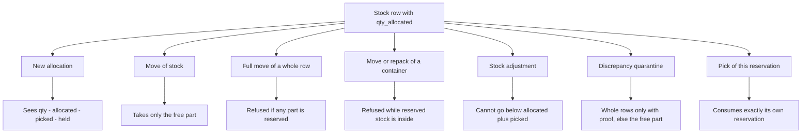

# Influence: What a Reservation Protects

A reservation is a number on a stock row: `inventory_balances.qty_allocated`. Other inventory operations read this number. This page shows which operation respects it and what the user sees when it refuses.

## 1. Who respects `qty_allocated`

**What this shows.** For one stock row with a reserved quantity, what each operation may do with the reserved part.

| Operation | Rule | What the user sees |
|---|---|---|
| New allocation | The available quantity is `qty - qty_allocated - qty_picked`, minus the whole row if a blocking hold covers it, and never below 0 | Reserved units are not offered twice |
| Generic move | Takes only free stock (`AvailableMove`) | `insufficient qty: requested {r}, available {a}` |
| Full move of a row | A partly reserved row refuses the whole move | `full move refused: only {a} of {r} is available — the rest is reserved (qty_allocated/qty_picked)` |
| Move of a container | Refused if any row inside carries reserved or picked stock | `container move refused: container {id} still holds reserved stock ...` |
| Repack | Refused if a row that would change container is reserved | `repack refused: container {id} still holds reserved stock ...` |
| Stock adjustment | The new quantity cannot be below `qty_allocated + qty_picked` | `balance {id}: the target is below what is reserved (allocated {x}, picked {y})` |
| Discrepancy quarantine (short pick follow-up) | Whole-row mode needs proof that no row is reserved. Partial mode moves only the free part. Reserved and picked stock stays | The location keeps its flag `CycleCountActive`, so nobody allocates the rest |
| Pick of the reservation | Reduces `qty` and `qty_allocated` together on exactly the source row of the pick | The pick is the only operation that consumes a reservation |

Reading notes.

- To free a reservation, use `Unallocate`, delete the pick, cancel the order or short the pick (see [page 13](13-journey-unallocate-cancel.md) and [page 14](14-journey-top-up.md)). No inventory screen releases it.
- A hold does not change `qty_allocated`. It makes the row unavailable for new allocation and stops the pick (see [page 24](24-influence-holds.md)).
- The reservation is recorded twice: on the stock row and on the order line (`shipment_order_line.qty_allocated`). The `pick_detail` row keeps the position (lot, location, LPN) that was reserved.

### Where it comes from

| Rule | Code |
|---|---|
| Available quantity of the view | `crates/libs/wms-lib-sql/sql/wms-app/migrations/011_a_hold_says_what_it_forbids.sql:105-114` |
| Accounting modes of a move | `crates/libs/wms-inventory/src/stock_move/accounting.rs:12-52` |
| Generic move takes the free part | `crates/libs/wms-inventory/src/movement/move_lines.rs:100-190` |
| Refusal texts of full move and container move | `crates/libs/wms-inventory/src/movement/types.rs:473-510` |
| Refusal text of repack | `crates/libs/wms-inventory/src/error/container.rs:83-104` |
| Adjustment floor | `crates/libs/wms-inventory/src/stock_adjust/plan.rs:112-123`, `crates/libs/wms-inventory/src/stock_adjust/mod.rs:91-100` |
| Quarantine: proof of no reservation, partial quarantine | `crates/libs/wms-inventory/src/stock_move/accounting.rs:54-77`, `crates/libs/wms-inventory/src/picking/remediation.rs:1-20` |
| Pick consumes its reservation: source must hold `qty` and `qty_allocated` | `crates/libs/wms-inventory/src/picking/reserved_pick.rs:306-314` |
| Reserve writes `qty_allocated` on the balance and on the line | `crates/libs/wms-outbound/src/allocation/reserve.rs:186-205` |

## Related pages

- [Holds and location state](24-influence-holds.md)
- [Unallocate and cancel](13-journey-unallocate-cancel.md)
- [Allocation of one line](11-journey-allocate-line.md)
- [Move (operator)](../../operator/06-move.md)
- [Inventory inquiry (operator)](../../operator/07-inventory-inquiry.md)
