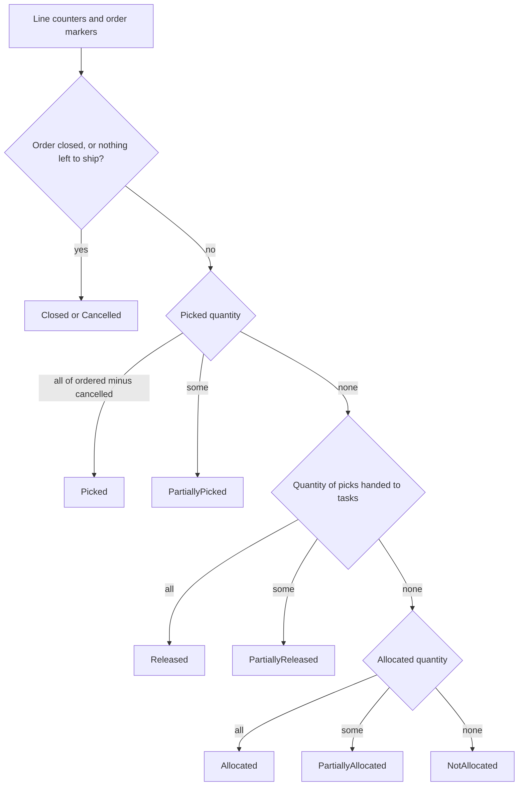
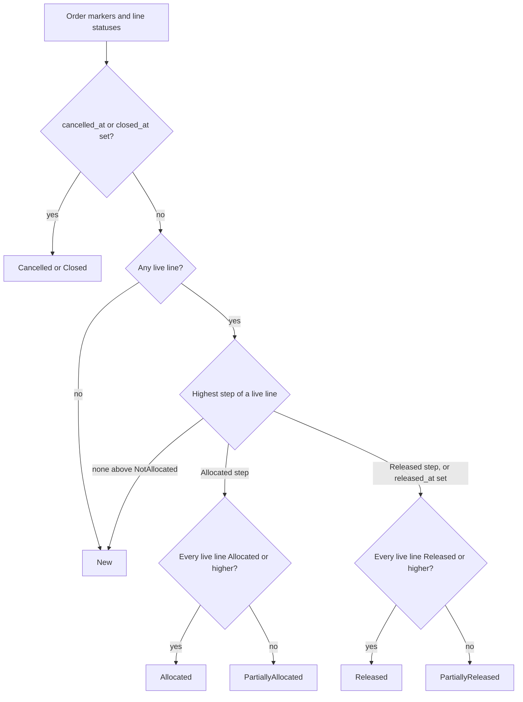

# Reference: Order and Line Status After Allocation

Nobody sets the status of an order line or of an order header by hand. The code computes both from the quantities and the markers (`released_at`, `cancelled_at`, `closed_at`) every time one of them changes. This page shows the two rules.

## 1. Status of a line

**What this shows.** The first rule that matches, from the top.

Reading notes.

- "All" means the quantity reaches `qty_ordered - qty_cancelled`, with a small tolerance.
- "Handed to tasks" means the sum of the quantity of the line's picks with status `Released`. A pick becomes `Released` when its task is created.
- A line is `Cancelled` when `ordered - cancelled - shipped` is zero. `Closed` wins when the whole order is closed.

### Where it comes from

| Rule | Code |
|---|---|
| Line rule, in this order | `crates/libs/wms-outbound/src/domain/shipment_order/status_derive.rs:46-77` |
| Quantity handed to tasks | `crates/libs/wms-lib-core/src/model/outbound/pick_detail.rs:555-595` |
| A pick becomes `Released` when its task is created | `crates/libs/wms-outbound/src/picking/infrastructure/tasks.rs:88-104` |
| Computed after every change of a counter or marker | `crates/libs/wms-outbound/src/service/shared/derived_status.rs:51-91` |

## 2. Status of the order header

**What this shows.** The header takes the highest step that any live line reached. It shows the "full" form only if every live line reached the full form.

Reading notes.

- Live lines are the lines that are not `Closed` or `Cancelled`.
- A set `released_at` lifts the highest step to at least the Released step. So a launched order whose lines have no task yet reads `PartiallyReleased`, and `New` is impossible while `released_at` is set and a live line exists.
- The picking steps (`PartiallyPicked`, `Picked`) follow the same pattern and belong to the picking area.
- A launched order whose lines are all cancelled reads `New` again, while its release marker stays.
- The status is written without changing the `version` of the order. A derived status is not a decision of a user.

| Header status you see after | Why |
|---|---|
| `Allocate` with enough stock on a `New` order | All lines are `Allocated` |
| `Allocate` with too little stock | Something is reserved, but not enough for every line: `PartiallyAllocated`. Nothing reserved at all: the order stays `New` |
| `Release` with enough stock | All picks have a task: `Released` |
| `Release` with too little stock | A line is not fully handed to tasks: `PartiallyReleased`. `Release` can be pressed again |
| `Unallocate` with all picks freed on a launched order | The release marker is cleared and the order reads `New` |

### Where it comes from

| Rule | Code |
|---|---|
| Header rule and the rungs | `crates/libs/wms-outbound/src/domain/shipment_order/status_derive.rs:106-168` |
| Rung of each line status | `crates/libs/wms-lib-core/src/model/outbound/shipment_order_line.rs:79-91` |
| `Release` offered again on `PartiallyReleased` | `crates/libs/wms-outbound/src/service/order/validate.rs:60-72` |
| No version bump for derived statuses | `crates/libs/wms-outbound/src/service/shared/derived_status.rs:17-24` |
| `Unallocate` clears the release marker | `crates/libs/wms-outbound/src/service/order/cancel_allocation.rs:157-172` |

## Related pages

- [Release and Allocate an order](10-journey-release.md)
- [Unallocate and cancel](13-journey-unallocate-cancel.md)
- [Allocation overview (policy reference)](../../admin/policies/10-allocation-overview.md)
