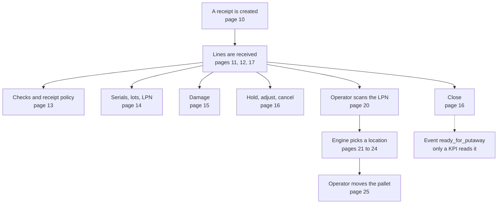

# Inbound diagrams: receiving and putaway

These pages show how goods move through receiving and putaway, and which settings change each decision.

## What this shows

The path of goods from a receipt to a shelf, and the page that explains each part.

Reading notes:

- Putaway does not wait for the close and is not started by it. It starts when the operator scans the pallet LPN on `PUTW01`.
- Putaway reads no receipt policy field. It reads the pallet, the SKU, the lot, the policy of putaway steps, and the locations.
- The dotted line is an event. The code publishes it on close. The only reader found is the dock-to-stock KPI.
## Pages

| Page | Question it answers |
|---|---|
| [10 Ways a receipt starts](10-receiving-ways-to-start.md) | How is a receipt made, by which method, and in which status? |
| [11 Receive against an ASN](11-receive-against-asn.md) | Which RF screens and API calls receive one line, and what is written? |
| [12 Blind receiving and returns](12-receive-blind-and-return.md) | How do blind receives and returns differ, and what does the return condition change? |
| [13 Receive checks and receipt policy](13-receive-checks-and-policy.md) | Which checks run, which receipt policy fields change them, who may approve? |
| [14 Serial numbers, lots and LPNs](14-serials-lots-lpn.md) | When are serials asked, how are they captured, which lot and LPN rules apply? |
| [15 Damaged goods](15-damage.md) | How is damage recorded, what do the owner settings change, how is it closed out? |
| [16 Hold, adjust, close, cancel](16-hold-adjust-close-cancel.md) | Which status changes exist, and what does each command check? |
| [17 Case-by-case receiving](17-case-level-receiving.md) | How does a case-level ASN work and how is one scan handled? |
| [20 Putaway journey](20-putaway-journey.md) | Which screens and calls take a pallet from the scan to the new location? |
| [21 Putaway pipeline](21-putaway-engine-steps.md) | In which order does the engine decide? |
| [22 Putaway: policy and step settings](22-putaway-influence-step-settings.md) | Which policy and step settings change which decision? |
| [23 Putaway: SKU, pack, lot, zone, location](23-putaway-influence-master-data.md) | Which master data fields change the capacity, fit and landing checks? |
| [24 Putaway: reservation and refusals](24-putaway-reservation-and-refusals.md) | How long does a reservation live, and what does the operator see when it fails? |
| [25 The move](25-move-execute.md) | What does `move_execute` check, and when does it refuse, ask for approval or redirect? |

## How to read these pages

- Each page starts with the question it answers, followed by the diagram and practical reading notes.
- "Stored only. It has no effect today." lists settings that are saved and shown but that no code reads. Do not rely on them.

## Related pages

- [Operator guide: receiving against an ASN](../../operator/02-receiving-against-asn.md)
- [Operator guide: putaway](../../operator/05-putaway.md)
- [Policy reference: putaway overview](../../admin/policies/00-putaway-overview.md)
- [Policy reference: receipt policy settings](../../admin/policies/40-receipt-policy-settings.md)
- [Reference: receipts overview](../../reference/inbound/00-receipts-overview.md)
